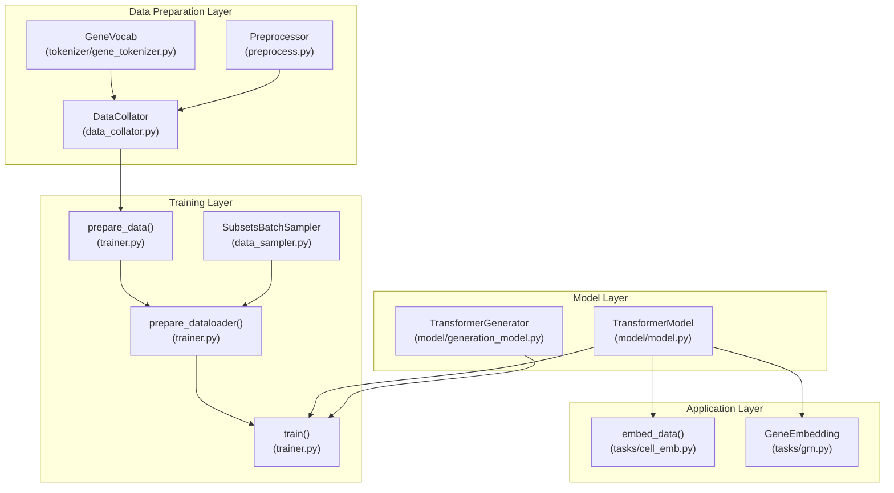
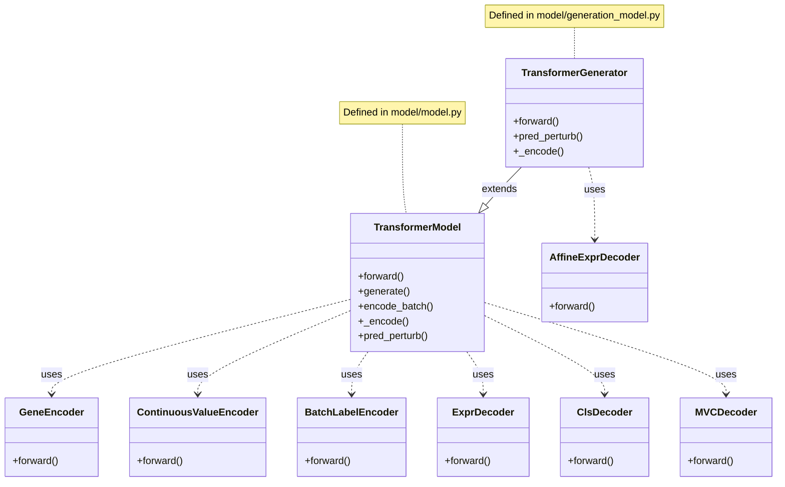
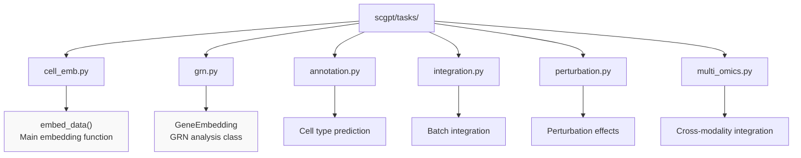
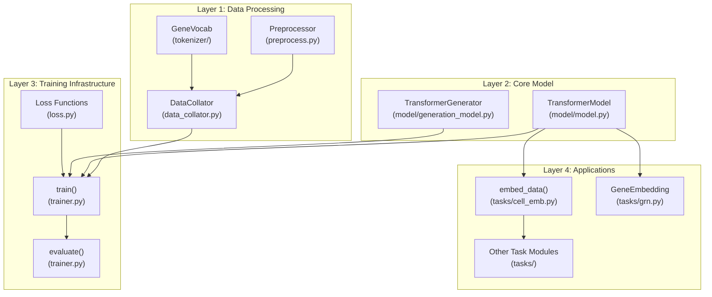

# Project Structure

<details>
<summary>Relevant source files</summary>

The following files were used as context for generating this wiki page:

- [pyproject.toml](pyproject.toml)
- [scgpt/__init__.py](scgpt/__init__.py)

</details>


This document provides an overview of the scGPT repository organization and code structure. It serves as a guide for developers who want to understand the codebase organization, locate specific components, and navigate the project efficiently.

## Repository Layout

The scGPT repository follows a standard Python package structure with the following top-level organization:

```
scGPT/
├── scgpt/                    # Main Python package
├── tutorials/                # Jupyter notebook tutorials
├── data/                     # Sample data and vocabulary files
├── save/                     # Model checkpoints and saved artifacts
├── docs/                     # Sphinx documentation source
├── tests/                    # Test suite
├── pyproject.toml            # Poetry dependency configuration
├── requirements.txt          # pip-compatible requirements
├── poetry.lock              # Locked dependency versions
├── setup.py                 # Package setup script
├── README.md                # Project overview and quick start
└── .readthedocs.yaml        # ReadTheDocs configuration
```

Sources: [pyproject.toml:1-40]()

## Configuration Files

The repository uses multiple configuration files for different purposes:

| File | Purpose | Format |
|------|---------|--------|
| `pyproject.toml` | Primary package definition using Poetry | TOML |
| `requirements.txt` | Pip-compatible dependency list | Text |
| `poetry.lock` | Locked dependency versions for reproducibility | TOML |
| `setup.py` | Traditional setuptools configuration | Python |
| `.readthedocs.yaml` | ReadTheDocs build configuration | YAML |

The package metadata is defined in [pyproject.toml:1-10](), including name (`"scGPT"`), version (`"0.2.4"`), description, license (MIT), and repository URL.

Sources: [pyproject.toml:1-40]()

## Core Package Structure

The main `scgpt/` package directory is organized into the following modules and files:

```
scgpt/
├── __init__.py              # Package initialization and exports
├── model/                   # Model architectures
│   ├── __init__.py
│   ├── model.py            # TransformerModel
│   ├── generation_model.py # TransformerGenerator
│   └── dsbn.py             # Domain-Specific Batch Normalization
├── tokenizer/              # Gene vocabulary and tokenization
│   ├── __init__.py
│   └── gene_tokenizer.py   # GeneVocab class
├── tasks/                  # Task-specific implementations
│   ├── __init__.py
│   ├── cell_emb.py        # embed_data() function
│   ├── grn.py             # GeneEmbedding class
│   └── ...                # Other task modules
├── scbank/                # Data management (deprecated)
│   └── ...
├── utils/                 # Utility functions
│   └── util.py           # Helper functions
├── data_collator.py      # DataCollator class
├── data_sampler.py       # SubsetsBatchSampler class
├── trainer.py            # Training loop functions
├── loss.py               # Loss function implementations
└── preprocess.py         # Preprocessor class
```

The package exports its main components through [scgpt/__init__.py:18-29](), making them accessible as `scgpt.model`, `scgpt.tokenizer`, etc.

Sources: [scgpt/__init__.py:1-30]()

## Module Dependencies and Import Structure

The scGPT package has a hierarchical import structure defined in [scgpt/__init__.py:18-29]():

```python
from . import model, tokenizer, scbank, utils, tasks
from .data_collator import DataCollator
from .data_sampler import SubsetsBatchSampler
from .trainer import (
    prepare_data, prepare_dataloader, train,
    define_wandb_metrcis, evaluate, eval_testdata, test
)
```

**Dependency Flow Diagram: Natural Language to Code Entities**



Sources: [scgpt/__init__.py:18-29]()

## Package Modules Reference

The following table maps modules to their primary classes, functions, and purposes:

| Module | Key Classes/Functions | File Path | Purpose |
|--------|----------------------|-----------|---------|
| **model** | `TransformerModel`, `TransformerGenerator` | model/model.py, model/generation_model.py | Core transformer architectures for pretraining and generation |
| **tokenizer** | `GeneVocab` | tokenizer/gene_tokenizer.py | Gene vocabulary management and tokenization |
| **tasks** | `embed_data()`, `GeneEmbedding` | tasks/cell_emb.py, tasks/grn.py | Task-specific inference and analysis |
| **utils** | Various utility functions | utils/util.py | Helper functions for data processing |
| **DataCollator** | `DataCollator` | data_collator.py | Collates data batches with masking and padding |
| **data_sampler** | `SubsetsBatchSampler` | data_sampler.py | Custom batch sampling for balanced training |
| **trainer** | `train()`, `evaluate()`, `prepare_data()` | trainer.py | Training loop, evaluation, and data preparation |
| **loss** | Loss function classes | loss.py | Multi-objective loss implementations (MLM, CLS, MVC, DAR) |
| **preprocess** | `Preprocessor` | preprocess.py | Data preprocessing and normalization |
| **scbank** | (Deprecated) | scbank/ | Legacy data bank system |

Sources: [scgpt/__init__.py:18-29]()

## Model Module Architecture

The `scgpt/model/` directory contains the core transformer implementations:

**Model Classes and Components Mapping**



**File Organization:**
- `model/model.py`: Contains `TransformerModel` and encoder/decoder classes
- `model/generation_model.py`: Contains `TransformerGenerator` for perturbation prediction
- `model/dsbn.py`: Domain-Specific Batch Normalization utilities

Sources: [scgpt/__init__.py:18]()

## Tasks Module Organization

The `scgpt/tasks/` directory contains task-specific implementations that use the pretrained models for downstream applications:

**Tasks Module Structure and Entry Points**



**Key Entry Points:**
- `tasks/cell_emb.py`: `embed_data()` - Primary function for generating cell embeddings from pretrained models
- `tasks/grn.py`: `GeneEmbedding` - Class for gene regulatory network inference using attention weights
- Other task modules provide specialized fine-tuning and inference workflows

Sources: [scgpt/__init__.py:18]()

## Tutorials and Examples

The `tutorials/` directory contains Jupyter notebook tutorials demonstrating scGPT usage:

**Tutorial Categories:**

| Tutorial Type | Example Notebooks | Purpose |
|---------------|-------------------|---------|
| **Zero-Shot** | Reference Mapping, Integration | Using pretrained models without fine-tuning |
| **Fine-tuning** | Cell Annotation, Perturbation Prediction | Task-specific model adaptation |
| **Advanced** | GRN Inference, Multi-omics Integration | Specialized biological analyses |

Tutorials use pretrained models from the `save/` directory and sample data from the `data/` directory. Each tutorial is self-contained with data loading, model initialization, and result visualization.

Sources: [pyproject.toml:1-40]()

## Data Organization

The repository includes several data-related directories:

```
data/
├── vocab/                    # Gene vocabulary files
│   ├── human_vocab.json     # Human gene vocabulary
│   └── ...
└── [sample datasets]         # Small datasets for tutorials

save/
├── scGPT_human/             # Pretrained whole-human model checkpoint
├── scGPT_CP/                # Continual pre-training checkpoint
└── [other checkpoints]/     # Organ-specific and task-specific models
```

**Vocabulary Files:**
- Store gene-to-token mappings as JSON
- Used by `GeneVocab` class for tokenization
- Different vocabularies for different species/gene sets

**Model Checkpoints:**
- `best_model.pt`: PyTorch model state dict
- `args.json`: Training configuration
- `vocab.json`: Associated gene vocabulary

Sources: [scgpt/__init__.py:18]()

## Code Organization Principles

The scGPT codebase architecture follows these design patterns:

**Layered Architecture:**



**Key Principles:**
1. **Separation of Concerns**: Data processing, model architecture, training, and applications are in separate modules
2. **Dependency Direction**: Lower layers (data, model) don't depend on higher layers (training, tasks)
3. **Reusability**: Core components (`TransformerModel`, `GeneVocab`) are used across multiple tasks
4. **Extensibility**: Task modules can be added without modifying core components

Sources: [scgpt/__init__.py:18-29]()

## Dependency Management

scGPT uses **Poetry** for dependency management, with configuration in [pyproject.toml:11-40]().

**Core Dependencies (Production):**

| Dependency | Version | Purpose |
|------------|---------|---------|
| `torch` | >=1.13.0 | Deep learning framework |
| `torchtext` | * | Vocabulary management |
| `scanpy` | ^1.9.1 | Single-cell RNA-seq analysis |
| `scvi-tools` | >=0.16.0,<1.0 | Variational inference models |
| `pandas` | >=1.3.5 | Data manipulation |
| `numba` | >=0.55.1 | JIT compilation for performance |
| `scikit-misc` | >=0.1.4 | Scientific utilities |
| `umap-learn` | >=0.5.3 | Dimensionality reduction |
| `leidenalg` | >=0.8.10 | Graph clustering |
| `datasets` | ^2.3.0 | Dataset loading utilities |
| `scib` | ^1.0.3 | Integration benchmarking |

**Development Dependencies:**

| Dependency | Purpose |
|------------|---------|
| `pytest` | Unit testing |
| `black` | Code formatting |
| `flash-attn` | Optimized attention (GPU-only) |
| `torch-geometric` | Graph neural network support |
| `wandb` | Experiment tracking |
| `tensorflow` | Alternative backend support |

**Installation Methods:**
- Poetry: `poetry install` (recommended for development)
- pip: `pip install scgpt` (for end users)
- From source: `pip install -e .` (for development)

Sources: [pyproject.toml:11-40]()

## Testing and Documentation Infrastructure

**Testing Structure:**
- Location: `tests/` directory
- Framework: pytest ([pyproject.toml:29]())
- Organization: Mirrors package structure
- Execution: `pytest tests/`

**Documentation System:**
- Builder: Sphinx
- Source: `docs/` directory with `.rst` files
- Notebook integration: nbsphinx for tutorial rendering
- Hosting: ReadTheDocs (configured via `.readthedocs.yaml`)
- Build locally: `cd docs && make html`

**Documentation Files:**
- `docs/conf.py`: Sphinx configuration
- `docs/scgpt.rst`: Main package API documentation
- `docs/scgpt.tasks.rst`: Tasks module documentation
- Tutorials are included via nbsphinx from `tutorials/`

Sources: [pyproject.toml:29]()

## Package Initialization and Exports

The package interface is defined in [scgpt/__init__.py:1-30]():

**Version and Logging:**
```python
__version__ = "0.2.4"  # Package version
logger = logging.getLogger("scGPT")  # Package-level logger
```

**Public API Exports:**

The `__init__.py` imports and exposes:
- Submodules: `model`, `tokenizer`, `scbank`, `utils`, `tasks`
- Classes: `DataCollator`, `SubsetsBatchSampler`
- Functions: `prepare_data`, `prepare_dataloader`, `train`, `evaluate`, `test`, etc.

This allows users to access components via:
```python
from scgpt import TransformerModel  # From scgpt.model
from scgpt import GeneVocab         # From scgpt.tokenizer
from scgpt import DataCollator      # Direct import
from scgpt import train             # From scgpt.trainer
```

Sources: [scgpt/__init__.py:1-30]()

## Developer Guidelines

When contributing to scGPT, follow these organizational conventions:

1. **Module Placement**:
   - Core architectures → `scgpt/model/`
   - Data processing → `scgpt/preprocess.py`, `scgpt/data_collator.py`
   - Task-specific code → `scgpt/tasks/`
   - Utilities → `scgpt/utils/`

2. **Dependency Rules**:
   - Core modules (`model/`, `tokenizer/`) should not import from `tasks/`
   - `tasks/` can import from all other modules
   - Avoid circular dependencies

3. **Code Style**:
   - Use `black` for formatting ([pyproject.toml:30]())
   - Type hints encouraged
   - Docstrings required for public APIs

4. **Adding New Tasks**:
   - Create new file in `scgpt/tasks/`
   - Import required core components
   - Provide clear entry point function or class
   - Add tutorial notebook to `tutorials/`

5. **Testing**:
   - Add tests to `tests/` mirroring module structure
   - Use pytest fixtures for common setup
   - Test both CPU and GPU paths where applicable

Sources: [pyproject.toml:1-40](), [scgpt/__init__.py:1-30]()

## Summary

The scGPT repository is organized around a main Python package with clearly defined modules for various aspects of single-cell analysis using transformer models. The organization follows principles of modularity, separation of concerns, and consistent interfaces. Understanding this structure will help developers navigate the codebase efficiently and contribute new functionality in accordance with the existing architecture.

Sources: [scgpt/__init__.py:1-30](), [pyproject.toml:1-40](), [docs/scgpt.rst:1-54](), [docs/scgpt.tasks.rst:1-30]()

---