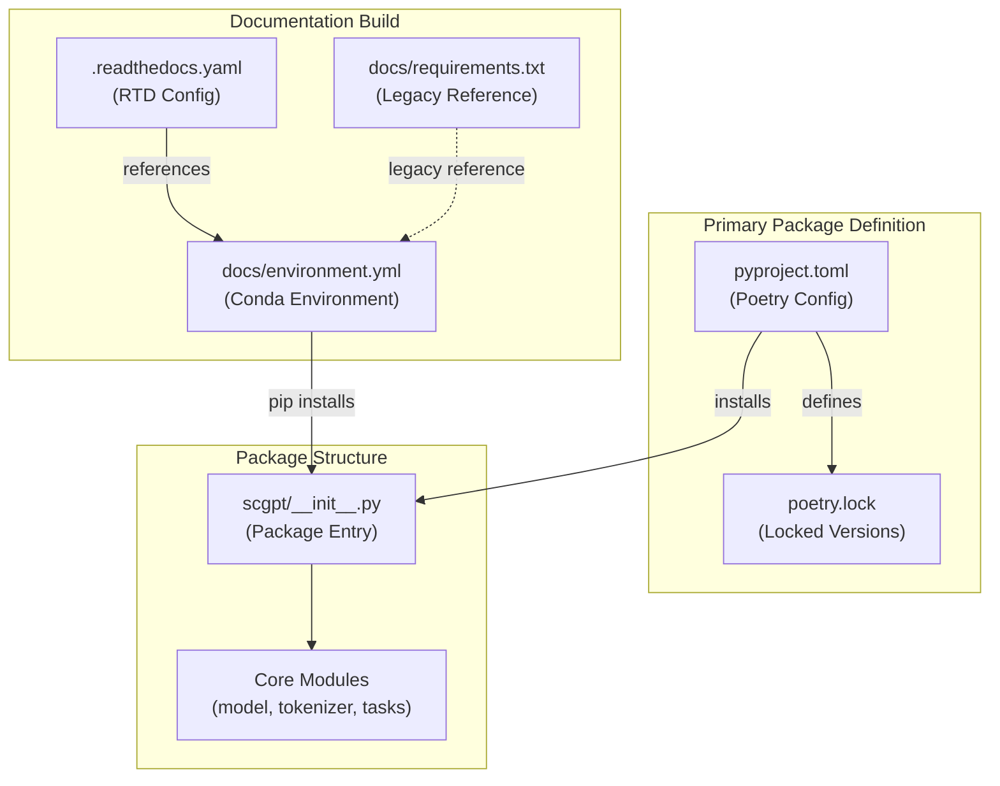
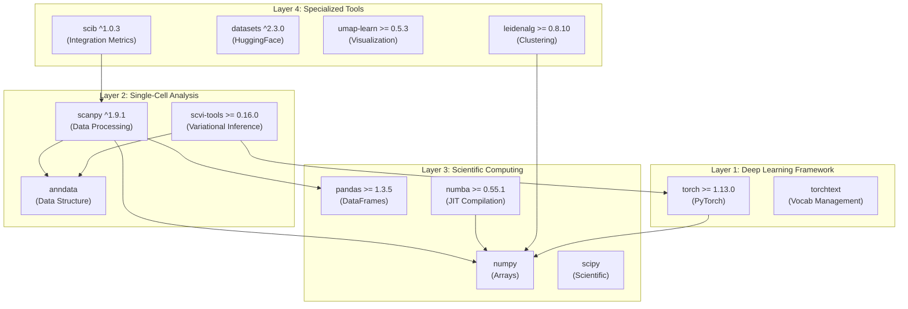
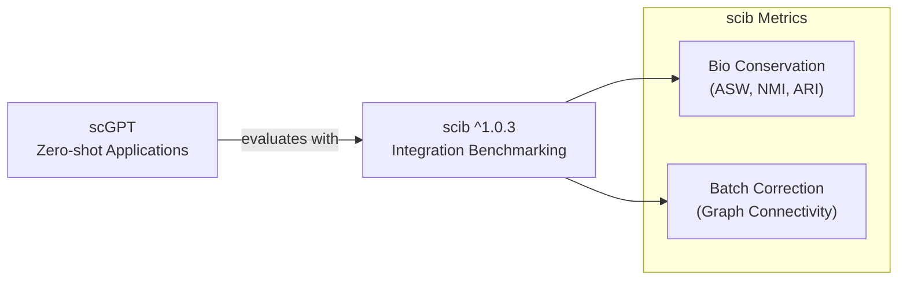
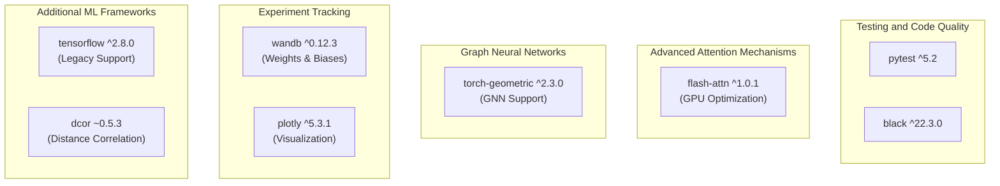
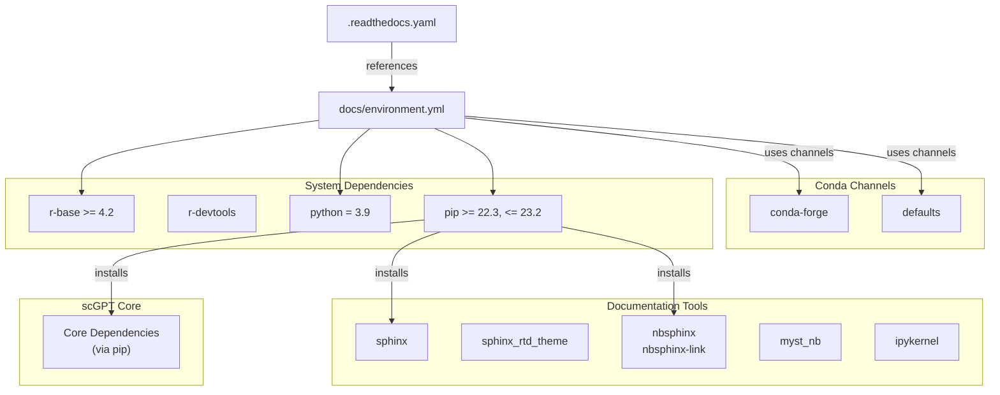
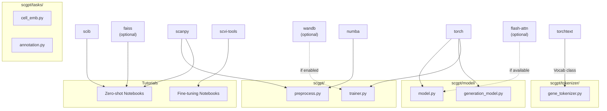
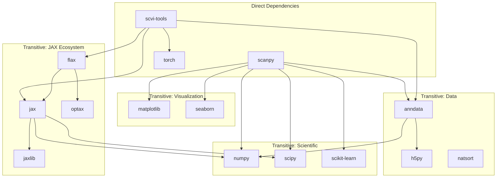

# Dependencies and Environment

<details>
<summary>Relevant source files</summary>

The following files were used as context for generating this wiki page:

- [.readthedocs.yaml](.readthedocs.yaml)
- [docs/environment.yml](docs/environment.yml)
- [docs/requirements.txt](docs/requirements.txt)
- [poetry.lock](poetry.lock)
- [pyproject.toml](pyproject.toml)
- [scgpt/tokenizer/gene_tokenizer.py](scgpt/tokenizer/gene_tokenizer.py)

</details>


This document provides a comprehensive reference for scGPT's dependency structure, environment configuration, and setup procedures. It covers the package management system, all required and optional dependencies, their purposes within the codebase, and environment setup for different deployment scenarios (development, production, documentation).

For information about the overall project structure, see [Project Structure](#10.1). For documentation build configuration specifically, see [Documentation System](#10.3).

## Dependency Management Architecture

scGPT uses **Poetry** as its primary package manager for dependency resolution and distribution, while **Conda** is used for the documentation build environment on ReadTheDocs. This dual approach balances Python ecosystem compatibility (Poetry) with reproducible documentation builds (Conda).

### Package Definition Files



**Sources:** [pyproject.toml:1-41](), [.readthedocs.yaml:1-35](), [docs/environment.yml:1-30]()

## Core Dependency Layers

The dependency stack is organized into four functional layers:



**Sources:** [pyproject.toml:11-26]()

## Core Dependencies

### Deep Learning and Tokenization

| Dependency | Version | Purpose | Key Usage |
|------------|---------|---------|-----------|
| `torch` | ≥1.13.0 | Deep learning framework | Model architecture, training loop, tensor operations |
| `torchtext` | * | Text/vocabulary utilities | `GeneVocab` class implementation |

The PyTorch version constraint ensures compatibility with modern features while maintaining broad hardware support. The `torchtext` library provides the foundational `Vocab` class that `GeneVocab` extends.

**Sources:** [pyproject.toml:16-17](), [scgpt/tokenizer/gene_tokenizer.py:10-12]()

### Single-Cell Analysis Ecosystem

| Dependency | Version | Purpose | Key Usage |
|------------|---------|---------|-----------|
| `scanpy` | ^1.9.1 | Single-cell data analysis | Preprocessing, HVG selection, data normalization |
| `scvi-tools` | ≥0.16.0, <1.0 | Variational inference models | Baseline comparisons, integration methods |
| `anndata` | (via scanpy) | Annotated data matrices | Primary data structure throughout codebase |

These dependencies form the single-cell genomics foundation. The caret (^) syntax for scanpy allows minor version updates within 1.x.

**Sources:** [pyproject.toml:14-15]()

### Scientific Computing Stack

| Dependency | Version | Purpose | Key Usage |
|------------|---------|---------|-----------|
| `pandas` | ≥1.3.5 | Data manipulation | Metadata handling, result aggregation |
| `numpy` | (transitive) | Numerical arrays | Data processing, tokenization |
| `scipy` | (transitive) | Scientific algorithms | Statistical tests, sparse matrices |
| `numba` | ≥0.55.1 | JIT compilation | Performance optimization for numeric functions |

The `numba` dependency enables just-in-time compilation for performance-critical numeric operations, particularly in preprocessing pipelines.

**Sources:** [pyproject.toml:13,18]()

### Integration and Quality Metrics



| Dependency | Version | Purpose |
|------------|---------|---------|
| `scib` | ^1.0.3 | Integration quality assessment |
| `umap-learn` | ≥0.5.3 | Dimensionality reduction and visualization |
| `leidenalg` | ≥0.8.10 | Graph-based clustering |
| `scikit-misc` | ≥0.1.4 | Additional scientific utilities |

The `scib` package is critical for evaluating zero-shot integration performance, providing standardized metrics like average biological conservation (avgBIO) and average batch correction (avgBATCH).

**Sources:** [pyproject.toml:19-25]()

### Data Loading and Utilities

| Dependency | Version | Purpose |
|------------|---------|---------|
| `datasets` | ^2.3.0 | HuggingFace dataset utilities |
| `typing-extensions` | ^4.2.0 | Advanced type hints for Python <3.10 |
| `cell-gears` | <0.0.3 | GEARS perturbation model utilities |
| `orbax` | <0.1.8 | JAX checkpoint management |

The `datasets` library enables standardized data loading patterns. The `typing-extensions` dependency provides `Self` type hint support for Python 3.7-3.9.

**Sources:** [pyproject.toml:22-26](), [scgpt/tokenizer/gene_tokenizer.py:6]()

## Optional Dependencies (Development)

Development dependencies are specified in `[tool.poetry.dev-dependencies]` and are not installed by default in production environments:



**Sources:** [pyproject.toml:28-36]()

### Performance Optimization

| Dependency | Version | Purpose | Requirement |
|------------|---------|---------|-------------|
| `flash-attn` | ^1.0.1 | Flash attention implementation | CUDA GPU |

The `flash-attn` package provides GPU-optimized attention mechanisms that significantly reduce memory usage and improve training speed. It requires CUDA-compatible GPUs and is optional for CPU-only deployments.

**Import pattern:** Conditional imports in model architecture allow graceful degradation when not available.

### Experiment Management

| Dependency | Version | Purpose |
|------------|---------|---------|
| `wandb` | ^0.12.3 | Experiment tracking and visualization |
| `plotly` | ^5.3.1 | Interactive plotting |

Weights & Biases integration enables comprehensive experiment tracking, hyperparameter logging, and result visualization during model development.

### Graph Neural Networks

| Dependency | Version | Purpose |
|------------|---------|---------|
| `torch-geometric` | ^2.3.0 | Graph neural network operations |

Required for GRN (Gene Regulatory Network) inference tasks that leverage graph-structured data.

### Testing and Code Quality

| Dependency | Version | Purpose |
|------------|---------|---------|
| `pytest` | ^5.2 | Testing framework |
| `black` | ^22.3.0 | Code formatting |
| `tensorflow` | ^2.8.0 | Legacy compatibility testing |

**Sources:** [pyproject.toml:28-36]()

## Documentation Environment

The documentation build uses a Conda environment to ensure reproducibility on ReadTheDocs:



**Sources:** [docs/environment.yml:1-30](), [.readthedocs.yaml:1-35]()

### ReadTheDocs Configuration

The `.readthedocs.yaml` file specifies the build environment:

| Setting | Value | Purpose |
|---------|-------|---------|
| `build.os` | ubuntu-22.04 | Base operating system |
| `build.tools.python` | mambaforge-4.10 | Conda distribution |
| `sphinx.configuration` | docs/conf.py | Sphinx config location |
| `conda.environment` | docs/environment.yml | Environment definition |

This configuration ensures consistent documentation builds across all ReadTheDocs deployments.

**Sources:** [.readthedocs.yaml:8-34]()

### Documentation-Specific Dependencies

The Conda environment includes documentation-specific packages via pip:

```python
# From docs/environment.yml pip section
sphinx                    # Documentation generator
sphinx_rtd_theme         # ReadTheDocs theme
nbsphinx                 # Jupyter notebook integration
nbsphinx-link            # Notebook linking
myst_nb                  # MyST markdown notebook support
ipykernel                # Jupyter kernel for notebook execution
```

The environment also specifies R dependencies (`r-base`, `r-devtools`) for R-related documentation if needed.

**Sources:** [docs/environment.yml:23-29]()

## Dependency Relationships and Import Patterns

The following diagram maps dependencies to their primary usage locations in the codebase:



**Sources:** [scgpt/tokenizer/gene_tokenizer.py:1-17]()

### Key Import Patterns

The `GeneVocab` class demonstrates the core dependency usage pattern:

```python
# From scgpt/tokenizer/gene_tokenizer.py:1-12
import json
import pickle
from pathlib import Path
from collections import Counter, OrderedDict
from typing import Dict, Iterable, List, Optional, Tuple, Union
from typing_extensions import Self  # Backport for Python <3.11

import numpy as np
import pandas as pd
import torch
import torchtext.vocab as torch_vocab
from torchtext.vocab import Vocab
```

This pattern shows:
- Standard library imports first
- `typing_extensions` for Python version compatibility
- NumPy/Pandas for data manipulation
- PyTorch and torchtext for deep learning functionality

**Sources:** [scgpt/tokenizer/gene_tokenizer.py:1-12]()

## Environment Setup Procedures

### Development Environment Setup

For local development with all optional dependencies:

```bash
# Using Poetry (recommended)
git clone https://github.com/bowang-lab/scGPT.git
cd scGPT
poetry install  # Installs core dependencies only

# Install with development dependencies
poetry install --with dev

# Install with specific optional dependencies
pip install flash-attn  # For GPU optimization (requires CUDA)
pip install faiss-gpu   # For efficient similarity search (GPU)
# OR
pip install faiss-cpu   # CPU-only version
```

### Production Environment Setup

For deployment with minimal dependencies:

```bash
# Using pip
pip install scgpt

# Or from source without dev dependencies
poetry install --without dev
```

### Documentation Build Environment

The documentation environment is automatically configured by ReadTheDocs, but can be reproduced locally:

```bash
# Using conda/mamba
conda env create -f docs/environment.yml
conda activate rtd

# Build documentation
cd docs
make html
```

**Sources:** [pyproject.toml:1-41](), [docs/environment.yml:1-30]()

## Python Version Compatibility

scGPT supports Python 3.7.12 through 3.11 with specific constraints:

```toml
# From pyproject.toml:12
python = ">=3.7.12,<4"
```

### Version-Specific Dependencies

Several dependencies require conditional imports or have version-specific behaviors:

| Dependency | Python Version | Constraint |
|------------|----------------|------------|
| `typing-extensions` | <3.8 | Required for `Self` type hint |
| `importlib-metadata` | <3.8 | Required for package metadata |
| `cached-property` | <3.8 | Backport of functools.cached_property |
| `numpy` | 3.7 | ≥1.14.5 |
| `numpy` | 3.8 | ≥1.17.5 |
| `numpy` | ≥3.9 | ≥1.19.3 |

The `poetry.lock` file maintains exact versions for all transitive dependencies to ensure reproducible builds.

**Sources:** [pyproject.toml:12](), [poetry.lock:55,61,877]()

## Transitive Dependencies

Key transitive dependencies (not directly specified but required by core dependencies):



**Sources:** [poetry.lock:46-66,604-620,985-1021]()

### JAX Ecosystem (via scvi-tools)

The `scvi-tools` dependency brings in the JAX ecosystem:

| Package | Version (from lock) | Purpose |
|---------|---------------------|---------|
| `jax` | 0.3.13 | Differentiate, compile, transform NumPy code |
| `jaxlib` | 0.3.10 | XLA library for JAX |
| `flax` | 0.4.1 | Neural network library for JAX |
| `optax` | (via flax) | Gradient processing and optimization |
| `chex` | 0.1.3 | Testing utilities for JAX |

These dependencies enable scvi-tools' variational inference capabilities but are not directly used by scGPT's core functionality.

**Sources:** [poetry.lock:985-1021,604-620,315-329]()

## Conflict Resolution and Constraints

The `pyproject.toml` includes specific version constraints to avoid known conflicts:

```toml
# From pyproject.toml:25-26
cell-gears = "<0.0.3"  # Compatibility constraint
orbax = "<0.1.8"       # Stability constraint
```

These constraints prevent version conflicts between scGPT and its dependencies' sub-dependencies.

### Build System

```toml
# From pyproject.toml:38-40
[build-system]
requires = ["poetry-core>=1.0.0"]
build-backend = "poetry.core.masonry.api"
```

This configuration uses Poetry's PEP 517 build backend for package distribution.

**Sources:** [pyproject.toml:25-26,38-40]()

## Summary

scGPT's dependency architecture balances three key requirements:

1. **Scientific Computing**: PyTorch, NumPy, SciPy foundation for deep learning
2. **Single-Cell Analysis**: scanpy, scvi-tools, anndata for domain-specific functionality  
3. **Flexibility**: Optional dependencies (flash-attn, faiss, wandb) for specialized use cases

The dual package management approach (Poetry for development, Conda for documentation) ensures both developer productivity and reproducible documentation builds. Version constraints are carefully chosen to maximize compatibility while leveraging modern features where available.

**Sources:** [pyproject.toml:1-41](), [docs/environment.yml:1-30](), [.readthedocs.yaml:1-35]()

---