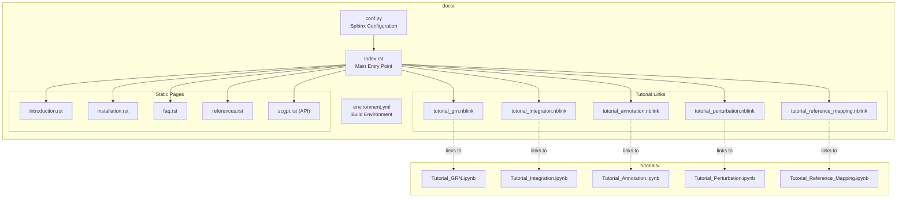
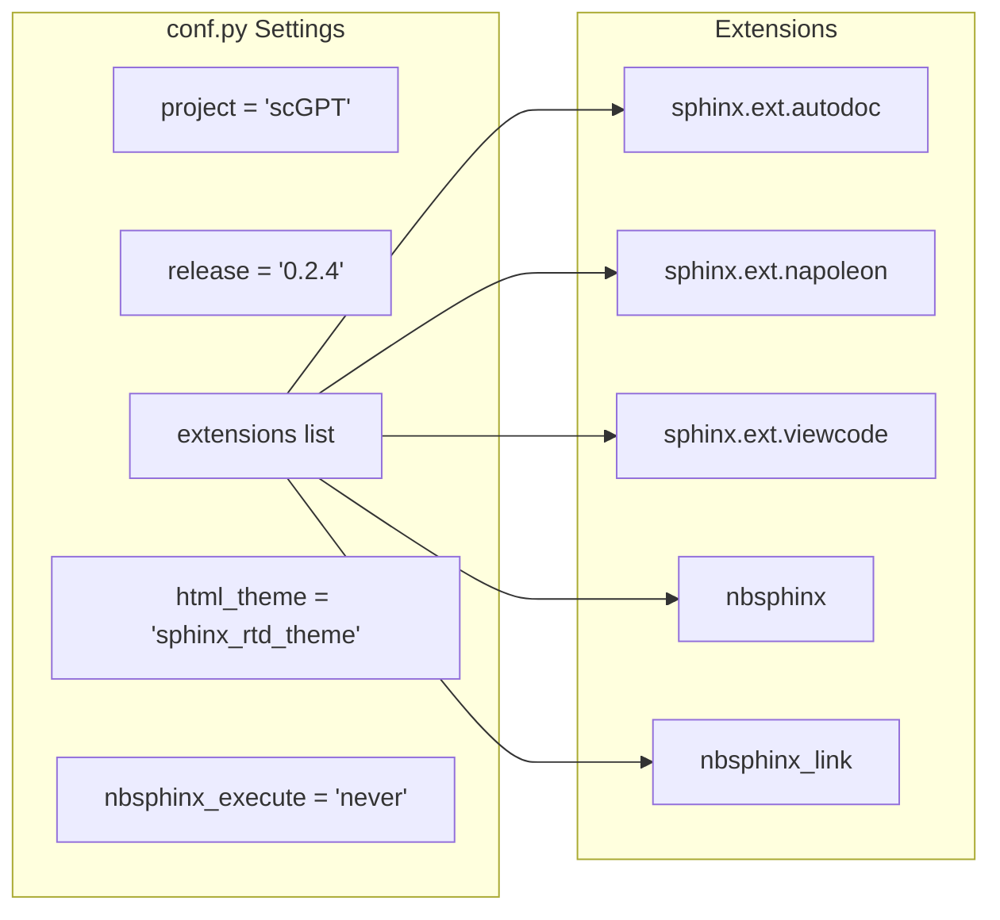
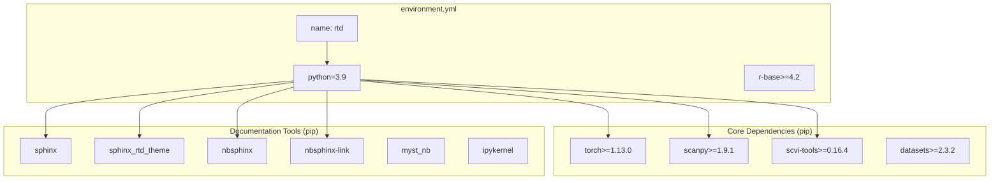
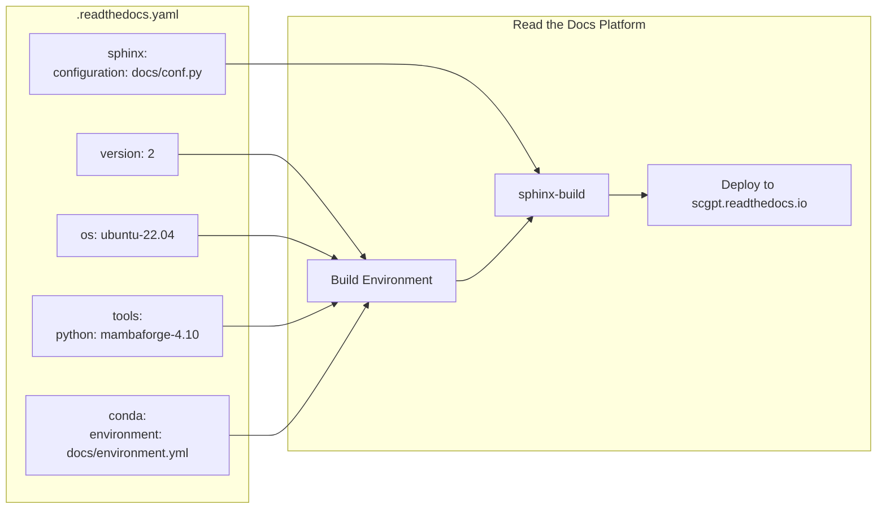
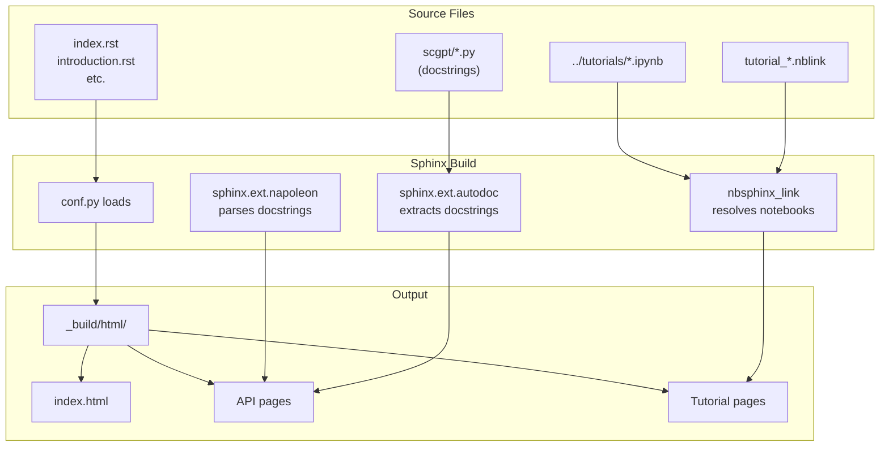

# Documentation System

<details>
<summary>Relevant source files</summary>

The following files were used as context for generating this wiki page:

- [.readthedocs.yaml](.readthedocs.yaml)
- [docs/conf.py](docs/conf.py)
- [docs/environment.yml](docs/environment.yml)
- [docs/index.rst](docs/index.rst)
- [docs/requirements.txt](docs/requirements.txt)
- [docs/tutorial_annotation.nblink](docs/tutorial_annotation.nblink)
- [docs/tutorial_perturbation.nblink](docs/tutorial_perturbation.nblink)

</details>


## Overview

The scGPT documentation system uses Sphinx with Read the Docs for automated building and hosting. The system supports three types of content: reStructuredText (`.rst`) files for static pages, auto-generated API documentation from docstrings, and Jupyter notebooks linked via `nbsphinx_link`. This page covers the technical infrastructure for building and contributing to documentation.

Sources: [docs/conf.py:1-46](), [.readthedocs.yaml:1-35](), [docs/index.rst:1-62]()

## Documentation File Structure

The documentation is organized in the `docs/` directory with the following key files:



Sources: [docs/index.rst:1-62](), [docs/tutorial_perturbation.nblink:1-3](), [docs/tutorial_annotation.nblink:1-3]()

### Documentation Entry Point

The `index.rst` file defines the documentation structure using Sphinx `toctree` directives:

| Section | Pages | Purpose |
|---------|-------|---------|
| Getting Started | `introduction`, `installation` | Initial setup and overview |
| Tutorials | 5 notebook links | Step-by-step guides for tasks |
| API Reference | `scgpt` | Auto-generated API documentation |
| References | `faq`, `references` | FAQs and citations |

Sources: [docs/index.rst:24-52]()

## Sphinx Configuration

The `conf.py` file configures Sphinx extensions and build settings:



Sources: [docs/conf.py:14-17](), [docs/conf.py:22-29](), [docs/conf.py:38](), [docs/conf.py:45]()

### Key Configuration Settings

| Setting | Value | Purpose |
|---------|-------|---------|
| `sys.path.insert(0, os.path.abspath(".."))` | Root directory | Allow autodoc to import `scgpt` package |
| `extensions` | List of 6 extensions | Enable autodoc, Napoleon, nbsphinx, etc. |
| `html_theme` | `"sphinx_rtd_theme"` | Use Read the Docs theme |
| `nbsphinx_execute` | `"never"` | Don't execute notebooks during build |

Sources: [docs/conf.py:9-12](), [docs/conf.py:22-29](), [docs/conf.py:38](), [docs/conf.py:45]()

## Tutorial Linking System

Tutorial notebooks are stored in `tutorials/` but linked into documentation using `.nblink` files. Each `.nblink` file is a JSON file pointing to a notebook:

```json
{
    "path": "../tutorials/Tutorial_Perturbation.ipynb"
}
```

This allows tutorials to remain in the repository root while being included in Sphinx documentation.

Sources: [docs/tutorial_perturbation.nblink:1-3](), [docs/tutorial_annotation.nblink:1-3]()

### Tutorial Files

| nblink File | Target Notebook | Topic |
|-------------|----------------|-------|
| `tutorial_grn.nblink` | `Tutorial_GRN.ipynb` | Gene regulatory network inference |
| `tutorial_integraion.nblink` | `Tutorial_Integration.ipynb` | Data integration |
| `tutorial_annotation.nblink` | `Tutorial_Annotation.ipynb` | Cell type annotation |
| `tutorial_perturbation.nblink` | `Tutorial_Perturbation.ipynb` | Perturbation prediction |
| `tutorial_reference_mapping.nblink` | `Tutorial_Reference_Mapping.ipynb` | Zero-shot reference mapping |

Sources: [docs/index.rst:35-39]()

## Build Environment

The documentation build requires specific Python packages defined in `environment.yml`:



Sources: [docs/environment.yml:1-30]()

### Environment Dependencies

The environment includes both scGPT runtime dependencies and documentation-specific tools:

| Category | Packages | Purpose |
|----------|----------|---------|
| Core ML | `torch`, `torchtext` | Required for importing scGPT modules |
| Single-cell | `scanpy`, `scvi-tools`, `scib` | Required by scGPT data processing |
| Documentation | `sphinx`, `sphinx_rtd_theme` | Build documentation |
| Notebooks | `nbsphinx`, `nbsphinx-link`, `ipykernel` | Include Jupyter notebooks |

Sources: [docs/environment.yml:18-29]()

## Read the Docs Integration

The `.readthedocs.yaml` configuration enables automated builds on Read the Docs:



Sources: [.readthedocs.yaml:6-34]()

### Read the Docs Build Configuration

The configuration specifies:

| Setting | Value | Purpose |
|---------|-------|---------|
| `version` | `2` | Read the Docs config file version |
| `build.os` | `ubuntu-22.04` | Linux distribution for builds |
| `build.tools.python` | `mambaforge-4.10` | Conda distribution |
| `sphinx.configuration` | `docs/conf.py` | Sphinx config file path |
| `conda.environment` | `docs/environment.yml` | Environment specification |

Sources: [.readthedocs.yaml:6-17](), [.readthedocs.yaml:19-20](), [.readthedocs.yaml:33-34]()

## Local Documentation Build

To build documentation locally, use the standard Sphinx workflow:

### Build Commands

```bash
# Navigate to docs directory
cd docs

# Build HTML documentation
make html

# Clean previous builds
make clean

# View all available targets
make help
```

The built documentation will be in `docs/_build/html/index.html`.

Sources: [docs/conf.py:1-46]()

### Build Process Flow



Sources: [docs/conf.py:9-29](), [docs/conf.py:45]()

## Contributing to Documentation

To contribute to the scGPT documentation:

1. Set up the Conda environment:
   ```bash
   conda env create -f docs/environment.yml
   conda activate rtd
   ```

2. Make changes to documentation source files (in the `docs/` directory)

3. Build the documentation locally:
   ```bash
   cd docs
   make html
   ```

4. View the built documentation in your browser (usually at `docs/_build/html/index.html`)

5. Submit changes through the standard pull request process

Sources: [docs/environment.yml:1-29](), [docs/Makefile:1-21]()

## Documentation Structure

The documentation is organized according to Sphinx conventions, with:

1. Index page as the entry point
2. API documentation automatically generated from docstrings
3. Tutorial pages from Jupyter notebooks
4. Custom documentation pages written in reStructuredText or Markdown

When contributing new documentation, maintain this structure to ensure consistency.

Sources: [docs/conf.py:22-29]()