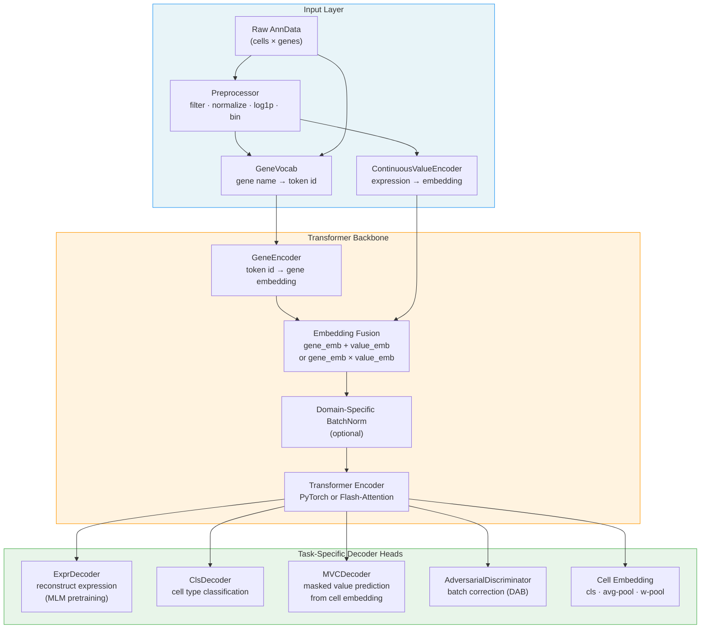

**scGPT** is a foundation model for single-cell multi-omics built with generative AI. It leverages a Transformer-based architecture to learn meaningful representations of single-cell gene expression data, enabling downstream tasks such as cell type annotation, multi-batch integration, perturbation prediction, gene regulatory network inference, and reference mapping — all from a single pretrained model. The project is published as a pip-installable Python package (v0.2.5) with pretrained checkpoints trained on up to 33 million cells.

Sources: [README.md](README.md#L1-L7), [scgpt/__init__.py](scgpt/__init__.py#L1-L30)

## What scGPT Does

Single-cell RNA sequencing (scRNA-seq) produces high-dimensional expression matrices where each row is a cell and each column is a gene. scGPT reformulates this data into a **sequence modeling problem**: each cell becomes a "sentence" whose tokens are genes and whose token values are expression levels. A Transformer encoder then learns to reconstruct masked expression values — analogous to masked language modeling in NLP — producing rich cell-level and gene-level embeddings that transfer across tasks and tissues.

The core insight is that **genes in a cell interact in context-dependent ways**, and a self-attention mechanism can capture these interactions without hand-crafted feature engineering. After pretraining on tens of millions of cells, scGPT can be fine-tuned with minimal labeled data for task-specific applications.

Sources: [scgpt/model/model.py](scgpt/model/model.py#L25-L95), [scgpt/model/model.py](scgpt/model/model.py#L290-L370)

## Architecture at a Glance

The diagram below traces the data flow from raw expression counts through tokenization, encoding, the Transformer backbone, and finally to task-specific decoder heads. Understanding this pipeline is the key to working with scGPT effectively.

> **Prerequisite**: This diagram uses Mermaid flowchart syntax. Each node represents a distinct module in the codebase; arrows indicate the primary data-flow direction during a forward pass.



Sources: [scgpt/model/model.py](scgpt/model/model.py#L25-L180), [scgpt/preprocess.py](scgpt/preprocess.py#L11-L100), [scgpt/tokenizer/gene_tokenizer.py](scgpt/tokenizer/gene_tokenizer.py#L21-L85)

## Core Components

The table below maps each major subsystem to its source module, responsibility, and the key class or function you will interact with most often.

| Subsystem | Source Module | Key Class / Function | Responsibility |
|---|---|---|---|
| **Preprocessing** | `scgpt.preprocess` | `Preprocessor` | Filter, normalize, log1p, select HVGs, bin expression values |
| **Tokenization** | `scgpt.tokenizer` | `GeneVocab` | Map gene names ↔ integer token IDs; load/save vocab files |
| **Data Collation** | `scgpt.data_collator` | `DataCollator` | Pad, bin, and apply MLM masking per batch |
| **Model** | `scgpt.model` | `TransformerModel` | Full encoder–decoder with configurable heads |
| **Multi-omics Model** | `scgpt.model` | `MultiOmicTransformerModel` | Extended model with modality-specific encoders |
| **Generation Model** | `scgpt.model` | `TransformerGenerator` | Perturbation-aware model with perturbation token encoder |
| **Loss Functions** | `scgpt.loss` | `masked_mse_loss`, `criterion_neg_log_bernoulli` | Masked reconstruction and zero-inflation losses |
| **Training** | `scgpt.trainer` | `train`, `evaluate`, `prepare_data` | Training loops, data prep, SCIB metric evaluation |
| **Cell Embedding** | `scgpt.tasks.cell_emb` | `embed_data`, `get_batch_cell_embeddings` | Batch inference for cell-level embeddings |
| **GRN Inference** | `scgpt.tasks.grn` | `GeneEmbedding` | Gene similarity, metagene discovery from gene embeddings |
| **Data Bank** | `scgpt.scbank` | `DataBank`, `DataTable` | Large-scale dataset storage and flexible access |

Sources: [scgpt/__init__.py](scgpt/__init__.py#L18-L30), [scgpt/data_collator.py](scgpt/data_collator.py#L7-L50), [scgpt/loss.py](scgpt/loss.py#L1-L37), [scgpt/tasks/__init__.py](scgpt/tasks/__init__.py#L1-L3)

## How a Cell Becomes a Sequence

Understanding the tokenization pipeline is critical because it bridges the biological data format (AnnData) and the model's expected input (padded, binned token sequences). The `Preprocessor` transforms raw counts through a configurable pipeline — filtering low-count genes/cells, normalizing to a fixed total, applying log1p, selecting highly variable genes, and finally **binning** non-zero expression values into discrete bins using quantile-based binning. The `GeneVocab` then maps each gene name to a unique integer token. The `DataCollator` assembles per-cell sequences at training time: it prepends a `<cls>` token, pads to `max_length`, applies random masking (MLM), and bins values on-the-fly.

> [!TIP]
> The first bin in the binning scheme is always reserved for zero expression. Non-zero values are binned using quantile boundaries, so each gene's expression distribution is adaptively discretized. This design preserves the sparsity structure of scRNA-seq data.

Sources: [scgpt/preprocess.py](scgpt/preprocess.py#L139-L200), [scgpt/tokenizer/gene_tokenizer.py](scgpt/tokenizer/gene_tokenizer.py#L21-L85), [scgpt/data_collator.py](scgpt/data_collator.py#L100-L170)

## Model Design Decisions

The `TransformerModel` exposes several configuration knobs that control how expression data is encoded and decoded. The most important are compared below.

| Parameter | Options | Default | Effect |
|---|---|---|---|
| `input_emb_style` | `continuous`, `category`, `scaling` | `continuous` | How gene and value embeddings combine. `continuous` = addition; `scaling` = element-wise multiplication; `category` = learned bin embeddings |
| `cell_emb_style` | `cls`, `avg-pool`, `w-pool` | `cls` | How to extract a cell-level vector from transformer output. `cls` uses the `<cls>` token position; `w-pool` uses expression-weighted average |
| `do_mvc` | `True` / `False` | `False` | Enable Masked Value Prediction for Cell embedding (MVC) decoder — reconstructs masked gene expressions from the cell embedding alone |
| `do_dab` | `True` / `False` | `False` | Enable Domain Adversarial Batch correction — a gradient-reversal discriminator that encourages batch-invariant embeddings |
| `explicit_zero_prob` | `True` / `False` | `False` | Model explicit zero-inflation by predicting a Bernoulli probability for each gene being zero |
| `use_fast_transformer` | `True` / `False` | `False` | Use Flash-Attention backend for faster and memory-efficient attention |
| `domain_spec_batchnorm` | `True`, `"dsbn"`, `"batchnorm"`, `False` | `False` | Apply domain-specific batch normalization per batch label |

> [!TIP]
> The `continuous` + `cls` combination is the default and most battle-tested configuration. Switch to `scaling` if you want the model to treat expression values as multiplicative scaling factors on gene embeddings — this can improve perturbation prediction tasks where expression fold-changes matter.

Sources: [scgpt/model/model.py](scgpt/model/model.py#L25-L95), [scgpt/model/model.py](scgpt/model/model.py#L180-L260)

## Pretraining Objectives

scGPT is pretrained with a combination of self-supervised objectives that teach the model different facets of single-cell biology. During a forward pass, multiple objectives can be active simultaneously via boolean flags (`CLS`, `CCE`, `MVC`, `ECS`).

| Objective | Flag | What It Teaches | Mechanism |
|---|---|---|---|
| **Masked Gene Expression (MLM)** | always active | Reconstruct masked expression values | Randomly mask ~15% of gene tokens; decode via `ExprDecoder` |
| **Cell Type Classification (CLS)** | `CLS=True` | Discriminative cell-type awareness | `ClsDecoder` maps cell embedding → cell type logits |
| **Contrastive Cell Embedding (CCE)** | `CCE=True` | Robust cell-level representations | Two forward passes with dropout; cosine similarity contrastive loss |
| **Masked Value for Cell (MVC)** | `MVC=True` | Cell embedding sufficiency | `MVCDecoder` reconstructs masked gene expressions from cell embedding alone using inner-product or concat-query architecture |
| **Elastic Cell Similarity (ECS)** | `ECS=True` | Within-cell gene coherence | Penalizes low similarity among embeddings of genes from the same cell |

Sources: [scgpt/model/model.py](scgpt/model/model.py#L290-L400), [scgpt/loss.py](scgpt/loss.py#L1-L37)

## Project Structure

The repository is organized so that the `scgpt/` package is the installable core, `tutorials/` provides end-to-end notebook walkthroughs, and `data/` contains scripts for building large-scale pretraining corpora.

```
scGPT/
├── scgpt/                          # 📦 Installable Python package
│   ├── model/
│   │   ├── model.py                # TransformerModel, encoders, decoders
│   │   ├── multiomic_model.py      # Multi-omic extension
│   │   ├── generation_model.py     # Perturbation generation model
│   │   ├── dsbn.py                 # Domain-specific batch normalization
│   │   ├── grad_reverse.py         # Gradient reversal for adversarial training
│   │   └── flash_attn_compat.py    # Flash-Attention compatibility layer
│   ├── tokenizer/
│   │   ├── gene_tokenizer.py       # GeneVocab class
│   │   ├── vocab_compat.py         # Cross-version Vocab compatibility
│   │   └── default_*.json          # Built-in vocabulary files
│   ├── tasks/
│   │   ├── cell_emb.py             # Cell embedding extraction
│   │   └── grn.py                  # Gene regulatory network inference
│   ├── scbank/                     # Large-scale data management
│   ├── preprocess.py               # Preprocessor pipeline
│   ├── data_collator.py            # Batch collation + MLM masking
│   ├── data_sampler.py             # SubsetsBatchSampler
│   ├── loss.py                     # Loss functions
│   ├── trainer.py                  # Training & evaluation loops
│   └── utils/                      # Utilities, pretrained model loading
│
├── tutorials/                      # 📓 Hands-on notebooks
│   ├── Tutorial_Annotation.ipynb
│   ├── Tutorial_Integration.ipynb
│   ├── Tutorial_Perturbation.ipynb
│   ├── Tutorial_GRN.ipynb
│   ├── Tutorial_Multiomics.ipynb
│   ├── Tutorial_Reference_Mapping.ipynb
│   └── zero-shot/                 # Zero-shot application notebooks
│
├── examples/                       # 🔧 Script-based fine-tuning example
│   └── finetune_integration.py
├── tests/                          # ✅ Unit tests
├── data/                           # 📊 Pretraining data build scripts
└── docs/                           # 📖 Sphinx documentation source
```

Sources: [scgpt/model/__init__.py](scgpt/model/__init__.py#L1-L12), [scgpt/tokenizer/__init__.py](scgpt/tokenizer/__init__.py#L1-L2), [scgpt/scbank/__init__.py](scgpt/scbank/__init__.py#L1-L20)

## Supported Downstream Tasks

scGPT's pretrained representations are designed to transfer across a wide range of single-cell analyses. The table summarizes each task, its tutorial entry point, and the model components involved.

| Task | Tutorial | Key Model Component | Description |
|---|---|---|---|
| **Cell Type Annotation** | `Tutorial_Annotation.ipynb` | `ClsDecoder` | Classify cell types in new datasets using fine-tuned classifier head |
| **Multi-Batch Integration** | `Tutorial_Integration.ipynb` | `ExprDecoder` + DAB | Remove batch effects while preserving biological variation |
| **Perturbation Prediction** | `Tutorial_Perturbation.ipynb` | `TransformerGenerator` | Predict post-perturbation expression from control cells |
| **Gene Regulatory Network** | `Tutorial_GRN.ipynb` / `Tutorial_Attention_GRN.ipynb` | `GeneEmbedding` / Attention weights | Infer gene–gene interactions from embeddings or attention maps |
| **Reference Mapping** | `Tutorial_Reference_Mapping.ipynb` | `embed_data` + FAISS | Map new cells to a reference atlas using cell embedding similarity |
| **Multi-omics Integration** | `Tutorial_Multiomics.ipynb` | `MultiOmicTransformerModel` | Jointly encode RNA + ATAC or other modality pairs |
| **Zero-Shot Applications** | `tutorials/zero-shot/` | `embed_data` | Use continually pretrained checkpoints without any fine-tuning |

Sources: [scgpt/tasks/cell_emb.py](scgpt/tasks/cell_emb.py#L20-L80), [scgpt/tasks/grn.py](scgpt/tasks/grn.py#L14-L60), [scgpt/model/generation_model.py](scgpt/model/generation_model.py#L30-L80), [README.md](README.md#L40-L60)

## Pretrained Model Zoo

scGPT ships with several pretrained checkpoints. The **whole-human** model, trained on 33 million normal human cells, is the recommended default for most applications. Organ-specific models (brain, blood, heart, lung, kidney) can outperform the general model when your fine-tuning data shares a similar tissue context. A separately **continual pretrained** checkpoint is optimized for zero-shot cell embedding tasks.

| Model | Training Data | Best For |
|---|---|---|
| `whole-human` (recommended) | 33M normal human cells | General-purpose fine-tuning |
| `continual pretrained` | Further pretraining for embeddings | Zero-shot cell embedding |
| `brain` | 13.2M brain cells | Neuroscience applications |
| `blood` | 10.3M blood & bone marrow cells | Hematology |
| `heart` | 1.8M heart cells | Cardiology |
| `lung` | 2.1M lung cells | Pulmonary research |
| `kidney` | 814K kidney cells | Nephrology |
| `pan-cancer` | 5.7M cancer cells | Oncology |

Sources: [README.md](README.md#L57-L72)

## Where to Go Next

Now that you have a mental map of scGPT's architecture and capabilities, here is the recommended reading path through the documentation:

1. **[Quick Start](2-quick-start)** — Install scGPT, load a pretrained model, and generate your first cell embeddings in under 10 minutes.
2. **[Pretrained Model Zoo](3-pretrained-model-zoo)** — Explore checkpoint details, download links, and guidance on choosing the right model for your task.
3. **Tutorials** (listed above) — Pick the notebook that matches your downstream application and run it end-to-end.
4. **[Latest Updates](4-latest-updates)** — Stay current with new features, checkpoint releases, and HuggingFace integration progress.
