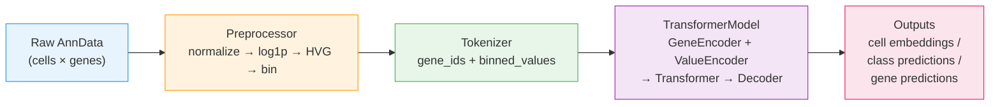
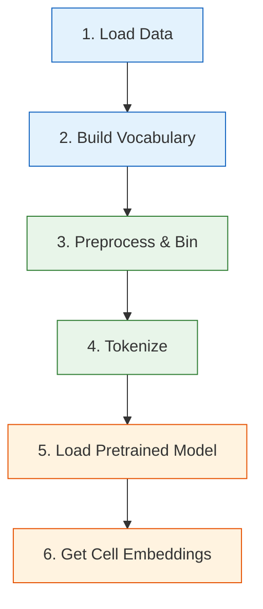

Get scGPT running in minutes. This page walks you through installation, a minimal working example, and the essential API surface you need to start fine-tuning a single-cell foundation model on your own data. By the end, you will have loaded a pretrained model, preprocessed an AnnData object, tokenized gene expression, and extracted cell embeddings — the core loop that underpins every scGPT workflow.

## How scGPT Works: The Big Picture

scGPT models each cell as a **sequence of gene–value token pairs** and processes them through a Transformer encoder. The architecture mirrors NLP's "token + embedding" paradigm, but here genes are tokens and binned expression values are their features. Understanding this data flow is the single most important mental model for working with scGPT.



The **Preprocessor** transforms raw counts into binned discrete values. The **Tokenizer** maps gene names to vocabulary indices and pairs them with those binned values. The **TransformerModel** encodes this sequence and can output cell embeddings, cell-type classifications, or reconstructed gene expressions depending on which decoder heads are enabled. Every downstream task — integration, annotation, perturbation prediction, GRN inference — is a variation on this same pipeline.

Sources: [scgpt/preprocess.py](/scgpt/preprocess.py#L24-L100), [scgpt/model/model.py](/scgpt/model/model.py#L21-L153), [scgpt/tokenizer/gene_tokenizer.py](/scgpt/tokenizer/gene_tokenizer.py#L293-L400)

## Installation

scGPT requires **Python ≥ 3.7.12** and **PyTorch ≥ 1.13**. Install the core package from PyPI:

```bash
pip install scgpt
```

For GPU-accelerated attention (strongly recommended for training), add the optional flash-attn dependency:

```bash
pip install scgpt "flash-attn<1.0.5"
```

> [!TIP]
> If `flash-attn` fails to install, it is usually a CUDA version mismatch. scGPT will gracefully fall back to PyTorch's native attention — you can set `use_fast_transformer=False` when constructing the model. See the [flash-attn repo](https://github.com/HazyResearch/flash-attention) for compatible CUDA versions.

Optionally, install [wandb](https://wandb.ai/) for experiment tracking:

```bash
pip install wandb
```

| Dependency | Minimum Version | Purpose |
|:---|:---|:---|
| `torch` | ≥ 1.13.0 | Core deep learning framework |
| `scanpy` | ≥ 1.9.1 | Single-cell data I/O and preprocessing |
| `scvi-tools` | ≥ 0.16.0 | Benchmark datasets and evaluation |
| `pandas` | ≥ 1.3.5 | Data manipulation |
| `datasets` | ≥ 2.20.0 | HuggingFace data loading |
| `flash-attn` | ≥ 2.8.0 (optional) | Fast GPU attention kernel |

Sources: [pyproject.toml](/pyproject.toml#L1-L62), [README.md](/README.md#L28-L45)

## Step-by-Step: Your First scGPT Pipeline

The following minimal example demonstrates the complete workflow from raw data to cell embeddings. Each step maps directly to the architecture diagram above.



### Step 1 — Load Your Data

scGPT consumes [AnnData](https://anndata.readthedocs.io/) objects, the standard container in the single-cell ecosystem. Gene names must be stored in `adata.var` with a known column name.

```python
import scanpy as sc

adata = sc.read("your_data.h5ad")  # or any scanpy loader
adata.var["gene_name"] = adata.var.index.tolist()  # ensure gene names column exists
```

### Step 2 — Build or Load the Gene Vocabulary

The **GeneVocab** maps each gene symbol to a unique integer ID. When loading a pretrained model, you **must** use the vocabulary that was saved alongside the checkpoint to ensure gene–ID alignment.

```python
from scgpt.tokenizer.gene_tokenizer import GeneVocab
from pathlib import Path

# Load the vocabulary from a pretrained checkpoint folder
vocab = GeneVocab.from_file(Path("save/scGPT_human/vocab.json"))

# Add special tokens required for processing
special_tokens = ["<pad>", "<cls>", "<eoc>"]
for s in special_tokens:
    if s not in vocab:
        vocab.append_token(s)
vocab.set_default_index(vocab["<pad>"])
```

Cross-check your data against the vocabulary to retain only genes the model knows:

```python
import numpy as np

adata.var["id_in_vocab"] = [
    1 if gene in vocab else -1 for gene in adata.var["gene_name"]
]
adata = adata[:, adata.var["id_in_vocab"] >= 0]
print(f"Matched {np.sum(adata.var['id_in_vocab'] >= 0)} genes in vocabulary")
```

Sources: [scgpt/tokenizer/gene_tokenizer.py](/scgpt/tokenizer/gene_tokenizer.py#L113-L160), [tutorials/Tutorial_Integration.ipynb](/tutorials/Tutorial_Integration.ipynb)

### Step 3 — Preprocess and Bin Expression Values

The **Preprocessor** orchestrates a configurable pipeline: filtering → normalization → log1p → HVG selection → binning. Binning converts continuous expression into discrete bins (the first bin is reserved for zeros), which is the format scGPT expects as input.

```python
from scgpt.preprocess import Preprocessor

preprocessor = Preprocessor(
    use_key="X",                    # use raw counts from adata.X
    filter_gene_by_counts=3,        # remove low-count genes
    normalize_total=1e4,            # depth normalization to 10,000
    log1p=True,                     # log1p transform
    subset_hvg=1200,                # keep top 1200 highly variable genes
    hvg_flavor="seurat_v3",        # HVG selection method
    binning=51,                     # bin into 51 discrete values
)
preprocessor(adata, batch_key="str_batch")
```

The preprocessor stores results in `adata.layers` — binned values go to `adata.layers["X_binned"]` by default.

| Preprocessor Parameter | Default | Purpose |
|:---|:---|:---|
| `filter_gene_by_counts` | `False` | Minimum total counts to keep a gene |
| `filter_cell_by_counts` | `False` | Minimum total counts to keep a cell |
| `normalize_total` | `1e4` | Target sum for depth normalization |
| `log1p` | `False` | Apply log(1+x) transform |
| `subset_hvg` | `False` | Number of HVGs to retain |
| `binning` | `None` | Number of discrete bins for quantile binning |

Sources: [scgpt/preprocess.py](/scgpt/preprocess.py#L24-L100), [scgpt/preprocess.py](/scgpt/preprocess.py#L101-L230)

### Step 4 — Tokenize the Data

Tokenization pairs each gene's vocabulary ID with its binned expression value, producing the `(gene_ids, values)` tensor pairs that the Transformer consumes.

```python
from scgpt.tokenizer import tokenize_and_pad_batch, random_mask_value
from scipy.sparse import issparse

pad_token = "<pad>"
pad_value = -2
mask_value = -1
max_seq_len = 1201  # n_hvg + 1 (for <cls> token)

input_layer_key = "X_binned"
all_counts = (
    adata.layers[input_layer_key].toarray()
    if issparse(adata.layers[input_layer_key])
    else adata.layers[input_layer_key]
)
genes = adata.var["gene_name"].tolist()
gene_ids = np.array(vocab(genes), dtype=int)

tokenized = tokenize_and_pad_batch(
    all_counts,
    gene_ids,
    max_len=max_seq_len,
    vocab=vocab,
    pad_token=pad_token,
    pad_value=pad_value,
    append_cls=True,          # prepend <cls> token
    include_zero_gene=True,   # include zero-expression genes
)
# tokenized["genes"]  → Tensor of gene IDs, shape (n_cells, max_seq_len)
# tokenized["values"] → Tensor of binned values, shape (n_cells, max_seq_len)
```

For training, apply random masking to create the masked-language-model objective:

```python
masked_values = random_mask_value(
    tokenized["values"],
    mask_ratio=0.4,
    mask_value=mask_value,
    pad_value=pad_value,
)
```

Sources: [scgpt/tokenizer/gene_tokenizer.py](/scgpt/tokenizer/gene_tokenizer.py#L293-L400), [tutorials/Tutorial_Integration.ipynb](/tutorials/Tutorial_Integration.ipynb)

### Step 5 — Load a Pretrained Model

The **TransformerModel** is the central scGPT architecture. When fine-tuning, load the pretrained weights and model config from a checkpoint directory containing `best_model.pt` and `args.json`.

```python
import json
import torch
from scgpt.model import TransformerModel
from scgpt.utils import load_pretrained

model_dir = Path("save/scGPT_human")

# Read model architecture from the checkpoint's saved config
with open(model_dir / "args.json", "r") as f:
    model_configs = json.load(f)

model = TransformerModel(
    ntoken=len(vocab),
    d_model=model_configs["embsize"],
    nhead=model_configs["nheads"],
    d_hid=model_configs["d_hid"],
    nlayers=model_configs["nlayers"],
    nlayers_cls=model_configs["n_layers_cls"],
    n_cls=1,                             # adjust for your number of cell types
    vocab=vocab,
    dropout=0.2,
    pad_token="<pad>",
    pad_value=-2,
    do_mvc=False,
    do_dab=True,                         # enable domain adversarial for batch correction
    use_batch_labels=True,
    num_batch_labels=num_batch_types,
    input_emb_style="continuous",
    n_input_bins=51,
    cell_emb_style="cls",
    use_fast_transformer=True,
)

# Load pretrained weights (non-strict: skips mismatched or new heads)
load_pretrained(model, torch.load(model_dir / "best_model.pt"), strict=False)
model.eval()
```

Sources: [scgpt/model/model.py](/scgpt/model/model.py#L21-L153), [scgpt/utils/util.py](/scgpt/utils/util.py#L238-L310)

### Step 6 — Extract Cell Embeddings

With the model loaded and data tokenized, extracting cell embeddings is a single forward pass. The `<cls>` token's output representation serves as the cell-level embedding by default.

```python
with torch.no_grad():
    output = model(
        src=tokenized["genes"],
        values=tokenized["values"],
        src_key_padding_mask=tokenized["genes"] == vocab["<pad>"],
    )
    cell_embeddings = output["cell_emb"]  # shape: (n_cells, d_model)
```

These embeddings can then be used for UMAP visualization, clustering, cell-type classification, or any downstream analysis.

> [!TIP]
> The `cell_emb_style` parameter controls how cell embeddings are extracted from the Transformer output: `"cls"` uses the `<cls>` token position, `"avg-pool"` averages across all gene positions, and `"w-pool"` applies a weighted sum. The pretrained models use `"cls"` — stick with it unless you have a specific reason to change.

Sources: [scgpt/model/model.py](/scgpt/model/model.py#L192-L210), [scgpt/model/model.py](/scgpt/model/model.py#L294-L350)

## Essential API Reference

Below is a quick-reference table of the most frequently used scGPT classes and functions, organized by pipeline stage.

| Stage | Import | Description |
|:---|:---|:---|
| **Preprocessing** | `scgpt.preprocess.Preprocessor` | Configurable pipeline: filter → normalize → log1p → HVG → bin |
| **Vocabulary** | `scgpt.tokenizer.gene_tokenizer.GeneVocab` | Gene symbol ↔ integer ID mapping |
| **Tokenization** | `scgpt.tokenizer.tokenize_and_pad_batch` | Convert binned expression to (gene_ids, values) tensors |
| **Masking** | `scgpt.tokenizer.random_mask_value` | Randomly mask values for MLM training objective |
| **Model** | `scgpt.model.TransformerModel` | Core Transformer with gene/value encoders and task decoders |
| **Loading** | `scgpt.utils.load_pretrained` | Load checkpoint weights with flash-attn / PyTorch backend compatibility |
| **Training** | `scgpt.trainer.train` | Training loop with wandb logging |
| **Seeding** | `scgpt.utils.set_seed` | Set reproducible random seeds across numpy and torch |

Sources: [scgpt/__init__.py](/scgpt/__init__.py#L1-L30), [scgpt/model/__init__.py](/scgpt/model/__init__.py#L1-L12), [scgpt/tokenizer/__init__.py](/scgpt/tokenizer/__init__.py#L1-L2)

## What's Next?

You now have the foundational pipeline running. Here's where to go based on what you want to accomplish:

| Goal | Recommended Path |
|:---|:---|
| Explore available pretrained checkpoints and choose the right one | [Pretrained Model Zoo](3-pretrained-model-zoo) |
| Understand scGPT's design philosophy and architecture at a deeper level | [Overview](1-overview) |
| Full end-to-end tutorials (integration, annotation, GRN, perturbation) | See the `tutorials/` directory for Jupyter notebooks |
| Fine-tune scGPT for batch integration via CLI | [examples/finetune_integration.py](/examples/finetune_integration.py) |
