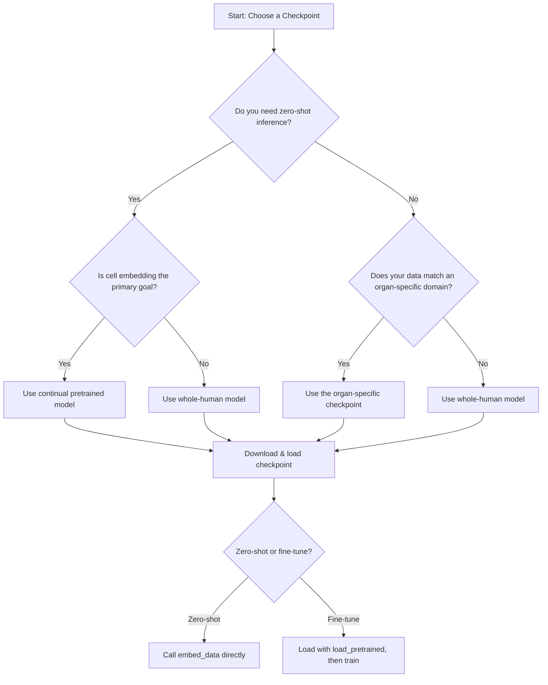
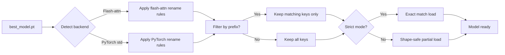
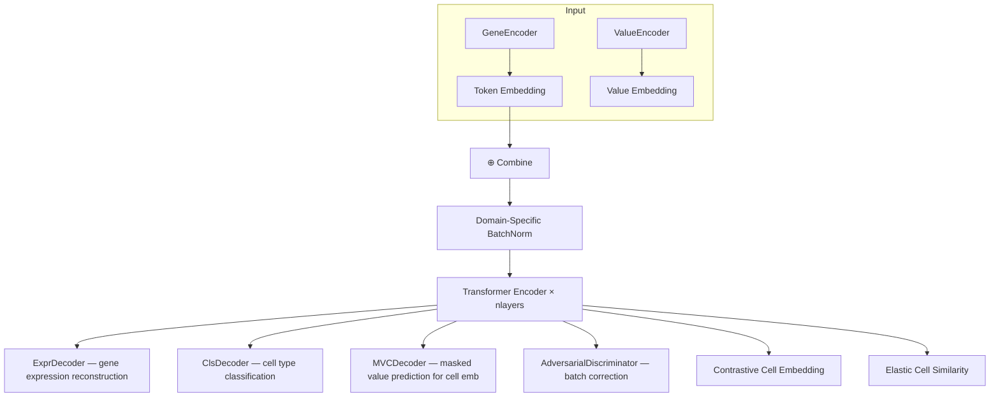

scGPT provides a collection of pretrained checkpoints that serve as starting points for a wide range of single-cell analysis tasks. Each checkpoint encodes knowledge learned from millions of cells during self-supervised pretraining, and can be either used directly for **zero-shot** inference or further **fine-tuned** on your downstream dataset. This page catalogues every available checkpoint, explains what each one contains, and walks you through the mechanics of loading and selecting the right model for your work.

## Available Checkpoints

The table below lists all officially released scGPT checkpoints. The **whole-human** model is the general-purpose default—start there unless your downstream data aligns closely with one of the organ-specific or specialised distributions.

| Model | Training Data | Description | Recommended Use | Download |
|:------|:-------------|:------------|:----------------|:---------|
| **whole-human** ★ | 33M normal human cells | Pretrained on the largest and most diverse normal human cell corpus | Default for all tasks; fine-tuning & zero-shot | [Google Drive](https://drive.google.com/drive/folders/1oWh_-ZRdhtoGQ2Fw24HP41FgLoomVo-y) |
| **continual pretrained** | whole-human + Tabula Sapiens labels | Further supervised with cell-type labels during a continual pretraining stage | Zero-shot cell embedding, integration, reference mapping | [Google Drive](https://drive.google.com/drive/folders/1_GROJTzXiAV8HB4imruOTk6PEGuNOcgB) |
| **brain** | 13.2M brain cells | Organ-specific pretraining | Brain-focused datasets | [Google Drive](https://drive.google.com/drive/folders/1vf1ijfQSk7rGdDGpBntR5bi5g6gNt-Gx) |
| **blood** | 10.3M blood & bone marrow cells | Organ-specific pretraining | Hematopoietic / immune datasets | [Google Drive](https://drive.google.com/drive/folders/1kkug5C7NjvXIwQGGaGoqXTk_Lb_pDrBU) |
| **heart** | 1.8M heart cells | Organ-specific pretraining | Cardiac datasets | [Google Drive](https://drive.google.com/drive/folders/1GcgXrd7apn6y4Ze_iSCncskX3UsWPY2r) |
| **lung** | 2.1M lung cells | Organ-specific pretraining | Pulmonary datasets | [Google Drive](https://drive.google.com/drive/folders/16A1DJ30PT6bodt4bWLa4hpS7gbWZQFBG) |
| **kidney** | 814K kidney cells | Organ-specific pretraining | Renal datasets | [Google Drive](https://drive.google.com/drive/folders/1S-1AR65DF120kNFpEbWCvRHPhpkGK3kK) |
| **pan-cancer** | 5.7M cancer cells (various types) | Pretrained on diverse cancer cell populations | Tumour / cancer-focused datasets | [Google Drive](https://drive.google.com/drive/folders/13QzLHilYUd0v3HTwa_9n4G4yEF-hdkqa) |

> [!TIP]
> When your fine-tuning dataset shares similar cell-type context with an organ-specific model's training data, that organ-specific checkpoint often converges faster and achieves better performance than the general whole-human model.

Sources: [README.md](/README.md#L56-L72), [tutorials/zero-shot/README.md](/tutorials/zero-shot/README.md#L1-L29)

## Checkpoint Structure

Every downloaded checkpoint folder contains three files that scGPT expects in a fixed layout. Understanding this structure is essential for both loading models correctly and debugging loading failures.

```
scGPT_human/              ← checkpoint folder (name may vary)
├── args.json             ← model architecture hyperparameters
├── best_model.pt         ← model state_dict (PyTorch checkpoint)
└── vocab.json            ← gene token → index mapping (≈60K genes)
```

| File | Format | Purpose |
|:-----|:-------|:--------|
| `args.json` | JSON dict | Stores architecture dimensions (`embsize`, `nheads`, `d_hid`, `nlayers`, `n_layers_cls`) that override any manually-specified model config during loading |
| `best_model.pt` | PyTorch `state_dict` | All learned weights—gene embeddings, transformer layers, decoders |
| `vocab.json` | JSON `{token: index}` | Maps gene symbol strings to integer token IDs; the whole-human vocabulary contains ~60,697 entries |

Sources: [tutorials/Tutorial_Integration.ipynb](/tutorials/Tutorial_Integration.ipynb#L322-L350), [scgpt/tokenizer/gene_tokenizer.py](/scgpt/tokenizer/gene_tokenizer.py#L106-L127)

## How to Choose a Model

The decision flow below helps you pick the right checkpoint for your scenario. The key differentiator is whether you need **zero-shot** embeddings (no training at all) or are willing to **fine-tune** on your target dataset.



### Zero-shot vs. Fine-tuning at a Glance

| Aspect | Zero-shot | Fine-tuning |
|:-------|:----------|:------------|
| Training required | None | 10–30 epochs on your data |
| Speed | Seconds to minutes | Minutes to hours (GPU) |
| When to prefer | Quick exploration; limited compute; large pretraining overlap | Small domain shift; best accuracy needed; novel cell types |
| Recommended model | Continual pretrained (embedding tasks) or whole-human | Organ-specific if available, else whole-human |
| Output | Cell embeddings stored in `adata.obsm["X_scGPT"]` | Full model with task-specific decoders |

Sources: [tutorials/zero-shot/Tutorial_ZeroShot_Integration.ipynb](/tutorials/zero-shot/Tutorial_ZeroShot_Integration.ipynb#L1-L36), [tutorials/zero-shot/README.md](/tutorials/zero-shot/README.md#L11-L18)

## Loading a Pretrained Model

### Step 1 — Download and Extract

Download your chosen checkpoint folder from the Google Drive link in the table above, and place it in a local directory (e.g., `save/scGPT_human/`).

### Step 2 — Load Vocabulary and Architecture Config

The vocabulary and model dimensions are loaded from the checkpoint's own files, ensuring exact compatibility:

```python
from pathlib import Path
from scgpt.tokenizer.gene_tokenizer import GeneVocab
import json

model_dir = Path("save/scGPT_human")
vocab_file = model_dir / "vocab.json"
model_config_file = model_dir / "args.json"
model_file = model_dir / "best_model.pt"

# Load vocabulary
vocab = GeneVocab.from_file(vocab_file)
# Ensure special tokens are present
special_tokens = ["<pad>", "<cls>", "<eoc>"]
for s in special_tokens:
    if s not in vocab:
        vocab.append_token(s)

# Load architecture config (overrides manual hyperparameters)
with open(model_config_file, "r") as f:
    model_configs = json.load(f)
```

Sources: [tutorials/Tutorial_Integration.ipynb](/tutorials/Tutorial_Integration.ipynb#L322-L357), [scgpt/tokenizer/gene_tokenizer.py](/scgpt/tokenizer/gene_tokenizer.py#L106-L127)

### Step 3 — Instantiate the Model and Load Weights

Create a `TransformerModel` with the architecture parameters from `args.json`, then call `load_pretrained` to inject the saved weights. The `load_pretrained` utility automatically handles **parameter renaming** between flash-attention and standard PyTorch backends, so you can load the same checkpoint on CPU, GPU, or flash-attention hardware:

```python
import torch
from scgpt.model import TransformerModel
from scgpt.utils import load_pretrained

ntokens = len(vocab)
model = TransformerModel(
    ntokens,
    model_configs["embsize"],       # embedding dimension
    model_configs["nheads"],        # number of attention heads
    model_configs["d_hid"],         # feed-forward hidden dimension
    model_configs["nlayers"],       # number of transformer layers
    vocab=vocab,
    dropout=0.2,
    pad_token="<pad>",
    pad_value=0,
    do_mvc=True,                    # enable MVC decoder for integration
    do_dab=True,                    # enable adversarial batch correction
    use_batch_labels=True,
    num_batch_labels=num_batch_types,  # from your dataset
    domain_spec_batchnorm=True,
    n_input_bins=51,
    ecs_threshold=0.8,
    explicit_zero_prob=True,
    use_fast_transformer=True,      # flash-attn if available
    pre_norm=False,
)

# Load pretrained weights (handles flash-attn ↔ PyTorch key remapping)
load_pretrained(model, torch.load(model_file), verbose=False)
model.to(device)
```

Sources: [scgpt/utils/util.py](/scgpt/utils/util.py#L290-L360), [scgpt/model/model.py](/scgpt/model/model.py#L12-L99), [tutorials/Tutorial_Integration.ipynb](/tutorials/Tutorial_Integration.ipynb#L672-L697)

### How `load_pretrained` Works Internally

The `load_pretrained` function performs three critical operations automatically:

1. **Backend-aware key renaming** — When flash-attention is not used, attention weight keys like `self_attn.Wqkv.` are renamed to `self_attn.in_proj_` (the standard PyTorch naming). When flash-attention *is* used, the reverse or version-specific renaming rules are applied. This means the same `best_model.pt` file works on any backend.

2. **Prefix filtering** (optional) — If you pass a `prefix` list, only parameters whose keys start with one of those prefixes are loaded. This is useful for partial transfer (e.g., loading only the encoder).

3. **Shape-safe partial loading** — In non-strict mode (the default), parameters whose shapes do not match the current model are silently skipped. This prevents crashes when the downstream task uses a different number of class labels or batch labels than the pretrained model.



Sources: [scgpt/utils/util.py](/scgpt/utils/util.py#L290-L360), [scgpt/model/flash_attn_compat.py](/scgpt/model/flash_attn_compat.py)

## Zero-shot Embedding

For zero-shot applications, you can skip manual model construction and use the high-level `embed_data` function, which handles preprocessing, tokenization, and batched encoding in a single call:

```python
import scgpt as scg

# Zero-shot embedding — no training required
embed_adata = scg.tasks.embed_data(
    adata,
    model_dir,
    gene_col="gene_name",
    batch_key="sample",
)
# Embeddings are stored in embed_adata.obsm["X_scGPT"]
```

The continual pretrained checkpoint is specifically optimised for zero-shot cell embedding tasks—it inherits the whole-human weights and was further supervised with cell-type labels from Tabula Sapiens, which improves the biological structure of the embedding space.

> [!TIP]
> Zero-shot inference is extremely fast (seconds to minutes) and is a great first step. If the zero-shot results already meet your needs, fine-tuning may be unnecessary.

Sources: [scgpt/tasks/cell_emb.py](/scgpt/tasks/cell_emb.py), [tutorials/zero-shot/Tutorial_ZeroShot_Integration.ipynb](/tutorials/zero-shot/Tutorial_ZeroShot_Integration.ipynb#L100-L200), [tutorials/zero-shot/Tutorial_ZeroShot_Integration_Continual_Pretraining.ipynb](/tutorials/zero-shot/Tutorial_ZeroShot_Integration_Continual_Pretraining.ipynb#L1-L45)

## Vocabulary and Gene Compatibility

Each checkpoint ships with its own `vocab.json` that maps gene symbols to integer token IDs. The whole-human vocabulary covers **60,697 genes**, while organ-specific models may use slightly smaller vocabularies tailored to their tissue. When loading a pretrained model, you **must** use the vocabulary from the same checkpoint folder—mismatched vocabularies will produce incorrect token mappings.

### Cross-checking Genes with Your Dataset

After loading the vocabulary, you should verify how many of your dataset's genes are covered. Genes not found in the vocabulary will be filtered out before fine-tuning:

```python
adata.var["id_in_vocab"] = [
    1 if gene in vocab else -1 for gene in adata.var["gene_name"]
]
gene_ids_in_vocab = np.array(adata.var["id_in_vocab"])
print(f"Match {np.sum(gene_ids_in_vocab >= 0)}/{len(gene_ids_in_vocab)} genes "
      f"in vocabulary of size {len(vocab)}.")
# Keep only genes that exist in the vocabulary
adata = adata[:, adata.var["id_in_vocab"] >= 0]
```

A typical PBMC 10K dataset retains approximately 97% of its genes (~3,256 out of 3,346) against the whole-human vocabulary. If your retention rate is significantly lower, verify that your gene naming convention (e.g., Ensembl IDs vs. gene symbols) matches the vocabulary format.

Sources: [tutorials/Tutorial_Integration.ipynb](/tutorials/Tutorial_Integration.ipynb#L322-L340), [scgpt/tokenizer/default_gene_vocab.json](/scgpt/tokenizer/default_gene_vocab.json#L1-L30)

## Model Architecture at a Glance

All checkpoints share the same `TransformerModel` architecture—the differences lie only in the training data and the learned weights. The architecture is configured by the parameters stored in each checkpoint's `args.json`:

| Parameter | Description | Typical Value (whole-human) |
|:----------|:------------|:---------------------------|
| `embsize` | Gene & value embedding dimension | 128–512 |
| `nheads` | Number of multi-head attention heads | 4–8 |
| `d_hid` | Feed-forward hidden dimension | 128–512 |
| `nlayers` | Number of transformer encoder layers | 4–12 |
| `n_layers_cls` | Number of layers in the classification decoder | 3 |



Sources: [scgpt/model/model.py](/scgpt/model/model.py#L12-L99), [scgpt/model/__init__.py](/scgpt/model/__init__.py#L1-L12)

## Known Limitations

The pretrained models are trained with purely self-supervised objectives (gene expression reconstruction), which means they may **not fully mitigate type II technical batch effects**—distribution shifts driven by sequencing procedures rather than biology. If your downstream task is highly sensitive to batch correction, consider enabling the DAB (Domain Adversarial Batch correction) and DSBN (Domain-Specific Batch Normalisation) objectives during fine-tuning, or evaluate whether the continual pretrained model's supervised cell-type knowledge offers better zero-shot separation.

Sources: [tutorials/zero-shot/README.md](/tutorials/zero-shot/README.md#L22-L29)

## Next Steps

Now that you understand the model zoo and how to load checkpoints, you are ready to apply scGPT to your own data:

- **[Quick Start](2-quick-start)** — End-to-end walkthrough from installation to your first embedding
- **[Overview](1-overview)** — Broader context on scGPT's architecture and design philosophy