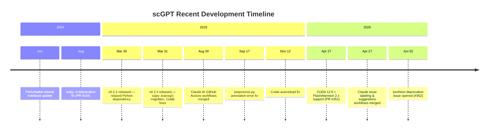

scGPT -- the generative pretrained transformer for single-cell multi-omics from Bo Wang Lab at the University of Toronto -- has been quietly but steadily evolving. Since its [publication in Nature Methods](https://doi.org/10.1038/s41592-024-02201-0) in February 2024, the project has pushed through dependency quagmires, modernized its GPU stack, and begun embracing AI-assisted development workflows. Here is a structured walkthrough of everything that has changed, what it means for users, and what is still unresolved.

---

## A Timeline of Recent Activity

---

## The Big One: CUDA 12.8 and FlashAttention 2.x Support

The most consequential recent change is [PR #351](https://github.com/bowang-lab/scGPT/commit/cebd6fae655b9c585a4807daa3ac31bb764f06b4), authored by lidanwu and merged on April 27, 2026. This is a structural overhaul of scGPT's attention backend, and it addresses what has been perhaps the single most painful installation problem since the project's inception.

### The Problem It Solves

For over two years, scGPT pinned `flash-attn<1.0.5`, which required CUDA 11.7. This was a constant source of frustration -- see the sprawling [Issue #10](https://github.com/bowang-lab/scGPT/issues/10) on the repo, the cross-filed [flash-attn#1014](https://github.com/Dao-AILab/flash-attention/issues/1014), and the recurring "pip install doesn't work" complaints. The old FlashAttention 1.x API was incompatible with newer CUDA toolkits, and users on modern GPU clusters (A100/H100 with CUDA 12.x) were essentially locked out of the fast attention path.

### What Changed

| Component | Before | After |
|---|---|---|
| FlashAttention | 1.x only (`flash-attn<1.0.5`) | FA2-backed `FlashMHA` with FA1 backward compat |
| CUDA requirement | 11.7 (hard pinned) | 12.8 primary, 11.7 backward compat |
| `GeneVocab` init | Used `torchtext.vocab` | Clean internal handling |
| Build system | Mixed | Switched to `setuptools` |
| Checkpoint loading | Single backend | Auto-detect FA backend, rename ckpt keys |

The PR is careful about **backward compatibility**: older FA1 checkpoints can still be loaded, with a renaming rule that detects mismatched attention backends and adapts on the fly. The mask logic in tests was also aligned, and edge cases in `GeneVocab` initialization were fixed. This is exactly the kind of infra work that is unglamorous but essential -- it unblocks an entire generation of hardware.

---

## Version Bumps: v0.2.2 and v0.2.4

Two PyPI releases landed in quick succession on March 30-31, 2025:

| Version | Date | Key Changes |
|---|---|---|
| [0.2.2](https://pypi.org/project/scgpt/) | Mar 30, 2025 | Relaxed Python dependency constraint |
| [0.2.4](https://pypi.org/project/scgpt/) | Mar 31, 2025 | Replaced `sparse.A` with `.toarray()`, pinned default torch for Colab |

The scipy migration deserves specific attention. The `.A` attribute on sparse matrices was [deprecated in SciPy 1.12](https://docs.scipy.org/doc/scipy-1.12.0/reference/generated/scipy.sparse.csr_matrix.A.html), and its removal broke scGPT's preprocessing pipeline. This was first flagged by community contributor Wei Li in [PR #234](https://github.com/bowang-lab/scGPT/commit/63208ba7243f6eb8b1065d7c906c92941be9b398) back in August 2024, but the fix did not propagate to a PyPI release until March 2025 -- an eight-month gap that left users encountering `AttributeError: 'csr_matrix' object has no attribute 'A'` ([Issue #254](https://github.com/bowang-lab/scGPT/issues/254)).

The Colab-specific fixes -- adding default torch version pins and removing `autoreload` magic -- were small but significant quality-of-life improvements. The [Colab install issue](https://github.com/bowang-lab/scGPT/issues/288) had been open since February 2025 with dependency conflicts around `llvmlite` versions.

---

## AI-Assisted Development: Claude GitHub Actions

In a move that is increasingly common across open-source projects, scGPT has integrated Claude AI into its GitHub workflows. [Two workflows were merged](https://github.com/bowang-lab/scGPT/commit/37da072fad0c1f32991ce45f4586dde3e17fbcc5) on August 30, 2025:

- **auto-issue-labeling.yml**: Automatically categorizes new issues by component, type, and priority
- **auto-issue-suggestions.yml**: Generates context-aware helpful comments on new issues using Claude AI

This was initiated by maintainer Haotian Cui in response to [Issue #325](https://github.com/bowang-lab/scGPT/issues/325), which explicitly requested Claude-powered issue triage. Additionally, a **Claude Code Review** workflow and a **Claude PR Assistant** workflow were added in the same batch.

The practical impact: new issues now get labeled faster, and users receive an initial AI-generated response that can point them to relevant documentation or common solutions. For a project where maintainer response time has been a recurring complaint, this is a pragmatic if imperfect solution.

---

## Ecosystem Expansion: scGPT-spatial

While not part of the main scGPT repository, the Bo Wang Lab released [scGPT-spatial](https://github.com/bowang-lab/scGPT-spatial) in February 2025 as a separate project. It continually pretrains the scGPT backbone on **30 million spatial transcriptomic profiles** (the SpatialHuman30M corpus), introducing:

- A novel **Mixture of Experts (MoE) decoder** for protocol-aware decoding
- **Spatially-aware sampling** and a **neighborhood-based reconstruction objective**
- Support for Visium, Visium HD, Xenium, and MERFISH platforms

The [preprint](https://www.biorxiv.org/content/10.1101/2025.02.05.636714v1) has already accumulated 45 citations per [Semantic Scholar](https://www.semanticscholar.org/paper/scGPT-spatial%3A-Continual-Pretraining-of-Single-Cell-Wang-Cui/8468eae54f0cb47f9e40c0c406a76d27cb1b4ef3), signaling strong community interest in extending the scGPT paradigm to spatial data.

---

## Platform Adoption: CZI Virtual Cells

scGPT was selected as one of the inaugural models on the [Chan Zuckerberg Initiative's Virtual Cells Platform](https://virtualcellmodels.cziscience.com/model/scgpt), with a [dedicated quickstart guide](https://virtualcellmodels.cziscience.com/quickstart/scgpt-quickstart) hosted by CZI. The platform provides a standardized model card, quickstart notebook, and integration with the CZ CELLxGENE Census data. This gives scGPT a visibility and accessibility boost that goes beyond the typical GitHub README.

The model is also available on [Hugging Face](https://huggingface.co/tdc/scGPT) via the Therapeutics Data Commons (TDC) interface, which wraps the weights for programmatic access through the `tdc` library.

---

## What Is Still Unresolved

Despite the recent progress, several structural issues remain open and actively discussed:

### The torchtext Time Bomb

[Issue #352](https://github.com/bowang-lab/scGPT/issues/352), opened June 2, 2026, reports that `torchtext.vocab` no longer exposes the `vocab` attribute -- because **torchtext is officially deprecated**. The PyTorch team [archived the repository](https://github.com/pytorch/text/issues/2250) in September 2025, and version 0.18.0 was the final release. scGPT's `GeneVocab` class depends on `torchtext.vocab.Vocab`, which means every new PyTorch installation will eventually break this import path. This is arguably the most urgent technical debt in the codebase right now.

### Dependency Hell Persists

Even with v0.2.4, installing scGPT remains non-trivial. [Issue #333](https://github.com/bowang-lab/scGPT/issues/333) reports `SparseDataset` import errors with recent `anndata` versions. [Issue #330](https://github.com/bowang-lab/scGPT/issues/330) documents how `pip install scgpt` forces a torch upgrade that breaks CUDA compatibility. These are not edge cases -- they represent a fundamental tension between scGPT's pinned transitive dependencies (scvi-tools, torchtext, flash-attn) and the rapid evolution of the scientific Python ecosystem.

### Perturbation Pipeline Gaps

Multiple open issues ([#165](https://github.com/bowang-lab/scGPT/issues/165), [#298](https://github.com/bowang-lab/scGPT/issues/298), [#338](https://github.com/bowang-lab/scGPT/issues/338)) highlight confusion and potential bugs in the perturbation prediction workflow. Issue #338 specifically asks where the iterative gene selection code described in the paper lives -- and whether the attention mask logic matches the published description. The disconnect between the paper's iterative confidence-based selection and the current implementation has not been publicly addressed.

---

## Summary

| Area | Status | Trajectory |
|---|---|---|
| GPU/CUDA support | **Improved** -- FA2 + CUDA 12.8 merged | Moving toward modern hardware |
| PyPI releases | **Active** -- v0.2.4 released Mar 2025 | Infra modernization, but slow cadence |
| AI-assisted dev | **Adopted** -- Claude Actions live | Faster issue triage, but not a substitute for code reviews |
| Ecosystem | **Growing** -- scGPT-spatial + CZI platform | The model family is expanding |
| torchtext dependency | **Critical debt** -- deprecated upstream | Needs a Vocab migration path, soon |
| Install experience | **Still painful** -- dependency conflicts persist | FA2 helps, but scvi/anndata pins remain a bottleneck |
| Perturbation docs | **Unclear** -- gap between paper and code | Awaiting maintainer response |

The project is clearly in a "paying down technical debt" phase rather than a "shipping new features" phase. The CUDA 12.8 support is the most meaningful improvement, but the torchtext deprecation and persistent dependency conflicts suggest that scGPT still needs a more aggressive modernization of its packaging and dependency strategy to remain accessible to the average computational biologist.