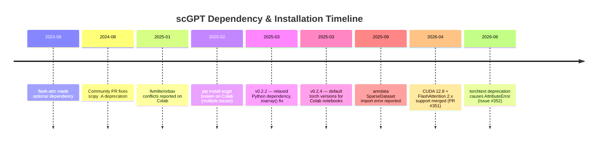
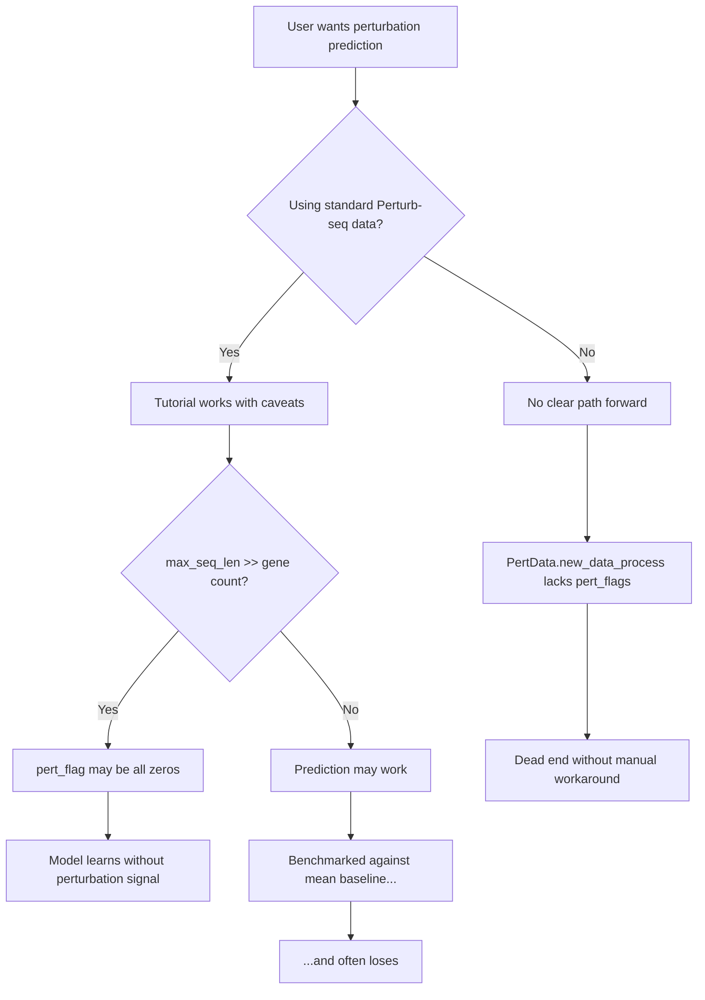

scGPT has garnered significant attention since its publication in *Nature Methods* (2024), and with that attention comes a steady stream of user-reported issues, feature requests, and critical feedback. This page consolidates the most prominent themes from the project's GitHub issues, external benchmarks, and community discussions — giving developers a clear picture of where scGPT shines, where it stumbles, and what the community is asking for next.

---

## The Dependency Installation Gauntlet

If there is a single, defining pain point reported by scGPT users, it is **installation**. The issue tracker is littered with dependency conflict reports, and the root cause is structural: scGPT sits at the intersection of PyTorch, flash-attention, scipy, anndata, scvi-tools, and torchtext — a stack where version compatibility is anything but trivial.

### The `flash-attn` Problem

The original installation instruction (`pip install scgpt "flash-attn<1.0.5"`) pinned flash-attention to versions that only support CUDA 11.7. This caused cascading failures on modern GPU environments. The problem was severe enough that it spawned its own issue on the [flash-attention repository](https://github.com/Dao-AILab/flash-attention/issues/1014), where multiple users reported that flash-attn 1.0.4 simply cannot build on newer CUDA/toolchain combinations. One commenter concluded:

> "It's better to just install flash attn with `--no-build-isolation` as a Docker command when building the image."

The April 2026 merge of [PR #351](https://github.com/bowang-lab/scGPT/commit/cebd6fae655b9c585a4807daa3ac31bb764f06b4) finally addressed this by adding **CUDA 12.8 and FlashAttention 2.x compatibility** with backward compatibility to CUDA 11.7 with FA1. This is a welcome and long-overdue fix.

### The `llvmlite` and `orbax` Conflicts

Multiple users reported that `pip install scgpt` fails with `ResolutionImpossible` errors caused by `llvmlite<0.39.0 and >=0.38.0` constraints. See [Issue #284](https://github.com/bowang-lab/scGPT/issues/284), [Issue #288](https://github.com/bowang-lab/scGPT/issues/288), and [Issue #289](https://github.com/bowang-lab/scGPT/issues/289). The same pattern repeated on Google Colab, where the default Python environment made it impossible to satisfy the constraint tree. The version bumps to 0.2.2 and 0.2.4 (March–April 2025) relaxed some of these pins, but users on older versions remain stuck.

### The `anndata` / `scvi-tools` Trap

[Issue #333](https://github.com/bowang-lab/scGPT/issues/333) reports `ImportError: cannot import name 'SparseDataset' from 'anndata._core.sparse_dataset'` after a default `pip install scgpt`. This traces back to anndata 0.12.2 and scvi-tools 0.20.3 being incompatible — a known problem in the [scvi-tools issue tracker](https://github.com/scverse/scvi-tools/issues/2953). [Issue #260](https://github.com/bowang-lab/scGPT/issues/260) documents an even deeper rabbit hole where scvi-tools 0.16.4 requires `pytorch-lightning<1.6`, which in turn depends on `torchtext.legacy`, a module removed in newer torchtext — creating an **impossible dependency graph** across scvi-tools, pytorch-lightning, and torchtext.

### The `scipy.sparse.A` Deprecation

A more targeted but recurring issue: `scipy.sparse.csr_matrix.A` was deprecated in scipy 1.12.0. This broke the `preprocess.py` pipeline. It was first reported in [Issue #254](https://github.com/bowang-lab/scGPT/issues/254) and partially fixed by community PR [Issue #234](https://github.com/bowang-lab/scGPT/commit/63208ba7243f6eb8b1065d7c906c92941be9b398), then properly addressed in [commit 534c023](https://github.com/bowang-lab/scGPT/commit/534c023ff027b9fad2a72fe8132045bb61999274) by switching to `.toarray()`.

### The `torchtext` Deprecation

The newest entry in this saga is [Issue #352](https://github.com/bowang-lab/scGPT/issues/352): `AttributeError: module 'torchtext.vocab' has no attribute 'vocab'`. Torchtext was officially deprecated by PyTorch (last version 0.18.0), and its API has been steadily breaking in newer PyTorch releases. scGPT's `GeneVocab` class inherits from `torchtext.vocab.Vocab`, which means the project is **building its core vocabulary abstraction on a deprecated library**. The recent FA2 PR refactored `GeneVocab.__init__`, but the torchtext dependency itself has not been removed. This is a ticking time bomb.

### The Pickle Problem on CPU

[Issue #282](https://github.com/bowang-lab/scGPT/issues/282) reports `AttributeError: Can't pickle local object 'get_batch_cell_embeddings.<locals>.Dataset'` when running the zero-shot reference mapping tutorial on CPU. The root cause is a locally-defined `Dataset` class inside `get_batch_cell_embeddings`, which Python's `multiprocessing` cannot serialize. This is a classic Python gotcha — the fix would be to hoist the class to module scope, but the issue remains open.

The following timeline summarizes the major installation-related milestones:



**Takeaway:** If you are setting up scGPT today, **pin your dependencies aggressively** or use the latest `main` branch (post-PR #351). Do not rely on the PyPI release alone — it lags behind the fixes on `main`. The project would benefit enormously from a lockfile, a `conda-forge` recipe, or a Docker image that captures a known-good environment.

---

## The Perturbation Prediction Question Mark

Perturbation prediction is one of scGPT's most touted capabilities, but also one of its most questioned. The GitHub issues and external benchmarks tell a surprisingly critical story.

### Code vs. Paper Gap

[Issue #338](https://github.com/bowang-lab/scGPT/issues/338) raises a fundamental question: the paper describes an iterative, confidence-based attention masking mechanism where "scGPT selects the top 1/K genes from the unknown set with the highest prediction confidence to be included as known genes in the next iteration." Yet the user could not find **any iterative code in the repository**. They ask:

> "How is the order of prediction specified in the current implementation: is it determined by attention scores, prediction confidence, or something else? Where is the relevant iterative code?"

This issue has been open since October 2025 without a definitive answer from the maintainers. It echoes a broader frustration: the gap between the paper's descriptions and the actual codebase is wider than users expect.

### The `pert_pad_id` Design Question

[Issue #266](https://github.com/bowang-lab/scGPT/issues/266) (closed) points out that in `generation_model.py`, `pert_pad_id` is set to 0 and used as `padding_idx` for `pert_encoder`. Since `pert_flags` only takes values 0 and 1, setting `padding_idx=0` means **the embedding for non-perturbed genes is always zeroed out**. The user asks whether this is deliberate — effectively, only perturbed genes contribute through `pert_encoder`. This is either a clever design or a subtle bug, and the issue was closed without a clear explanation.

### The `max_seq_len` Problem

[Issue #298](https://github.com/bowang-lab/scGPT/issues/298) raises a more alarming concern: when `max_seq_len` is much smaller than the input gene count, `pert_flag` sampling may produce an **all-zero vector**, meaning the model receives no perturbation signal at all — yet it still predicts post-perturbation expression. The user asks:

> "Without providing the model with perturbation flags, what does the model learn?"

This is a legitimate architectural concern. If perturbation flags are frequently dropped due to sequence truncation, the model may be relying on shortcuts that don't generalize.

### External Benchmark: Foundation Models Underperform

The community concerns are not limited to GitHub. A 2025 paper in *BMC Genomics* by Csendes et al., ["Benchmarking foundation cell models for post-perturbation RNA-seq prediction"](https://pubmed.ncbi.nlm.nih.gov/40269681/), found that:

> "Even the simplest baseline model — taking the mean of training examples — outperformed scGPT and scFoundation."

Furthermore, "basic machine learning models that incorporate biologically meaningful features outperformed scGPT by a large margin." The paper also notes that standard Perturb-Seq benchmark datasets exhibit low perturbation-specific variance, making them suboptimal for evaluation.

Similarly, a [Genome Biology paper by Kedzierska et al. (2025)](https://pubmed.ncbi.nlm.nih.gov/40251685/) ("Zero-shot evaluation reveals limitations of single-cell foundation models") evaluated scGPT in zero-shot settings and concluded:

> "Both Geneformer and scGPT exhibit limited reliability in zero-shot settings and often underperform compared to simpler methods."

A [Reddit thread on r/bioinformatics](https://www.reddit.com/r/bioinformatics/comments/1k3cmpd/what_do_you_think_about_foundation_models_and) summarized the sentiment:

> "scGPT is probably better known in the field... [but] I could barely find actual biology papers among the citations."

### Missing Tutorials for Custom Data

[Issue #165](https://github.com/bowang-lab/scGPT/issues/165) asks how to apply perturbation prediction to non-Perturb-seq data (e.g., 10X tissue datasets). The existing tutorial only covers Adamson/Norman datasets, which are specially formatted. [Issue #271](https://github.com/bowang-lab/scGPT/issues/271) (closed) reports that using `PertData.new_data_process()` fails because `pert_flags` is missing from the processed output. These gaps make it extremely difficult for biologists to apply scGPT to their own perturbation data.



---

## Preprocessing & Data Pipeline Concerns

### The Binning Randomization Problem

[Issue #319](https://github.com/bowang-lab/scGPT/issues/319) is perhaps the most technically detailed and concerning open issue. The user discovered that the custom `_digitize` function in the binning preprocessing step introduces **randomization** when bin edges contain repeated values (common with quantile-based binning on sparse data):

```python
rands = np.random.rand(len(x))
digits = rands * (right_digits - left_digits) + left_digits
```

This means the same input value can be assigned to different bins across runs, which in sparse single-cell data can "disproportionately affect the resulting feature vector." The user raises three sharp questions:

1. What is the motivation for randomization instead of deterministic `np.digitize`?
2. Has an ablation study been done with randomization disabled?
3. **How is this handled during inference?** If randomization is applied at inference, predictions are unstable. If disabled, the input distribution differs from training.

The user provides a concrete example where the same raw values produce different bin assignments on different runs — a reproducibility red flag. **This issue has been open since August 2025 with no maintainer response.**

### Vocabulary Coverage Gaps

[Issue #346](https://github.com/bowang-lab/scGPT/issues/346) (closed) highlights that when fine-tuning the scGPT_Human model on data annotated with a recent GENCODE version (GRCh38 v44), **36.54% of genes are missing from the vocabulary** — mostly lncRNAs and novel transcripts with Ensembl IDs. The user asks whether to fine-tune as-is or train from scratch. This is a structural limitation of any fixed-vocabulary model: as gene annotations evolve, the vocabulary becomes stale.

### Missing Mouse Model

[Issue #347](https://github.com/bowang-lab/scGPT/issues/347) requests resources for training a custom mouse model. Despite the model zoo offering organ-specific human checkpoints, **no mouse model exists**, and there are no guidelines for pretraining on non-human data. This is a significant gap for a substantial portion of the single-cell community.

### Dataset Reproducibility

[Issue #262](https://github.com/bowang-lab/scGPT/issues/262) asks whether the cell type classification datasets (Multiple Sclerosis, Myeloid, hPancreas) are raw counts or already normalized — the documentation does not specify. [Issue #299](https://github.com/bowang-lab/scGPT/issues/299) (closed) asks for the pan-cancer dataset used in Supplementary Figure 2, noting that the 5.7 million cells from cellxgene don't match the figure's cancer types. [Issue #302](https://github.com/bowang-lab/scGPT/issues/302) (closed) asks for clarification on which datasets are used in the perturbation tutorial and how to combine multiple perturbation datasets for fine-tuning.

---

## Fine-Tuning & Model Usage Friction

| Issue | Theme | Status |
|-------|-------|--------|
| [#349](https://github.com/bowang-lab/scGPT/issues/349) | How to fine-tune with generative pretraining pipeline on custom data | Open |
| [#346](https://github.com/bowang-lab/scGPT/issues/346) | Fine-tuning with 36% missing genes from vocabulary | Closed |
| [#330](https://github.com/bowang-lab/scGPT/issues/330) | `pip install scgpt` upgrades torch, breaking CUDA compatibility | Open |
| [#282](https://github.com/bowang-lab/scGPT/issues/282) | Pickle error on CPU inference | Open |
| [#268](https://github.com/bowang-lab/scGPT/issues/268) | Vocabulary/tokenization confusion during embedding generation | Closed |

A common thread across these issues is that **the tutorials and documentation cover happy paths but don't address the messy reality of custom datasets**. Users who deviate from the provided notebooks quickly encounter undocumented edge cases — missing `pert_flags`, vocabulary mismatches, tokenization errors, and pickle failures. The maintainers have been responsive to some issues (the scipy fix, the Colab fixes), but many technical questions — especially around the core model architecture — remain unanswered for months.

---

## Community Sentiment: Hype vs. Reality

The external feedback on scGPT reflects a broader tension in the single-cell foundation model space. The model was published in a top-tier journal, cited hundreds of times, and listed on the [CZI Virtual Cells Platform](https://virtualcellmodels.cziscience.com/model/scgpt). Yet independent evaluations consistently find that **simpler methods often match or exceed its performance**.

A 2025 *Nature Biotechnology* piece by Xie et al., ["Overcoming barriers to the wide adoption of single-cell large language models in biomedical research"](https://pubmed.ncbi.nlm.nih.gov/41131148), explicitly identifies the adoption gap: despite impressive benchmark numbers in the original paper, real-world biologists are not integrating these tools into their workflows. The reasons cited include dependency complexity, lack of interpretability, and the fact that task-specific methods (scVI, Harmony, CellTypist) remain easier to use and often perform just as well.

The CZI model card itself acknowledges key limitations:

> "The model's performance may degrade when analyzing cell types, tissues, or species not well represented in the training data."

> "Specific groups or conditions (e.g., rare diseases or minority populations) may be underrepresented in the dataset, impacting generalizability."

---

## Summary: What the Issues Tell Us

| Category | Core Problem | Severity | Progress |
|----------|-------------|----------|----------|
| **Installation** | Cascading dependency conflicts (flash-attn, llvmlite, torchtext, scipy, anndata) | High | Partially addressed (FA2, v0.2.4); torchtext time bomb remains |
| **Perturbation** | Code-paper gap; pert_flag may be zeroed out; outperformed by baselines | High | No substantive response |
| **Preprocessing** | Randomized binning breaks reproducibility | Medium-High | No response |
| **Vocabulary** | Gene annotations evolve; 36%+ genes may be missing; no mouse model | Medium | No mouse model planned |
| **Documentation** | Tutorials only cover happy paths; dataset provenance unclear | Medium | Minor updates |
| **Reproducibility** | External benchmarks show simpler methods often win | Structural | Acknowledged in CZI model card |

The honest assessment is this: **scGPT is a pioneering contribution that demonstrated the feasibility of foundation models for single-cell biology, but its software engineering has not kept pace with its scientific ambition.** The dependency graph is fragile, the perturbation module has unresolved architectural questions, the binning pipeline has a reproducibility flaw, and the documentation assumes you're running the provided notebooks verbatim. The recent CUDA 12.8 / FlashAttention 2.x PR and the automated issue-labeling workflows are positive signals, but the project needs sustained investment in robustness and transparency — not just new features — to earn the trust of working biologists.

If you're considering scGPT for a production pipeline, start with the **latest `main` branch**, pin every dependency, validate against simpler baselines (scVI, Harmony), and be prepared to debug the preprocessing pipeline yourself. The model is a powerful idea; the software is still catching up.