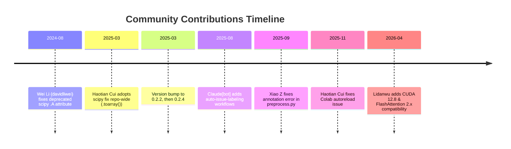

scGPT is not a solo act -- it's the product of a tightly-knit research group at the intersection of machine learning and computational biology, augmented by a growing open-source community. Understanding *who* built this project and *where they come from* tells you a lot about the decisions baked into the codebase: the emphasis on generative pretraining, the FlashAttention dependency headaches, the academic pacing of releases. Let's pull back the curtain.

## The Lab: Bo Wang Group at University of Toronto

The [bowang-lab](https://github.com/bowang-lab) organization on GitHub is home to scGPT and several related projects. The lab is led by **[Bo Wang](https://medbio.utoronto.ca/faculty/wang)**, who holds a remarkable cluster of titles: Assistant Professor in the Department of Medical Biophysics at the University of Toronto, Chief AI Scientist at University Health Network (UHN), Tier 2 Canada Research Chair in Artificial Intelligence for Medicine, and Canada CIFAR AI Chair at the [Vector Institute](https://vectorinstitute.ai). His PhD is from Stanford's Department of Computer Science, and he has held research positions at Illumina and Genentech -- a background that sits squarely at the boundary of deep ML and genomics, which explains scGPT's dual personality as both a rigorous Nature Methods paper and a somewhat fragile pip install.

As [UHN Research noted](https://www.uhnresearch.ca/news/4-24-2024/generative-ai-for-cellular-insights) when the paper was published:

> "To address this, we wanted to develop a foundation model to employ machine learning to decode and predict single-cell behaviours from sequencing data." -- Bo Wang

Bo Wang is also on the advisory board of Vevo Therapeutics. This industry connection is worth noting -- it partially explains the lab's push toward practical tooling (reference mapping apps, cloud deployments on Superbio.ai) alongside the academic publications.

## The Co-First Authors

### Haotian Cui -- The Architect

If scGPT has a single architect, it's **[Haotian Cui](https://subercui.github.io)**. He completed his **Ph.D. in Computer Science** at the University of Toronto (2019-2024) under Bo Wang's supervision, and scGPT was his doctoral centerpiece. On GitHub, he operates under the handle **@subercui**, and the commit history makes it clear: he is by far the most active contributor to the repository.

His [personal website](https://subercui.github.io) describes his focus as:

> "I am a researcher specializing in **machine learning, genomics, and drug discovery**. My work focuses on developing **large-scale self-supervised models** to enable biological insights and therapeutic discoveries."

Looking at the commit log, Haotian has shouldered the unglamorous work that keeps a research repo alive: [bumping versions](https://github.com/bowang-lab/scGPT/commit/dd6bc1ce4b9ce287b4b36f0acd03e7b0b449170f) (0.2.2, then 0.2.4), [fixing scipy deprecations](https://github.com/bowang-lab/scGPT/commit/534c023ff027b9fad2a72fe8132045bb61999274) (`.A` to `.toarray()`), [relaxing Python dependencies](https://github.com/bowang-lab/scGPT/commit/b9b452a134ff70ceacee8f16758b77bb2e3b08bc), [setting up Claude GitHub Actions workflows](https://github.com/bowang-lab/scGPT/commit/5867896291f10b280176931f349ac0eafc075d26), and [fixing Colab compatibility](https://github.com/bowang-lab/scGPT/commit/05a7c94270277ea08fa48b4f815513a191a32ce9). This is the kind of maintenance grind that rarely earns citations but determines whether a project survives contact with real users.

Beyond scGPT, Haotian's publication record is strikingly broad for a PhD student:

| Project | Venue | Description |
|---------|-------|-------------|
| **scGPT** | Nature Methods, 2024 | Foundation model for single-cell multi-omics |
| **scGPT-spatial** | bioRxiv, 2025 | Continual pretraining for spatial transcriptomics |
| **LUMI-lab** | bioRxiv, 2025 | Foundation model-driven autonomous lab for mRNA therapeutics |
| **MethylGPT** | bioRxiv, 2024 | Foundation model for the DNA methylome |
| **DeepVelo** | Genome Biology, 2024 | Deep learning extends RNA velocity |
| **AGILE platform** | Nature Communications, 2024 | Deep learning for LNP development for mRNA delivery |
| **Towards Multimodal Foundation Models** | Nature, 2025 (forthcoming) | Perspective on multimodal foundation models in molecular cell biology |

That last one -- a *Nature* perspective co-authored with researchers from EMBL, ETH Zurich, and UCSF -- signals that Haotian has moved from "building a specific model" to "shaping how the field thinks about foundation models in biology." That's a trajectory worth watching.

### Chloe (Xueqi) Wang -- The Generalist Who Went Spatial

**Chloe Wang** is the other co-first author, a doctoral candidate at TGHRI (Toronto General Hospital Research Institute). In the [UHN Research feature](https://www.uhnresearch.ca/news/4-24-2024/generative-ai-for-cellular-insights), she stated:

> "The release of scGPT models and workflows will be able to accelerate research in cellular biology and beyond, offering a standardized approach for analyzing single-cell omics." -- Chloe Wang

While Haotian drove the core architecture, Chloe has taken the baton on the most significant extension of scGPT: **[scGPT-spatial](https://www.biorxiv.org/content/10.1101/2025.02.05.636714v1)**, a continual pretraining approach that adapts the original scRNA-seq foundation model to spatial transcriptomics. The preprint, co-first-authored by Chloe and Haotian, introduces a 30-million-cell spatial transcriptomics dataset (SpatialHuman30M), a novel Mixture-of-Experts (MoE) decoder, and spatially-aware training objectives. This is not an incremental extension -- it's a fundamental architectural rethink that addresses the spatial blindness of the original scGPT. Bo Wang himself [tweeted](https://x.com/BoWang87/status/1762153505324687461) that Haotian and Chloe are "really the emerging superstars in AI and biology."

## The Core Co-Authors

### Hassaan Maan -- From Single-Cell to Histopathology

**[Hassaan Maan](https://hmaan.ca)** is a fifth-year PhD candidate in the Department of Medical Biophysics at the University of Toronto, co-supervised by Bo Wang, Kieran Campbell, and Michael D. Taylor. He's also a [Vector Institute](https://vectorinstitute.ai) affiliate and a two-time Microsoft Research intern (Immunomics team), where he worked on T-cell receptor repertoire analysis and HLA-interaction modeling.

His personal website describes research spanning "representation learning for single-cell sequencing, spatial transcriptomics, and histopathology data, for tasks such as integration, predictive modeling, and dynamic modeling." Notably, he also developed a COVID-19 genome analysis tool during his internship at the Vector Institute's AI Engineering Team -- a reminder that many of these researchers pivoted between pandemic response and foundation model work during 2020-2022.

Beyond scGPT, Hassaan co-authored **DeepVelo** (Genome Biology, 2024) with Haotian, extending RNA velocity estimation to multi-lineage systems using deep learning.

### Kuan Pang and Fengning Luo

**Kuan Pang** and **Fengning Luo** are both affiliated with the Department of Computer Science at the University of Toronto and the Vector Institute. They appear as co-authors on the original Nature Methods paper but maintain a lower public profile. Based on the paper's acknowledgements and the lab's publication patterns, they contributed to the data curation, model training infrastructure, and benchmarking that underpins the 33-million-cell pretraining run -- the kind of work that is invisible in a commit log but determines whether a paper clears peer review.

### Nan Duan -- The Industry Bridge

**Nan Duan**, listed as a co-author on the Nature Methods paper, is an employee of Microsoft Research. According to the [publication's competing interests statement](https://pubmed.ncbi.nlm.nih.gov/38409223), he "holds equity in the company." His presence on the author list reflects a broader pattern in Bo Wang's lab of maintaining industry collaborations, which also shows up in Haotian's [CodeExp paper at EMNLP 2022](https://subercui.github.io) (co-authored with researchers from Microsoft). The Microsoft connection likely influenced scGPT's use of certain NLP-inspired architectural choices, though the codebase itself has no Microsoft licensing.

## The Community Contributors

Beyond the core lab, scGPT has attracted a handful of external contributors who have quietly improved the project's usability. The commit history tells this story clearly:

### Wei Li -- The Dependency Fixer

**Wei Li** ([@davidliwei](https://github.com/bowang-lab/scGPT/commit/74603ca5d8a2adf2a7420936c73784a1fef01597)) submitted a focused [pull request](https://github.com/bowang-lab/scGPT/commit/63208ba7243f6eb8b1065d7c906c92941be9b398) in August 2024 fixing the deprecated `csr_matrix.A` attribute from newer versions of scipy. As he noted in the commit message:

> "The csr_matrix.A has been depreciated in newer scipy. See https://docs.scipy.org/doc/scipy-1.12.0/reference/generated/scipy.sparse.csr_matrix.A.html"

This was exactly the issue that was flooding the issue tracker -- see [Issue #254: `layer_data.A` in `preprocess.py`](https://github.com/bowang-lab/scGPT/issues/254). The fix sat in a PR for months before Haotian merged it and propagated the change across the entire codebase in [March 2025](https://github.com/bowang-lab/scGPT/commit/534c023ff027b9fad2a72fe8132045bb61999274). That lag between community fix and upstream adoption is a familiar pattern in academic-maintained projects.

### Lidanwu -- The FlashAttention 2.x Upgrader

**Lidanwu** authored the most technically substantial recent community contribution: [PR #351](https://github.com/bowang-lab/scGPT/commit/cebd6fae655b9c585a4807daa3ac31bb764f06b4), which adds **CUDA 12.8 and FlashAttention 2.x compatibility** while maintaining backward compatibility with CUDA 11.7 and FlashAttention 1.x. This is a non-trivial engineering feat. The PR touches FlashMHA internals, vocabulary handling, mask logic, and checkpoint loading -- effectively a modernization pass that the core team hadn't gotten to. The 17-commit PR with messages like "FA2-backed FlashMHA," "fix FA1 test," and "ckpt rename rule for mismatched FA backend" suggests this was a careful, iterative effort, not a weekend hack.

This contribution directly addresses what has been scGPT's most persistent installation pain point. The original dependency pin of `flash-attn<1.0.5` (from [May 2023](https://github.com/bowang-lab/scGPT)) locked users into a CUDA version that was already obsolete by 2024, spawning a trail of installation issues ([#288](https://github.com/bowang-lab/scGPT/issues/288), [#289](https://github.com/bowang-lab/scGPT/issues/289), [#284](https://github.com/bowang-lab/scGPT/issues/284), [#330](https://github.com/bowang-lab/scGPT/issues/330)).

### Xiao Z and learning1112

**Xiao Z** fixed [an annotation error in `preprocess.py`](https://github.com/bowang-lab/scGPT/commit/f35fbecdea002d072e03e9c3bbf01bbb3c0cf3ce) in September 2025, and **learning1112** submitted a separate [preprocess.py update](https://github.com/bowang-lab/scGPT/commit/fc038391970ce7e2c9b189e32bdc098a82306318). These are small, surgical fixes from users who encountered problems in the wild and chose to fix them upstream rather than fork. The pattern of both targeting `preprocess.py` is telling -- that file is the first thing users touch, and it's where version incompatibilities surface earliest.

### Claude[bot] -- The Automated Contributor

A curious entry in the commit log is **claude[bot]**, which authored two commits in [August 2025](https://github.com/bowang-lab/scGPT/commit/88ac3f7bd75c4be347f2ed076eb7cbbc1edab196) adding auto issue labeling and suggestion workflows. These were co-authored by Haotian Cui, who opened [Issue #325](https://github.com/bowang-lab/scGPT/issues/325) requesting Claude-based automation for issue triage. The result: every new issue now gets automatically categorized with component, type, and priority labels. It's a pragmatic move for a repo with 350+ issues and limited maintainer bandwidth, though it remains to be seen whether AI-generated suggestions actually reduce the response time on substantive technical questions.

## The Broader Ecosystem

The contributors above don't operate in a vacuum. scGPT is embedded in a broader ecosystem of related projects from the same lab:

| Project | Relation | Status |
|---------|----------|--------|
| [scGPT-spatial](https://www.biorxiv.org/content/10.1101/2025.02.05.636714v1) | Continual pretraining extension | Preprint, 2025 |
| [LUMI-lab](https://subercui.github.io) | Autonomous lab for mRNA therapeutics | Preprint (under review at Cell), 2025 |
| [MethylGPT](https://subercui.github.io) | Foundation model for DNA methylome | Preprint, 2024 |
| [DeepVelo](https://subercui.github.io) | Deep learning RNA velocity | Published, Genome Biology, 2024 |
| [AGILE platform](https://subercui.github.io) | LNP development for mRNA delivery | Published, Nature Communications, 2024 |
| [CZI Virtual Cells Platform](https://virtualcellmodels.cziscience.com/model/scgpt) | Model card & deployment | Live, hosted by CZI |

The [Chan Zuckerberg Initiative's Virtual Cells Platform](https://virtualcellmodels.cziscience.com/model/scgpt) listing is particularly notable: it means scGPT has been vetted and hosted by one of the largest funders of single-cell biology infrastructure, with a formal model card documenting its 53 million parameters, 512 embedding size, and 12 transformer blocks. The CZI listing also includes explicit documentation of biases, risks, and out-of-scope use cases -- the kind of responsible AI framing that academic repos rarely provide on their own.

## The Maintainer Gap

Here's the honest assessment: scGPT's contributor landscape reveals a structural weakness common to academic open-source projects. **The bus factor is approximately 1.5**. Haotian Cui handles virtually all day-to-day maintenance -- merging PRs, fixing Colab notebooks, bumping versions, setting up CI. Bo Wang provides strategic direction. Everyone else has moved on to next projects (scGPT-spatial, LUMI-lab, MethylGPT).

This explains the chronic latency on issue responses. The [scipy `.A` deprecation](https://github.com/bowang-lab/scGPT/issues/254) was reported in September 2024, fixed by a community PR in August 2024, but not propagated across the codebase until March 2025. The [torchtext deprecation](https://github.com/bowang-lab/scGPT/issues/352) (Issue #352, opened June 2026) still sits open. The [FlashAttention 2.x compatibility](https://github.com/bowang-lab/scGPT/commit/cebd6fae655b9c585a4807daa3ac31bb764f06b4) was a community contribution, not an internal effort.

The scGPT team has built something genuinely important -- one of the first and most cited foundation models for single-cell biology, published in a top venue, adopted by thousands. But the gap between "impactful research artifact" and "well-maintained open-source tool" remains wide. The community contributors (Wei Li, Lidanwu, Xiao Z) are doing the work that keeps scGPT installable on modern hardware. Whether that's sustainable depends on whether the lab invests in dedicated engineering support, or continues to rely on PhD students squeezing maintenance between paper deadlines.

---

*All contributor information sourced from public profiles, GitHub commit history, the [scGPT Nature Methods paper](https://pubmed.ncbi.nlm.nih.gov/38409223), [UHN Research](https://www.uhnresearch.ca/news/4-24-2024/generative-ai-for-cellular-insights), the [bioRxiv preprint](https://www.biorxiv.org/content/10.1101/2023.04.30.538439v2), the [scGPT-spatial preprint](https://www.biorxiv.org/content/10.1101/2025.02.05.636714v1), [CZI Virtual Cells Platform](https://virtualcellmodels.cziscience.com/model/scgpt), and individual personal websites.*