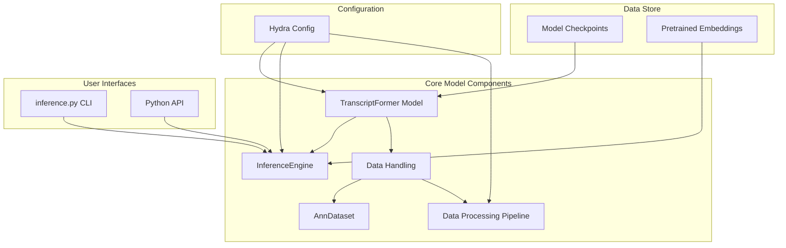
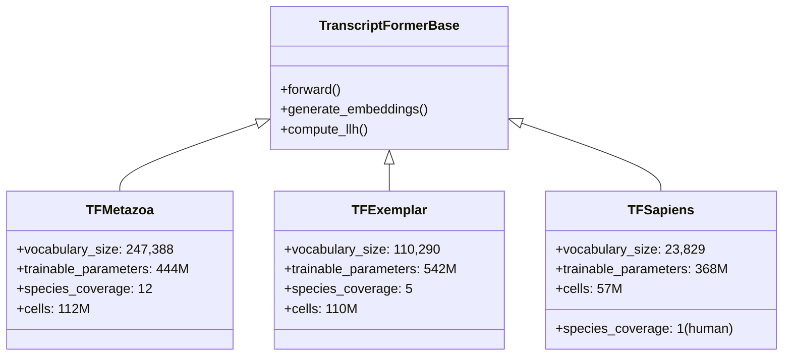
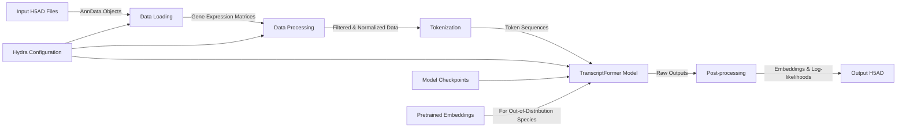
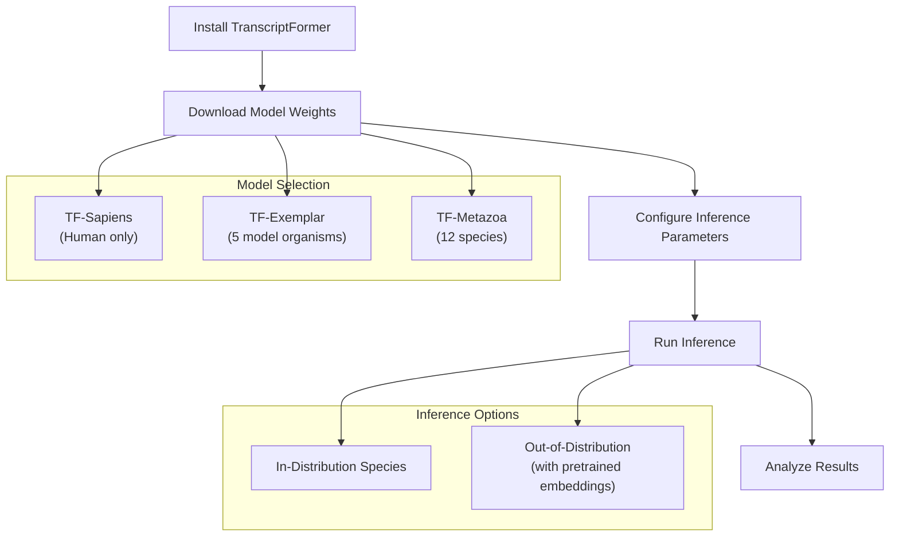

# Overview

Relevant source files

The following files were used as context for generating this wiki page:

- [README.md](README.md)
- [assets/model_overview.png](assets/model_overview.png)
- [pyproject.toml](pyproject.toml)

This document provides an introduction to the TranscriptFormer repository, a system that implements a family of generative foundation models for single-cell transcriptomics. TranscriptFormer uses transformer-based architectures to create rich representations of gene expression data across multiple species.

For detailed information about specific model variants, see [Model Variants](#1.1). For installation instructions, see [Getting Started](#2).

## Introduction to TranscriptFormer

TranscriptFormer is a collection of generative foundation models representing a cross-species generative cell atlas trained on up to 112 million cells spanning 1.53 billion years of evolution across 12 species. The models learn contextual gene expression patterns and can be used for tasks such as cell type classification, disease state identification, and inference of gene-gene regulatory relationships.

The core functionality includes:
- Generation of cell embeddings from gene expression data
- Cross-species analysis capability
- Zero-shot performance for cell type classification
- Generative modeling of gene expression

Sources: [README.md:16-31]()

## System Architecture Overview

TranscriptFormer is built around a modular architecture that supports both research and production use cases.

The system consists of several key components:
- **TranscriptFormer Model**: The core transformer-based architecture
- **Inference Engine**: Handles the processing of data through the model
- **Data Handling**: Manages loading and preprocessing of gene expression data
- **Configuration**: Uses Hydra for flexible parameter management
- **User Interfaces**: Command-line and programmatic interfaces

Sources: [README.md:86-102](), [README.md:113-151]()

## Model Variants

TranscriptFormer comes in three variants, each trained on different datasets:

1. **TF-Metazoa**: The most comprehensive model, trained on 112 million cells across 12 species including vertebrates, invertebrates, a fungus, and a protist.

2. **TF-Exemplar**: Focused on five model organisms (human, mouse, zebrafish, fruit fly, and C. elegans), trained on 110 million cells.

3. **TF-Sapiens**: Human-specific model trained on 57 million human cells.

Sources: [README.md:18-28]()

## Data Flow Pipeline

The following diagram illustrates how data flows through the TranscriptFormer system:

The pipeline consists of:
1. **Data Loading**: Reads H5AD files containing gene expression data
2. **Data Processing**: Filters and normalizes gene expression values
3. **Tokenization**: Converts gene IDs and expression values to token sequences
4. **Model Inference**: Processes tokens through the transformer architecture
5. **Post-processing**: Generates embeddings and log-likelihood scores
6. **Output Generation**: Saves results in H5AD format

Sources: [README.md:113-200]()

## Input and Output Format

### Input Requirements
TranscriptFormer expects input data in H5AD format (AnnData objects) with specific requirements:

| Requirement | Description |
|-------------|-------------|
| Gene IDs | The `var` dataframe must contain an `ensembl_id` column with Ensembl gene identifiers |
| Expression Data | Raw count data stored in the `adata.X` matrix (non-normalized) |
| Cell Metadata | Any cell metadata in the `obs` dataframe will be preserved in the output |

### Output Format
The inference results are saved as an H5AD file with:
- Cell embeddings stored in `obsm['embeddings']`
- Original cell metadata preserved in the `obs` dataframe
- Log-likelihood scores stored in `uns['llh']`

Sources: [README.md:170-198]()

## Usage Workflow

A typical workflow for using TranscriptFormer involves:

1. **Installation**: Install the TranscriptFormer package
2. **Download Models**: Obtain pre-trained model weights
3. **Configure**: Set up inference parameters using Hydra
4. **Run Inference**: Process gene expression data through the model
5. **Analysis**: Use the generated embeddings for downstream tasks

Sources: [README.md:36-83](), [README.md:113-151]()

## Key Dependencies

TranscriptFormer relies on several key dependencies:

- **PyTorch**: Deep learning framework (version 2.5.x)
- **PyTorch Lightning**: High-level training interface
- **AnnData**: For handling single-cell data
- **Scanpy**: For single-cell analysis
- **Hydra**: For configuration management
- **NumPy/Pandas**: For data manipulation
- **H5PY**: For handling HDF5 files

Sources: [pyproject.toml:18-34](), [README.md:66-78]()

## Hardware Requirements

- GPU (A100 40GB recommended) for efficient inference and embedding extraction
- Alternative: Can use a GPU with less VRAM (16GB) by reducing the inference batch size to 1-4

Sources: [README.md:80-83]()

The TranscriptFormer system represents a powerful tool for analyzing and understanding single-cell transcriptomics data across species, with applications in research and clinical settings.

---