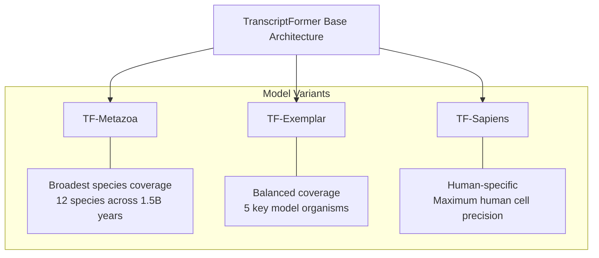
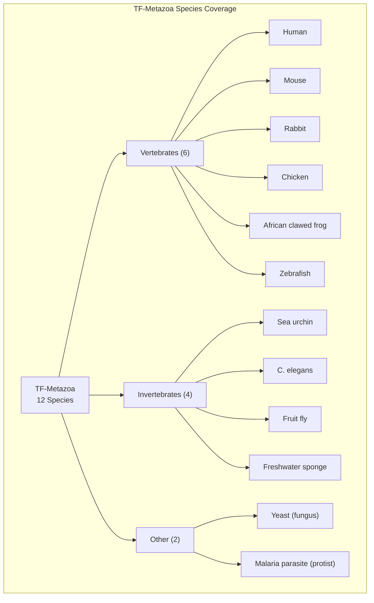
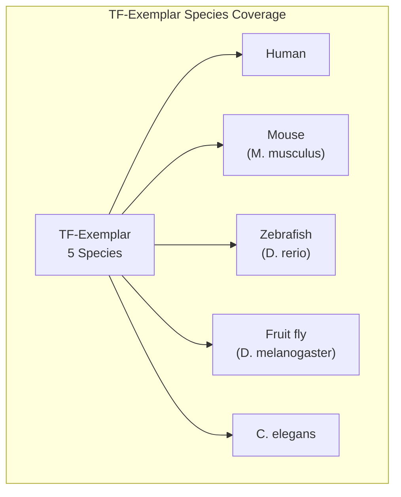
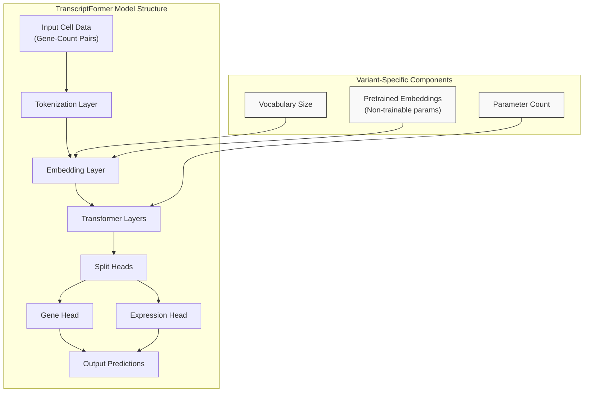
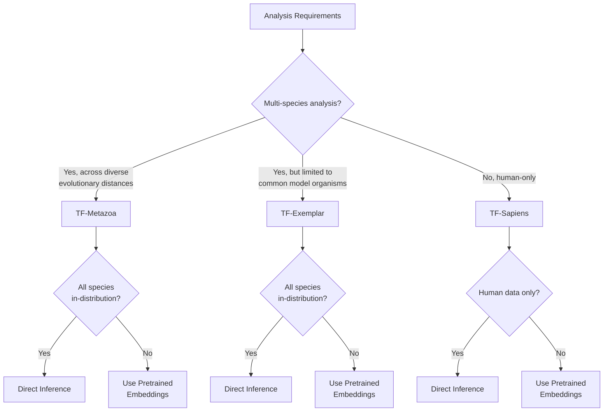

# Model Variants

<details>
<summary>Relevant source files</summary>

The following files were used as context for generating this wiki page:

- [README.md](README.md)
- [assets/model_overview.png](assets/model_overview.png)

</details>


## Purpose and Scope

This document provides detailed information about the three TranscriptFormer model variants: TF-Metazoa, TF-Exemplar, and TF-Sapiens. It covers their architecture, training data, parameters, species coverage, vocabulary sizes, and intended use cases. For general information about the TranscriptFormer system, see [Overview](#1).

## TranscriptFormer Family Overview

TranscriptFormer consists of three specialized model variants built on the same architectural foundation but trained on different datasets with varying species coverage. Each model is designed to serve different research purposes, balancing species breadth, parameter count, and domain specificity.

**TranscriptFormer Model Hierarchy**



Sources: [README.md:17-31]()

## Model Variant Specifications

The following table summarizes the key specifications of each TranscriptFormer model variant:

| Feature | TF-Metazoa | TF-Exemplar | TF-Sapiens |
|---------|------------|-------------|------------|
| **Cells in Training** | 112 million | 110 million | 57 million |
| **Species Coverage** | 12 species | 5 species | Human only |
| **Trainable Parameters** | 444 million | 542 million | 368 million |
| **Non-trainable Parameters** | 633 million | 282 million | 61 million |
| **Vocabulary Size** | 247,388 | 110,290 | 23,829 |
| **Evolutionary Span** | 1.53 billion years | N/A | N/A |
| **Primary Use Case** | Cross-species analysis across diverse evolutionary distances | Analysis across common model organisms | Human-specific analysis |

Sources: [README.md:17-31]()

## Detailed Model Descriptions

### TF-Metazoa

TF-Metazoa is the most comprehensive model in the TranscriptFormer family, designed to cover the broadest evolutionary range.

**Key Features:**
- Trained on 112 million cells spanning twelve species
- Covers 1.53 billion years of evolution
- Includes six vertebrates, four invertebrates, a fungus, and a protist
- 444 million trainable parameters
- 633 million non-trainable parameters (from frozen pretrained embeddings)
- Vocabulary size of 247,388 genes

**Species Coverage:**



**Use Cases:** Best suited for cross-species comparisons and evolutionary studies spanning the widest range of species. Ideal for research questions involving distant evolutionary relationships.

Sources: [README.md:19-22]()

### TF-Exemplar

TF-Exemplar provides focused coverage of human cells and four widely-used model organisms.

**Key Features:**
- Trained on 110 million cells
- Covers five species: human, mouse, zebrafish, fruit fly, and C. elegans
- 542 million trainable parameters
- 282 million non-trainable parameters
- Vocabulary size of 110,290 genes

**Species Coverage:**



**Use Cases:** Optimized for research involving common model organisms. Balances breadth of species coverage with depth of representation for each included species.

Sources: [README.md:24-26]()

### TF-Sapiens

TF-Sapiens is specialized exclusively for human cells.

**Key Features:**
- Trained on 57 million human-only cells
- 368 million trainable parameters
- 61 million non-trainable parameters
- Vocabulary size of 23,829 genes

**Use Cases:** Best suited for human-specific research where maximum precision for human cell analysis is required. Ideal for clinical applications, human disease studies, and situations where cross-species comparison is not needed.

Sources: [README.md:28-29]()

## Model Implementation and Technical Architecture

The TranscriptFormer models share a common architectural foundation while differing in their vocabulary sizes, parameter counts, and training data.

**TranscriptFormer Model Architecture and Components**



### Model Variant Selection and Usage

When selecting a TranscriptFormer model variant, consider:

1. **Species Coverage Requirement:**
   - For multi-species analysis spanning diverse evolutionary distances: TF-Metazoa
   - For analysis focused on common model organisms: TF-Exemplar
   - For human-only analysis: TF-Sapiens

2. **Computational Resources:**
   - TF-Metazoa requires the most memory for vocabulary handling
   - TF-Exemplar has the highest parameter count
   - TF-Sapiens is the most efficient for human-only data

3. **In-Distribution vs. Out-of-Distribution Inference:**
   - For in-distribution species (species the model was trained on), direct inference is possible
   - For out-of-distribution species, pretrained embeddings must be supplied

**Model Variant Selection Flow**



## Using Model Variants for Inference

The checkpoint paths for each model variant are standardized as follows:

- TF-Metazoa: `./checkpoints/tf_metazoa/`
- TF-Exemplar: `./checkpoints/tf_exemplar/`
- TF-Sapiens: `./checkpoints/tf_sapiens/`

These paths are used in the inference configuration to specify which model variant to use. For more details on running inference, see [Running Inference](#3).

**Example inference command for TF-Sapiens:**

```bash
python inference.py --config-name=inference_config.yaml model.checkpoint_path=./checkpoints/tf_sapiens
```

For out-of-distribution species inference, you must provide the appropriate pretrained embeddings:

```bash
python inference.py --config-name=inference_config.yaml \
  model.checkpoint_path=./checkpoints/tf_sapiens \
  model.inference_config.data_files.0=test/data/mouse_val.h5ad \
  model.inference_config.pretrained_embedding=./checkpoints/all_embeddings/mus_musculus_gene.h5
```

Sources: [README.md:114-170]()

## Downloading Model Variants

All model variants can be downloaded using the provided `download_artifacts.py` script:

```bash
# Download a specific model
python download_artifacts.py tf-sapiens
python download_artifacts.py tf-exemplar
python download_artifacts.py tf-metazoa

# Download all models and embeddings
python download_artifacts.py all
```

For more details on downloading model weights and artifacts, see [Downloading Model Weights](#2.2).

Sources: [README.md:85-111]()

---