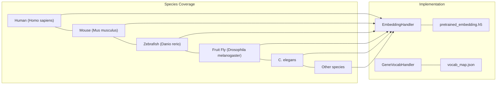
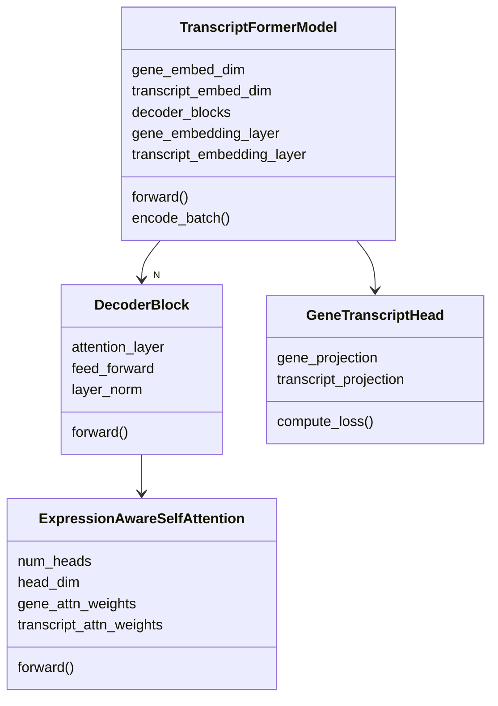
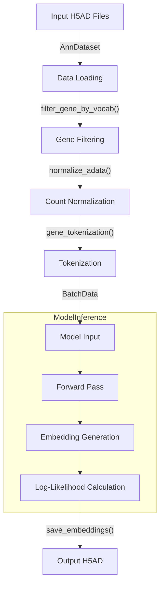
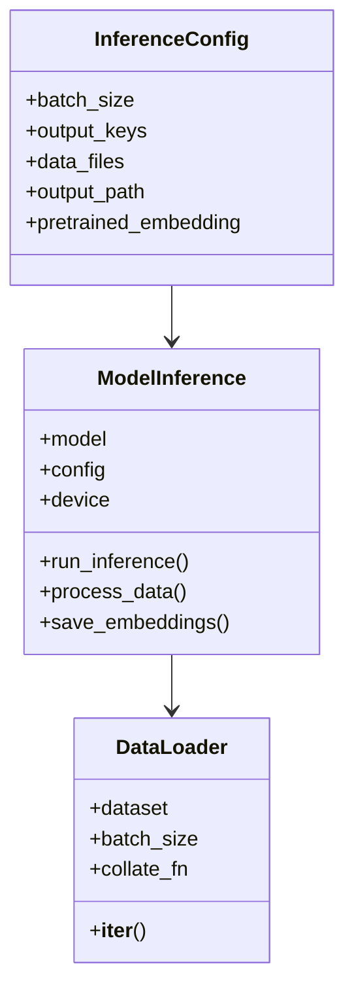

# Key Features

Relevant source files

The following files were used as context for generating this wiki page:

- [README.md](README.md)
- [assets/model_overview.png](assets/model_overview.png)
- [pyproject.toml](pyproject.toml)

This document outlines the core capabilities and distinctive features of the TranscriptFormer models and codebase. For more details about the specific model variants, see [Model Variants](#1.1). For installation and setup information, see [Getting Started](#2).

## Cross-Species Representation Learning

TranscriptFormer's most distinctive capability is its ability to learn and represent single-cell transcriptomes across multiple species within a unified framework:

- **Evolutionary Breadth**: Spans 1.53 billion years of evolution across up to 12 species
- **Transfer Learning**: Enables knowledge transfer between model organisms and humans
- **OOD Support**: Handles out-of-distribution species through pretrained embeddings
- **Cross-Species Integration**: Bridges genomic data across diverse species with variable gene sets

Sources: [README.md:17-32]()

## Architectural Innovations

TranscriptFormer implements several architectural innovations for analyzing single-cell transcriptomics data:

1. **Generative Autoregressive Architecture**: Joint modeling of genes and their expression levels within a generative framework
2. **Novel Attention Mechanism**: Expression-aware multi-head self-attention that accounts for transcript abundance
3. **Gene-Transcript Coupling**: Specialized coupling between gene and transcript representation heads
4. **Count Likelihood Modeling**: Captures transcript-level variability through appropriate count distributions

Sources: [README.md:31-32]()

## Data Processing Pipeline

TranscriptFormer features a sophisticated data processing pipeline designed for efficient handling of single-cell transcriptomics data:

- **H5AD Format Support**: Native integration with the widely-used AnnData format
- **Automated Preprocessing**: Built-in normalization, filtering, and tokenization steps
- **Vocabulary Management**: Handles gene vocabulary mapping across different species
- **Batch Processing**: Efficient batching for GPU acceleration

Sources: [README.md:170-193]()

## Zero-Shot Capabilities

TranscriptFormer demonstrates several zero-shot capabilities without requiring additional fine-tuning:

| Capability | Description |
|------------|-------------|
| Cell Type Classification | Accurate identification of cell types across species based on expression patterns |
| Disease State Detection | Detection of disease states in human cells from expression profiles |
| Transcription Factor Prediction | Identification of cell type-specific transcription factors |
| Regulatory Network Inference | Prediction of gene-gene regulatory relationships |

Sources: [README.md:31-32]()

## Flexible Inference System

The codebase provides a comprehensive and flexible inference system:

- **Configurable Pipeline**: Hydra-based configuration system for customizing inference parameters
- **Multiple Interfaces**: Command-line interface, Python API, and notebook support
- **GPU Acceleration**: Optimized for GPU hardware with configurable batch sizes and precision
- **Out-of-Distribution Support**: Dedicated handling for species not seen during training

Sources: [README.md:113-140]()

## Hardware Optimization

TranscriptFormer is designed with hardware considerations in mind:

- **GPU Memory Management**: Configurable batch sizes to adapt to available GPU memory
- **Mixed Precision**: Support for 16-bit mixed precision to accelerate inference
- **Resource Monitoring**: Built-in monitoring of GPU memory usage
- **Fallback Options**: Can operate with smaller batch sizes on GPUs with less VRAM

Sources: [README.md:80-83](), [README.md:130-131]()

## Implementation Details

TranscriptFormer's implementation includes several practical features that enhance usability:

- **PyTorch/Lightning Integration**: Built on PyTorch and PyTorch Lightning for modern deep learning infrastructure
- **Artifact Management**: Simplified downloading of model weights and pretrained embeddings
- **Output Format Consistency**: Results are stored in compatible H5AD format with embeddings in `obsm['embeddings']`
- **Metadata Preservation**: Original cell metadata is preserved through the analysis pipeline

Sources: [README.md:65-78](), [README.md:85-110](), [README.md:185-191]()

## Summary

TranscriptFormer represents a significant advance in computational genomics, offering a unified framework for analyzing single-cell transcriptomics data across species. Its key innovations include cross-species representation learning, architectural advancements for handling gene expression data, and practical features that enhance usability for both research and applied contexts.

---