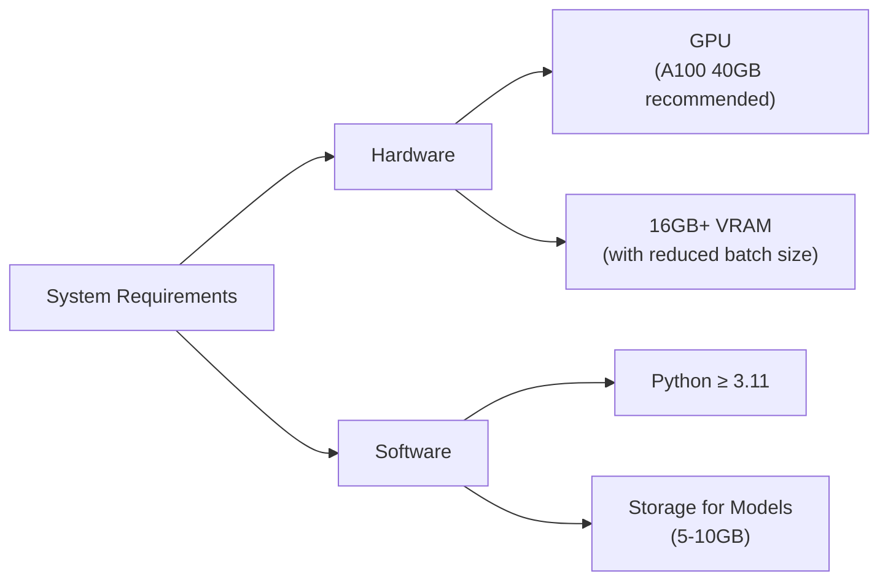
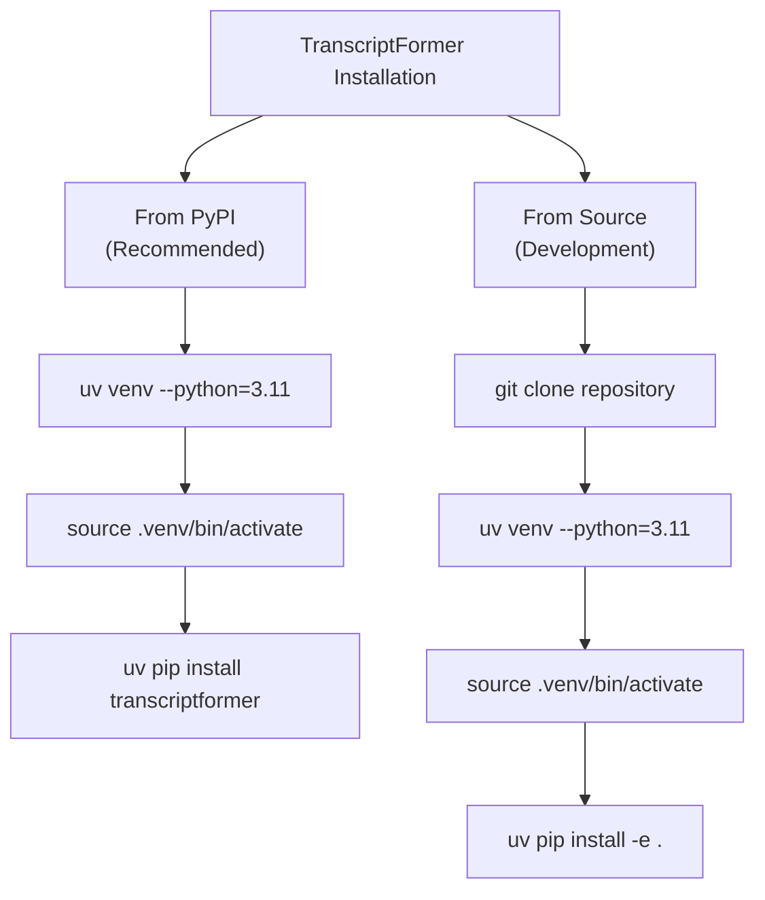
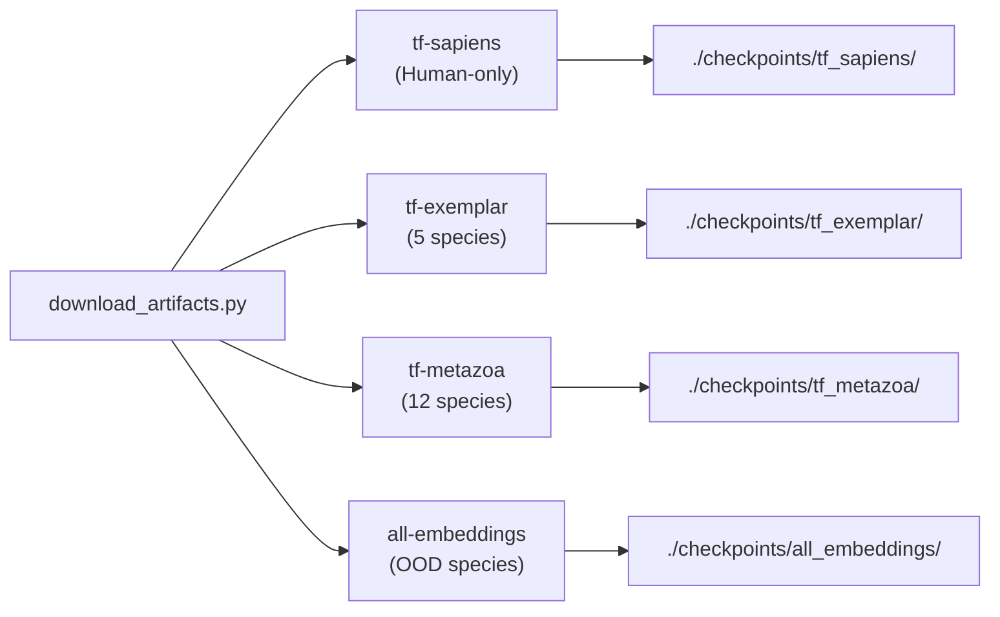
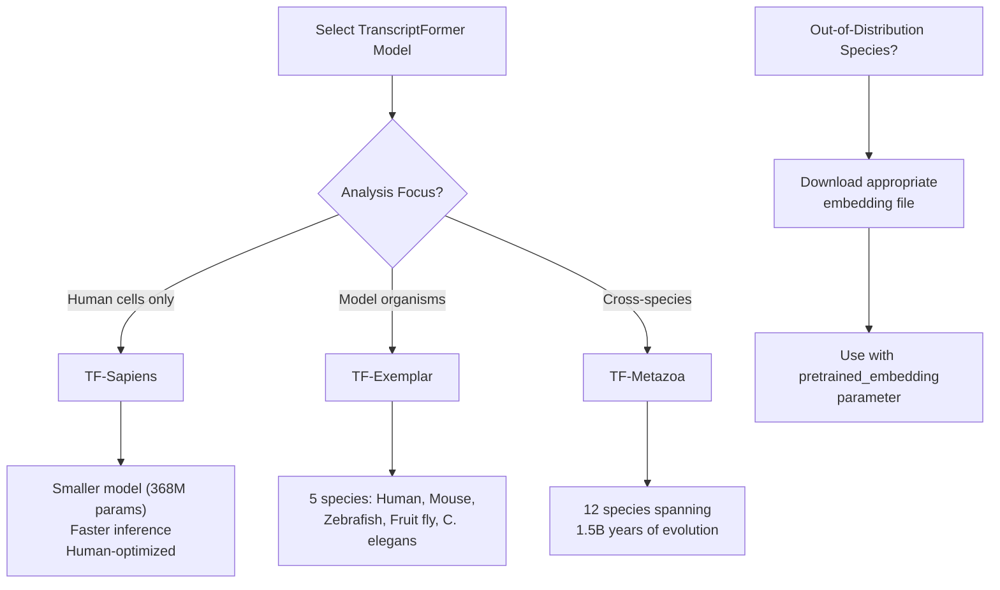

# Getting Started

<details>
<summary>Relevant source files</summary>

The following files were used as context for generating this wiki page:

- [README.md](README.md)
- [assets/model_overview.png](assets/model_overview.png)
- [pyproject.toml](pyproject.toml)

</details>


This guide provides instructions for setting up TranscriptFormer, a family of generative foundation models for single-cell transcriptomics. It covers system requirements, installation steps, and downloading pre-trained model weights. For detailed instructions on running inference after installation, see [Running Inference](#3).

## System Requirements

Before installing TranscriptFormer, ensure your system meets the following requirements:



### Hardware Requirements

- **GPU**: An NVIDIA GPU is strongly recommended for efficient inference
  - A100 40GB is ideal for optimal performance
  - GPUs with less VRAM (16GB minimum) can be used by reducing the batch size to 1-4
- **Storage**: Approximately 5-10GB for model weights and embeddings

### Software Requirements

- **Python**: Version 3.11 or higher (3.12 is also supported)
- **Package manager**: pip or uv (uv recommended for faster installation)

Sources: [README.md:78-83]()

## Installation Methods

TranscriptFormer can be installed either from PyPI (recommended for most users) or from source (for developers).



### Installation from PyPI

The simplest way to install TranscriptFormer is from PyPI:

```bash
# Create and activate a virtual environment with Python 3.11
uv venv --python=3.11
source .venv/bin/activate  # On Windows: .venv\Scripts\activate

# Install from PyPI
uv pip install transcriptformer
```

### Installation from Source

For development or to access the latest features, install from source:

```bash
# Clone the repository
git clone https://github.com/czi-ai/transcriptformer.git
cd transcriptformer

# Create and activate a virtual environment with Python 3.11
uv venv --python=3.11
source .venv/bin/activate  # On Windows: .venv\Scripts\activate

# Install in development mode
uv pip install -e .
```

### Dependencies

When you install TranscriptFormer, the following core dependencies are automatically installed:

| Dependency | Purpose |
|------------|---------|
| PyTorch (<=2.5.1) | Deep learning framework |
| PyTorch Lightning | Training framework |
| anndata | Data handling for annotated matrices |
| scanpy | Single-cell analysis toolkit |
| numpy | Numerical computing |
| pandas | Data manipulation |
| h5py | HDF5 file handling |
| hydra-core | Configuration management |

**Note**: PyTorch 2.6.0+ is not recommended due to potential pickle errors.

Sources: [README.md:36-78](), [pyproject.toml:18-34]()

## Downloading Model Weights

TranscriptFormer provides three model variants with different capabilities and species coverage. Model weights and artifacts are stored in AWS S3 and can be downloaded using the provided `download_artifacts.py` script.



### Model Variants

| Model | Species Coverage | Parameters | Vocabulary Size | Recommended For |
|-------|------------------|------------|----------------|-----------------|
| TF-Sapiens | Human only (57M cells) | 368M trainable | 23,829 | Human-specific analysis |
| TF-Exemplar | 5 species (110M cells) | 542M trainable | 110,290 | Model organism studies |
| TF-Metazoa | 12 species (112M cells) | 444M trainable | 247,388 | Cross-species analysis |

### Downloading Specific Models

To download a specific model, use:

```bash
# Download TF-Sapiens model
python download_artifacts.py tf-sapiens

# Download TF-Exemplar model
python download_artifacts.py tf-exemplar

# Download TF-Metazoa model
python download_artifacts.py tf-metazoa
```

### Downloading Multiple Resources

To download all models and embeddings:

```bash
# Download all models and embeddings
python download_artifacts.py all

# Download only embedding files (for out-of-distribution species)
python download_artifacts.py all-embeddings
```

### Specifying a Custom Directory

By default, model weights are downloaded to the `./checkpoints` directory. To specify a different location:

```bash
python download_artifacts.py tf-sapiens --checkpoint-dir /path/to/custom/dir
```

### Downloaded Files Structure

The script will create the following directory structure:

```
./checkpoints/
├── tf_sapiens/         # TF-Sapiens model weights and vocab files
├── tf_exemplar/        # TF-Exemplar model weights and vocab files 
├── tf_metazoa/         # TF-Metazoa model weights and vocab files
└── all_embeddings/     # Embedding files for out-of-distribution species
```

Sources: [README.md:85-111]()

## Choosing the Right Model



When choosing which TranscriptFormer model to use, consider:

1. **Species of interest**: 
   - For human-only analysis, use TF-Sapiens
   - For analysis across model organisms, use TF-Exemplar
   - For broader cross-species analysis, use TF-Metazoa

2. **Computational resources**:
   - TF-Sapiens requires less memory and is faster
   - TF-Metazoa and TF-Exemplar require more computational resources

3. **Out-of-distribution species**:
   - For species not included in the model's training data, you'll need to download appropriate embedding files

Sources: [README.md:16-31]()

## Next Steps

After completing installation and downloading the required model weights, you're ready to:

1. **Run inference** on your data - See [Running Inference](#3) for detailed instructions
2. **Configure your pipeline** - See [Configuration](#3.1) for customization options
3. **Prepare your data** - See [Input Data Requirements](#3.2) for data format specifications

For specific applications like cell type classification across species, refer to [Example Applications](#5).

Sources: [README.md:113-202]()

---