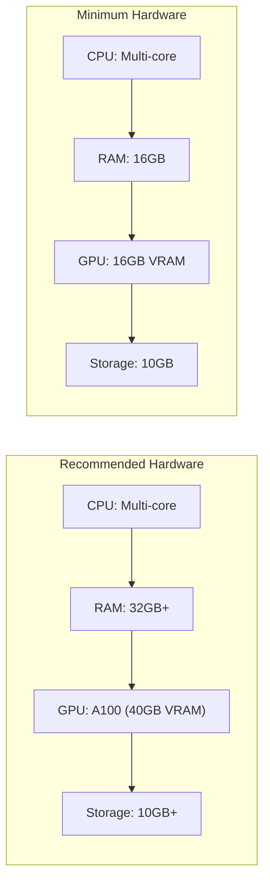
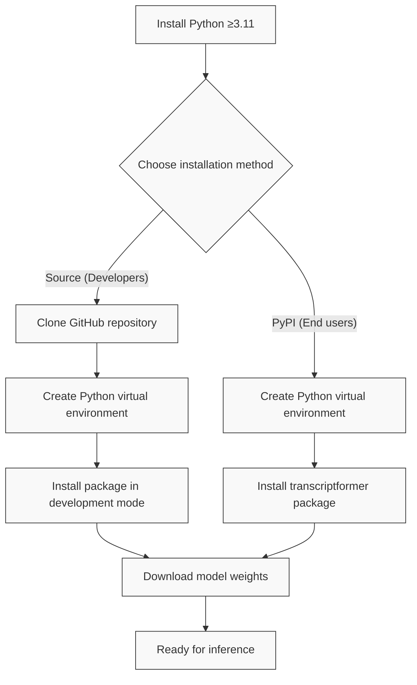
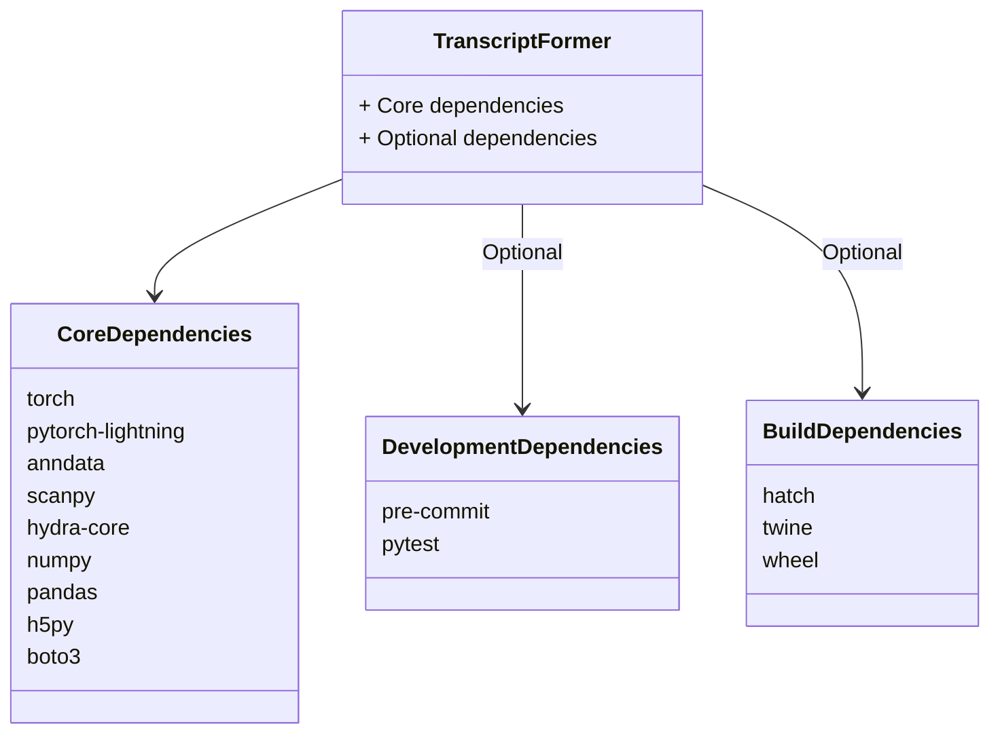

# Installation

<details>
<summary>Relevant source files</summary>

The following files were used as context for generating this wiki page:

- [README.md](README.md)
- [assets/model_overview.png](assets/model_overview.png)
- [pyproject.toml](pyproject.toml)

</details>


This page details the installation methods and requirements for TranscriptFormer, a family of generative foundation models for single-cell transcriptomics. It covers installation from both PyPI and source, along with hardware and software prerequisites. For downloading pre-trained model weights after installation, see [Downloading Model Weights](#2.2).

## System Requirements

### Software Requirements

- **Python**: Version 3.11 or 3.12 (Python 3.11 recommended)
- **Package Manager**: pip or uv (uv recommended for faster installation)
- **Operating Systems**: Compatible with Linux, macOS, and Windows

### Hardware Requirements

- **CPU**: Multi-core processor (for data preprocessing)
- **RAM**: 16GB minimum, 32GB+ recommended for larger datasets
- **GPU**: NVIDIA GPU with CUDA support
  - 16GB VRAM minimum (can run with batch size 1-4)
  - 40GB VRAM recommended (A100 or equivalent) for optimal performance
- **Storage**: At least 10GB for the package, dependencies, and model checkpoints



Sources: [README.md:79-83]()

## Installation Methods

TranscriptFormer can be installed either through PyPI (recommended for end users) or from source (recommended for developers).

### Installation from PyPI

Using `uv` (recommended):

```bash
# Create and activate a virtual environment
uv venv --python=3.11
source .venv/bin/activate  # On Windows: .venv\Scripts\activate

# Install from PyPI
uv pip install transcriptformer
```

Using `pip`:

```bash
# Create a virtual environment
python -m venv .venv
source .venv/bin/activate  # On Windows: .venv\Scripts\activate

# Install from PyPI
pip install transcriptformer
```

### Installation from Source

Using `uv` (recommended):

```bash
# Clone the repository
git clone https://github.com/czi-ai/transcriptformer.git
cd transcriptformer

# Create and activate a virtual environment
uv venv --python=3.11
source .venv/bin/activate  # On Windows: .venv\Scripts\activate

# Install in development mode
uv pip install -e .
```

Using `pip`:

```bash
# Clone the repository
git clone https://github.com/czi-ai/transcriptformer.git
cd transcriptformer

# Create and activate a virtual environment
python -m venv .venv
source .venv/bin/activate  # On Windows: .venv\Scripts\activate

# Install in development mode
pip install -e .
```

Sources: [README.md:36-64]()

## Installation Workflow



Sources: [README.md:36-64]()

## Dependencies

TranscriptFormer has several dependencies that are automatically installed when you install the package. These dependencies are managed in the [pyproject.toml:18-34]() file.

### Core Dependencies

| Dependency | Version | Purpose |
|------------|---------|---------|
| torch | >=2.5,<2.6 | Deep learning framework |
| pytorch-lightning | >=2.3 | High-level interface for PyTorch |
| anndata | >=0.10.5 | Data structure for single-cell data |
| scanpy | >=1.10 | Analysis tools for single-cell data |
| hydra-core | >=1.3 | Configuration management |
| numpy | >=1.26 | Numerical computing |
| pandas | >=2.2 | Data manipulation and analysis |
| h5py | >=3.10 | HDF5 file handling |
| boto3 | >=1.33 | AWS SDK for model artifact downloads |
| cellxgene-census | >=0.1.17 | CELLxGENE Census API client |
| psutil | >=5.9 | System monitoring |
| pynvml | >=11.5 | NVIDIA Management Library |



Sources: [pyproject.toml:18-34](), [README.md:66-78]()

### Optional Dependencies

For development purposes, additional packages can be installed:

```bash
# For development tools (pre-commit hooks, testing)
pip install transcriptformer[dev]

# For building the package
pip install transcriptformer[build]
```

Development dependencies include:
- pre-commit
- pytest

Build dependencies include:
- hatch
- twine
- wheel

Sources: [pyproject.toml:36-45]()

## Verifying Installation

You can verify that TranscriptFormer is correctly installed by running:

```bash
python -c "import transcriptformer; print(transcriptformer.__version__)"
```

This should output the installed version of TranscriptFormer.

## Next Steps

After successfully installing TranscriptFormer, the next step is to download the pre-trained model weights. See [Downloading Model Weights](#2.2) for detailed instructions on downloading model checkpoints.

## Troubleshooting

### Common Issues

1. **PyTorch Version Conflicts**: TranscriptFormer requires PyTorch 2.5.x (not 2.6.0+). If you encounter pickle errors, ensure you have the correct PyTorch version:
   ```bash
   pip install "torch>=2.5,<2.6"
   ```

2. **CUDA Compatibility Issues**: Ensure your NVIDIA drivers support the CUDA version required by PyTorch.

3. **Virtual Environment Problems**: If you encounter path issues with your virtual environment:
   ```bash
   # Recreate the virtual environment
   rm -rf .venv
   python -m venv .venv
   source .venv/bin/activate
   ```

4. **Python Version Errors**: TranscriptFormer requires Python 3.11+. Verify your Python version:
   ```bash
   python --version
   ```

5. **Memory Errors During Inference**: If you encounter CUDA out-of-memory errors, try reducing the batch size:
   ```bash
   python inference.py --config-name=inference_config.yaml model.inference_config.batch_size=1
   ```

Sources: [README.md:66-78](), [README.md:128-131]()

---