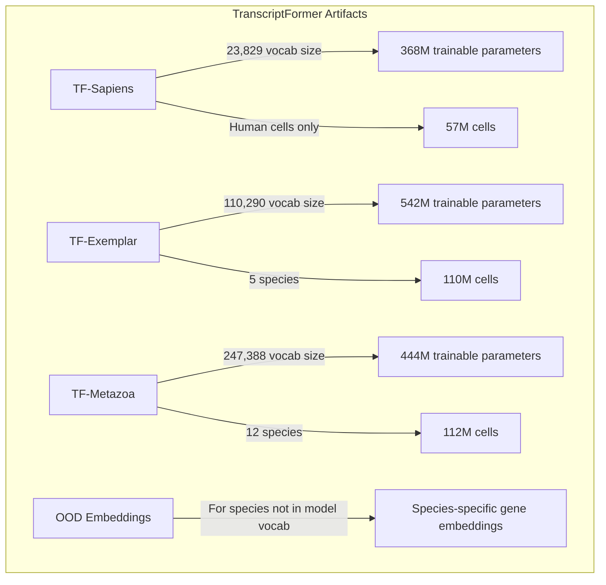
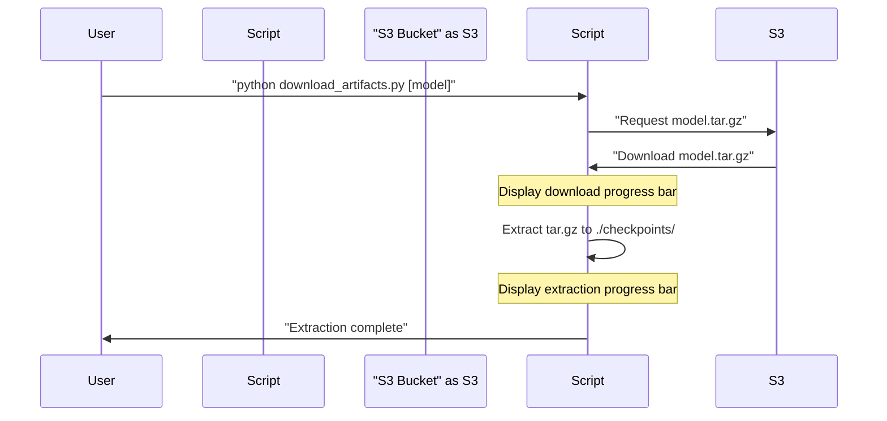
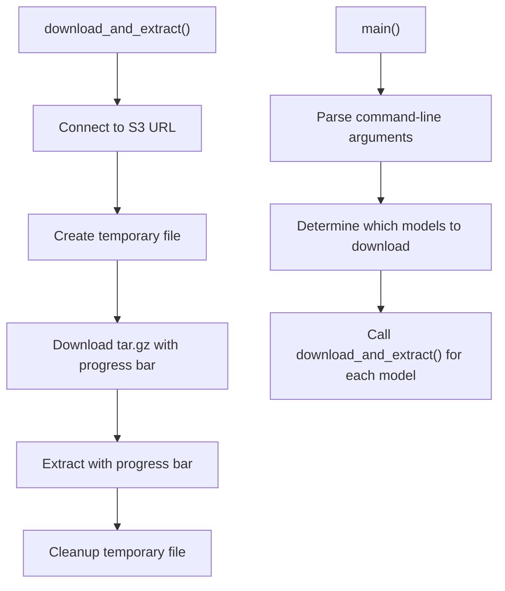

# Downloading Model Weights

<details>
<summary>Relevant source files</summary>

The following files were used as context for generating this wiki page:

- [README.md](README.md)
- [assets/model_overview.png](assets/model_overview.png)
- [download_artifacts.py](download_artifacts.py)

</details>


This document provides technical instructions for downloading pre-trained model weights and embedding files required to run the TranscriptFormer models. For installation instructions, see [Installation](#2.1).

## Available Model Weights and Artifacts

TranscriptFormer provides three pre-trained model variants and a set of embeddings for out-of-distribution species inference:



Sources: [README.md:18-28]()

| Model | Description | Parameters | Vocab Size | Download Size |
|-------|-------------|------------|------------|---------------|
| TF-Sapiens | Human-only model | 368M trainable | 23,829 | ~1.5 GB |
| TF-Exemplar | 5 species model | 542M trainable | 110,290 | ~2.8 GB |
| TF-Metazoa | 12 species model | 444M trainable | 247,388 | ~2.3 GB |
| OOD Embeddings | Out-of-distribution species | N/A | Varies | ~1.0 GB |

Sources: [README.md:18-28]()

## Download Script

TranscriptFormer provides a dedicated Python script (`download_artifacts.py`) that handles:
1. Downloading model weights from a public AWS S3 bucket
2. Extracting the tar.gz archives
3. Organizing files in the correct directory structure



Sources: [download_artifacts.py:1-164]()

## Usage Instructions

The download script supports downloading individual models or all artifacts at once.

### Basic Syntax

```
python download_artifacts.py [model] [--checkpoint-dir DIR]
```

Where:
- `model`: The model to download (required)
- `--checkpoint-dir`: Optional directory to store the downloaded checkpoints (default: `./checkpoints`)

Sources: [download_artifacts.py:10-22](), [README.md:87-103]()

### Model Options

The script accepts the following model options:

| Option | Description |
|--------|-------------|
| `tf-sapiens` | Download the TF-Sapiens model |
| `tf-exemplar` | Download the TF-Exemplar model |
| `tf-metazoa` | Download the TF-Metazoa model |
| `all` | Download all models and embeddings |
| `all-embeddings` | Download only the embedding files |

Sources: [download_artifacts.py:131-135](), [README.md:90-99]()

### Example Commands

Download a specific model:
```bash
python download_artifacts.py tf-sapiens
```

Download all models and embeddings:
```bash
python download_artifacts.py all
```

Download only the embedding files:
```bash
python download_artifacts.py all-embeddings
```

Specify a custom checkpoint directory:
```bash
python download_artifacts.py tf-sapiens --checkpoint-dir /path/to/custom/dir
```

Sources: [README.md:90-102](), [download_artifacts.py:24-35]()

## Download Process Details

The script performs the following operations:

1. Connects to the public S3 bucket at `https://czi-transcriptformer.s3.amazonaws.com/weights/`
2. Downloads the specified model's tar.gz file to a temporary location
3. Displays a progress bar for the download
4. Extracts the tar.gz file to the checkpoint directory
5. Displays a progress bar for the extraction process



Sources: [download_artifacts.py:64-126](), [download_artifacts.py:129-160]()

## Output Directory Structure

After downloading, the model weights and artifacts will be organized in the following directory structure:

```
./checkpoints/                # Or your custom checkpoint directory
├── tf_sapiens/               # TF-Sapiens model
│   ├── config.json           # Model configuration
│   ├── model.ckpt            # PyTorch model checkpoint
│   ├── pytorch_model.bin     # Model weights
│   └── vocab_files/          # Vocabulary files
│       └── ...
├── tf_exemplar/              # TF-Exemplar model
│   └── ...
├── tf_metazoa/               # TF-Metazoa model
│   └── ...
└── all_embeddings/           # Out-of-distribution embeddings
    ├── homo_sapiens_gene.h5  # Human gene embeddings
    ├── mus_musculus_gene.h5  # Mouse gene embeddings
    └── ...                   # Other species embeddings
```

Sources: [README.md:105-110](), [download_artifacts.py:38-41]()

## Using the Downloaded Weights

Once downloaded, you can use the model weights for inference by pointing to the appropriate checkpoint directory:

```bash
python inference.py --config-name=inference_config.yaml model.checkpoint_path=./checkpoints/tf_sapiens
```

For out-of-distribution inference, you'll also need to specify the embedding file:

```bash
python inference.py --config-name=inference_config.yaml \
  model.checkpoint_path=./checkpoints/tf_sapiens \
  model.inference_config.data_files.0=test/data/mouse_val.h5ad \
  model.inference_config.pretrained_embedding=./checkpoints/all_embeddings/mus_musculus_gene.h5
```

For more details on running inference, see [Running Inference](#3).

Sources: [README.md:119-151]()

## Troubleshooting

If you encounter download errors:

1. **Network Issues**: Ensure you have a stable internet connection
2. **Disk Space**: Check that you have sufficient disk space for the model files
3. **Permission Errors**: Ensure you have write permissions for the checkpoint directory
4. **HTTP Errors**: If you see 404 errors, the requested model may not be available or the URL may have changed

If extraction fails:

1. **Corrupt Download**: Delete the partially downloaded file and try again
2. **Disk Space**: Ensure you have enough space for the extracted files (approximately 3x the size of the compressed file)

Sources: [download_artifacts.py:92-125]()

---