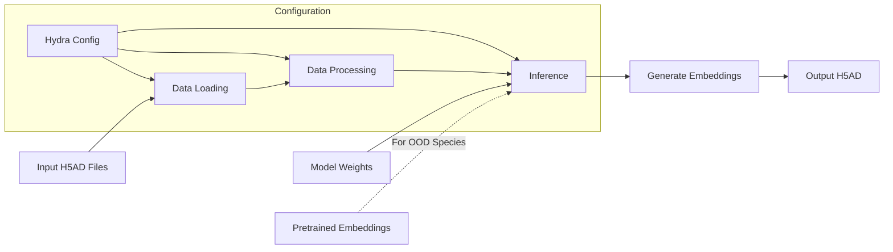
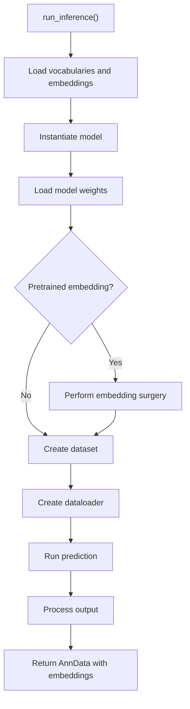
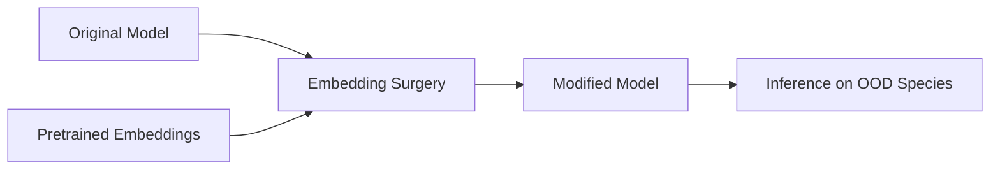
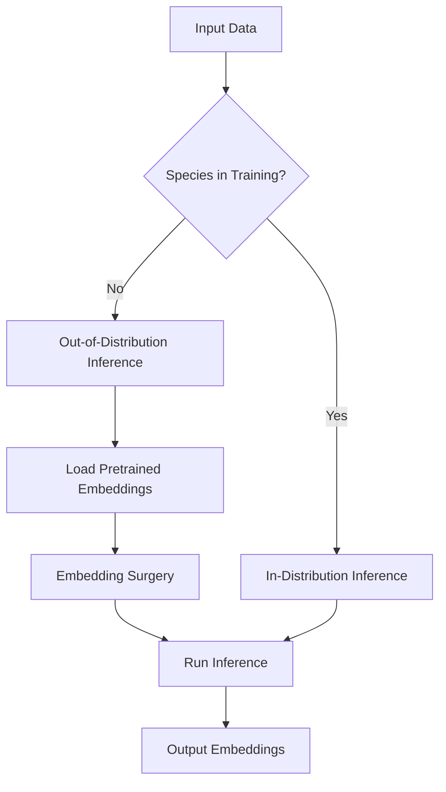
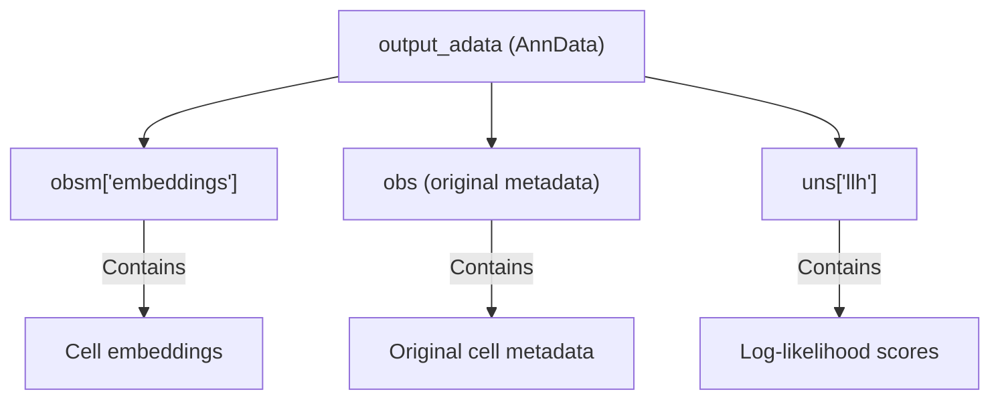

# Running Inference

<details>
<summary>Relevant source files</summary>

The following files were used as context for generating this wiki page:

- [README.md](README.md)
- [assets/model_overview.png](assets/model_overview.png)
- [inference.py](inference.py)
- [src/transcriptformer/model/inference.py](src/transcriptformer/model/inference.py)

</details>


This page provides a comprehensive guide for running inference with TranscriptFormer models. It covers how to use the inference pipeline to generate cell embeddings from single-cell transcriptomics data, configure the inference process, and understand the output format. For information about model variants and their capabilities, see [Model Variants](#1.1).

## Inference Pipeline Overview

The TranscriptFormer inference pipeline allows you to generate embeddings for single-cell transcriptomic data. It supports both in-distribution species (those seen during training) and out-of-distribution species through embedding surgery.



The inference pipeline processes input data in H5AD format, applies necessary preprocessing, runs the data through the model, and outputs embeddings and log-likelihood scores in a new H5AD file.

Sources: [src/transcriptformer/model/inference.py:27-140](), [inference.py:1-66]()

## Command-line Interface

The TranscriptFormer package provides a command-line interface through the `inference.py` script. This script uses Hydra for configuration management, allowing flexible parameter specification.

### Basic Usage

```bash
python inference.py --config-name=inference_config.yaml model.checkpoint_path=./checkpoints/tf_sapiens
```

### Key Parameters

| Parameter | Description | Default |
|-----------|-------------|---------|
| `model.checkpoint_path` | Path to model checkpoint directory | Required |
| `model.inference_config.data_files` | List of input H5AD files | Required |
| `model.inference_config.output_path` | Directory to save output | `./inference_results` |
| `model.inference_config.batch_size` | Batch size for inference | `32` |
| `model.inference_config.precision` | Numerical precision | `16-mixed` |
| `model.inference_config.pretrained_embedding` | Path to pretrained embeddings for OOD species | None |

Sources: [inference.py:5-10](), [README.md:118-131]()

## Running Inference Pipeline

### For In-Distribution Species

When running inference on species that were included in the model's training data (in-distribution), you only need to provide the model checkpoint and input data:

```bash
python inference.py --config-name=inference_config.yaml \
  model.checkpoint_path=./checkpoints/tf_sapiens \
  model.inference_config.data_files.0=test/data/human_val.h5ad \
  model.inference_config.batch_size=8
```

### For Out-of-Distribution Species

For species not included in the training data (out-of-distribution), you need to provide pretrained embeddings:

```bash
python inference.py --config-name=inference_config.yaml \
  model.checkpoint_path=./checkpoints/tf_sapiens \
  model.inference_config.data_files.0=test/data/mouse_val.h5ad \
  model.inference_config.pretrained_embedding=./checkpoints/all_embeddings/mus_musculus_gene.h5
```

Sources: [README.md:134-151](), [inference.py:11-66]()

## Inference Pipeline Internals

The core inference workflow is implemented in `run_inference()` function in the TranscriptFormer package:



Sources: [src/transcriptformer/model/inference.py:27-140]()

### Embedding Surgery for Out-of-Distribution Species

When performing inference on out-of-distribution species (those not seen during training), TranscriptFormer uses a technique called "embedding surgery":



Embedding surgery replaces the standard gene embeddings with pretrained embeddings that are specific to the out-of-distribution species, allowing the model to generalize to new species.

Sources: [src/transcriptformer/model/inference.py:68-75]()

## Input Data Requirements

Input data files should be in H5AD format (AnnData objects) with the following requirements:

| Requirement | Description |
|-------------|-------------|
| Gene IDs | The `var` dataframe must contain an `ensembl_id` column with Ensembl gene identifiers |
| Expression Data | Raw count data should be stored in the `adata.X` matrix |
| Data Format | The model expects raw (non-normalized) counts; log-transformed data may lead to unexpected results |
| Metadata | Cell metadata in the `obs` dataframe will be preserved in the output |

Sources: [README.md:174-182]()

### Data Processing Parameters

The inference pipeline applies several data processing steps that can be configured:

| Parameter | Description | Default |
|-----------|-------------|---------|
| `filter_to_vocab` | Only use genes in the model vocabulary | `true` |
| `filter_outliers` | Remove outlier cells | `true` |
| `gene_col_name` | Column name for gene IDs | `ensembl_id` |
| `normalize_to_scale` | Normalize counts to a specific scale | Varies by model |
| `clip_counts` | Clip count values above a threshold | Varies by model |
| `min_expressed_genes` | Minimum number of expressed genes per cell | Model-dependent |

Sources: [src/transcriptformer/model/inference.py:78-93]()

## In-Distribution vs Out-of-Distribution Inference

TranscriptFormer supports inference on both in-distribution species (those seen during training) and out-of-distribution species (those not seen during training).



The choice between in-distribution and out-of-distribution inference depends on the species in your data:

| Model | In-Distribution Species |
|-------|-------------------------|
| TF-Metazoa | Human, mouse, rabbit, chicken, frog, zebrafish, sea urchin, C. elegans, fruit fly, freshwater sponge, yeast, malaria parasite |
| TF-Exemplar | Human, mouse, zebrafish, fruit fly, C. elegans |
| TF-Sapiens | Human only |

For out-of-distribution inference, you need to download the appropriate pretrained embeddings using the `download_artifacts.py` script:

```bash
python download_artifacts.py all-embeddings
```

Sources: [README.md:134-150](), [README.md:85-103](), [README.md:18-31]()

## Output Format

The inference results are saved as an AnnData object with the following structure:



The output contains:

1. Cell embeddings: Stored in `obsm` with keys specified in `output_keys` config
2. Original cell metadata: Preserved in the `obs` dataframe 
3. Log-likelihood scores: Stored in `uns['llh']` if available

The output AnnData is saved to the specified output directory (default: `./inference_results`) in a file named `embeddings.h5ad`.

Sources: [src/transcriptformer/model/inference.py:122-139](), [README.md:192-198](), [inference.py:59-61]()

## Hardware Requirements

TranscriptFormer inference has the following hardware requirements:

- **GPU**: Recommended for efficient inference
  - A100 40GB recommended for maximum performance
  - Can use GPUs with less VRAM (16GB) by reducing batch size (1-4)
- **Memory**: Requirements depend on the dataset size
- **Storage**: Space for model weights (~1-2GB per model) and output files

The precision setting (`model.inference_config.precision`) can be adjusted to balance memory usage and performance:
- `16-mixed`: Better performance, less memory
- `32`: Higher precision, more memory

Sources: [README.md:80-83](), [src/transcriptformer/model/inference.py:107-114]()

## Common Usage Patterns

### Processing Multiple Files

To run inference on multiple files, specify them as a list:

```bash
python inference.py --config-name=inference_config.yaml \
  model.checkpoint_path=./checkpoints/tf_sapiens \
  model.inference_config.data_files.0=test/data/human_val.h5ad \
  model.inference_config.data_files.1=test/data/mouse_val.h5ad
```

Alternatively, use the list notation:

```bash
python inference.py --config-name=inference_config.yaml \
  model.checkpoint_path=./checkpoints/tf_sapiens \
  "model.inference_config.data_files=[test/data/human_val.h5ad,test/data/mouse_val.h5ad]"
```

### Selecting Output Embeddings

By default, the model outputs cell embeddings. You can specify which embeddings to include in the output using the `output_keys` parameter:

```bash
python inference.py --config-name=inference_config.yaml \
  model.checkpoint_path=./checkpoints/tf_sapiens \
  model.inference_config.data_files.0=test/data/human_val.h5ad \
  "model.inference_config.output_keys=[embeddings,attention_weights]"
```

Sources: [src/transcriptformer/model/inference.py:129-131](), [README.md:153-160]()

## Troubleshooting

Common issues and their solutions:

| Issue | Solution |
|-------|----------|
| Out of memory errors | Reduce batch size (`model.inference_config.batch_size`) |
| Missing gene IDs | Ensure input data has an `ensembl_id` column in `var` |
| Poor performance on out-of-distribution species | Use appropriate pretrained embeddings for the species |
| Slow inference | Use GPU acceleration and mixed precision (`16-mixed`) |

If you encounter persistent issues, check that your input data meets all the requirements and that you're using the correct model for your species.

Sources: [README.md:80-83](), [README.md:174-182]()

---