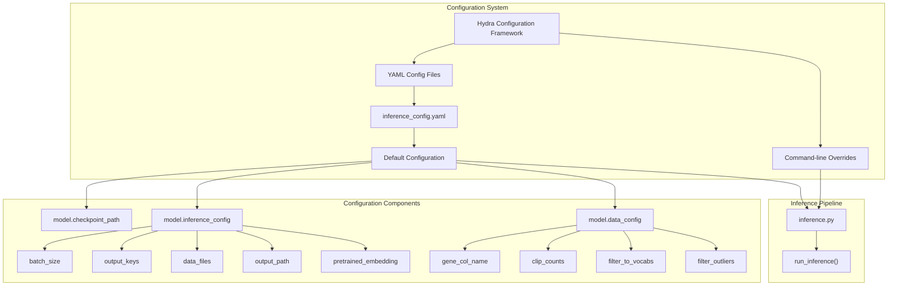
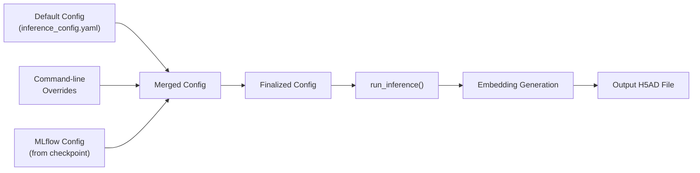
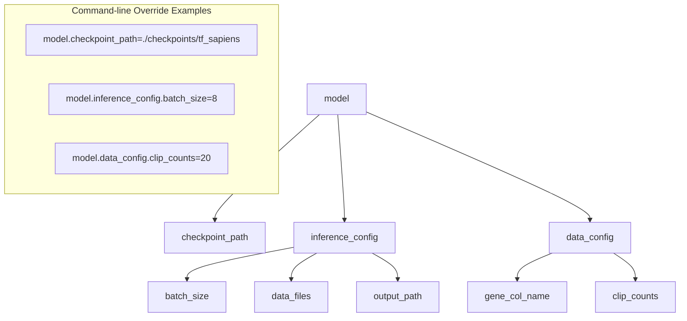
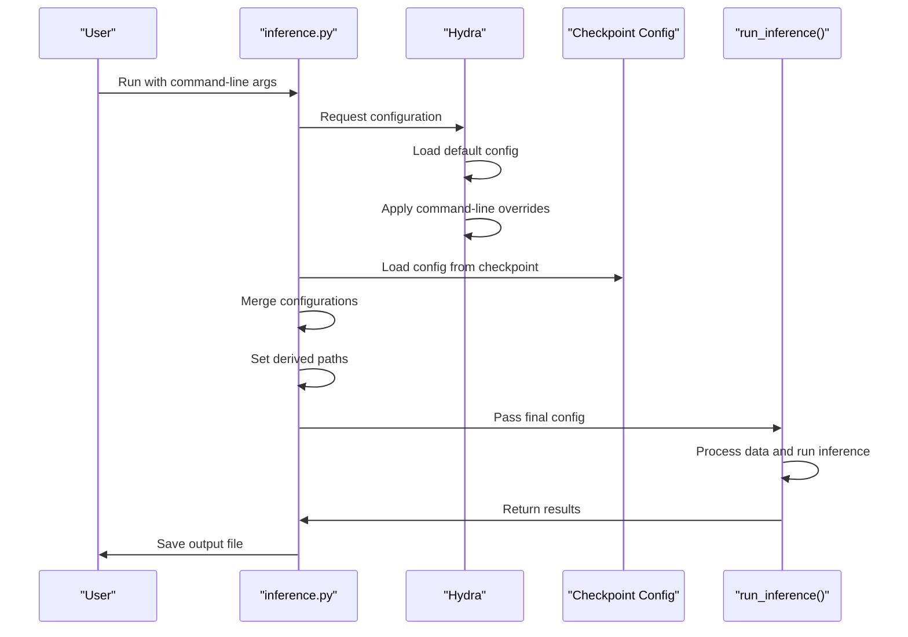
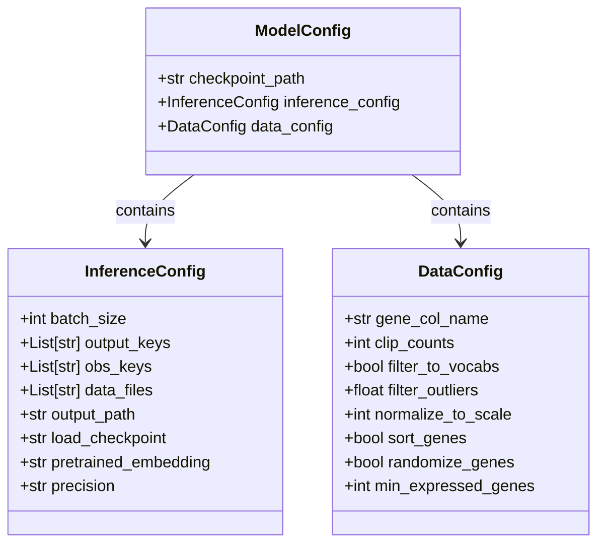

# Configuration

<details>
<summary>Relevant source files</summary>

The following files were used as context for generating this wiki page:

- [README.md](README.md)
- [assets/model_overview.png](assets/model_overview.png)
- [conf/inference_config.yaml](conf/inference_config.yaml)
- [inference.py](inference.py)

</details>


This page explains the configuration system used to customize and control the TranscriptFormer inference pipeline. TranscriptFormer leverages Hydra, a flexible and powerful configuration framework, to manage various settings for model loading, data processing, and inference parameters. For information about running the inference pipeline, see [Running Inference](#3).

## Overview of the Configuration System

TranscriptFormer uses Hydra to manage configurations, allowing for flexible parameter specification through YAML files and command-line overrides. The configuration system enables users to control all aspects of the inference process without modifying code.



**Diagram: Configuration System Architecture**

Sources: [conf/inference_config.yaml](), [inference.py]()

## Configuration Structure

The configuration is hierarchically organized into the following main sections:

### 1. Model Checkpoint Path

The `model.checkpoint_path` specifies the directory containing the model weights and vocabulary files. This is the model variant you wish to use for inference.

### 2. Inference Configuration

The `model.inference_config` section is implemented as `InferenceConfig` class and controls the inference process with the following parameters:

| Parameter | Type | Description |
|-----------|------|-------------|
| `batch_size` | int | Number of samples to process in each batch |
| `output_keys` | list | Keys to include in the output (e.g., embeddings, llh) |
| `obs_keys` | list | Columns from the original obs dataframe to include in output |
| `data_files` | list | Paths to input AnnData files in H5AD format |
| `output_path` | str | Directory where results will be saved |
| `load_checkpoint` | str | Path to model weights (automatically set by inference.py) |
| `pretrained_embedding` | str | Path to pretrained embeddings for out-of-distribution species |
| `precision` | str | Numerical precision for inference (16-mixed, 32, etc.) |

Sources: [conf/inference_config.yaml:7-22]()

### 3. Data Configuration

The `model.data_config` section is implemented as `DataConfig` class and controls data processing with the following parameters:

| Parameter | Type | Description |
|-----------|------|-------------|
| `gene_col_name` | str | Column name in AnnData.var containing gene identifiers |
| `clip_counts` | int | Maximum count value (higher values will be clipped) |
| `filter_to_vocabs` | bool | Whether to filter genes to only those in the vocabulary |
| `filter_outliers` | float | Standard deviation threshold for filtering outlier cells |
| `normalize_to_scale` | int | Scale factor for count normalization (0 = no normalization) |
| `sort_genes` | bool | Whether to sort genes by expression level |
| `randomize_genes` | bool | Whether to randomize gene order |
| `min_expressed_genes` | int | Minimum number of expressed genes required per cell |

Sources: [conf/inference_config.yaml:24-34]()

## Configuration Flow

The inference script loads and merges configurations from multiple sources:



**Diagram: Configuration Flow in Inference Pipeline**

Sources: [inference.py:35-62]()

## Command-line Override Syntax

Hydra allows overriding any configuration value through command-line arguments. The general syntax is:

```
python inference.py --config-name=inference_config.yaml key=value
```

Where `key` is the fully qualified configuration path (e.g., `model.checkpoint_path`), and `value` is the desired value.

The TranscriptFormer configuration uses nested structures, which can be accessed using dot notation:



**Diagram: Configuration Hierarchy and Override Examples**

Sources: [README.md:115-151](), [inference.py:4-9]()

## Common Configuration Examples

### Basic In-distribution Inference

For running inference on human data with the TF-Sapiens model:

```bash
python inference.py --config-name=inference_config.yaml \
  model.checkpoint_path=./checkpoints/tf_sapiens \
  model.inference_config.data_files.0=test/data/human_val.h5ad \
  model.inference_config.batch_size=8
```

Sources: [README.md:135-140]()

### Out-of-distribution Inference

For running inference on mouse data with the TF-Sapiens model (which requires a pretrained embedding):

```bash
python inference.py --config-name=inference_config.yaml \
  model.checkpoint_path=./checkpoints/tf_sapiens \
  model.inference_config.data_files.0=test/data/mouse_val.h5ad \
  model.inference_config.pretrained_embedding=./checkpoints/all_embeddings/mus_musculus_gene.h5 \
  model.inference_config.batch_size=8
```

Sources: [README.md:144-151]()

### Multiple Input Files

You can specify multiple input files using indexed notation:

```bash
python inference.py --config-name=inference_config.yaml \
  model.checkpoint_path=./checkpoints/tf_sapiens \
  model.inference_config.data_files.0=test/data/human_val.h5ad \
  model.inference_config.data_files.1=test/data/mouse_val.h5ad
```

Or using list notation:

```bash
python inference.py --config-name=inference_config.yaml \
  model.checkpoint_path=./checkpoints/tf_sapiens \
  "model.inference_config.data_files=[test/data/human_val.h5ad,test/data/mouse_val.h5ad]"
```

Sources: [README.md:155-168]()

## Default Configuration File

The default configuration is defined in `inference_config.yaml`:

```yaml
defaults:
  - _self_  # Load the current config file

model:
  checkpoint_path: null  # Path to the model checkpoint directory

  inference_config:
    _target_: transcriptformer.data.dataclasses.InferenceConfig
    batch_size: 8  # Number of samples to process in each batch
    output_keys:
      - embeddings  # Include cell embeddings in the output
    obs_keys:
      - all  # Return all columns from the obs dataframe in the output
    data_files:
      - test/data/human_val.h5ad  # Path to input AnnData file(s)
    output_path: ./inference_results  # Directory where results will be saved
    load_checkpoint: null  # Path to model weights file (automatically set by inference.py)
    pretrained_embedding: null  # Path to pretrained embeddings for out-of-distribution species
    precision: 16-mixed  # Numerical precision for inference (16-mixed, 32, etc.)

  data_config:
    _target_: transcriptformer.data.dataclasses.DataConfig
    gene_col_name: 'ensembl_id'  # Column name in AnnData.var containing gene identifiers
    clip_counts: 30  # Maximum count value (higher values will be clipped)
    filter_to_vocabs: true  # Whether to filter genes to only those in the vocabulary
    filter_outliers: 0.0  # Standard deviation threshold for filtering outlier cells (0.0 = no filtering)
    normalize_to_scale: 0  # Scale factor for count normalization (0 = no normalization)
    sort_genes: false  # Whether to sort genes by expression level
    randomize_genes: false  # Whether to randomize gene order
    min_expressed_genes: 0  # Minimum number of expressed genes required per cell
```

Sources: [conf/inference_config.yaml]()

## Configuration Processing in Code

The inference script processes the configuration as follows:

1. Loads default configuration via Hydra
2. Reads configuration from the model checkpoint
3. Merges configurations, with command-line overrides taking precedence
4. Sets derived configuration values (checkpoint paths)
5. Passes the final configuration to the inference function



**Diagram: Configuration Processing Sequence**

Sources: [inference.py:35-62]()

## Configuration Class Relationships

The configuration is organized into dataclasses that define the structure of each configuration section:



**Diagram: Configuration Class Relationships**

Sources: [conf/inference_config.yaml:7-22](), [conf/inference_config.yaml:24-34]()

---