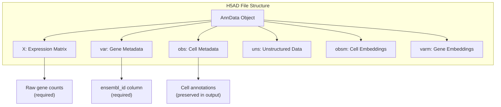
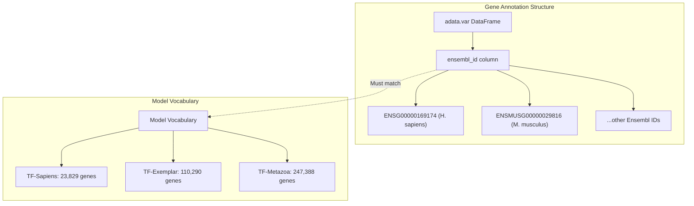
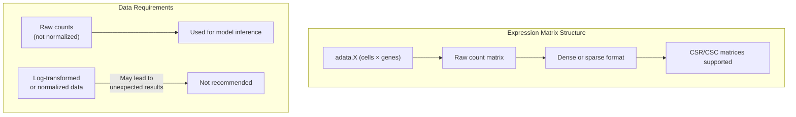
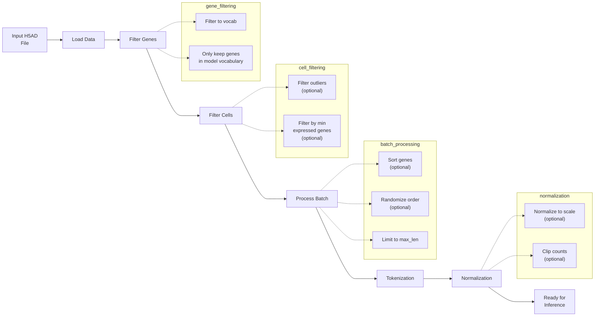
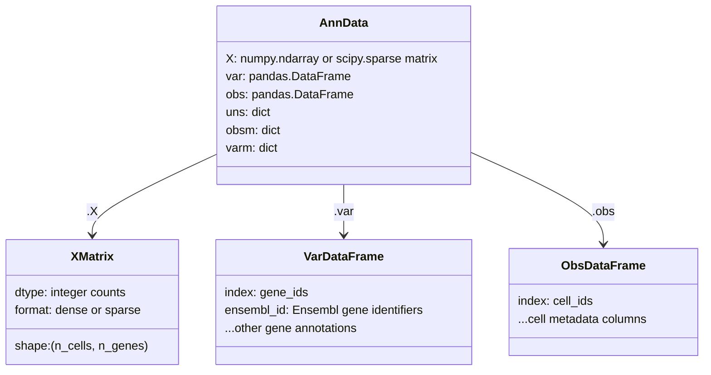

# Input Data Requirements

<details>
<summary>Relevant source files</summary>

The following files were used as context for generating this wiki page:

- [README.md](README.md)
- [assets/model_overview.png](assets/model_overview.png)
- [src/transcriptformer/data/dataloader.py](src/transcriptformer/data/dataloader.py)

</details>


This page documents the required format and structure of input data files used with TranscriptFormer for inference. It covers the expected file format, gene annotation requirements, expression data specifications, and how data is processed during inference. For information about running the inference pipeline itself, see [Running Inference](#3) and [Configuration](#3.1).

## File Format Overview

TranscriptFormer accepts input data in `.h5ad` format, which is the standard file format for [AnnData](https://anndata.readthedocs.io/) objects commonly used in single-cell analysis. AnnData (Annotated Data) provides a convenient format for storing both gene expression matrices and associated metadata.



### Key Requirements:

- Files must be in `.h5ad` format (readable by `scanpy.read_h5ad()`)
- Gene expression matrix stored in `adata.X`
- Gene metadata stored in `adata.var` with gene identifiers

Sources: [README.md:174-176](), [src/transcriptformer/data/dataloader.py:20-27]()

## Gene Annotation Requirements

The `var` dataframe in the AnnData object must include gene identifiers that can be mapped to the model's vocabulary.



### Key Requirements:

- The `adata.var` dataframe must contain an `ensembl_id` column with Ensembl gene identifiers
- The gene identifiers should match the vocabulary of the model being used
- Out-of-vocabulary genes will be automatically filtered out during processing
- Only genes present in the model's vocabulary will be used for inference

Sources: [README.md:174-176](), [src/transcriptformer/data/dataloader.py:30-36](), [src/transcriptformer/data/dataloader.py:40-75]()

## Expression Data Requirements

The expression matrix (`adata.X`) contains the gene expression counts per cell.



### Key Requirements:

- Raw (non-normalized) gene counts should be stored in the `adata.X` matrix
- Both dense and sparse matrix formats (CSR/CSC) are supported
- The model expects raw counts; using log-transformed or normalized data may lead to unexpected results
- Zero counts are handled appropriately during processing

Sources: [README.md:177-181](), [src/transcriptformer/data/dataloader.py:239]()

## Data Processing Pipeline

When data is loaded for inference, it undergoes several processing steps:



### 1. Gene Filtering

- By default, genes are filtered to include only those in the model's vocabulary
- This filtering can be controlled with the `filter_to_vocab` parameter
- If a dataset has no genes matching the vocabulary, a warning will be logged

### 2. Cell Filtering

- Optional filtering of outlier cells based on total expression
- Optional filtering of cells with too few expressed genes
- These filters help remove low-quality cells that might negatively impact results

### 3. Batch Processing

- Genes can be sorted by expression level (optional)
- Gene order can be randomized (optional)
- Number of genes per cell is limited to `max_len` (default: 2000)

### 4. Tokenization

- Gene names are converted to token indices using the model's vocabulary
- This enables the transformer model to process the gene expression data

### 5. Normalization

- Optional normalization of counts to a specific scale
- Optional clipping of count values to a maximum threshold

Sources: [src/transcriptformer/data/dataloader.py:40-75](), [src/transcriptformer/data/dataloader.py:78-163](), [src/transcriptformer/data/dataloader.py:167-207]()

## Configuration Parameters

The following configuration parameters control how input data is processed:

| Parameter | Default | Description |
|-----------|---------|-------------|
| `gene_col_name` | "feature_id" | Column in `adata.var` containing gene identifiers |
| `filter_to_vocab` | `True` | Filter genes to only those in model vocabulary |
| `filter_outliers` | 0.0 | Filter cells outside N standard deviations of mean expression (0=disabled) |
| `min_expressed_genes` | 200 | Minimum number of expressed genes required per cell |
| `normalize_to_scale` | `None` | Scale to normalize counts to (disabled if `None`) |
| `clip_counts` | 1e10 | Maximum value to clip counts to |
| `max_len` | 2000 | Maximum number of genes to use per cell |
| `sort_genes` | `False` | Whether to sort genes by expression level |
| `randomize_order` | `False` | Whether to randomize gene order |
| `pad_zeros` | `True` | Whether to pad zero expressions with pad token |

These parameters can be configured through the Hydra configuration system when running inference. For more details on configuration, see [Configuration](#3.1).

Sources: [src/transcriptformer/data/dataloader.py:167-207]()

## Example Input Data Structure

Below is a visualization of the expected structure of an input AnnData object for TranscriptFormer:



### Example Gene Identifier Format

For human cells: `ENSG00000141510` (TP53)
For mouse cells: `ENSMUSG00000059552` (Trp53)

Different models support different species:
- TF-Sapiens: Human genes only (23,829 vocabulary size)
- TF-Exemplar: 5 species (110,290 vocabulary size)
- TF-Metazoa: 12 species (247,388 vocabulary size)

Sources: [README.md:18-28](), [README.md:174-176]()

## Out-of-Distribution Species

When using a model with data from a species not represented in the model's training data, you must provide a pretrained embedding file. For example, when using TF-Sapiens with mouse data:

```bash
python inference.py --config-name=inference_config.yaml \
  model.checkpoint_path=./checkpoints/tf_sapiens \
  model.inference_config.data_files.0=test/data/mouse_val.h5ad \
  model.inference_config.pretrained_embedding=./checkpoints/all_embeddings/mus_musculus_gene.h5
```

For more details on handling out-of-distribution species, see [In-Distribution vs Out-of-Distribution Inference](#3.3).

Sources: [README.md:142-151]()

## Common Issues and Troubleshooting

| Issue | Possible Cause | Solution |
|-------|---------------|----------|
| "Warning: Filtered all genes" | No genes in the dataset match the model's vocabulary | Check gene identifiers; ensure they are Ensembl IDs matching the model species |
| Empty dataset after filtering | Too many cells filtered out due to strict filtering criteria | Adjust `filter_outliers` or `min_expressed_genes` parameters |
| Unexpected results | Using normalized or log-transformed data instead of raw counts | Use raw count data in `adata.X` |
| Missing gene identifiers | `gene_col_name` parameter doesn't match the column name in your data | Set the correct `gene_col_name` to match your dataset |

Sources: [src/transcriptformer/data/dataloader.py:54-58](), [src/transcriptformer/data/dataloader.py:254-255]()

---