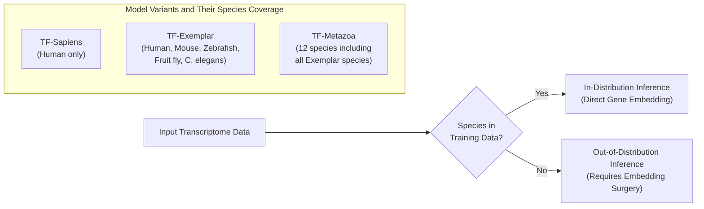
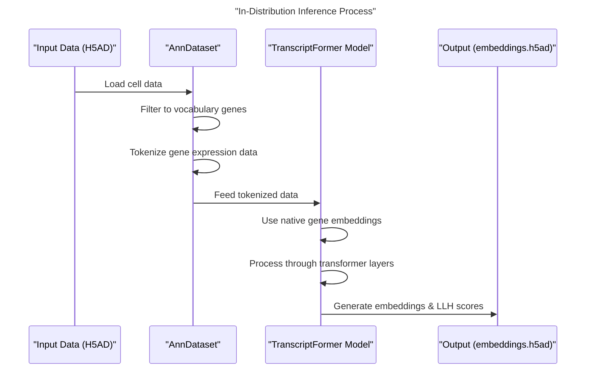
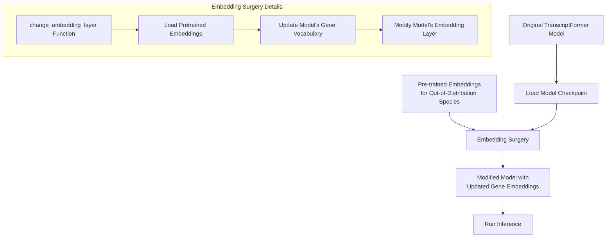
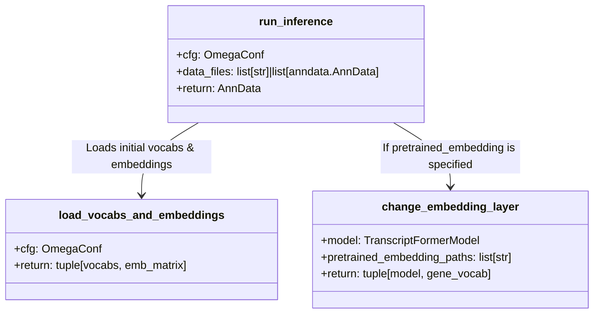

# In-Distribution vs Out-of-Distribution Inference

<details>
<summary>Relevant source files</summary>

The following files were used as context for generating this wiki page:

- [README.md](README.md)
- [assets/model_overview.png](assets/model_overview.png)
- [src/transcriptformer/model/inference.py](src/transcriptformer/model/inference.py)

</details>


## Purpose and Scope

This document explains how TranscriptFormer handles inference for both in-distribution species (those included in the model's training data) and out-of-distribution species (those not seen during training). We cover the technical differences between these two inference approaches, the embedding surgery process for out-of-distribution inference, and provide configuration examples for both scenarios. For information about general inference configuration, see [Configuration](#3.1).

## Understanding In-Distribution vs Out-of-Distribution

TranscriptFormer models are trained on specific species. When running inference, the species in your data may or may not have been part of the training set.



**Sources:** [README.md:18-31](), [README.md:133-151]()

## In-Distribution Inference

In-distribution inference occurs when using a model on species that were included in its training data:

- **TF-Sapiens**: Only human cells
- **TF-Exemplar**: Human, mouse, zebrafish, fruit fly, and C. elegans
- **TF-Metazoa**: All 12 species (6 vertebrates, 4 invertebrates, fungus, protist)

During in-distribution inference, the gene embeddings learned during training are directly used to process the input data.



**Sources:** [src/transcriptformer/model/inference.py:27-141](), [README.md:133-140]()

### Configuration Example for In-Distribution Inference

For in-distribution inference, you only need to specify the model checkpoint and input data:

```bash
python inference.py --config-name=inference_config.yaml \
  model.checkpoint_path=./checkpoints/tf_sapiens \
  model.inference_config.data_files.0=test/data/human_val.h5ad \
  model.inference_config.batch_size=8
```

**Sources:** [README.md:136-140]()

## Out-of-Distribution Inference

Out-of-distribution inference is necessary when analyzing species that were not part of the model's training data. This requires special handling through a process called "embedding surgery."

### The Embedding Surgery Process

Embedding surgery is the process of replacing or augmenting the model's native gene embeddings with pre-trained embeddings for the out-of-distribution species.



**Sources:** [src/transcriptformer/model/inference.py:67-76](), [README.md:143-150]()

### Technical Implementation

The embedding surgery process is implemented in the `change_embedding_layer` function, which is called during the inference setup when a pretrained embedding path is provided:



**Sources:** [src/transcriptformer/model/inference.py:67-76](), [src/transcriptformer/model/embedding_surgery.py]()

## Configuration and Usage

### Running Out-of-Distribution Inference

For out-of-distribution inference, you must provide:
1. The model checkpoint
2. Input data files
3. Pretrained embedding file for the target species

Example command:

```bash
python inference.py --config-name=inference_config.yaml \
  model.checkpoint_path=./checkpoints/tf_sapiens \
  model.inference_config.data_files.0=test/data/mouse_val.h5ad \
  model.inference_config.pretrained_embedding=./checkpoints/all_embeddings/mus_musculus_gene.h5
  model.inference_config.batch_size=8
```

**Sources:** [README.md:143-150]()

### Downloading Pretrained Embeddings

Pretrained embeddings for supported out-of-distribution species can be downloaded using the provided script:

```bash
# Download all embedding files
python download_artifacts.py all-embeddings

# The embeddings will be stored in ./checkpoints/all_embeddings/
```

**Sources:** [README.md:85-111]()

## Practical Considerations

### When to Use Each Approach

| Scenario | Approach | Example |
|----------|----------|---------|
| Human data with TF-Sapiens | In-distribution inference | Using TF-Sapiens for analyzing human blood cells |
| Mouse data with TF-Sapiens | Out-of-distribution inference | Using TF-Sapiens for mouse data by providing mouse gene embeddings |
| Human data with TF-Exemplar | In-distribution inference | Using TF-Exemplar for analyzing human pancreatic cells |
| Chicken data with TF-Metazoa | In-distribution inference | Using TF-Metazoa for chicken data (one of the 12 species) |
| Rabbit data with TF-Exemplar | Out-of-distribution inference | Using TF-Exemplar for rabbit data by providing rabbit gene embeddings |

**Sources:** [README.md:18-31](), [README.md:133-151]()

### Performance Considerations

When performing out-of-distribution inference:

1. **Memory Usage**: The embedding surgery process may require additional memory, especially when dealing with large gene vocabularies
2. **Batch Size**: You may need to adjust the batch size (e.g., reducing it to 1-4) if using a GPU with limited VRAM
3. **Gene Matching**: Only genes that are present in both your data and the pretrained embeddings will be used for inference

**Sources:** [README.md:80-83](), [src/transcriptformer/model/inference.py:92-93]()

### Species Support

TranscriptFormer provides pretrained embeddings for a variety of species. When using these embeddings, it's important to ensure that the gene identifiers in your data match those in the pretrained embeddings (typically Ensembl IDs).

| Model | In-Distribution Species | Typical Out-of-Distribution Use Cases |
|-------|-------------------------|--------------------------------------|
| TF-Sapiens | Human | Non-human mammals with pretrained embeddings |
| TF-Exemplar | Human, Mouse, Zebrafish, Fruit fly, C. elegans | Other vertebrates or invertebrates with pretrained embeddings |
| TF-Metazoa | 12 species (see README) | Other non-included species with pretrained embeddings |

**Sources:** [README.md:18-31](), [README.md:172-183]()

## Input Data Requirements for Both Approaches

Whether performing in-distribution or out-of-distribution inference, your input data must:

1. Be in H5AD format (AnnData objects)
2. Contain an `ensembl_id` column in the `var` dataframe with Ensembl gene identifiers
3. Have raw count data stored in the `adata.X` matrix
4. For out-of-distribution inference, genes should match those in the pretrained embeddings

**Sources:** [README.md:172-183]()

---