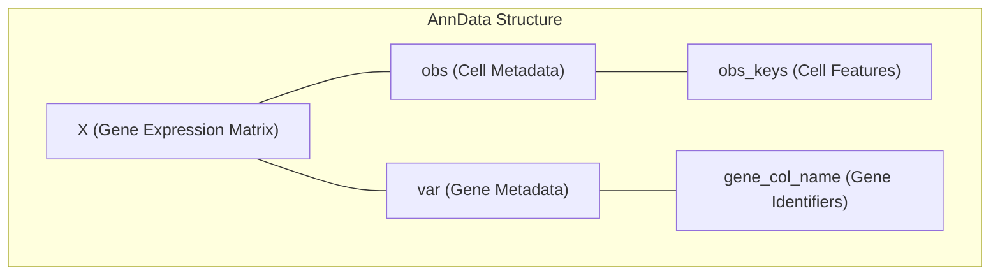
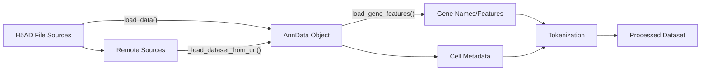
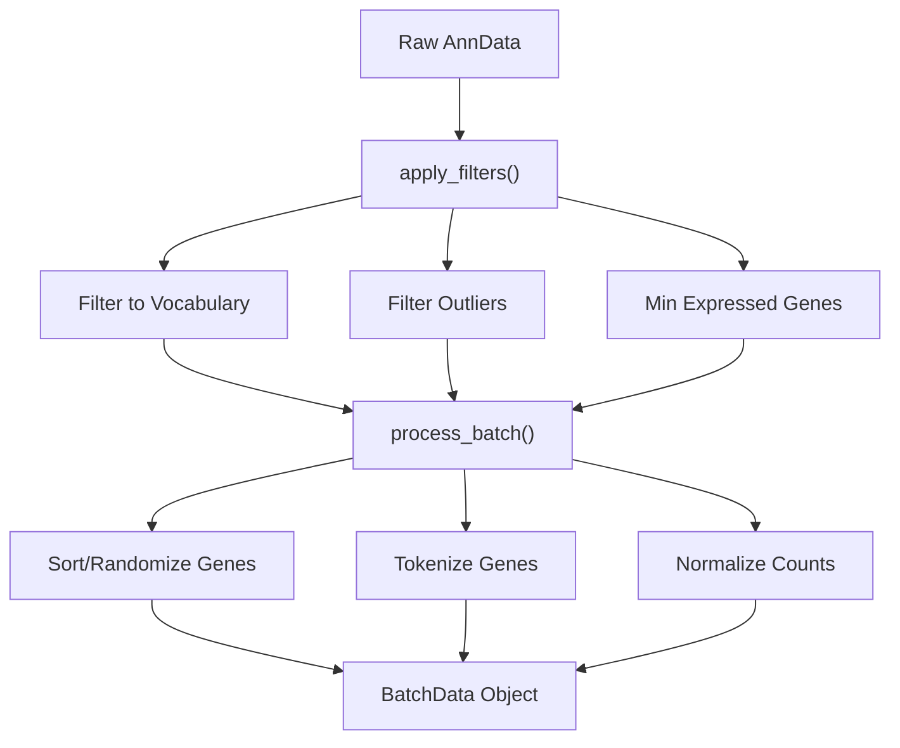
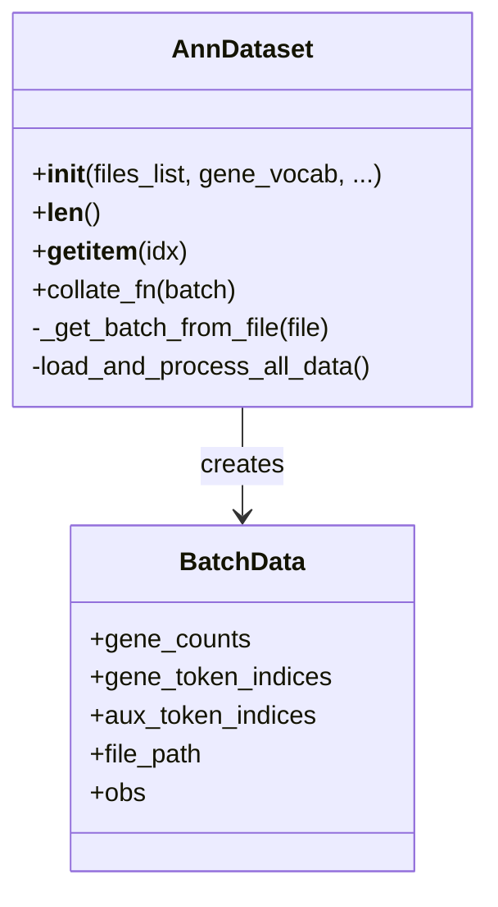
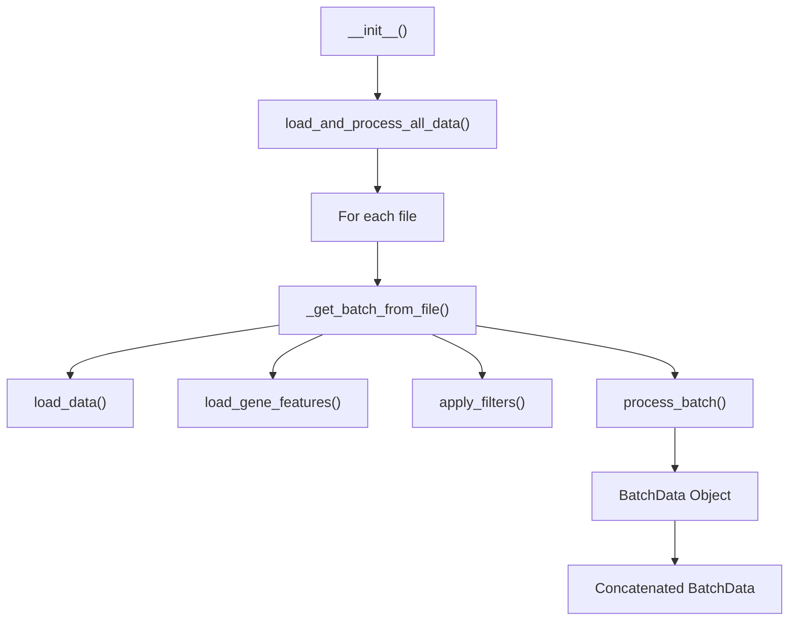
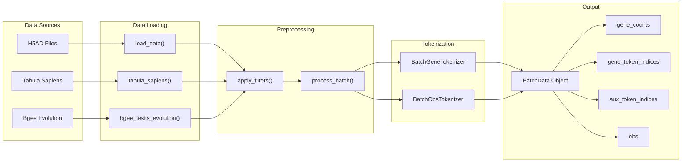

# Data Management

Relevant source files

The following files were used as context for generating this wiki page:

- [src/transcriptformer/data/dataloader.py](src/transcriptformer/data/dataloader.py)
- [src/transcriptformer/datasets.py](src/transcriptformer/datasets.py)

This document details the data management system in TranscriptFormer, covering data loading, processing, and dataset handling mechanisms. For information about running inference with these datasets, see [Running Inference](#3). For model architecture details, see [Model Variants](#1.1).

## 1. Data Formats and Sources

TranscriptFormer works with single-cell RNA sequencing data stored in the AnnData (h5ad) format. The framework provides built-in functions for accessing commonly used datasets.

### 1.1 Supported Data Formats

The primary data format used by TranscriptFormer is H5AD (HDF5-based AnnData format), which stores both the gene expression matrix and associated metadata.

Sources: [src/transcriptformer/data/dataloader.py:234-237](), [src/transcriptformer/data/dataloader.py:239-240]()

### 1.2 Built-in Dataset Functions

TranscriptFormer provides convenient functions to access standard datasets:

| Function | Description | Parameters | Return Value |
|----------|-------------|------------|--------------|
| `tabula_sapiens()` | Loads tissue datasets from Tabula Sapiens | tissue, path, force_download, version | AnnData object |
| `bgee_testis_evolution()` | Loads testis tissue from evolutionary organisms | organism, path, force_download | AnnData object |
| `download_all_embeddings()` | Downloads all pre-trained embeddings | path, force_download | None |

Sources: [src/transcriptformer/datasets.py:10-117](), [src/transcriptformer/datasets.py:120-172](), [src/transcriptformer/datasets.py:175-249]()

## 2. Data Loading Pipeline

The data loading pipeline handles loading data from files or URLs and preparing it for processing.

Sources: [src/transcriptformer/data/dataloader.py:20-27](), [src/transcriptformer/datasets.py:252-282]()

### 2.1 Dataset Loading Functions

The framework provides functions to load various datasets:

**Tabula Sapiens Loading**:
- Supports multiple tissue types (lymphnode, heart, ear, etc.)
- Option to load v1 (in-distribution) or v2 (out-of-distribution) datasets
- Automatic filtering based on dataset version

**Bgee Evolution Loading**:
- Loads testis data from various organisms (human, mouse, marmoset, etc.)
- Useful for cross-species analysis

Sources: [src/transcriptformer/datasets.py:10-117](), [src/transcriptformer/datasets.py:120-172]()

## 3. Data Processing Pipeline

The data processing pipeline handles filtering, normalization, and preparation of data for model input.

Sources: [src/transcriptformer/data/dataloader.py:39-75](), [src/transcriptformer/data/dataloader.py:78-163]()

### 3.1 Filtering Options

TranscriptFormer provides several filtering mechanisms to prepare data:

| Filter | Description | Parameter |
|--------|-------------|-----------|
| Vocabulary Filtering | Filters genes to those in the vocabulary | `filter_to_vocab` |
| Outlier Filtering | Removes cells with extreme expression counts | `filter_outliers` |
| Minimum Expressed Genes | Removes cells with too few expressed genes | `min_expressed_genes` |

Sources: [src/transcriptformer/data/dataloader.py:39-75]()

### 3.2 Data Normalization

The system provides options for normalizing gene expression data:

- **Scale Normalization**: Adjusts counts to a specified scale (`normalize_to_scale`)
- **Count Clipping**: Limits maximum count values (`clip_counts`)

Sources: [src/transcriptformer/data/dataloader.py:144-150]()

### 3.3 Gene Ordering and Tokenization

TranscriptFormer provides options for controlling how genes are ordered and tokenized:

- **Gene Sorting**: Sorts genes by expression level (`sort_genes`)
- **Random Ordering**: Randomizes gene order (`randomize_order`)
- **Tokenization**: Converts gene names to token indices using vocabulary

Sources: [src/transcriptformer/data/dataloader.py:94-119]()

## 4. The AnnDataset Class

The `AnnDataset` class is the primary interface for loading and processing data in TranscriptFormer. It inherits from PyTorch's `Dataset` class and adds specialized functionality for working with gene expression data.

Sources: [src/transcriptformer/data/dataloader.py:166-359]()

### 4.1 AnnDataset Configuration Options

The `AnnDataset` class supports numerous configuration options:

| Parameter | Description | Default |
|-----------|-------------|---------|
| `files_list` | List of files or AnnData objects | Required |
| `gene_vocab` | Dictionary mapping gene names to token indices | Required |
| `max_len` | Maximum sequence length | 2000 |
| `normalize_to_scale` | Scale for count normalization | None |
| `sort_genes` | Whether to sort genes by expression | False |
| `filter_to_vocab` | Whether to filter genes to vocabulary | True |
| `filter_outliers` | Standard deviation multiplier for outlier filtering | 0.0 |
| `min_expressed_genes` | Minimum number of expressed genes | 200 |
| `clip_counts` | Maximum count value | 1e10 |
| `inference` | Whether in inference mode | False |
| `obs_keys` | Cell metadata keys to include | None |

Sources: [src/transcriptformer/data/dataloader.py:167-206]()

### 4.2 Data Loading Process

The `AnnDataset` loading process involves:

1. Initializing with configuration parameters
2. Loading and processing all data files
3. Converting gene names to token indices
4. Applying filtering and normalization
5. Creating `BatchData` objects containing processed data

Sources: [src/transcriptformer/data/dataloader.py:217-323]()

## 5. Working with Embeddings

TranscriptFormer provides utilities for working with pre-trained embeddings, which are crucial for cross-species analysis and transfer learning.

### 5.1 Downloading Pre-trained Embeddings

The `download_all_embeddings()` function downloads all embeddings used in the TranscriptFormer paper:

- Downloads a tarball containing all embeddings
- Extracts embeddings to a cache directory (default: `~/.cache/transcriptformer`)
- Provides safe extraction with path validation

Sources: [src/transcriptformer/datasets.py:175-249]()

### 5.2 Embedding Usage

Embeddings are used for:

- Out-of-distribution (OOD) inference on species not seen during training
- Transfer learning to new domains
- Cross-species analysis

For detailed information about using these embeddings, see [In-Distribution vs Out-of-Distribution Inference](#3.3).

Sources: [src/transcriptformer/datasets.py:175-177]()

## 6. Data Processing Flow

This diagram illustrates the complete data processing flow from raw files to model-ready format:

Sources: [src/transcriptformer/data/dataloader.py:290-323](), [src/transcriptformer/datasets.py:10-117](), [src/transcriptformer/datasets.py:120-172]()

---