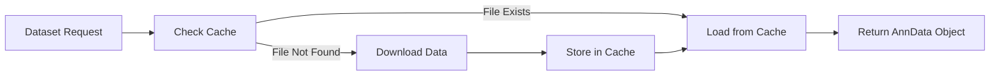
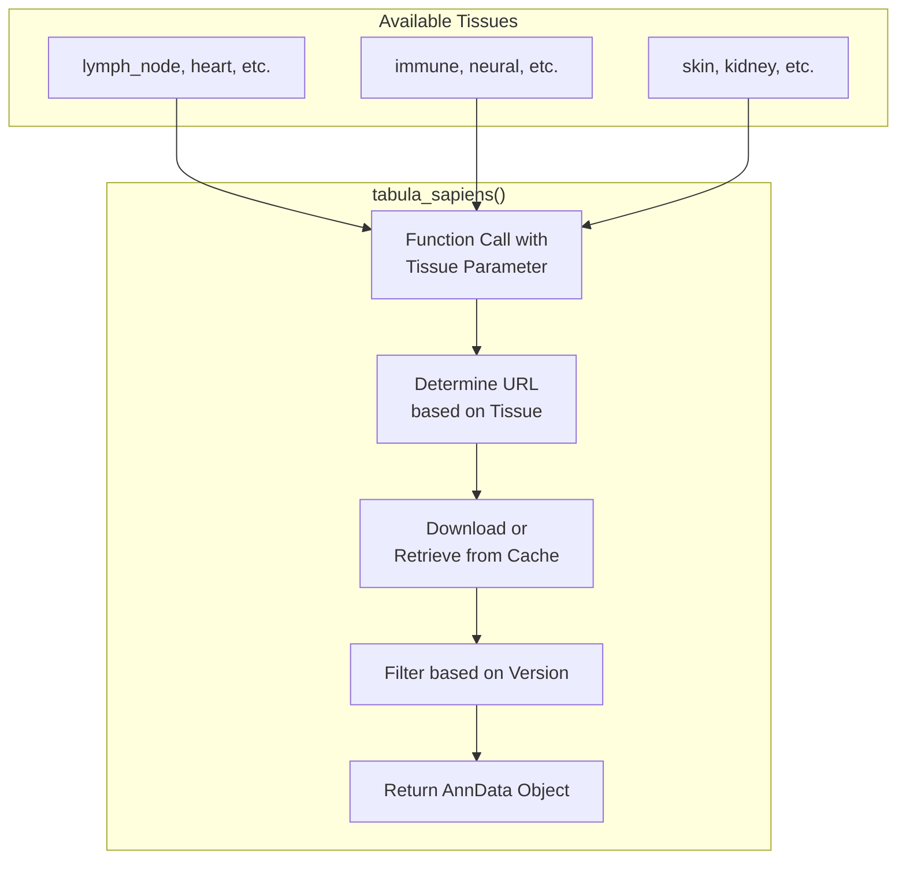
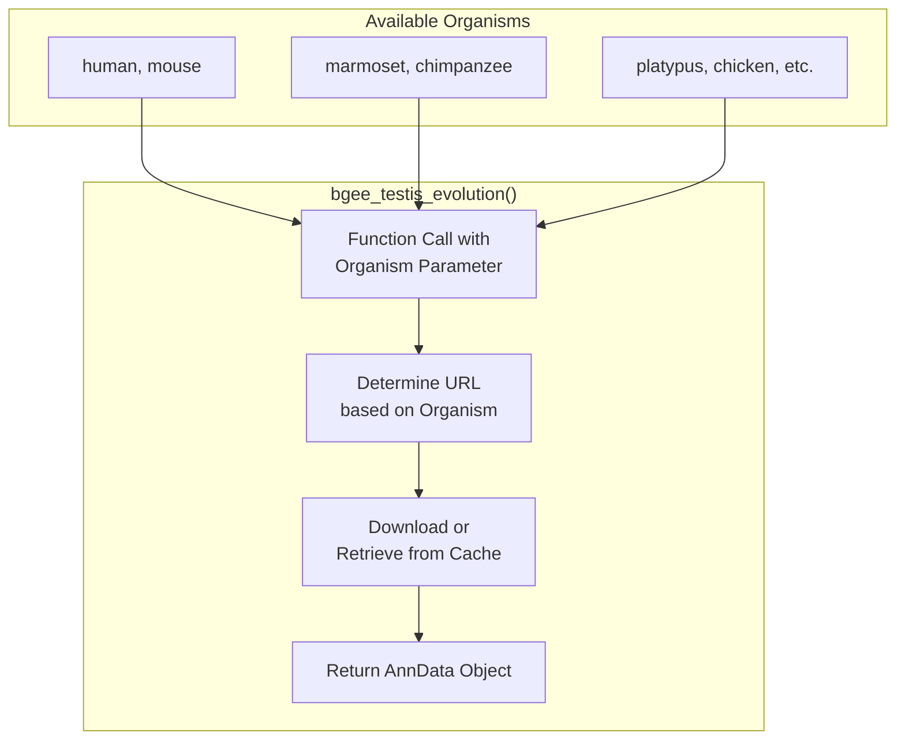
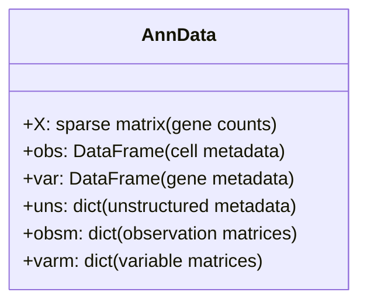
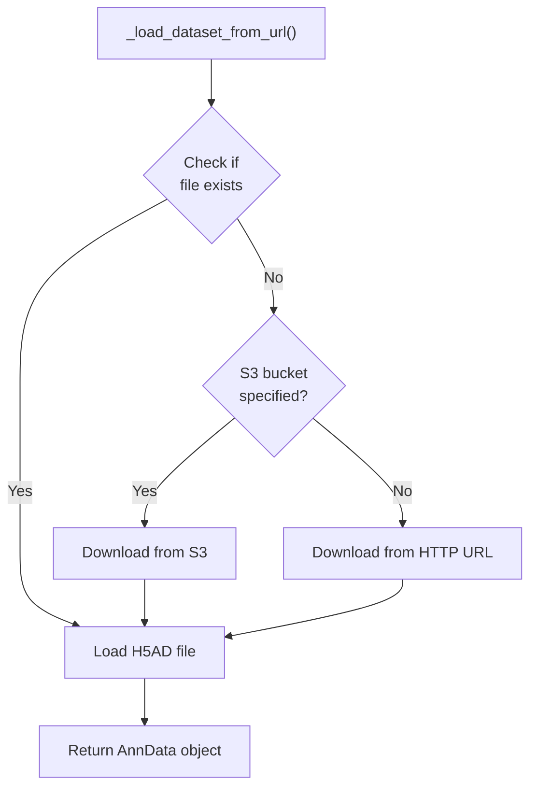
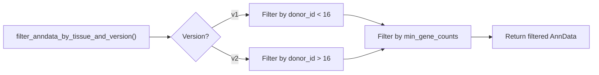

# Dataset Loading

<details>
<summary>Relevant source files</summary>

The following files were used as context for generating this wiki page:

- [src/transcriptformer/datasets.py](src/transcriptformer/datasets.py)

</details>


This document details the dataset loading capabilities in TranscriptFormer, focusing on how to load pre-processed single-cell RNA sequencing data from various sources. For information about data processing and transformation after loading, see [Data Processing Pipeline](#4.2).

## Overview

TranscriptFormer provides utility functions for loading standardized datasets that can be used for model inference. These datasets primarily come from two sources:

1. **Tabula Sapiens** - A human single-cell atlas with various tissue types
2. **Bgee Evolution** - A cross-species dataset focusing on testis tissue

The dataset loading system automatically handles downloading data files when needed and caching them locally for future use.



Sources: [src/transcriptformer/datasets.py:252-282]()

## Supported Datasets

### Tabula Sapiens

Tabula Sapiens is a human cell atlas containing data from multiple tissues. TranscriptFormer supports loading specific tissue datasets from this collection.

The datasets are available in two versions:
- **v1**: In-distribution for TranscriptFormer (donors with ID < 16)
- **v2**: Out-of-distribution for TranscriptFormer (donors with ID > 16)



Sources: [src/transcriptformer/datasets.py:10-117]()

### Bgee Evolution Dataset

The Bgee Evolution dataset contains testis tissue data from multiple species, allowing for cross-species comparison and analysis.



Sources: [src/transcriptformer/datasets.py:120-172]()

## Dataset Loading Functions

The library provides three main functions for dataset loading:

### tabula_sapiens()

This function loads tissue-specific data from the Tabula Sapiens collection.

```python
tabula_sapiens(
    tissue,           # Specific tissue to load (e.g., "heart", "lung")
    path=None,        # Path to save dataset (defaults to ~/.cache/transcriptformer/{tissue}_{version}.h5ad)
    force_download=False,  # Whether to force download even if file exists
    version="v2"      # Dataset version ("v1" or "v2")
)
```

Sources: [src/transcriptformer/datasets.py:10-117]()

### bgee_testis_evolution()

This function loads testis tissue data from different organisms.

```python
bgee_testis_evolution(
    organism,         # Organism to load (e.g., "human", "mouse")
    path=None,        # Path to save dataset (defaults to ~/.cache/transcriptformer/{organism}.h5ad)
    force_download=False  # Whether to force download even if file exists
)
```

Sources: [src/transcriptformer/datasets.py:120-172]()

### download_all_embeddings()

This utility function downloads all pre-trained embeddings used in the TranscriptFormer paper.

```python
download_all_embeddings(
    path=None,        # Path to save embeddings (defaults to ~/.cache/transcriptformer)
    force_download=False  # Whether to force download and overwrite existing files
)
```

Sources: [src/transcriptformer/datasets.py:175-250]()

## Dataset Format and Structure

All dataset loading functions return data in the AnnData format (from the anndata package), which is a standard format for single-cell genomics data.



Sources: [src/transcriptformer/datasets.py:4]()

## Implementation Details

### Data Caching and Download

All dataset functions use a common helper function `_load_dataset_from_url()` that:
1. Checks if the requested file exists in the cache
2. Downloads it from the specified URL if not found
3. Loads the H5AD file into an AnnData object

For S3-hosted files, the system uses boto3 with unsigned access to download datasets from public buckets.



Sources: [src/transcriptformer/datasets.py:252-282]()

### Version Filtering

For Tabula Sapiens datasets, the `filter_anndata_by_tissue_and_version()` function filters the data based on:

1. Version (v1 or v2)
2. Minimum gene count threshold

This ensures that the data matches the expected distribution for the model version being used.



Sources: [src/transcriptformer/datasets.py:285-303]()

## Usage Examples

### Loading a Tabula Sapiens Tissue Dataset

```python
from transcriptformer.datasets import tabula_sapiens

# Load the heart tissue dataset (version 2)
heart_adata = tabula_sapiens(tissue="heart", version="v2")

# Check dataset size
print(f"Number of cells: {heart_adata.n_obs}")
print(f"Number of genes: {heart_adata.n_vars}")
```

### Loading a Cross-Species Dataset

```python
from transcriptformer.datasets import bgee_testis_evolution

# Load human testis data
human_testis = bgee_testis_evolution(organism="human")

# Load mouse testis data for comparison
mouse_testis = bgee_testis_evolution(organism="mouse")
```

### Downloading All Pre-trained Embeddings

```python
from transcriptformer.datasets import download_all_embeddings

# Download all embeddings to default cache location
download_all_embeddings()
```

## Summary

The dataset loading functions in TranscriptFormer provide convenient access to standardized single-cell RNA sequencing datasets for use with the model. By handling downloading, caching, and basic filtering, these utilities streamline the process of working with TranscriptFormer.

The dataset loading system is designed to be:
1. User-friendly with sensible defaults
2. Flexible with customization options
3. Efficient through local caching

For information on how to process and transform these datasets after loading, refer to [Data Processing Pipeline](#4.2).

---