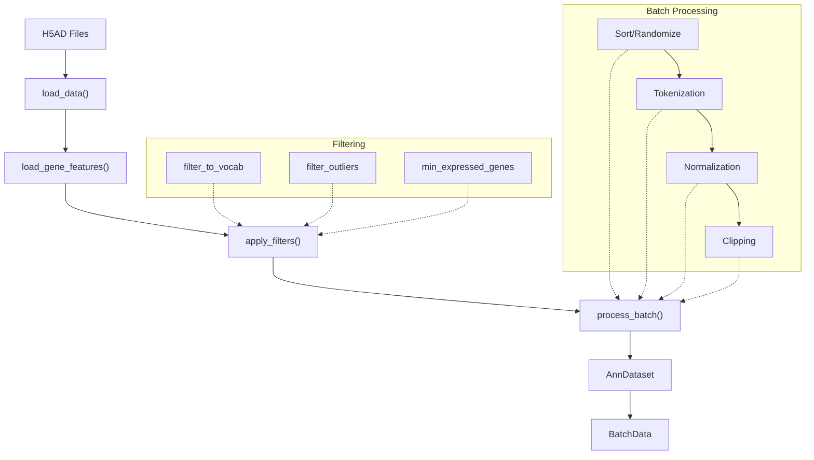
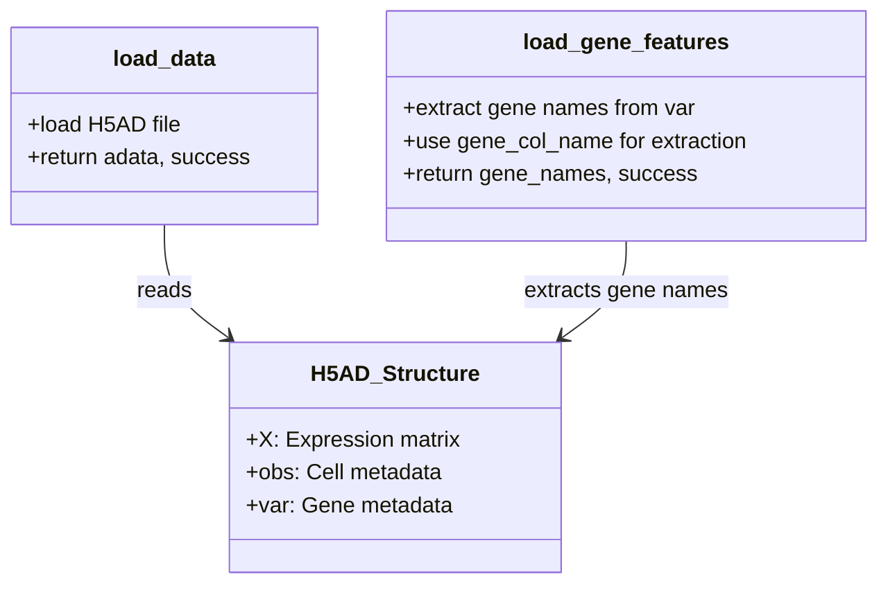
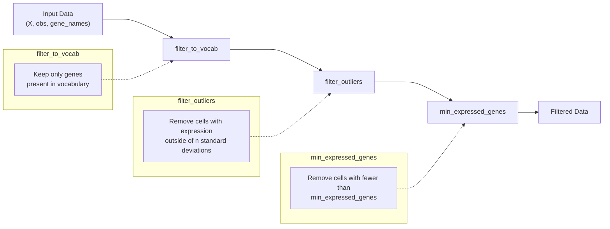
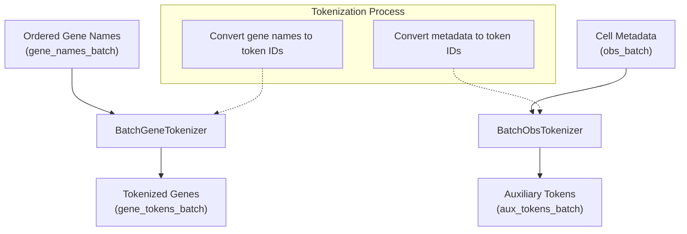
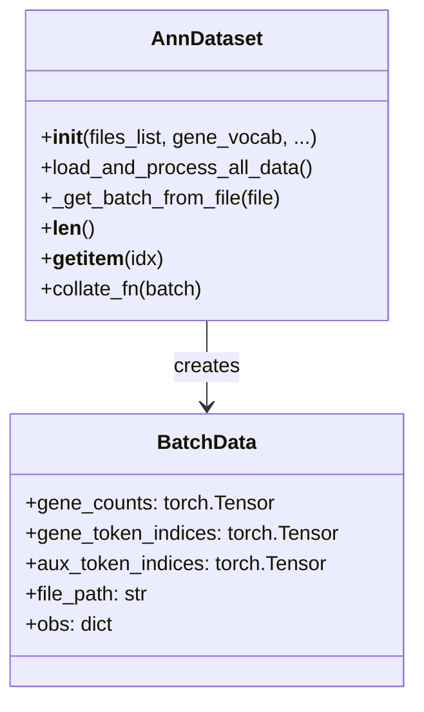
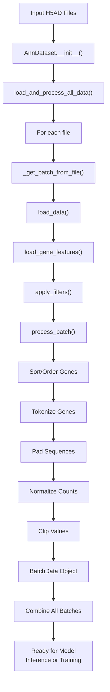

# Data Processing Pipeline

Relevant source files

The following files were used as context for generating this wiki page:

- [src/transcriptformer/data/dataclasses.py](src/transcriptformer/data/dataclasses.py)
- [src/transcriptformer/data/dataloader.py](src/transcriptformer/data/dataloader.py)

This document provides a detailed technical overview of the data processing pipeline in TranscriptFormer. This pipeline handles the transformation of raw gene expression data into tokenized, normalized format suitable for model inference. For information about loading specific datasets, see [Dataset Loading](#4.1). For handling model embeddings, see [Embedding Handling](#4.3).

## Pipeline Overview

The TranscriptFormer data processing pipeline transforms raw H5AD files containing gene expression data into normalized, tokenized, and properly formatted batches for model inference or training.

Sources: [src/transcriptformer/data/dataloader.py:20-323](). [src/transcriptformer/data/dataclasses.py:209-216]()

## 1. Data Loading Process

The pipeline begins with loading data from H5AD files, which are a common format for storing single-cell genomics data.

The data loading process consists of two key functions:

1. `load_data(file_path)`: Loads an H5AD file and returns an AnnData object
2. `load_gene_features(adata, gene_col_name)`: Extracts gene names from the loaded data using the specified column name

H5AD files contain gene expression matrices, cell metadata, and gene metadata. The data loading process extracts this information to prepare it for the subsequent processing steps.

Sources: [src/transcriptformer/data/dataloader.py:20-36]()

## 2. Filtering Mechanisms

After loading, the data undergoes several filtering steps through the `apply_filters()` function:

The filtering process includes:

1. **Vocabulary Filtering**: Removes genes not present in the provided vocabulary, which ensures all genes can be tokenized
2. **Outlier Filtering**: Removes cells with abnormally high or low total expression counts (outside n standard deviations from the mean)
3. **Minimum Gene Expression**: Removes cells that express fewer than a specified minimum number of genes

These filtering steps help remove low-quality cells and irrelevant genes, focusing the analysis on biologically meaningful data.

Sources: [src/transcriptformer/data/dataloader.py:39-75]()

## 3. Batch Processing

The core of the data processing pipeline is the `process_batch()` function, which performs several transformations on a batch of data.

### 3.1 Gene Sorting and Ordering

The first step in batch processing is arranging genes in a specific order. This can be done in two ways:

1. **Sort genes by expression value**: Genes are sorted by their expression level in descending order
2. **Non-zero first, with optional randomization**: Non-zero expression genes are placed first, potentially in random order, followed by zero-expression genes

This ordering is important because it affects how the model views the gene sequence and its attention to specific genes.

### 3.2 Tokenization

After ordering, genes are tokenized using the `BatchGeneTokenizer` and optionally `BatchObsTokenizer` for auxiliary data:

The tokenization process converts gene names and cell metadata into token indices that the model can process. The tokenizers use predefined vocabularies (`gene_vocab` and `aux_vocab`).

### 3.3 Normalization and Clipping

The final batch processing steps include:

1. **Padding**: Adding padding tokens to reach the required sequence length (`max_len`)
2. **Normalization**: Scaling gene counts to a specific value (`normalize_to_scale`) while preserving relative expression
3. **Clipping**: Limiting expression values to a maximum threshold (`clip_counts`) to prevent extreme values

These steps ensure that the data has a consistent format and scale, which improves model training stability and inference reliability.

Sources: [src/transcriptformer/data/dataloader.py:78-163]()

## 4. Dataset Creation and Management

The `AnnDataset` class provides a PyTorch-compatible dataset for working with processed gene expression data.

The `AnnDataset` class performs these key operations:

1. Processes a list of H5AD files by calling the pipeline functions
2. Combines the processed data into a single large batch
3. Provides methods to access individual samples and collate them for batched processing
4. Stores the processed data as `BatchData` objects, which contain the gene counts, token indices, and metadata

The dataset's initialization triggers the entire data processing pipeline and prepares the data for model inference.

Sources: [src/transcriptformer/data/dataloader.py:166-359]() [src/transcriptformer/data/dataclasses.py:209-216]()

## 5. Configuration Parameters

The data processing pipeline is highly configurable through the `DataConfig` class. The table below shows the key parameters that control the pipeline's behavior:

| Parameter | Description | Default | Impact |
|-----------|-------------|---------|--------|
| `gene_col_name` | Column name for gene identifiers | "feature_id" | Determines which column to use for gene names |
| `clip_counts` | Maximum value for gene counts | None | Limits extreme expression values |
| `filter_to_vocabs` | Whether to filter genes by vocabulary | True | Removes genes not in vocabulary |
| `filter_outliers` | Standard deviation threshold for outlier removal | 0.0 | Higher values retain more cells |
| `normalize_to_scale` | Target sum for count normalization | None | Sets the scale of normalized counts |
| `min_expressed_genes` | Minimum genes expressed per cell | 200 | Filters low-quality cells |
| `sort_genes` | Whether to sort genes by expression | False | Affects gene ordering |
| `randomize_order` | Whether to randomize gene order | False | Introduces variation in gene sequences |
| `pad_zeros` | Whether to pad zero expressions | True | Affects tokenization of non-expressed genes |
| `max_len` | Maximum sequence length | 2000 | Limits the number of genes per cell |

These configuration parameters can significantly impact the quality and characteristics of the processed data and should be tuned based on the specific requirements of the analysis.

Sources: [src/transcriptformer/data/dataclasses.py:90-142]() [src/transcriptformer/data/dataloader.py:167-206]()

## 6. Data Processing Flow

The following diagram illustrates the complete data processing flow from raw files to model-ready data:

This comprehensive pipeline ensures that raw gene expression data is properly transformed, filtered, normalized, and tokenized before being used by the TranscriptFormer model, which is crucial for achieving accurate and reliable results in single-cell transcriptomics analysis.

Sources: [src/transcriptformer/data/dataloader.py:166-323]()

---