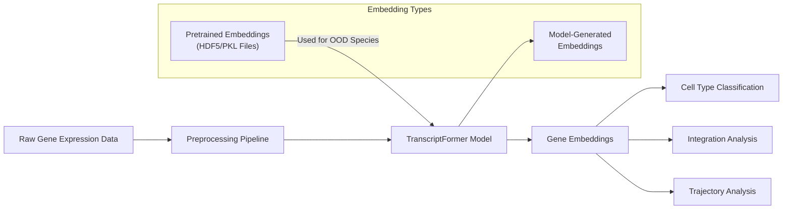
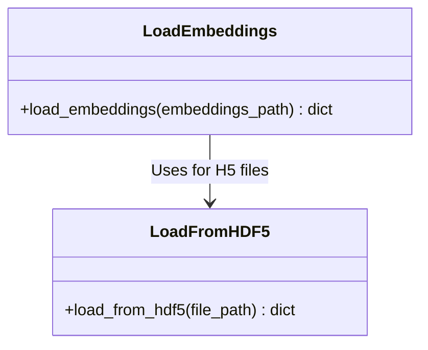
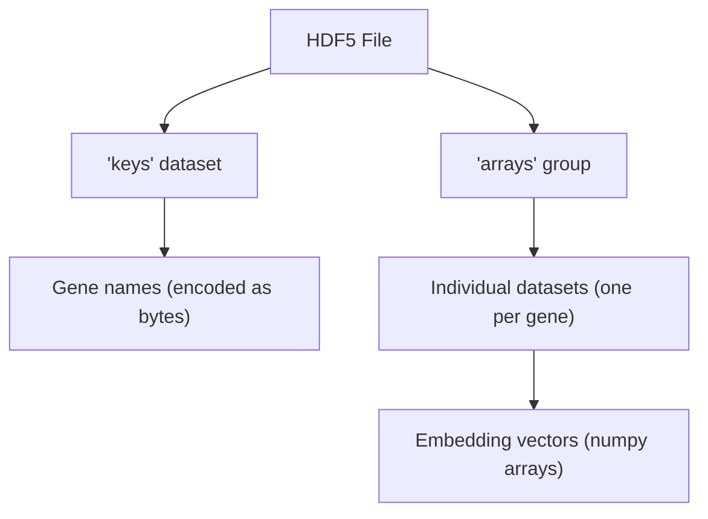
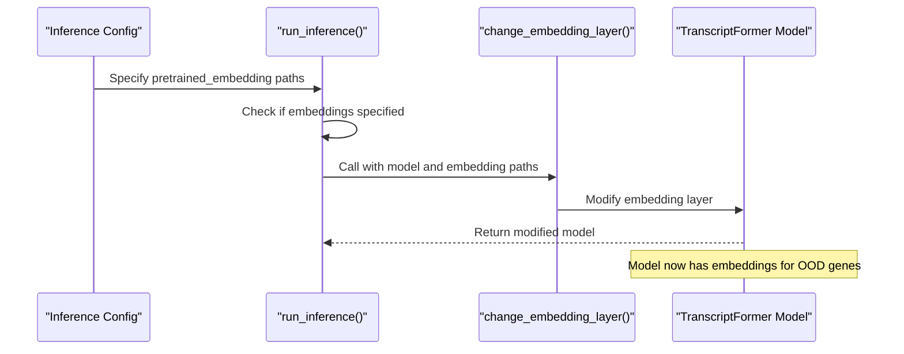
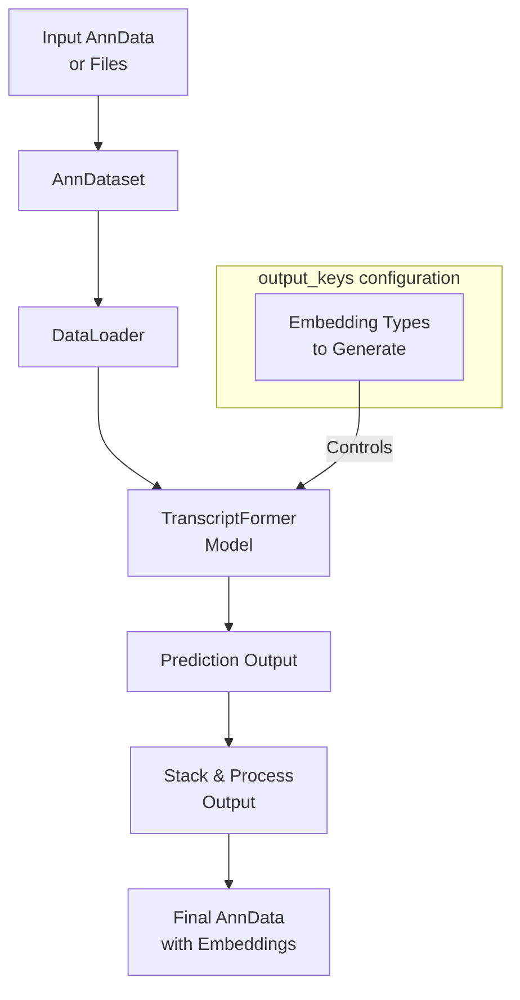
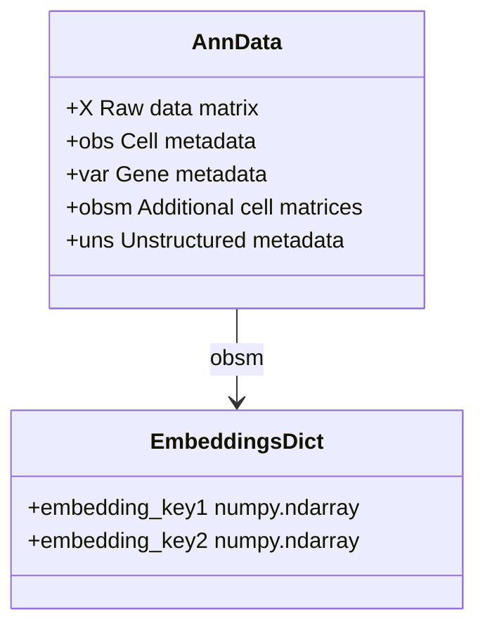
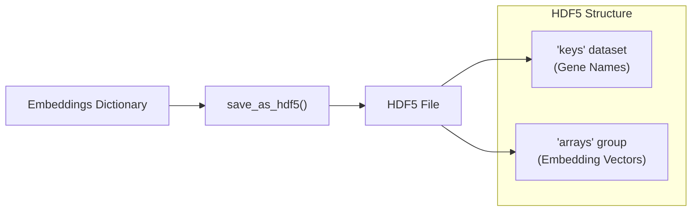
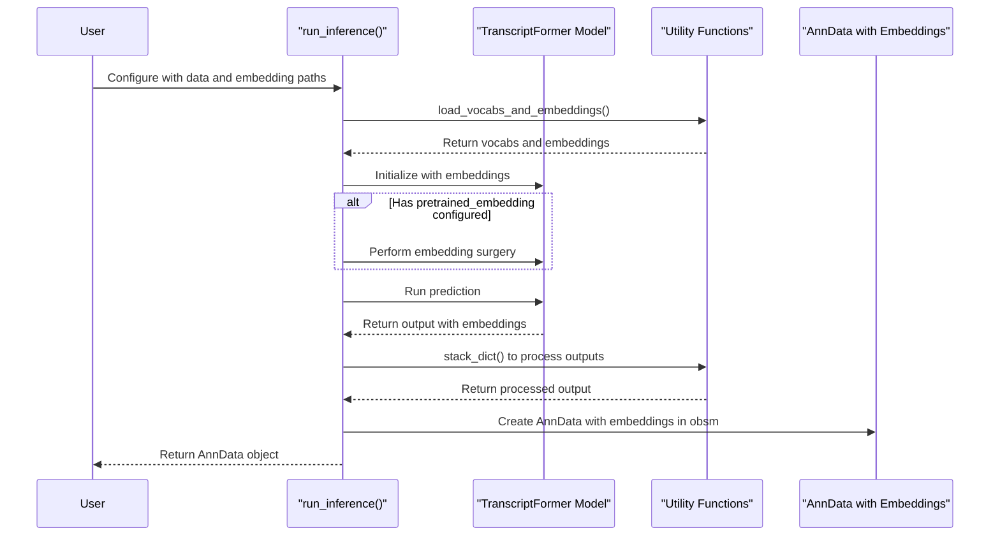

# Embedding Handling

Relevant source files

The following files were used as context for generating this wiki page:

- [src/transcriptformer/model/inference.py](src/transcriptformer/model/inference.py)
- [src/transcriptformer/utils/utils.py](src/transcriptformer/utils/utils.py)

## Purpose and Scope

This document describes how TranscriptFormer models handle gene embeddings - the numerical vector representations of genes that capture their functional and contextual similarities. The page covers loading pre-trained embeddings, performing embedding surgery for out-of-distribution inference, generating embeddings during model inference, and storing/manipulating embeddings in various file formats. For information about the data processing pipeline prior to embedding generation, see [Data Processing Pipeline](#4.2).

## Embedding Overview

Gene embeddings in TranscriptFormer represent the core method for transforming gene expression data into meaningful numerical representations that can be used for downstream analysis.

Sources: [src/transcriptformer/model/inference.py:36-75](). [src/transcriptformer/utils/utils.py:13-45]()

## Loading Embeddings

TranscriptFormer supports loading pre-trained embeddings from both pickle (`.pkl`) and HDF5 (`.h5`) files. These embeddings map gene identifiers to vector representations.

### Loading Functions

The system provides utility functions for loading embeddings from different file formats:

The `load_embeddings()` function determines the appropriate loading method based on the file extension and returns a dictionary mapping gene names to their corresponding embedding vectors.

Sources: [src/transcriptformer/utils/utils.py:13-45]()

### HDF5 Embedding Structure

When loading from HDF5 files, TranscriptFormer expects a specific structure:

The `load_from_hdf5()` function reads this structure and converts it to a Python dictionary where keys are gene names (decoded from bytes to UTF-8 strings) and values are numpy arrays representing embeddings.

Sources: [src/transcriptformer/utils/utils.py:22-45]()

## Embedding Surgery

A key feature of TranscriptFormer is "embedding surgery," which enables out-of-distribution inference by replacing or augmenting the model's embedding layer with pre-trained embeddings for genes not seen during training.

This process is triggered during the inference process when `pretrained_embedding` is specified in the inference configuration. The function `change_embedding_layer()` replaces or extends the model's embedding layer with the pre-trained embeddings.

Sources: [src/transcriptformer/model/inference.py:68-75]()

## Generating Embeddings During Inference

TranscriptFormer generates embeddings during the inference process:

The embeddings to generate are specified in the `output_keys` parameter of the inference configuration. These embeddings are then stored in the `obsm` attribute of the output AnnData object.

Sources: [src/transcriptformer/model/inference.py:118-138]()

## Working with Output Embeddings

The output of TranscriptFormer inference is an AnnData object with embeddings stored in its `obsm` attribute:

Each key in `obsm` corresponds to a specific type of embedding specified in the `output_keys` configuration. The values are numpy arrays containing the embeddings for each cell.

Sources: [src/transcriptformer/model/inference.py:128-138]()

## Saving Embeddings

TranscriptFormer provides utilities for saving embeddings to HDF5 files:

The `save_as_hdf5()` function takes a dictionary of embeddings and saves it to an HDF5 file with the specified structure. The keys are stored as a dataset, and the embedding arrays are stored in an "arrays" group.

Sources: [src/transcriptformer/utils/utils.py:71-81]()

## Example Usage Flow

Below is an end-to-end overview of how embeddings are handled in a typical TranscriptFormer workflow:

This diagram illustrates the complete flow of embedding handling during the inference process, from configuration to the final output.

Sources: [src/transcriptformer/model/inference.py:27-140](), [src/transcriptformer/utils/utils.py:13-81]()

## Best Practices

When working with embeddings in TranscriptFormer:

1. **For in-distribution species**: Use the model's built-in embeddings without modification.
2. **For out-of-distribution species**: Provide pre-trained embeddings through the `pretrained_embedding` parameter.
3. **When saving embeddings**: Use the HDF5 format for better compatibility with the loading functions.
4. **For downstream analysis**: Access embeddings through the `obsm` attribute of the output AnnData object.

Sources: [src/transcriptformer/model/inference.py:68-75](), [src/transcriptformer/utils/utils.py:13-81]()

---