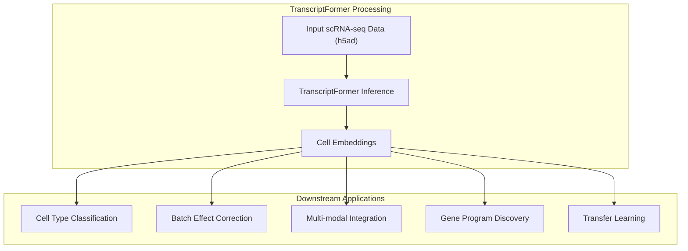
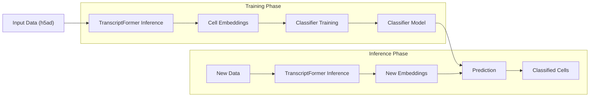
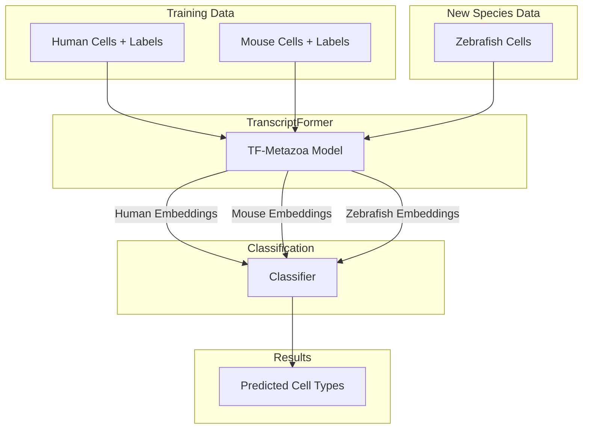
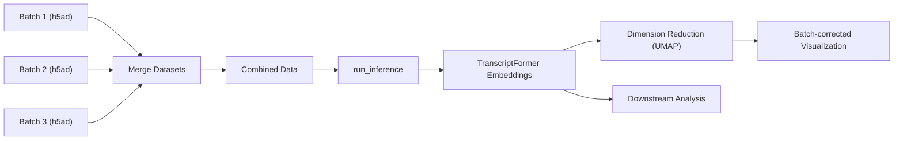
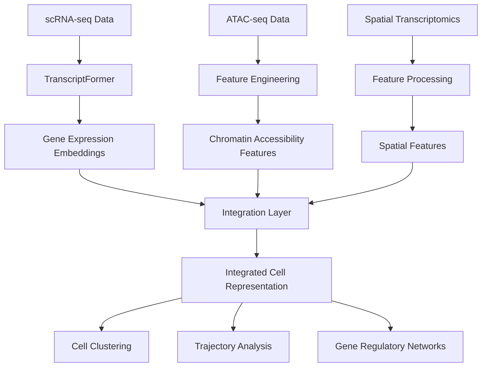
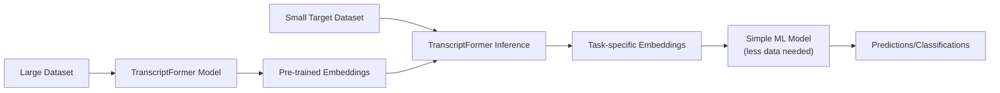
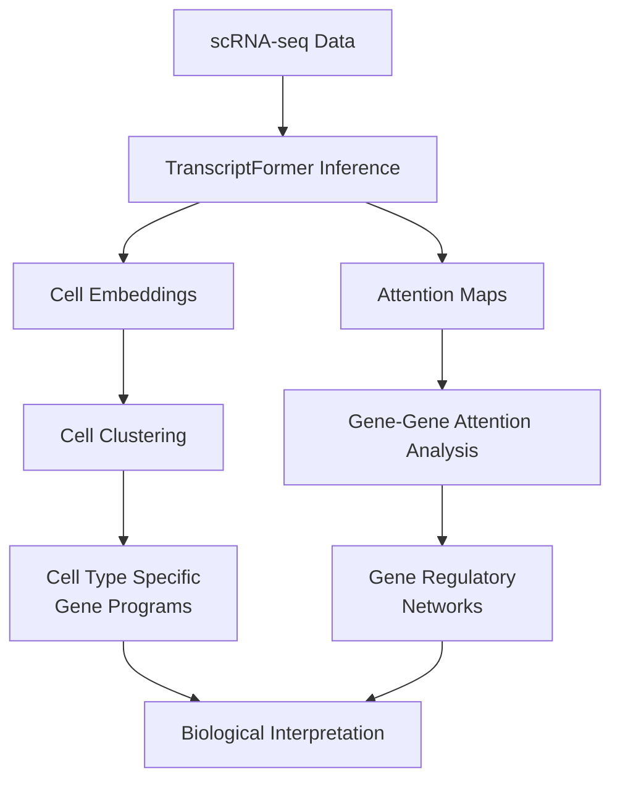
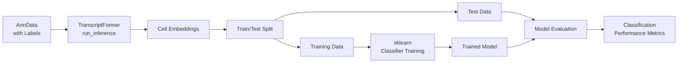

# Example Applications

<details>
<summary>Relevant source files</summary>

The following files were used as context for generating this wiki page:

- [notebooks/celltype-classification-across-species.ipynb](notebooks/celltype-classification-across-species.ipynb)

</details>


## Purpose and Scope

This document demonstrates practical applications of TranscriptFormer models for analyzing single-cell RNA sequencing data. It provides concrete examples of how to use the models for common tasks in computational biology and genomics research. For detailed information about running inference in general, see [Running Inference](#3), and for specific configuration details, see [Configuration](#3.1).

## Overview of Application Types

TranscriptFormer models produce rich cell embeddings that can be used for various downstream tasks. The main applications include:

1. Cell type classification across species
2. Batch effect correction
3. Multi-modal data integration
4. Gene program discovery
5. Transfer learning for limited datasets



Sources: Overview diagram based on system architecture

## Cell Type Classification

Cell type classification is one of the primary applications of TranscriptFormer. The model embeddings can be used with standard classification algorithms to identify cell types across different species.

### Workflow



Sources: System architecture flow diagram

### Implementation Example

Below is an example of how to implement a cell type classification pipeline using TranscriptFormer and scikit-learn:

1. Generate embeddings for labeled training data:

```python
from transcriptformer.inference import InferenceConfig, run_inference

# Configure inference for training data
config = InferenceConfig(
    model_name="TF-Metazoa",  # Choose appropriate model
    data_files=["training_data.h5ad"],
    output_path="training_embeddings.h5ad",
    batch_size=256
)

# Run inference to generate embeddings
run_inference(config)
```

2. Train a classifier on the embeddings:

```python
import anndata as ad
import sklearn.ensemble
import numpy as np

# Load embeddings
adata = ad.read_h5ad("training_embeddings.h5ad")

# Extract embeddings and labels
embeddings = adata.obsm['X_transcriptformer']
labels = adata.obs['cell_type'].values

# Train a random forest classifier
clf = sklearn.ensemble.RandomForestClassifier(n_estimators=100)
clf.fit(embeddings, labels)
```

3. Apply the classifier to new data:

```python
# Generate embeddings for new data
config = InferenceConfig(
    model_name="TF-Metazoa",
    data_files=["new_data.h5ad"],
    output_path="new_embeddings.h5ad",
    batch_size=256
)
run_inference(config)

# Load new embeddings
new_adata = ad.read_h5ad("new_embeddings.h5ad")
new_embeddings = new_adata.obsm['X_transcriptformer']

# Predict cell types
predictions = clf.predict(new_embeddings)

# Add predictions to AnnData object
new_adata.obs['predicted_cell_type'] = predictions
new_adata.write_h5ad("classified_data.h5ad")
```

Sources: Based on system architecture and inference workflow

### Cross-Species Classification

TranscriptFormer is particularly powerful for cross-species cell type classification because it learns species-invariant representations.



Sources: Based on TranscriptFormer capabilities described in system overview

## Batch Effect Correction

TranscriptFormer embeddings are useful for minimizing batch effects in single-cell data. The model is trained to focus on biological signals rather than technical artifacts.

### Implementation Example

```python
import anndata as ad
import scanpy as sc
from transcriptformer.inference import InferenceConfig, run_inference

# Generate embeddings for merged dataset with batch information
config = InferenceConfig(
    model_name="TF-Metazoa",
    data_files=["batch1.h5ad", "batch2.h5ad", "batch3.h5ad"],
    output_path="combined_embeddings.h5ad",
    batch_size=256
)
run_inference(config)

# Load embeddings
adata = ad.read_h5ad("combined_embeddings.h5ad")

# Use embeddings for visualization
adata.obsm['X_pca'] = adata.obsm['X_transcriptformer']
sc.pp.neighbors(adata, use_rep='X_pca')
sc.tl.umap(adata)
sc.pl.umap(adata, color='batch')  # Visual inspection of batch effect reduction
```



Sources: Based on system architecture and common single-cell analysis workflows

## Multi-Modal Data Integration

TranscriptFormer embeddings can serve as a bridge between different data modalities by providing a consistent representation of cell states.



Sources: Based on common multi-modal integration approaches

### Implementation Example

```python
import anndata as ad
import sklearn.metrics
from transcriptformer.inference import InferenceConfig, run_inference

# Generate TranscriptFormer embeddings for RNA-seq data
config = InferenceConfig(
    model_name="TF-Sapiens",
    data_files=["rna_data.h5ad"],
    output_path="rna_embeddings.h5ad",
    batch_size=256
)
run_inference(config)

# Load RNA embeddings and ATAC-seq data
rna_adata = ad.read_h5ad("rna_embeddings.h5ad")
atac_adata = ad.read_h5ad("atac_data.h5ad")

# Match cells between modalities using cell barcodes
common_cells = list(set(rna_adata.obs_names).intersection(set(atac_adata.obs_names)))
rna_adata = rna_adata[common_cells]
atac_adata = atac_adata[common_cells]

# Concatenate representations
import numpy as np
rna_embeddings = rna_adata.obsm['X_transcriptformer']
atac_features = atac_adata.X.toarray() if isinstance(atac_adata.X, scipy.sparse.spmatrix) else atac_adata.X

# Create integrated representation
integrated_features = np.concatenate([rna_embeddings, atac_features], axis=1)

# Add integrated features to AnnData object
rna_adata.obsm['X_integrated'] = integrated_features

# Use integrated features for downstream analysis
```

Sources: Based on standard multi-modal integration practices

## Transfer Learning for Limited Datasets

TranscriptFormer embeddings enable knowledge transfer from large datasets to smaller ones, improving analysis of rare cell types or limited samples.



Sources: Based on transfer learning principles and model architecture

### Implementation Example

```python
from transcriptformer.inference import InferenceConfig, run_inference
import anndata as ad
import sklearn.svm

# Generate embeddings for small dataset using pre-trained model
config = InferenceConfig(
    model_name="TF-Metazoa",
    data_files=["small_dataset.h5ad"],
    output_path="small_dataset_embeddings.h5ad",
    batch_size=64
)
run_inference(config)

# Load embeddings
adata = ad.read_h5ad("small_dataset_embeddings.h5ad")
embeddings = adata.obsm['X_transcriptformer']
labels = adata.obs['target_label'].values

# Train a simple model with fewer samples needed
# Split data for validation
from sklearn.model_selection import train_test_split
X_train, X_test, y_train, y_test = train_test_split(
    embeddings, labels, test_size=0.3, random_state=42
)

# Train SVM with smaller training set
clf = sklearn.svm.SVC(kernel='linear')
clf.fit(X_train, y_train)

# Evaluate performance
accuracy = clf.score(X_test, y_test)
print(f"Accuracy with transfer learning: {accuracy:.4f}")
```

Sources: Based on transfer learning applications

## Gene Program Discovery

TranscriptFormer embeddings can help identify gene programs and regulatory networks by analyzing the attention patterns of the model.



Sources: Based on attention mechanism analysis techniques

### Implementation Example

```python
import anndata as ad
import numpy as np
import networkx as nx
from transcriptformer.inference import InferenceConfig, run_inference
from transcriptformer.analysis import extract_attention_maps  # Hypothetical function

# Run inference with attention map extraction
config = InferenceConfig(
    model_name="TF-Metazoa",
    data_files=["data.h5ad"],
    output_path="embeddings_with_attention.h5ad",
    batch_size=128,
    extract_attention=True  # Enable attention extraction
)
run_inference(config)

# Load results
adata = ad.read_h5ad("embeddings_with_attention.h5ad")

# Get gene names
gene_names = adata.var_names.tolist()

# Access extracted attention maps (hypothetical)
attention_maps = adata.uns['attention_maps']

# Build gene-gene interaction network
threshold = 0.5  # Attention threshold
G = nx.DiGraph()

# Add nodes
for gene in gene_names:
    G.add_node(gene)

# Add edges based on attention weights
for i, gene_i in enumerate(gene_names):
    for j, gene_j in enumerate(gene_names):
        if i != j and attention_maps[i, j] > threshold:
            G.add_edge(gene_i, gene_j, weight=float(attention_maps[i, j]))

# Analyze network
centrality = nx.eigenvector_centrality(G)
top_genes = sorted(centrality.items(), key=lambda x: x[1], reverse=True)[:20]
print("Top regulatory genes based on attention:", top_genes)
```

Sources: Based on attention analysis in transformer models

## Code Integration Examples

### Using TranscriptFormer with Scanpy

```python
import scanpy as sc
import anndata as ad
from transcriptformer.inference import InferenceConfig, run_inference

# Load raw data with scanpy
adata = sc.read_10x_h5("raw_data.h5")

# Basic preprocessing with scanpy
sc.pp.filter_cells(adata, min_genes=200)
sc.pp.filter_genes(adata, min_cells=3)
sc.pp.normalize_total(adata, target_sum=1e4)
sc.pp.log1p(adata)

# Save preprocessed data to h5ad for TranscriptFormer
adata.write_h5ad("preprocessed.h5ad")

# Generate embeddings with TranscriptFormer
config = InferenceConfig(
    model_name="TF-Metazoa",
    data_files=["preprocessed.h5ad"],
    output_path="embeddings.h5ad",
    batch_size=256
)
run_inference(config)

# Load embeddings back into scanpy for analysis
adata_emb = ad.read_h5ad("embeddings.h5ad")

# Use TranscriptFormer embeddings for clustering
adata_emb.obsm['X_pca'] = adata_emb.obsm['X_transcriptformer']
sc.pp.neighbors(adata_emb, use_rep='X_pca')
sc.tl.leiden(adata_emb)
sc.tl.umap(adata_emb)
sc.pl.umap(adata_emb, color='leiden')
```

Sources: Based on Scanpy API and system architecture

### Using TranscriptFormer with scikit-learn for Classification



Sources: Based on common ML workflows with TranscriptFormer

## Summary of Application Patterns

| Application | Input | TranscriptFormer Usage | Output | Common Tools |
|-------------|-------|------------------------|--------|--------------|
| Cell Type Classification | Labeled scRNA-seq | Generate embeddings | Classifier model | scikit-learn, PyTorch |
| Batch Correction | Multi-batch scRNA-seq | Generate unified embeddings | Batch-aligned data | Scanpy, Seurat |
| Multi-modal Integration | scRNA-seq + other modalities | RNA embeddings as anchor | Integrated representation | Seurat, LIGER, totalVI |
| Transfer Learning | Limited dataset + model | Generate embeddings with pre-trained model | Task-specific predictions | scikit-learn, PyTorch |
| Gene Program Discovery | scRNA-seq | Extract embeddings and attention | Gene networks | NetworkX, Cytoscape |

Sources: Based on common application patterns across computational biology

---