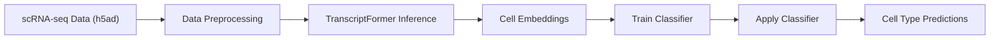
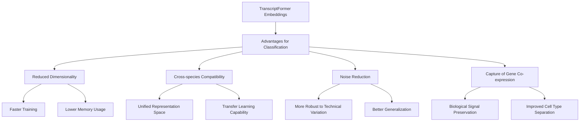
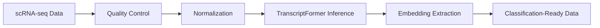
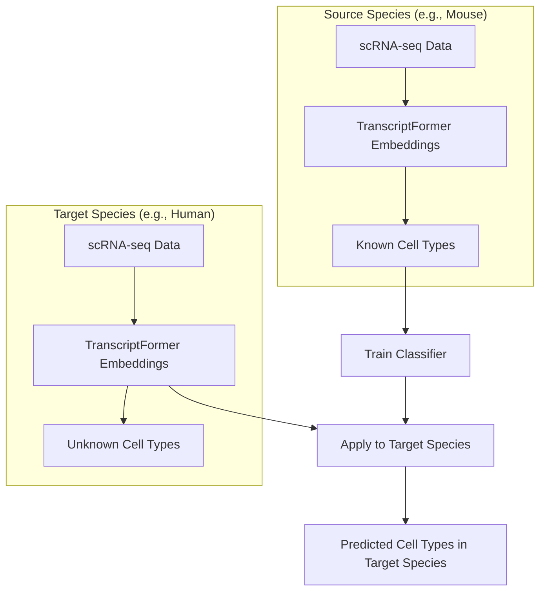
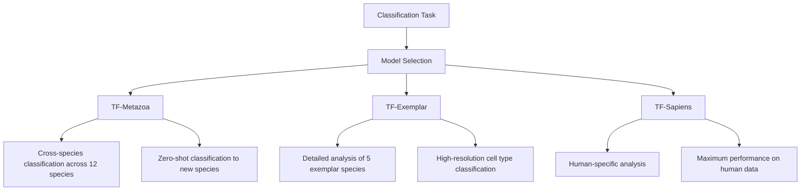

# Cell Type Classification

<details>
<summary>Relevant source files</summary>

The following files were used as context for generating this wiki page:

- [notebooks/celltype-classification-across-species.ipynb](notebooks/celltype-classification-across-species.ipynb)

</details>


This document provides a detailed guide for using TranscriptFormer models to perform cell type classification across species. Cell type classification is one of the primary applications of TranscriptFormer embeddings, leveraging their ability to create a unified representation space across species.

## Purpose and Scope

This guide covers how to use TranscriptFormer embeddings for cell type classification tasks, with special focus on cross-species applications. It explains the workflow from data preparation to evaluation of classification results. For information about generating embeddings through inference, see [Running Inference](#3).

## Classification Workflow

The general workflow for cell type classification using TranscriptFormer involves several key steps:



Title: Cell Type Classification Workflow

## Embedding Advantages for Classification

TranscriptFormer embeddings offer several advantages compared to using raw gene expression for cell type classification:



Title: Advantages of TranscriptFormer Embeddings for Classification

## Data Preparation

Before performing classification, your data must be properly prepared:



Title: Data Preparation Pipeline

Common preprocessing steps include:

| Step | Purpose | Typical Parameters |
|------|---------|-------------------|
| Cell filtering | Remove low-quality cells | min_genes=200, max_genes=5000 |
| Gene filtering | Remove rarely expressed genes | min_cells=10 |
| Normalization | Make cells comparable | target_sum=10000 |
| Log transformation | Handle skewed distributions | base=e |
| Embedding extraction | Get TranscriptFormer features | layer="last" or "all" |

## Classification Methods

TranscriptFormer embeddings can be used with various machine learning classifiers:

| Classifier | Strengths | Weaknesses | Best For |
|------------|-----------|------------|----------|
| Random Forest | Robust to noise, handles non-linear patterns | Memory-intensive for large datasets | General-purpose classification |
| SVM | Works well in high dimensions | Slower for large datasets | When clear boundaries exist |
| Logistic Regression | Fast, interpretable | Limited to linear boundaries | Baseline model, interpretability |
| Neural Networks | Captures complex patterns | Requires more data, risk of overfitting | Large datasets with complex relationships |
| kNN | Simple, no training required | Slow for large datasets | Quick prototyping, irregular boundaries |

## Cross-Species Classification

One of the key strengths of TranscriptFormer is enabling cross-species cell type classification:



Title: Cross-Species Classification Workflow

### Cross-Species Classification Approaches

1. **Direct Transfer**: Train on source species, apply directly to target species
2. **Fine-tuning**: Train on source species, then refine with limited target labels
3. **Multi-species Training**: Train on combined data from multiple species
4. **Domain Adaptation**: Apply techniques to align feature distributions between species

## Model Selection for Classification

Choose the appropriate TranscriptFormer model variant for your classification task:



Title: Model Selection for Classification Tasks

## Example Classification Workflow

A typical workflow for cell type classification using TranscriptFormer might look like this:

```python
# Conceptual example (not actual code)
import anndata
import scanpy as sc
from sklearn.ensemble import RandomForestClassifier
from sklearn.model_selection import train_test_split

# Load and preprocess data
adata = anndata.read_h5ad("mouse_data.h5ad")
sc.pp.filter_cells(adata, min_genes=200)
sc.pp.filter_genes(adata, min_cells=10)
sc.pp.normalize_total(adata, target_sum=1e4)
sc.pp.log1p(adata)

# Generate embeddings
embeddings = transcriptformer.infer(adata)

# Train classifier
X_train, X_test, y_train, y_test = train_test_split(
    embeddings, adata.obs["cell_type"], test_size=0.3, random_state=42
)
clf = RandomForestClassifier(n_estimators=100)
clf.fit(X_train, y_train)

# Evaluate
accuracy = clf.score(X_test, y_test)
print(f"Accuracy: {accuracy:.4f}")

# Cross-species application
human_adata = anndata.read_h5ad("human_data.h5ad")
human_embeddings = transcriptformer.infer(human_adata)
human_predictions = clf.predict(human_embeddings)
human_adata.obs["predicted_cell_type"] = human_predictions
```

## Best Practices

### Classification Strategy

1. **Start simple**: Begin with Random Forest or SVM before trying complex models
2. **Cross-validation**: Use k-fold cross-validation to prevent overfitting
3. **Hyperparameter tuning**: Optimize classifier parameters for TranscriptFormer embeddings
4. **Ensemble methods**: Consider combining multiple classifiers for better performance

### Cross-Species Considerations

1. **Evolutionary distance**: Classification performance generally decreases with evolutionary distance
2. **Reference selection**: Choose closely related source species when possible
3. **Fine-tuning**: Even a small amount of labeled target data can significantly improve performance
4. **Confidence scoring**: Use prediction probabilities to filter low-confidence classifications

## Troubleshooting

Common issues and solutions:

| Issue | Cause | Solution |
|-------|-------|----------|
| Poor classification performance | Data quality issues | Improve preprocessing, check for batch effects |
| Overfitting | Complex model, limited data | Simplify model, use regularization, get more data |
| Class imbalance | Rare cell types | Use balanced accuracy metrics, class weights, oversampling |
| Domain shift | Biological differences between species | Use domain adaptation, fine-tune with target data |
| Batch effects | Technical variation | Apply batch correction before embedding generation |

## Evaluation Guidelines

Evaluate your classification results using:

1. **Accuracy**: Overall proportion of correct predictions
2. **Balanced accuracy**: Average of recall for each class (better for imbalanced data)
3. **F1 score**: Harmonic mean of precision and recall
4. **Confusion matrix**: Detailed view of class-specific performance
5. **UMAP visualization**: Embed and visualize predicted vs. actual labels

For cross-species evaluation, compare performance to:
- Random prediction baseline
- Raw gene expression-based classification
- Previous state-of-the-art methods

## Real-World Applications

TranscriptFormer embeddings can be particularly useful for these classification scenarios:

1. **Cell atlas integration**: Unifying cell type annotations across datasets
2. **Rare cell type identification**: Leveraging knowledge from well-characterized species
3. **Evolutionary homology detection**: Finding conserved cell types across species
4. **Disease-state classification**: Identifying pathological cell states

---