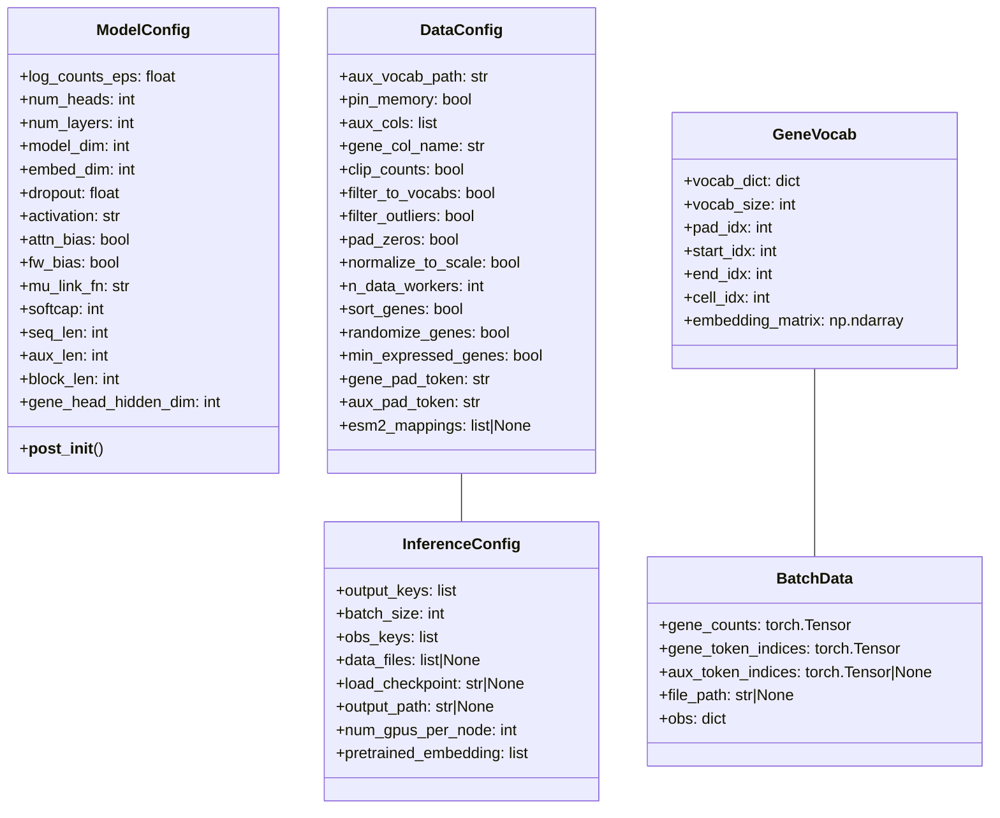
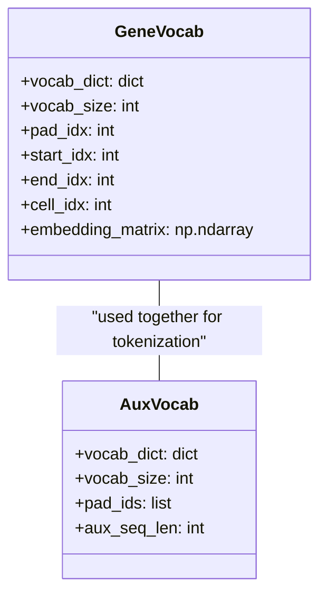
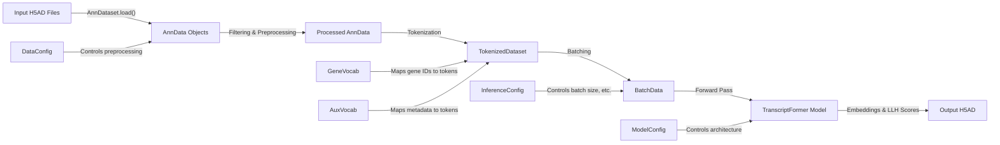
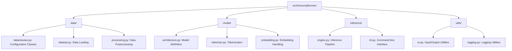

# Technical Reference

<details>
<summary>Relevant source files</summary>

The following files were used as context for generating this wiki page:

- [pyproject.toml](pyproject.toml)
- [src/transcriptformer/data/dataclasses.py](src/transcriptformer/data/dataclasses.py)

</details>


This document provides detailed technical information for developers who are working with the TranscriptFormer codebase. It covers core configuration classes, data structures, code organization, and architectural components. For usage instructions, see [Getting Started](#2) and [Running Inference](#3).

## Core Configuration Classes

TranscriptFormer uses a hierarchical configuration system based on Hydra for managing model architecture, data processing, and inference parameters. These classes are defined as dataclasses to ensure type safety and proper validation.



Sources: [src/transcriptformer/data/dataclasses.py:12-216]()

### ModelConfig

The `ModelConfig` class defines the transformer model architecture parameters. Key attributes include:

- `num_heads`: Number of attention heads
- `num_layers`: Number of transformer layers
- `model_dim`: Dimension of model's hidden representations
- `embed_dim`: Embedding dimension for tokens
- `dropout`: Dropout rate for regularization
- `activation`: Activation function (default: "gelu")
- `seq_len`: Maximum sequence length for genes (default: 2047)
- `aux_len`: Auxiliary sequence length (default: 1)

The `__post_init__` method performs validation to ensure that the sequence and auxiliary lengths are compatible with the block length, and that the mu link function is valid.

Sources: [src/transcriptformer/data/dataclasses.py:14-70]()

### DataConfig

The `DataConfig` class controls data processing and loading parameters:

- `gene_col_name`: Column name for gene identifiers
- `clip_counts`: Whether to clip maximum count values
- `filter_to_vocabs`: Whether to filter genes to only those in vocabulary
- `filter_outliers`: Whether to filter gene outliers
- `normalize_to_scale`: Whether to normalize counts to a specific scale
- `sort_genes`: Whether to sort genes by expression values
- `randomize_genes`: Whether to randomize gene order in each cell

Sources: [src/transcriptformer/data/dataclasses.py:90-142]()

### InferenceConfig

The `InferenceConfig` class manages inference settings:

- `batch_size`: Batch size for inference
- `output_keys`: Which model outputs to save
- `data_files`: List of data files to process
- `output_path`: Path where output files will be saved
- `num_gpus_per_node`: Number of GPUs to use per node
- `pretrained_embedding`: List of pretrained embeddings to use for out-of-distribution species

Sources: [src/transcriptformer/data/dataclasses.py:160-188]()

## Data Structures and Classes

TranscriptFormer uses several specialized data structures to handle gene expression data throughout the pipeline.

### Vocabulary Management



Sources: [src/transcriptformer/data/dataclasses.py:190-207]()

The `GeneVocab` class manages the vocabulary mapping between gene identifiers and token indices, with special indices for padding, start, end, and cell tokens. An optional embedding matrix can be included for pre-trained embeddings.

The `AuxVocab` class handles vocabulary for auxiliary information such as cell types or species, with support for padding tokens and controlling sequence length.

### Batch Processing

The `BatchData` class represents a batch of processed data ready for model input, containing:

- `gene_counts`: Tensor of gene expression counts
- `gene_token_indices`: Tensor of tokenized gene indices
- `aux_token_indices`: Optional tensor of auxiliary token indices
- `obs`: Dictionary containing observation metadata

Sources: [src/transcriptformer/data/dataclasses.py:210-216]()

## Data Flow Pipeline

The following diagram illustrates how data flows through the TranscriptFormer system:



Sources: [src/transcriptformer/data/dataclasses.py:90-142](), [src/transcriptformer/data/dataclasses.py:160-188]()

## Project Dependencies

TranscriptFormer relies on several key dependencies to function:

| Dependency | Version | Purpose |
|------------|---------|---------|
| torch | >=2.5,<2.6 | Deep learning framework |
| pytorch-lightning | >=2.3 | Training framework |
| anndata | >=0.10.5 | Data structure for gene expression matrices |
| hydra-core | >=1.3 | Configuration management |
| scanpy | >=1.10 | Single-cell analysis tools |
| pandas | >=2.2 | Data manipulation |
| numpy | >=1.26 | Numerical computing |
| boto3 | >=1.33 | AWS SDK for downloading model assets |
| h5py | >=3.10 | HDF5 file format support |

Sources: [pyproject.toml:18-34]()

## Model Architecture

TranscriptFormer implements a transformer-based architecture specialized for gene expression data:

```mermaid
flowchart TD
    A["Input: Gene & Aux Tokens"] --> B["Embedding Layer"]
    B --> C["Transformer Encoder"]
    C --> D["Output Representations"]
    D --> E1["Gene ID Head"]
    D --> E2["Expression Level Head"]
    
    subgraph "TranscriptFormer Encoder"
        F1["Layer 1: Multi-Head Attention"] --> F2["Layer 1: Feed Forward"]
        F2 --> F3["Layer 2: Multi-Head Attention"] --> F4["Layer 2: Feed Forward"]
        F4 --> F5["..."]
        F5 --> F6["Layer N: Multi-Head Attention"] --> F7["Layer N: Feed Forward"]
    end
    
    C --- TranscriptFormer Encoder
```

The architecture consists of:

1. An embedding layer that maps gene and auxiliary tokens to dense vectors
2. A stack of transformer encoder layers with multi-head attention
3. Output heads for gene identification and expression level prediction

The model parameters are controlled by the `ModelConfig` class, which specifies the number of layers, attention heads, embedding dimensions, and other architectural hyperparameters.

Sources: [src/transcriptformer/data/dataclasses.py:14-70]()

## Model Variants and Configurations

TranscriptFormer comes in three main variants, each with different parameters and training data:

| Model Variant | Parameters | Species Coverage | Vocabulary Size |
|---------------|------------|------------------|-----------------|
| TF-Metazoa | 444M | 12 species | 247,388 genes |
| TF-Exemplar | 542M | 5 species | 110,290 genes |
| TF-Sapiens | 368M | Human only | 23,829 genes |

Each variant uses the same underlying architecture but differs in vocabulary size, training data, and specific hyperparameters.

## Inference System

The inference pipeline processes new gene expression data through pre-trained TranscriptFormer models:

```mermaid
flowchart LR
    A["Input H5AD Files"] --> B["Data Loading"]
    B --> C["Preprocessing"]
    C --> D["InferenceEngine"]
    E["Model Checkpoint"] --> D
    F["Pretrained Embeddings"] -->"For OOD species"-->D
    D --> G["Gene Embeddings"]
    D --> H["Log-Likelihood Scores"]
    G --> I["Output H5AD File"]
    H --> I
    
    J["InferenceConfig"] -->"Controls process"-->D
    K["DataConfig"] -->"Controls preprocessing"-->C
```

The inference system supports:

1. **In-Distribution Inference**: Processing cells from species the model was trained on
2. **Out-of-Distribution Inference**: Processing cells from new species using pretrained embeddings

Sources: [src/transcriptformer/data/dataclasses.py:160-188]()

## Project Structure

The TranscriptFormer codebase follows a modular organization:



This structure separates concerns into distinct modules:
- `data/`: Data handling and configuration
- `model/`: Model architecture and components
- `inference/`: Inference pipeline and interfaces
- `utils/`: Common utilities for I/O and logging

Sources: [pyproject.toml:50-51]()

## Configuration System

TranscriptFormer uses Hydra for configuration management, which allows:

1. Hierarchical configuration with inheritance
2. Command-line overrides
3. Configuration composition
4. Default value specification

Configuration files are stored in YAML format and loaded via Hydra's `@hydra.main()` decorator, with the dataclasses providing type validation and conversion.

Sources: [pyproject.toml:22-25]()

---