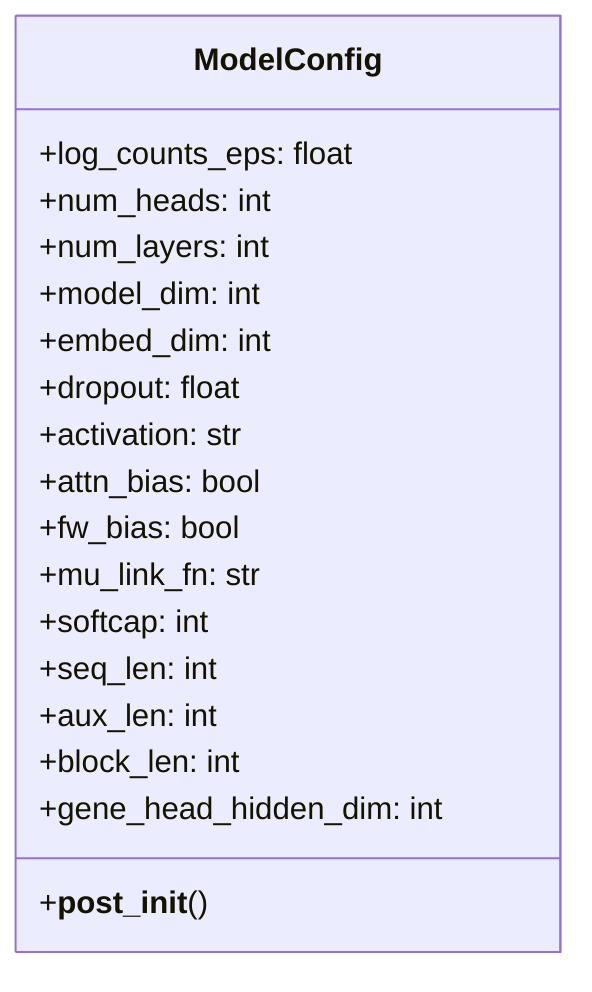
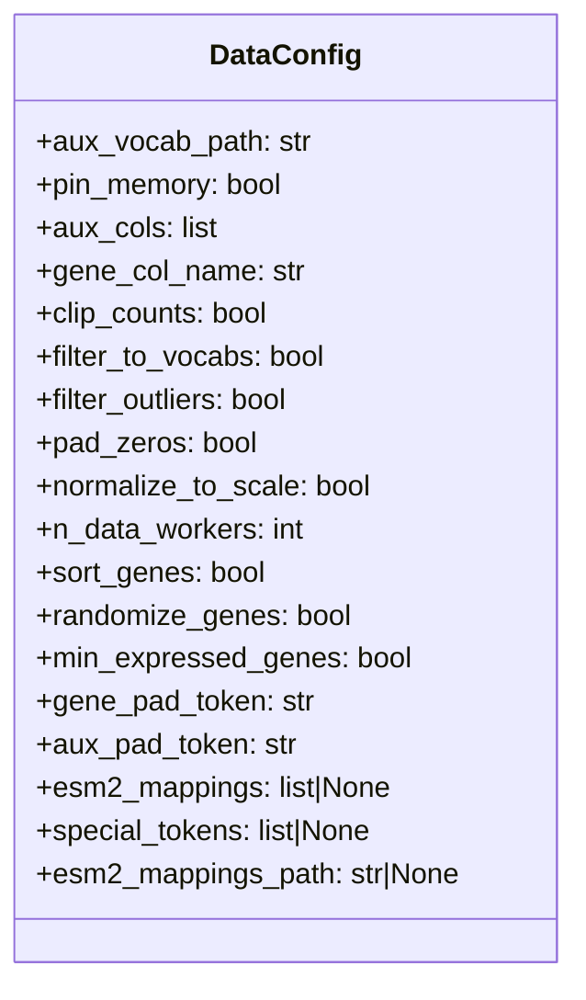
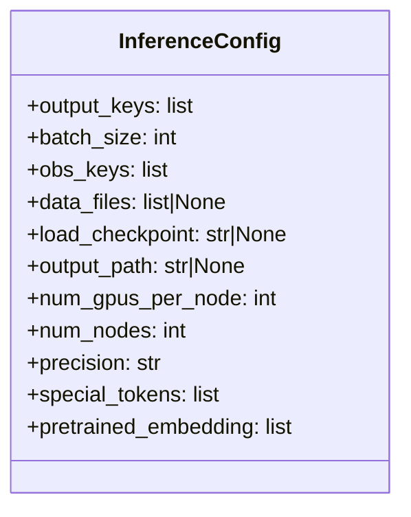
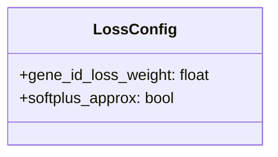
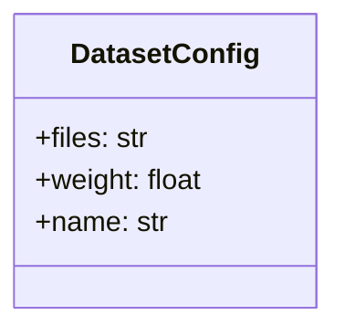
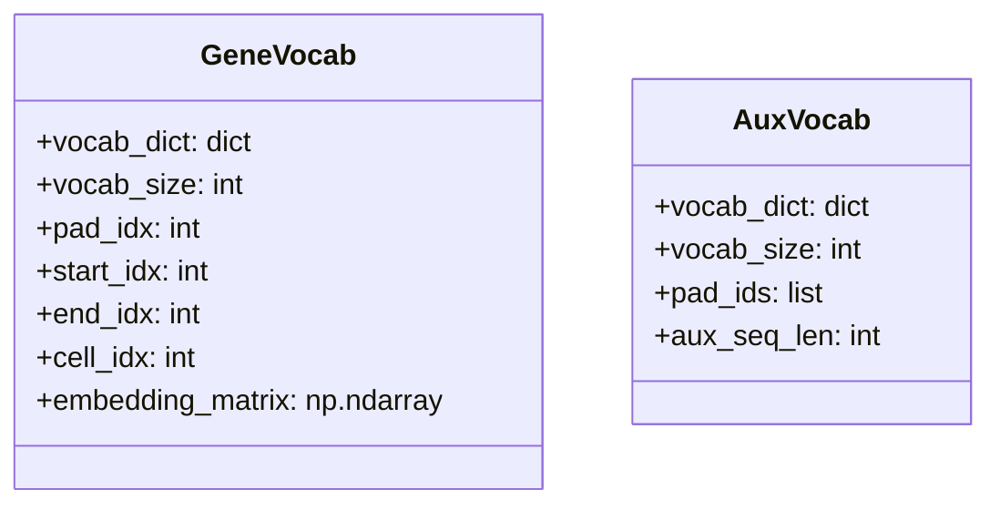
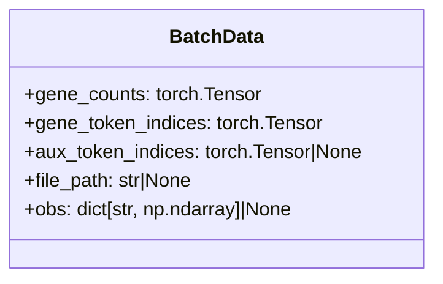
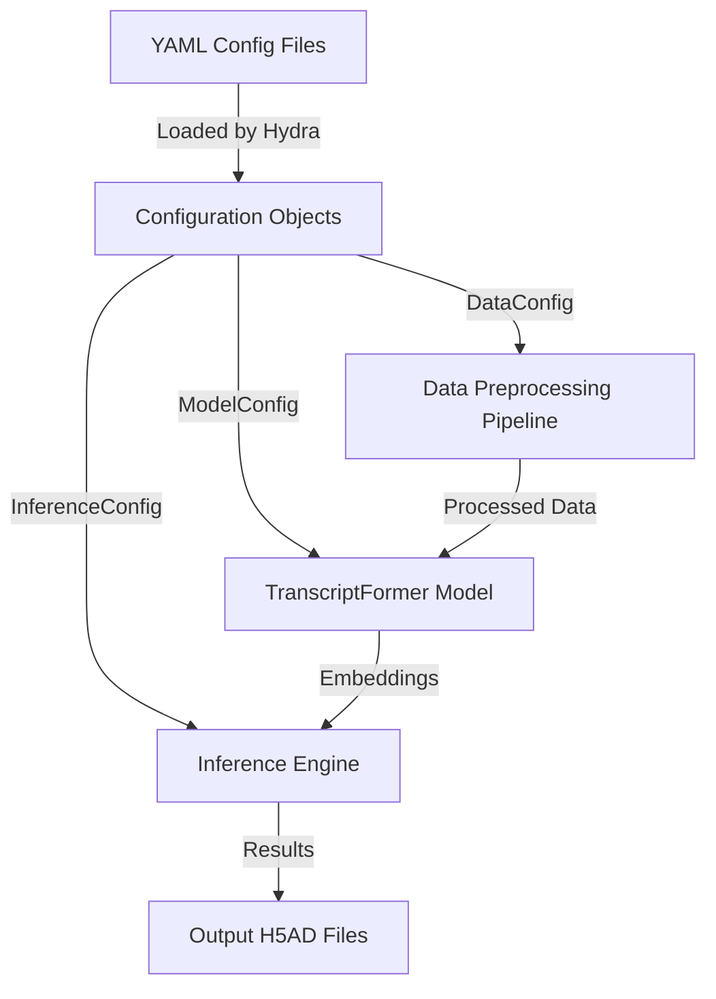

# Configuration Classes

<details>
<summary>Relevant source files</summary>

The following files were used as context for generating this wiki page:

- [conf/inference_config.yaml](conf/inference_config.yaml)
- [src/transcriptformer/data/dataclasses.py](src/transcriptformer/data/dataclasses.py)

</details>


This page documents the configuration dataclasses that govern various aspects of the TranscriptFormer system, from model architecture to data processing and inference settings. These configuration classes provide a structured, type-safe way to define parameters and settings used throughout the codebase.

For information about using these configurations when running inference, see [Running Inference](#3).

## Configuration Class Hierarchy

The configuration system in TranscriptFormer uses Python dataclasses to define the settings for different components. These classes form a logical hierarchy that reflects the structure of the system:

```mermaid
graph TD
    A["InferenceConfig"] --> B["DataConfig"]
    C["ModelConfig"] --- D["LossConfig"]
    E["DatasetConfig"] <-- B
    F["GeneVocab"] --- G["AuxVocab"]
    H["BatchData"] --> F
    H --> G
```

Sources: [src/transcriptformer/data/dataclasses.py:1-216]()

## Core Configuration Classes

### ModelConfig

`ModelConfig` defines the architecture of the transformer model:



Key parameters include:
- `num_heads`: Number of attention heads in the transformer
- `num_layers`: Number of transformer layers
- `model_dim`: Model dimension for internal representations
- `embed_dim`: Embedding dimension
- `dropout`: Dropout rate for regularization
- `activation`: Activation function (typically "gelu")
- `seq_len`: Maximum sequence length for genes (2047 by default)
- `aux_len`: Length of auxiliary token sequence (1 by default)

The `__post_init__` method validates configuration settings, ensuring that:
1. The sum of `seq_len` and `aux_len` is divisible by `block_len`
2. The `mu_link_fn` is one of the supported functions: 'exp', 'log', 'relu', 'sigmoid', 'softplus', 'linear', or 'softmax'

Sources: [src/transcriptformer/data/dataclasses.py:13-70]()

### DataConfig

`DataConfig` controls how input data is processed:



Key parameters include:
- `gene_col_name`: Column name in AnnData.var containing gene identifiers (default: 'ensembl_id')
- `clip_counts`: Maximum count value to allow (higher values are clipped)
- `filter_to_vocabs`: Whether to filter genes to only those in the vocabulary
- `filter_outliers`: Standard deviation threshold for filtering outlier cells
- `normalize_to_scale`: Scale factor for count normalization (0 = no normalization)
- `sort_genes`: Whether to sort genes by expression level
- `randomize_genes`: Whether to randomize gene order
- `min_expressed_genes`: Minimum number of expressed genes required per cell

Sources: [src/transcriptformer/data/dataclasses.py:89-142](), [conf/inference_config.yaml:24-34]()

### InferenceConfig

`InferenceConfig` specifies settings for running inference:



Key parameters include:
- `batch_size`: Number of samples to process in each batch
- `output_keys`: Keys to include in the output (e.g., 'embeddings', 'llh')
- `obs_keys`: Observation columns to include in output (e.g., 'all', 'cell_type', 'tissue')
- `data_files`: Paths to input AnnData files
- `output_path`: Directory where results will be saved
- `precision`: Numerical precision for inference (e.g., '16-mixed', '32')
- `pretrained_embedding`: Path to pretrained embeddings for out-of-distribution species

Sources: [src/transcriptformer/data/dataclasses.py:159-187](), [conf/inference_config.yaml:7-22]()

### LossConfig

`LossConfig` defines parameters for model training loss functions:



Key parameters:
- `gene_id_loss_weight`: Weight for gene ID prediction loss
- `softplus_approx`: Whether to use softplus approximation (default: true)

Sources: [src/transcriptformer/data/dataclasses.py:145-156]()

### DatasetConfig

`DatasetConfig` configures individual datasets:



Key parameters:
- `files`: Path to dataset files
- `weight`: Dataset weight in training (default: 1.0)
- `name`: Dataset name

Sources: [src/transcriptformer/data/dataclasses.py:73-86]()

## Vocabulary and Data Structures

### GeneVocab & AuxVocab

These classes define vocabularies for gene tokens and auxiliary tokens:



`GeneVocab` holds the mapping from gene identifiers to token indices and includes special token indices for padding, start, end, and cell tokens.

`AuxVocab` similarly defines the mapping for auxiliary tokens (like metadata) and their padding IDs.

Sources: [src/transcriptformer/data/dataclasses.py:190-207]()

### BatchData

`BatchData` represents a structured batch of data during processing:



Key fields:
- `gene_counts`: Tensor containing gene expression counts
- `gene_token_indices`: Tensor of gene token indices
- `aux_token_indices`: Optional tensor of auxiliary token indices
- `file_path`: Optional source file path
- `obs`: Optional dictionary of observation metadata

Sources: [src/transcriptformer/data/dataclasses.py:209-215]()

## Configuration Flow in TranscriptFormer

The following diagram illustrates how configuration is used within the TranscriptFormer system:



When running inference, the system:
1. Loads configuration from YAML files using Hydra
2. Instantiates `InferenceConfig` and `DataConfig` objects
3. Uses `DataConfig` to control data preprocessing
4. Uses `InferenceConfig` to guide the inference process
5. Outputs results according to the specified configuration

Sources: [conf/inference_config.yaml:1-34]()

## Example Configuration

Here's an example of how configuration is typically defined in YAML:

```yaml
model:
  inference_config:
    _target_: transcriptformer.data.dataclasses.InferenceConfig
    batch_size: 8
    output_keys:
      - embeddings
    obs_keys:
      - all
    data_files:
      - test/data/human_val.h5ad
    output_path: ./inference_results
    precision: 16-mixed

  data_config:
    _target_: transcriptformer.data.dataclasses.DataConfig
    gene_col_name: 'ensembl_id'
    clip_counts: 30
    filter_to_vocabs: true
    filter_outliers: 0.0
    normalize_to_scale: 0
    sort_genes: false
    randomize_genes: false
    min_expressed_genes: 0
```

In this example, the `_target_` field specifies which Python class to instantiate with the provided parameters. Hydra handles the instantiation process, creating properly configured objects for use by the system.

Sources: [conf/inference_config.yaml:1-34]()

## Configuration Usage Patterns

The configuration classes in TranscriptFormer follow these key design principles:

1. **Type Safety**: All parameters have explicit types for better IDE support and error checking
2. **Validation**: The `__post_init__` method validates parameters to ensure they meet requirements
3. **Defaults**: Sensible defaults are provided for optional parameters
4. **Extensibility**: The configuration system is designed to accommodate new parameters as the system evolves

These principles make the configuration system both robust and flexible, allowing users to customize the behavior of TranscriptFormer while preventing misconfigurations.

Sources: [src/transcriptformer/data/dataclasses.py:1-216]()

---