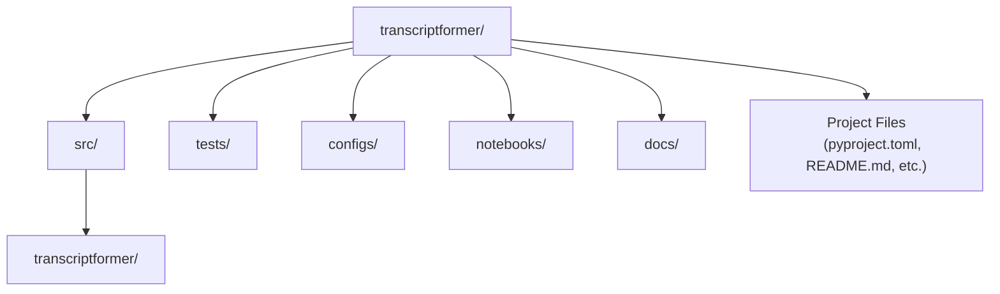
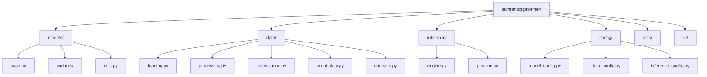
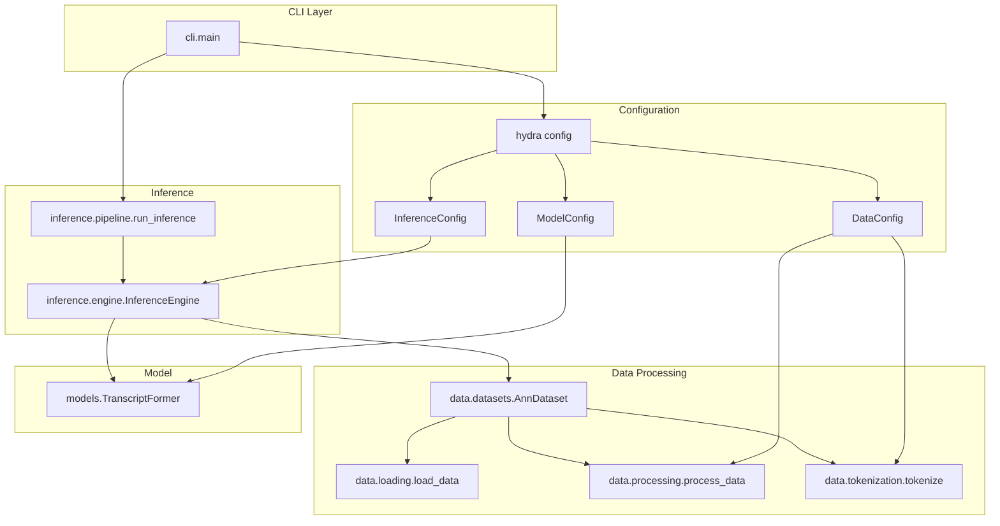
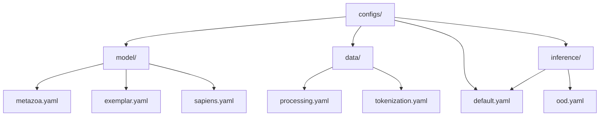
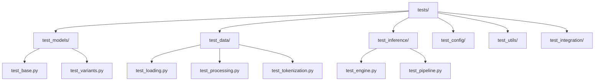
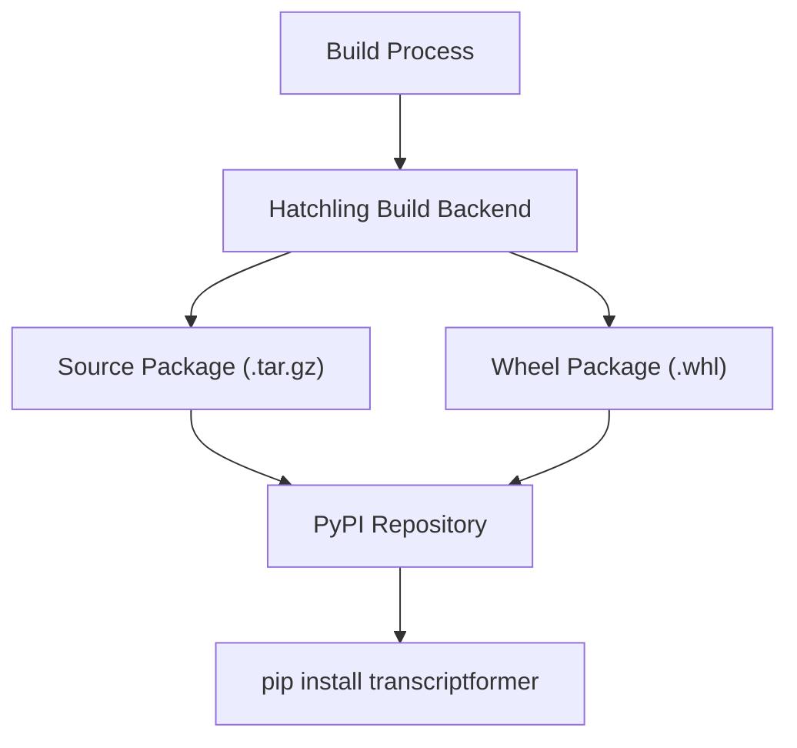

# Project Structure

Relevant source files

The following files were used as context for generating this wiki page:

- [.gitignore](.gitignore)
- [pyproject.toml](pyproject.toml)
- [src/transcriptformer/__init__.py](src/transcriptformer/__init__.py)
- [src/transcriptformer/data/__init__.py](src/transcriptformer/data/__init__.py)

This page provides an overview of the TranscriptFormer repository's file organization and directory structure. Understanding the project structure is essential for developers who want to contribute to the project or customize the models for their specific needs. For information about configuration classes used in the project, see [Configuration Classes](#6.1).

## Top-Level Organization

The TranscriptFormer repository follows a modern Python package structure with a src-based layout. This layout separates the package code from other project files and helps maintain a clean distribution.

Sources: [pyproject.toml](), [.gitignore]()

## Package Organization

The `src/transcriptformer` directory contains the main package code organized into several subpackages that align with the system's architecture.

Sources: [src/transcriptformer/__init__.py](), [src/transcriptformer/data/__init__.py]()

## Key Components and Their Roles

The TranscriptFormer codebase is organized around several key components, each with a specific responsibility in the system:

| Component | Purpose | Key Files |
|-----------|---------|-----------|
| Models | Defines the TranscriptFormer model architecture variants | models/base.py, models/variants/*.py |
| Data | Handles data loading, processing, and tokenization | data/loading.py, data/processing.py, data/tokenization.py |
| Inference | Manages the inference process | inference/engine.py, inference/pipeline.py |
| Config | Contains configuration classes for models, data, and inference | config/*.py |
| Utils | Provides utility functions used across the codebase | utils/*.py |
| CLI | Implements the command-line interface | cli/*.py |

## Data Flow and Component Interaction

The following diagram illustrates how the different components interact during the typical inference workflow:

Sources: [pyproject.toml]()

## Configuration System

TranscriptFormer uses Hydra for configuration management. Configuration files are stored in the `configs/` directory and organized hierarchically to match the structure of the code.

Sources: [.gitignore:180-181]()

## Development Tools and Project Files

The repository includes several files that support the development workflow and package distribution:

| File | Purpose |
|------|---------|
| pyproject.toml | Defines package metadata, dependencies, and build configuration |
| .gitignore | Specifies files and directories to exclude from version control |
| .pre-commit-config.yaml | Configures pre-commit hooks for code quality |
| README.md | Contains project documentation and usage instructions |

The project uses modern Python tooling:

- **Ruff** for linting and formatting, configured in pyproject.toml
- **Pytest** for testing
- **Hatchling** as the build backend

Sources: [pyproject.toml:1-97](), [.gitignore:1-183]()

## Test Structure

Tests are organized to mirror the package structure, ensuring comprehensive test coverage across all components:

Sources: [pyproject.toml:98-99]()

## Package Distribution

The project is configured as a Python package that can be installed via pip. The build configuration in `pyproject.toml` specifies that the package code is located in the `src/transcriptformer` directory.

Sources: [pyproject.toml:1-5](), [pyproject.toml:50-51]()

## Output and Artifact Management

The repository structure also accounts for various outputs and artifacts generated during model training and inference:

- **lightning_logs/** - Contains logs generated by PyTorch Lightning during training
- **outputs/** - Stores outputs from inference runs
- **mlruns/** - Used for experiment tracking with MLflow
- **multirun/** - Contains outputs from Hydra's multirun feature

These directories are included in the .gitignore file to prevent large binary files from being committed to the repository.

Sources: [.gitignore:171-176]()

## Summary

The TranscriptFormer project follows a well-organized structure that separates concerns and promotes maintainability. The src-based layout with clear module boundaries aligns with modern Python best practices. The configuration system, powered by Hydra, provides flexibility while maintaining control over model behavior. This organization facilitates both research experimentation and production deployment of the TranscriptFormer models.

---