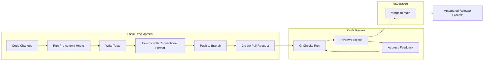
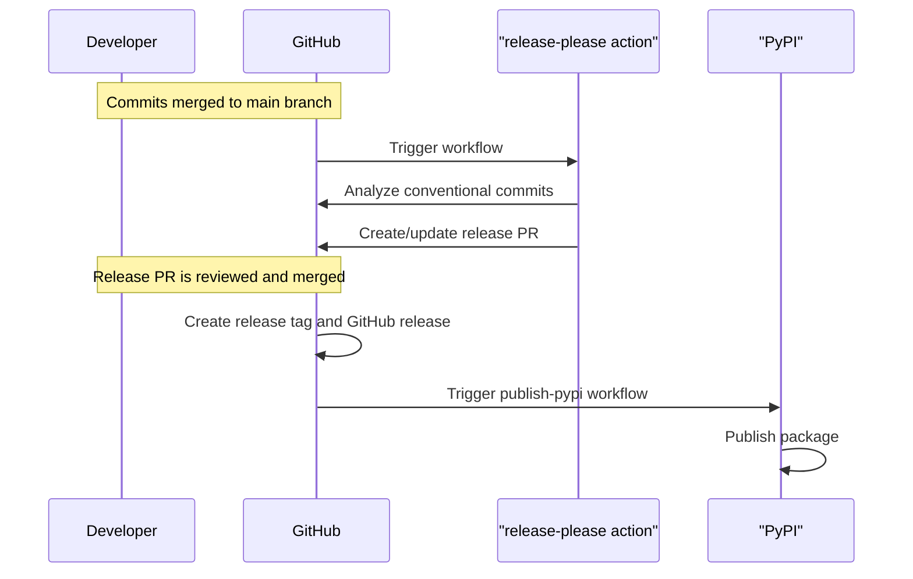
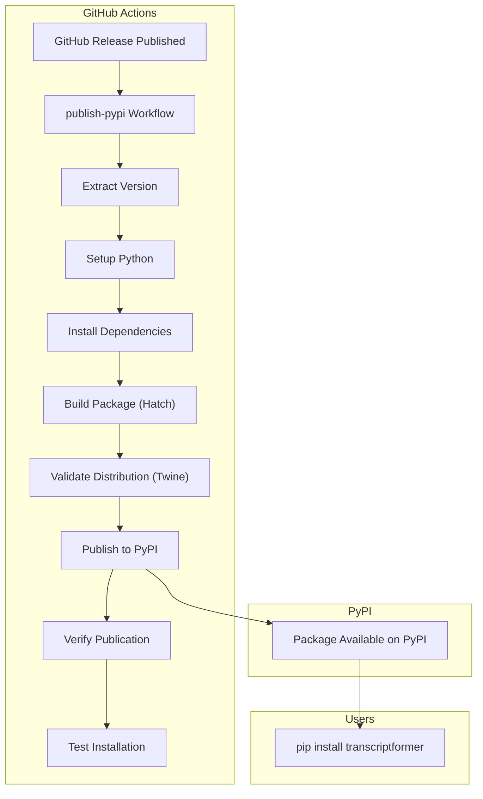
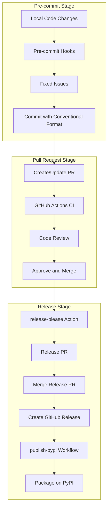

# Development and Release Process

<details>
<summary>Relevant source files</summary>

The following files were used as context for generating this wiki page:

- [.github/workflows/publish-pypi.yml](.github/workflows/publish-pypi.yml)
- [.github/workflows/release-please.yaml](.github/workflows/release-please.yaml)

</details>


This page documents the development and release process for the TranscriptFormer repository. It covers the entire workflow from development to release, including code quality standards, continuous integration, and package publishing. For information about the project structure, see [Project Structure](#6.2). For configuration details, see [Configuration Classes](#6.1).

## Development Workflow

The TranscriptFormer project follows modern software development practices with an emphasis on code quality and automation.

### Code Quality Tools

TranscriptFormer uses several tools to maintain code quality:

1. **Pre-commit Hooks**: Automated checks that run before each commit to ensure code quality standards are met.
2. **Conventional Commits**: A standardized commit message format that makes the commit history more readable and enables automated versioning.
3. **Unit Tests**: Comprehensive test suite to verify functionality.

### Conventional Commits Standard

All commits should follow the [Conventional Commits](https://www.conventionalcommits.org/) format:

```
<type>(<scope>): <description>

[optional body]

[optional footer(s)]
```

Common types:
- `feat`: A new feature
- `fix`: A bug fix
- `docs`: Documentation only changes
- `style`: Changes that do not affect the meaning of the code
- `refactor`: Code changes that neither fix a bug nor add a feature
- `test`: Adding or modifying tests
- `chore`: Changes to the build process or auxiliary tools

Example:
```
feat(inference): add support for out-of-distribution species
```

This commit message convention is essential as it powers the automated release process described below.

Sources: `.github/workflows/release-please.yaml`

### Development Workflow Diagram



Sources: `.github/workflows/release-please.yaml`

## Release Process

TranscriptFormer uses an automated release process powered by [Release Please](https://github.com/googleapis/release-please), which automatically creates release pull requests based on conventional commits.

### Release Automation

When code changes are merged to the main branch, the `release-please` GitHub Action analyzes the commit history since the last release and:

1. Determines the appropriate version bump (major, minor, or patch) based on conventional commit types
2. Updates the version in `pyproject.toml`
3. Generates a changelog based on commit messages
4. Creates or updates a release pull request

Once the release PR is approved and merged, GitHub automatically:

1. Creates a new release tag
2. Publishes a GitHub release with generated release notes
3. Triggers the PyPI publish workflow



Sources: `.github/workflows/release-please.yaml`

### Release Please Configuration

The Release Please workflow is configured in [.github/workflows/release-please.yaml]().

Key configuration:
- Triggered on pushes to main branch
- Uses `release-type: python` for Python package versioning
- Creates or updates a release PR when conventional commits indicate a version change

## Package Building and Publishing

When a new release is created on GitHub, the `publish-pypi` workflow automatically builds and publishes the package to PyPI.

### PyPI Publication Process

The publication process consists of the following steps:

1. Checkout code repository
2. Extract version from GitHub release tag
3. Set up Python environment
4. Install build dependencies
5. Build package using Hatch
6. Validate distribution files with Twine
7. Publish to PyPI using Trusted Publisher authentication
8. Verify publication by checking PyPI index
9. Install and test the published package



Sources: `.github/workflows/publish-pypi.yml`

### Package Build Process

The package is built using [Hatch](https://github.com/pypa/hatch), a modern Python project management tool. The build configuration is defined in `pyproject.toml`.

The `publish-pypi.yml` workflow:
1. Installs dependencies with `uv`, a fast Python package installer
2. Builds the package with `hatch build`
3. Validates distribution files with `twine check`
4. Publishes to PyPI using the GitHub-provided trusted publisher authentication
5. Verifies the package is available on PyPI and installable

Sources: `.github/workflows/publish-pypi.yml:46-67`

## Continuous Integration

Continuous integration runs automatically on all pull requests to ensure code quality and prevent regressions.

### CI Checks

The CI pipeline performs several checks:

1. **Linting**: Code style and quality checks
2. **Type Checking**: Static type analysis
3. **Unit Tests**: Run test suite to verify functionality
4. **Build Checks**: Ensure package builds correctly

### Integration with Development Workflow



## Development Tips

### Local Testing

Before submitting a PR, run the following locally:

1. Pre-commit hooks to catch common issues:
   ```bash
   pre-commit run --all-files
   ```

2. Tests to ensure functionality:
   ```bash
   pytest
   ```

3. Build check to verify package builds:
   ```bash
   hatch build
   ```

### Triggering a Manual Release

In exceptional cases, a release can be triggered manually:

1. Create a PR that bumps the version in `pyproject.toml`
2. After merging, manually create a GitHub release
3. The publish workflow will automatically trigger

Manual publication can also be initiated by triggering the `publish-pypi` workflow directly via the GitHub Actions interface.

Sources: `.github/workflows/publish-pypi.yml:6`

## Troubleshooting

### Common Release Issues

1. **Release Not Created**: Ensure conventional commit format is followed. The release automation relies on these commit messages to determine version changes.

2. **PyPI Publication Failure**: Check the workflow logs for specific errors. Common issues include:
   - Version conflicts (version already exists on PyPI)
   - Build failures
   - PyPI authentication issues

### Getting Help

If you encounter issues with the development or release process, please create an issue on the GitHub repository with details about the problem.

---