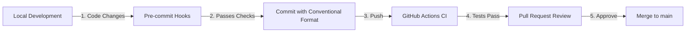
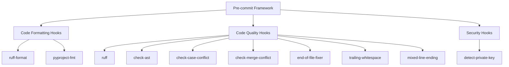
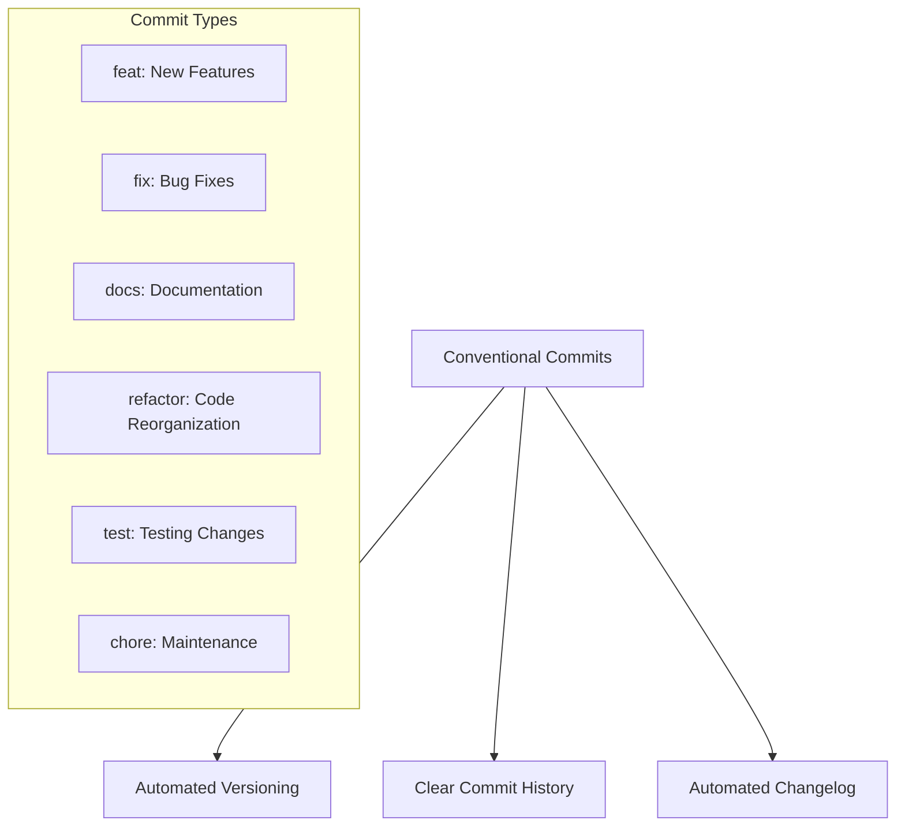
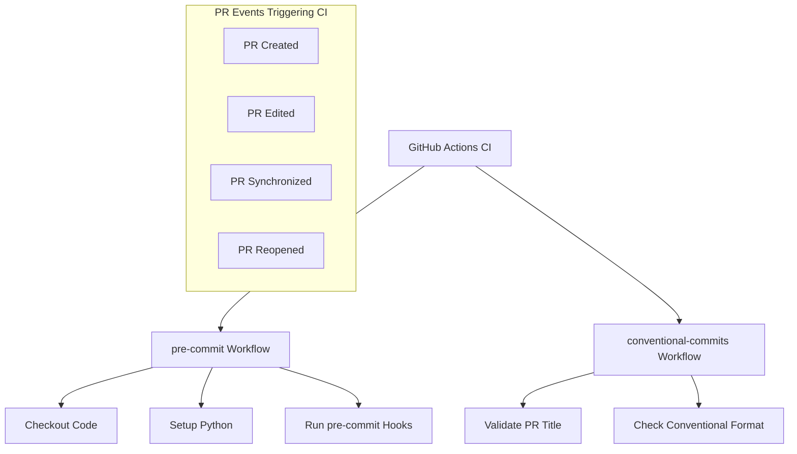
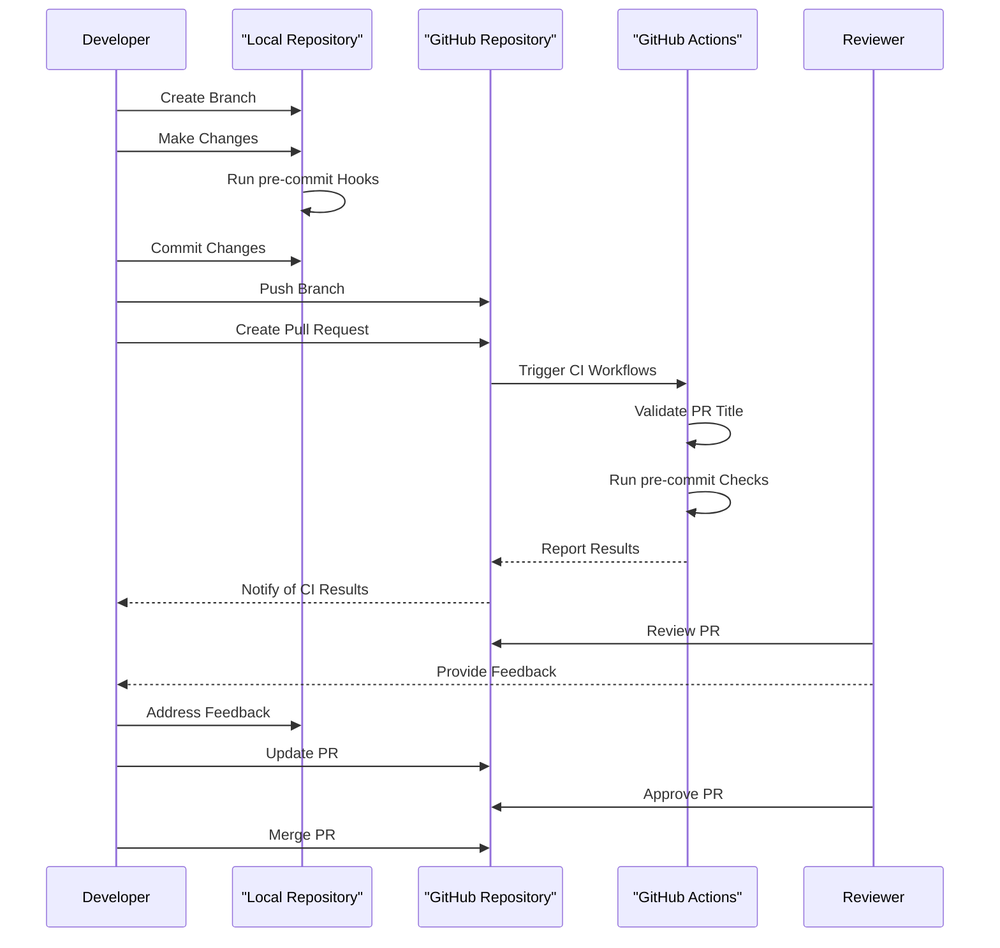

# Development Workflow

<details>
<summary>Relevant source files</summary>

The following files were used as context for generating this wiki page:

- [.github/workflows/conventional-commits.yml](.github/workflows/conventional-commits.yml)
- [.github/workflows/pre-commit.yml](.github/workflows/pre-commit.yml)
- [.pre-commit-config.yaml](.pre-commit-config.yaml)

</details>


This document describes the development workflow for the TranscriptFormer project, including code quality tools, commit standards, continuous integration, and the pull request process. For information about the release process, see [Release Process](#7.2).

## Development Workflow Overview

The TranscriptFormer project follows a structured development workflow to ensure code quality and maintainability. The workflow incorporates automated checks, standardized commit messages, and continuous integration.



Sources: [.github/workflows/pre-commit.yml](), [.github/workflows/conventional-commits.yml](), [.pre-commit-config.yaml]()

## Code Quality Tools

TranscriptFormer uses pre-commit hooks to maintain code quality. These hooks run automatically before each commit (when configured locally) and as part of CI workflows.

### Pre-commit Hooks Configuration

The project uses the following pre-commit hooks:

| Hook | Purpose |
|------|---------|
| pyproject-fmt | Formats pyproject.toml files |
| ruff | Lints Python code with automatic fixing |
| ruff-format | Formats Python code |
| detect-private-key | Prevents committing private keys |
| check-ast | Validates Python syntax |
| end-of-file-fixer | Ensures files end with a newline |
| mixed-line-ending | Normalizes line endings to LF |
| trailing-whitespace | Removes trailing whitespace |
| check-case-conflict | Checks for case conflicts |
| check-merge-conflict | Checks for unresolved merge conflicts |



Sources: [.pre-commit-config.yaml]()

### Setting Up Pre-commit Locally

To set up pre-commit hooks in your local environment:

1. Install pre-commit: `pip install pre-commit`
2. Install the git hooks: `pre-commit install`
3. Install the push hooks: `pre-commit install --hook-type pre-push`

Once installed, pre-commit will automatically run the configured hooks before each commit.

## Commit Standards

TranscriptFormer follows the Conventional Commits standard for commit messages. This standardized format makes the commit history readable and facilitates automated versioning and changelog generation.

### Conventional Commits Format

```
<type>[optional scope]: <description>

[optional body]

[optional footer(s)]
```

Common types include:
- `feat`: A new feature
- `fix`: A bug fix
- `docs`: Documentation changes
- `style`: Changes that don't affect code meaning (formatting, etc.)
- `refactor`: Code changes that neither fix bugs nor add features
- `test`: Adding or updating tests
- `chore`: Changes to build process or auxiliary tools

Example commit messages:
```
feat(model): add support for out-of-distribution species
fix(data): correct normalization for sparse matrices
docs: update installation instructions
```

The PR title must also follow this convention, as it's validated by the CI workflow.



Sources: [.github/workflows/conventional-commits.yml]()

## Continuous Integration

The project uses GitHub Actions for continuous integration, which automatically runs checks on pull requests and pushes to the main branch.

### CI Workflows

#### Pre-commit Validation

This workflow runs the pre-commit hooks on all files to ensure code quality.

```yaml
# Runs on pull requests and pushes to main
name: pre-commit
runs-on: ubuntu-latest
steps:
  - checkout code
  - setup Python
  - run pre-commit hooks
```

#### Conventional Commits Validation

This workflow validates that PR titles follow the Conventional Commits standard.

```yaml
# Runs on PR creation, edit, synchronize, and reopen
name: conventional-commits
runs-on: ubuntu-latest
steps:
  - validate PR title follows conventional commits format
```



Sources: [.github/workflows/pre-commit.yml](), [.github/workflows/conventional-commits.yml]()

## Pull Request Process

The pull request process for TranscriptFormer follows these steps:

1. Create a branch for your changes
2. Make your changes and ensure all pre-commit hooks pass
3. Commit with conventional commit messages
4. Push your branch and create a pull request
5. Ensure the PR title follows the conventional commits format
6. Wait for CI checks to pass
7. Address review feedback
8. Once approved, merge the PR

### PR Title Validation

PR titles are automatically validated to ensure they follow the Conventional Commits standard. This validation occurs when a PR is:
- Created
- Edited
- Synchronized with new commits
- Reopened

If the PR title doesn't follow the standard, the check will fail and you'll need to update the title.



Sources: [.github/workflows/conventional-commits.yml](), [.github/workflows/pre-commit.yml]()

## Troubleshooting Common Issues

### Pre-commit Hook Failures

If pre-commit hooks fail, read the error message carefully. Common issues include:

- **Formatting issues**: Run `pre-commit run --all-files` to fix formatting issues automatically
- **Linting errors**: Review the ruff error messages and fix the issues manually
- **End-of-file issues**: Ensure all files end with a newline

### Conventional Commits Validation Failures

If the PR title validation fails, ensure your PR title follows the conventional commits format:

```
<type>[optional scope]: <description>
```

Valid types include: feat, fix, docs, style, refactor, test, chore.

## Conclusion

Following this development workflow ensures code quality and consistency across the TranscriptFormer project. The automated checks and standardized commit messages help maintain a clean codebase and facilitate future development.

For information about how releases are created and published to PyPI, see the [Release Process](#7.2) documentation.

---