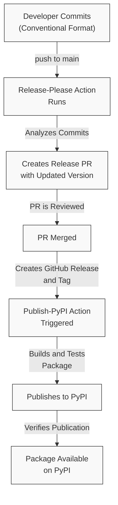
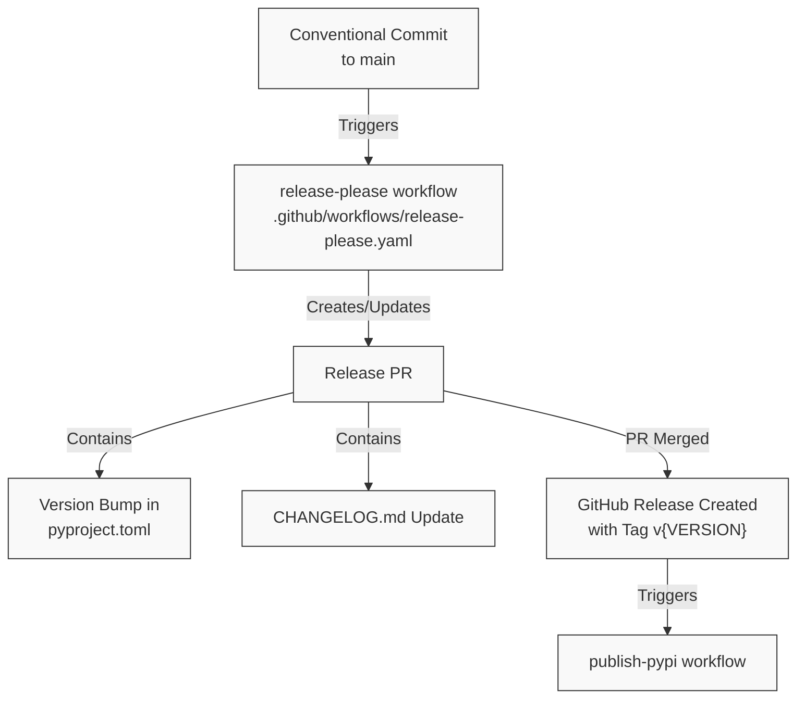
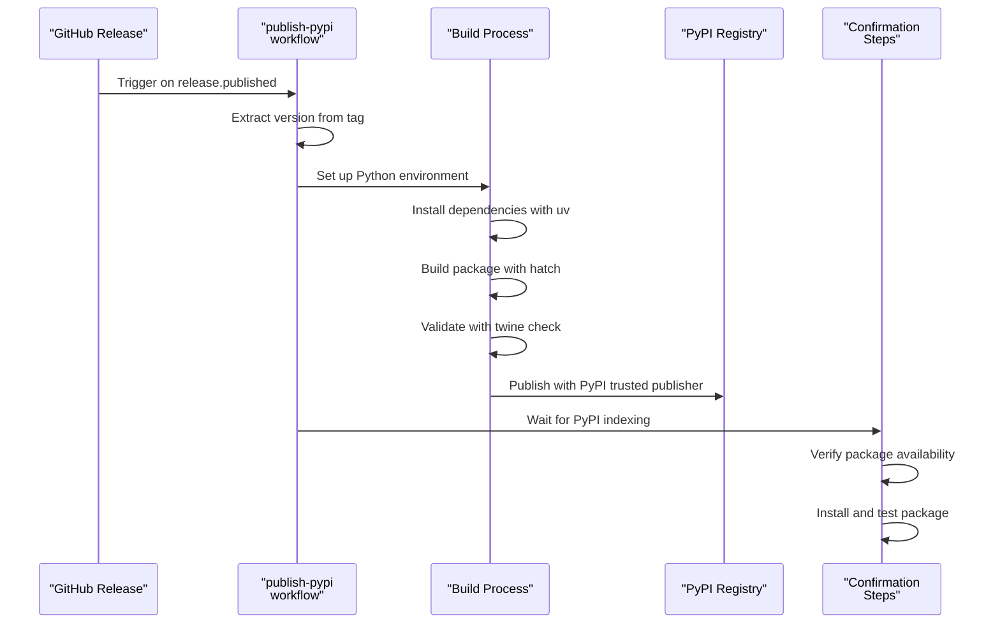

# Release Process

Relevant source files

The following files were used as context for generating this wiki page:

- [.github/workflows/publish-pypi.yml](.github/workflows/publish-pypi.yml)
- [.github/workflows/release-please.yaml](.github/workflows/release-please.yaml)

This page documents the automated release process for the TranscriptFormer package, which includes version management, release creation, and PyPI publication. For information about the development workflow that precedes the release process, see [Development Workflow](#7.1).

## Release Process Overview

TranscriptFormer uses an automated release process that integrates with GitHub Actions workflows. The process is designed to maintain consistent versioning, comprehensive release notes, and reliable PyPI package publication.

Sources: [.github/workflows/release-please.yaml](), [.github/workflows/publish-pypi.yml]()

## Conventional Commits

TranscriptFormer relies on [Conventional Commits](https://www.conventionalcommits.org/) to automate version increments and generate release notes. The commit format determines how version numbers are incremented.

| Commit Type | Example | Version Impact |
|-------------|---------|----------------|
| `feat` | `feat: add new embedding method` | Minor version increment (1.0.0 → 1.1.0) |
| `fix` | `fix: resolve OOD inference issue` | Patch version increment (1.0.0 → 1.0.1) |
| `feat!` or `fix!` | `feat!: change API interface` | Major version increment (1.0.0 → 2.0.0) |
| `docs`, `test`, `refactor`, etc. | `docs: update installation guide` | No version increment |

All commits to the main branch should follow this format to ensure proper release automation.

## Release-Please Workflow

The Release-Please workflow automates version management and release preparation.

Sources: [.github/workflows/release-please.yaml]()

### Key Components of Release-Please

1. **GitHub App Token**: A custom GitHub App token is used to authenticate the release-please action
   - This allows the action to create PRs that can trigger other workflows

2. **Release Type**: Configured for Python projects
   - Automatically detects version formats in pyproject.toml
   - Updates files according to Python project standards

3. **Pull Request Contents**:
   - Version updates in pyproject.toml
   - Updated CHANGELOG.md with grouped changes (Features, Bug Fixes, etc.)
   - Other version references updated throughout the codebase

4. **Merge Process**:
   - PR requires review and approval
   - Once merged, a GitHub Release is automatically created with the new version tag

## PyPI Publishing Workflow

When a new release is published on GitHub, the PyPI publishing workflow automatically builds and publishes the package to PyPI.

Sources: [.github/workflows/publish-pypi.yml]()

### Key Steps in PyPI Publishing

1. **Environment Setup**:
   - Runs on Ubuntu latest
   - Uses PyPI environment for secret management
   - Configures write permissions for PyPI trusted publisher authentication

2. **Build Process**:
   - Extracts version number from GitHub tag: [.github/workflows/publish-pypi.yml:19-26]()
   - Sets up Python based on version in pyproject.toml: [.github/workflows/publish-pypi.yml:28-31]()
   - Uses `uv` for dependency installation: [.github/workflows/publish-pypi.yml:40-44]()
   - Builds package with `hatch build`: [.github/workflows/publish-pypi.yml:46-47]()
   - Validates distribution files with `twine check`: [.github/workflows/publish-pypi.yml:49-50]()

3. **Publication**:
   - Uses PyPI's trusted publisher workflow for secure authentication: [.github/workflows/publish-pypi.yml:52-53]()
   - No API tokens need to be stored in GitHub secrets

4. **Verification**:
   - Confirms package indexing on PyPI with retries: [.github/workflows/publish-pypi.yml:55-61]()
   - Installs and tests the package from PyPI: [.github/workflows/publish-pypi.yml:63-67]()
   - Verifies correct version is installed

## Manual Release Process

While the automated process is preferred, releases can be triggered manually if needed:

1. **Manual Release-Please Trigger**: Not available through UI actions

2. **Manual PyPI Publication**:
   - Can be triggered through GitHub UI via workflow_dispatch event
   - Navigate to Actions → Publish to PyPI → Run workflow
   - This will build and publish the current code

## Release Artifacts

After a successful release, the following artifacts are produced:

| Artifact | Location | Purpose |
|----------|----------|---------|
| GitHub Release | GitHub Releases tab | Release notes and downloadable source archives |
| PyPI Package | PyPI.org | Installable via pip install transcriptformer |
| Git Tag | GitHub Repository | Reference point in version control |
| Updated CHANGELOG.md | Repository | Historical record of changes |

## Troubleshooting

If the release process fails, check the following common issues:

1. **Release-Please PR fails to generate**:
   - Ensure commits follow conventional format
   - Check if the GitHub App token has correct permissions

2. **PyPI publication fails**:
   - Check GitHub Actions logs for build errors
   - Ensure PyPI trusted publisher configuration is correct
   - Verify package version is not already published

3. **Version conflicts**:
   - If release version already exists, manually bump version in release-please PR

Sources: [.github/workflows/release-please.yaml](), [.github/workflows/publish-pypi.yml]()

---