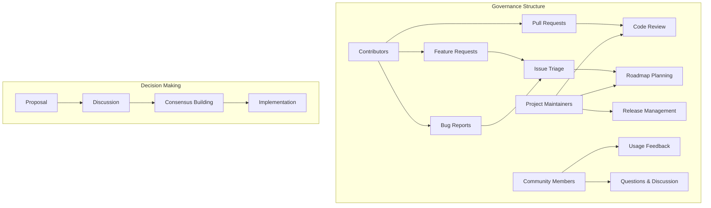
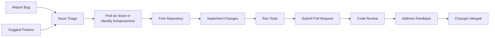
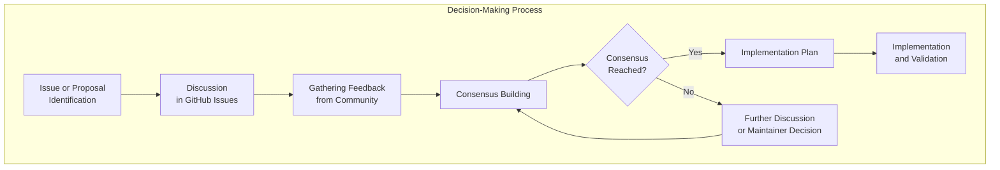
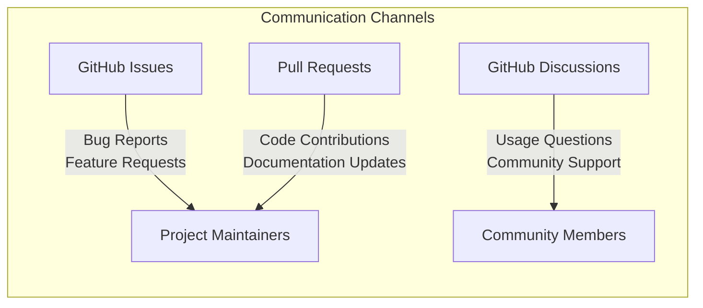
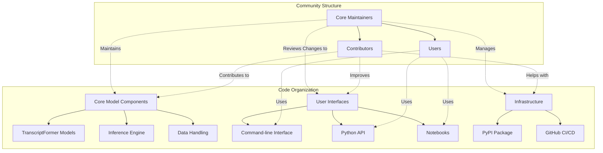

# Community and Governance

Relevant source files

The following files were used as context for generating this wiki page:

- [CODE_OF_CONDUCT.md](CODE_OF_CONDUCT.md)
- [LICENSE.md](LICENSE.md)
- [SECURITY.md](SECURITY.md)

This page provides information about the TranscriptFormer community structure, governance model, and guidelines for participation. It covers how decisions are made, how to contribute to the project, and the policies that govern community interactions. For technical information about the development workflow, please refer to [Development Workflow](#7.1).

## Project Governance Structure

TranscriptFormer is an open-source project maintained by the Chan Zuckerberg Initiative (CZI). The project follows a transparent governance model to ensure sustainable development and community engagement.

The governance structure enables collaborative development while maintaining project quality and alignment with scientific research needs.

Sources: [CODE_OF_CONDUCT.md:41-51]()

## How to Contribute

TranscriptFormer welcomes contributions from the community. Contributors can participate through various channels and activities:

All contributions to TranscriptFormer must adhere to the project's Code of Conduct and follow the established development workflow.

Sources: [CODE_OF_CONDUCT.md:17-26]()

## Community Guidelines and Code of Conduct

TranscriptFormer follows the Contributor Covenant Code of Conduct to ensure a welcoming and inclusive environment for all participants. The code of conduct outlines expectations for community behavior and enforcement procedures.

### Key Principles

| Principle | Description |
|-----------|-------------|
| Respect | Be respectful of differing opinions, viewpoints, and experiences |
| Empathy | Demonstrate empathy and kindness toward other people |
| Constructive Feedback | Give and gracefully accept constructive feedback |
| Accountability | Accept responsibility and apologize when mistakes are made |
| Community Focus | Focus on what is best for the overall community |

### Enforcement

Violations of the code of conduct can be reported to the community leaders responsible for enforcement at opensource@chanzuckerberg.com. All complaints will be reviewed and investigated promptly and fairly.

The full Code of Conduct can be found in the repository's [CODE_OF_CONDUCT.md]() file.

Sources: [CODE_OF_CONDUCT.md:3-37](), [CODE_OF_CONDUCT.md:62-114]()

## Decision-Making Process

Decisions in the TranscriptFormer project are made through a consensus-seeking approach with final authority resting with the project maintainers.

Major decisions about the project's direction, architecture, and feature roadmap are guided by balancing community input with the project's long-term vision and scientific goals.

Sources: [CODE_OF_CONDUCT.md:41-51]()

## License and Usage Terms

TranscriptFormer is released under the MIT License, which provides the following permissions and limitations:

| Permission | Description |
|------------|-------------|
| Commercial use | The software can be used for commercial purposes |
| Modification | The software can be modified |
| Distribution | The software can be distributed |
| Private use | The software can be used privately |
| Sublicense | The software can be sublicensed |

### License Requirements

Users of TranscriptFormer must include the original copyright notice and permission notice in all copies or substantial portions of the software.

The full license terms can be found in the repository's [LICENSE.md]() file.

Sources: [LICENSE.md:1-21]()

## Responsible Use Policy

As an AI-based tool for biological data analysis, TranscriptFormer has established guidelines for responsible use:

- Users are expected to follow the project's [Acceptable Use Policy](https://virtualcellmodels.cziscience.com/acceptable-use-policy)
- The tool should be used in accordance with applicable laws and regulations
- Users should be transparent about the use of AI-generated results in scientific publications

Sources: [CODE_OF_CONDUCT.md:39]()

## Security Vulnerability Reporting

TranscriptFormer takes security issues seriously. If you discover a security vulnerability within the project, please follow these steps:

1. Do not disclose the vulnerability publicly
2. Report the issue directly to security@chanzuckerberg.com
3. Provide detailed information about the vulnerability and steps to reproduce it
4. Allow time for the issue to be addressed before public disclosure

For more information, see the [SECURITY.md]() file in the repository.

Sources: [SECURITY.md:1-3]()

## Community Communication Channels

The TranscriptFormer community uses these primary channels for communication:

1. **GitHub Issues**: For bug reports, feature requests, and tracking development tasks
2. **GitHub Discussions**: For general questions, use cases, and community support
3. **Pull Requests**: For submitting code contributions and reviewing changes

Sources: [CODE_OF_CONDUCT.md:55-59]()

## Relationship between Community and Code Structure

The following diagram illustrates how the community governance structure maps to the project's code organization:

This relationship demonstrates how community roles align with different components of the codebase, ensuring that development efforts are coordinated and that all parts of the system receive appropriate attention and maintenance.

Sources: [CODE_OF_CONDUCT.md:41-51]()

## Evolution and Future Growth

The TranscriptFormer community is designed to evolve over time as the project matures. Future governance changes may include:

- Formation of specialized working groups for different aspects of the project
- Establishment of a more formal technical steering committee
- Development of additional contributor guidelines for specific components
- Creation of a more structured roadmap planning process

Community members are encouraged to participate in discussions about the project's governance and future direction.

Sources: [CODE_OF_CONDUCT.md:17-26]()