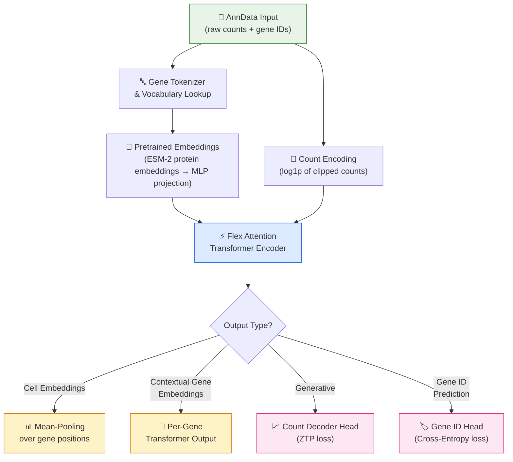

TranscriptFormer is a family of **generative foundation models** for single-cell transcriptomics that learns rich, context-aware representations of cells by jointly modeling genes and their expression levels. Trained on up to 112 million cells spanning 1.53 billion years of evolution across 12 species, it represents a **cross-species generative cell atlas** — a single model architecture that can encode, reconstruct, and compare transcriptomes from organisms as diverse as humans, fruit flies, and freshwater sponges. Whether you want to extract cell embeddings for clustering, compute contextual gene embeddings for downstream analysis, or predict expression counts autoregressively, TranscriptFormer provides a unified CLI and model interface to do so.


Sources: [README.md](/README.md#L1-L52)

## What TranscriptFormer Does

At its core, TranscriptFormer treats each cell as a **sentence of genes** — a sequence of gene tokens, each paired with an expression count — and processes it through a transformer encoder to produce two kinds of outputs. **Cell embeddings** are mean-pooled vectors summarizing the entire transcriptomic state of a cell, useful for clustering, annotation, and cross-species comparison. **Contextual gene embeddings** capture how each gene is represented within the context of a specific cell, enabling gene-level analyses such as functional similarity and gene program discovery. During training, the model also learns to **autoregressively predict** gene identity and expression levels, making it a generative model capable of reconstructing transcriptomes.

The model's power comes from three design pillars working together: **pretrained protein embeddings** from ESM-2 provide biologically grounded gene representations without requiring the model to learn gene semantics from scratch; a **Flex Attention Transformer Encoder** with causal masking and count-based attention bias allows the model to attend over gene sequences while conditioning on expression magnitudes; and a **Zero-Truncated Poisson loss** properly handles the discrete, non-zero count data that characterizes single-cell RNA sequencing. These components are described in depth in the [Architecture Overview](4-architecture-overview) page.

Sources: [model.py](/src/transcriptformer/model/model.py#L217-L317), [layers.py](/src/transcriptformer/model/layers.py#L44-L99), [losses.py](/src/transcriptformer/model/losses.py#L101-L163)

## Model Variants at a Glance

TranscriptFormer ships as three pretrained checkpoints, each designed for a different breadth of biological coverage. All three share the same architecture but differ in training data, vocabulary size, and parameter count. Choosing the right variant depends on your species of interest and the level of cross-species generalization you need.

| Variant | Training Data | Trainable Params | Frozen Params (ESM-2) | Vocabulary Size | Best For |
|---------|--------------|-------------------|------------------------|-----------------|----------|
| **TF-Sapiens** | 57M human cells | 368M | 61M | 23,829 | Human-only studies; smallest footprint |
| **TF-Exemplar** | 110M cells (human + 4 model organisms) | 542M | 282M | 110,290 | Cross-species work across common model organisms |
| **TF-Metazoa** | 112M cells (12 species spanning Metazoa + Fungi + Protista) | 444M | 633M | 247,388 | Broadest evolutionary coverage; invertebrate and non-model species |

> [!TIP]
> TF-Metazoa has fewer trainable parameters than TF-Exemplar despite covering more species because its ESM-2 embeddings (which are frozen) are larger. The total parameter count is actually higher — 1.08B vs 824M — but the trainable fraction is smaller.

Sources: [README.md](/README.md#L19-L44)

## Architecture at a High Level

The following diagram shows the end-to-end data flow through TranscriptFormer, from raw AnnData input through embedding extraction and count prediction. Each block maps to a dedicated module in the codebase.



Key architectural details to note: the transformer uses **causal masking** (each gene attends only to preceding genes) combined with a **count-based attention bias** (expression magnitude modulates attention scores), enforced through PyTorch's `flex_attention` with compiled block masks. The **Count Decoder Head** receives a concatenated skip-connection of transformer output and input gene embeddings (doubling the effective dimension), then applies a link function — by default `softmax` over the gene axis, scaled by total cell counts — to produce rate parameters for the Zero-Truncated Poisson distribution. This generative formulation is what distinguishes TranscriptFormer from purely embedding-based models.

Sources: [model.py](/src/transcriptformer/model/model.py#L217-L317), [layers.py](/src/transcriptformer/model/layers.py#L271-L344), [masks.py](/src/transcriptformer/model/masks.py#L1-L17), [losses.py](/src/transcriptformer/model/losses.py#L101-L163)

## Cross-Species Design

A defining feature of TranscriptFormer is its ability to operate across species boundaries. During training, all species share the same transformer weights, but each gene is represented by its **ESM-2 protein embedding** — meaning that orthologous genes with similar protein sequences naturally receive similar representations, even if they have never been seen together during training. For species not included in any training set (out-of-distribution species like rat, pig, or chimpanzee), TranscriptFormer supports **embedding surgery**: swapping the gene embedding layer with one constructed from the new species' ESM-2 embeddings while preserving all other model weights. This allows zero-shot transfer to entirely new organisms without retraining.

The pretrained embedding files for 24 species (12 in-distribution + 12 out-of-distribution) are available for download via the CLI. If you need a species not covered by these pre-generated embeddings, you can produce your own ESM-2 protein embeddings and perform embedding surgery using the utilities in the `preprocess/` directory.

Sources: [embedding_surgery.py](/src/transcriptformer/model/embedding_surgery.py#L8-L80), [vocab.py](/src/transcriptformer/tokenizer/vocab.py#L10-L62), [README.md](/README.md#L88-L136)

## Project Structure

The codebase is organized around clean separation between model definition, data handling, tokenization, and CLI orchestration:

```
transcriptformer/
├── cli/                          # Command-line interface
│   ├── conf/                     # Hydra configuration files
│   │   └── inference_config.yaml # Default inference configuration
│   ├── download_artifacts.py     # Model checkpoint & embedding downloader
│   ├── download_data.py          # CellxGene dataset downloader
│   └── inference.py              # Inference pipeline orchestration
├── data/                         # Data loading & processing
│   ├── bulk_download.py          # Bulk dataset download from CellxGene
│   ├── dataclasses.py            # Config dataclasses (Model, Data, Loss, Inference)
│   └── dataloader.py             # PyTorch DataLoader construction
├── datasets.py                   # Dataset classes for training & inference
├── model/                        # Core model implementation
│   ├── model.py                  # Transcriptformer & ESM2CE modules
│   ├── layers.py                 # Transformer, attention, embeddings, decoder
│   ├── losses.py                 # ZTP NLL & Cross-Entropy losses
│   ├── masks.py                  # Causal & padding mask factories
│   ├── embedding_surgery.py      # Cross-species embedding swap
│   └── inference.py              # Lightning-based inference runner
├── tokenizer/                    # Gene tokenization & vocabulary
│   ├── tokenizer.py              # Gene expression tokenizer
│   └── vocab.py                  # Vocabulary construction & ESM-2 loading
└── utils/                        # Shared utilities
    └── utils.py                  # Helper functions (embedding loading, etc.)
```

> [!TIP]
> The `ESM2CE` class in `model.py` inherits from `Transcriptformer` and overrides the forward pass to return raw ESM-2 embeddings without transformer processing — it serves as a baseline comparison model referenced in the paper. You can select it via `--model-type esm2ce` at inference time.

Sources: [model.py](/src/transcriptformer/model/model.py#L443-L527), [dataclasses.py](/src/transcriptformer/data/dataclasses.py#L1-L200), [inference_config.yaml](/conf/inference_config.yaml#L1-L36)

## Quick Start Preview

Getting started with TranscriptFormer follows a three-step workflow: **install** the package, **download** a model checkpoint, and **run inference** on your data. The CLI handles all of this:

```bash
# 1. Install
uv pip install transcriptformer

# 2. Download a model
transcriptformer download tf-sapiens

# 3. Run inference
transcriptformer inference \
  --checkpoint-path ./checkpoints/tf_sapiens \
  --data-file your_data.h5ad \
  --output-path ./results \
  --batch-size 8
```

Input data must be in **H5AD (AnnData) format** with Ensembl gene IDs in the `var` dataframe and raw (unnormalized) count data in `X` or `raw.X`. The model handles all preprocessing internally — count clipping, vocabulary filtering, and log-transformation — so no manual normalization is required. Output is also an H5AD file, with cell embeddings stored in `obsm['embeddings']` by default.

Sources: [README.md](/README.md#L54-L80), [README.md](/README.md#L157-L210), [inference_config.yaml](/conf/inference_config.yaml#L1-L36)

## Where to Go Next

The documentation is organized into two tracks. The **Get Started** track walks you through installation, your first inference run, and choosing the right model variant. The **Deep Dive** track covers every architectural component, the cross-species design, the data pipeline, and advanced inference features in detail.

| Track | Page | What You'll Learn |
|-------|------|-------------------|
| Get Started | [Quick Start](2-quick-start) | Step-by-step installation and first inference run |
| Get Started | [Model Variants and Species Coverage](3-model-variants-and-species-coverage) | Detailed comparison of TF-Sapiens, TF-Exemplar, TF-Metazoa |
| Deep Dive | [Architecture Overview](4-architecture-overview) | End-to-end model architecture walkthrough |
| Deep Dive | [Pretrained Protein Embeddings](5-pretrained-protein-embeddings) | How ESM-2 embeddings ground gene representations |
| Deep Dive | [Flex Attention Transformer Encoder](6-flex-attention-transformer-encoder) | Causal masking, count bias, and block mask compilation |
| Deep Dive | [Count Decoder and Expression Prediction](7-count-decoder-and-expression-prediction) | The generative decoder head and link functions |
| Deep Dive | [Zero-Truncated Poisson Loss](8-zero-truncated-poisson-loss) | Why ZTP and how it handles single-cell count data |
| Deep Dive | [Multi-Species Training Strategy](9-multi-species-training-strategy) | How 12 species are jointly trained |
| Deep Dive | [Embedding Surgery for New Species](10-embedding-surgery-for-new-species) | Zero-shot transfer to unseen organisms |
| Deep Dive | [Gene Tokenizer and Vocabulary](11-gene-tokenizer-and-vocabulary) | Gene tokenization and vocabulary construction |
| Deep Dive | [Data Loading and Preprocessing](12-data-loading-and-preprocessing) | AnnData handling, count processing, and batching |
| Deep Dive | [CLI Inference Commands](13-cli-inference-commands) | Complete CLI reference with examples |
| Deep Dive | [Cell and Contextual Gene Embeddings](14-cell-and-contextual-gene-embeddings) | Working with both embedding output types |
| Deep Dive | [Multi-GPU and OOM-Safe Inference](15-multi-gpu-and-oom-safe-inference) | Scaling inference across GPUs and large datasets |
| Deep Dive | [Configuration Reference](16-configuration-reference) | All config parameters and their defaults |

**Recommended reading order for beginners**: start with [Quick Start](2-quick-start) → [Model Variants and Species Coverage](3-model-variants-and-species-coverage) → [Architecture Overview](4-architecture-overview), then explore the Deep Dive pages that are relevant to your use case.
