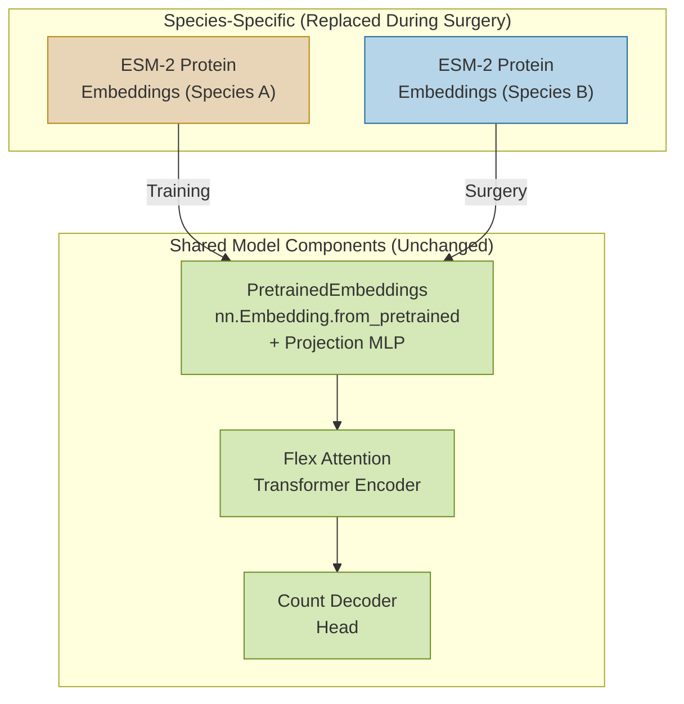
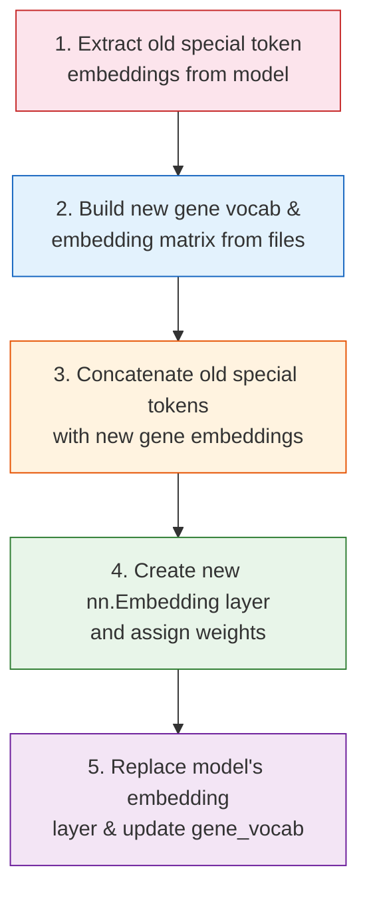

TranscriptFormer's cross-species power rests on a critical architectural insight: the gene embedding layer is the *only* component that encodes species-specific information. Every other model component—the transformer encoder, count decoder, attention masks, and loss functions—is species-agnostic by design. **Embedding surgery** exploits this fact by surgically replacing the gene embedding matrix and vocabulary at inference time, enabling a model trained on one set of species to process data from an entirely new species without any retraining. The only requirement is that pretrained protein embeddings (e.g., from ESM-2) exist for the new species' gene sequences.

Sources: [embedding_surgery.py](src/transcriptformer/model/embedding_surgery.py#L1-L80), [model.py](src/transcriptformer/model/model.py#L1-L80)

## Why Embedding Surgery Works

The `Transcriptformer` model initializes gene representations through a `PretrainedEmbeddings` module that wraps a frozen `nn.Embedding.from_pretrained` matrix with a learnable projection MLP. Because the source protein embeddings are already aligned across species—they all originate from the same ESM-2 model—genes that are orthologous across species naturally occupy similar regions of the embedding space. The projection MLP, trained on the original species, learns a transformation from ESM-2 space into the model's internal representation space. This transformation generalizes: when you swap in ESM-2 embeddings from a new species, the trained MLP projects them into the same semantically meaningful space that the transformer encoder expects.

Sources: [layers.py](src/transcriptformer/model/layers.py#L348-L384), [model.py](src/transcriptformer/model/model.py#L85-L92)

The following diagram illustrates the conceptual relationship between the shared model backbone and the swappable embedding layer:



Sources: [layers.py](src/transcriptformer/model/layers.py#L348-L384), [model.py](src/transcriptformer/model/model.py#L140-L155)

## The Surgery Procedure in Detail

The `change_embedding_layer` function in `embedding_surgery.py` executes a precise five-step operation that replaces the gene embedding matrix while preserving all special token representations that the model's other components depend on.



**Step 1 — Extract old special token embeddings.** The function identifies which special tokens from the `SPECIAL_TOKENS` list (`["unknown", "[START]", "[END]", "[RD]", "[CELL]", "[PAD]", "⊣"]`) are present in the model's existing vocabulary. It then extracts their embedding vectors from the current `nn.Embedding` layer by looking up their indices. This is critical because downstream components like the causal mask factory and count decoder reference these tokens by their index positions.

**Step 2 — Build the new gene vocabulary and embedding matrix.** The `construct_gene_embeddings` function loads one or more embedding files (`.pkl` or `.h5` format), deduplicates any overlapping gene names, builds a fresh vocabulary dictionary, and generates random embeddings for *new* special tokens (those not already in the old vocabulary). The random initialization uses a fixed seed (`random_seed=42`) for reproducibility.

**Step 3 — Concatenate embeddings.** The old special token embeddings (from Step 1) are prepended to the new gene embedding matrix (from Step 2). This ensures special tokens retain their trained positions at the start of the index space, while new gene tokens follow after them.

**Step 4 — Create and populate the new embedding layer.** A fresh `nn.Embedding` is instantiated with the concatenated matrix dimensions. The weight data is copied from the concatenated tensor, and the layer is moved to the same device as the existing model.

**Step 5 — Replace and update.** The model's `gene_embeddings.embedding` attribute is swapped to the new layer, and the `gene_vocab.vocab_dict` and `gene_vocab.embedding_matrix` are updated to reflect the new vocabulary mapping. The vocabulary indices are offset by `len(old_special_tokens)` so that gene IDs start after the reserved special token slots.

Sources: [embedding_surgery.py](src/transcriptformer/model/embedding_surgery.py#L1-L80), [vocab.py](src/transcriptformer/tokenizer/vocab.py#L7-L64)

### Index Layout After Surgery

The vocabulary index space follows a fixed convention that the surgery procedure must preserve:

| Index Range | Contents | Source |
|---|---|---|
| `0` to `len(old_special_tokens)-1` | Special tokens (`[PAD]`, `[START]`, `[END]`, etc.) | Extracted from original model |
| `len(old_special_tokens)` to `len(gene_vocab)-1` | Gene tokens from new species | Loaded from embedding files |

The `padding_idx` is preserved from the original model's `gene_vocab.pad_idx`, ensuring that padding behavior remains consistent throughout the transformer encoder and mask generation.

Sources: [embedding_surgery.py](src/transcriptformer/model/embedding_surgery.py#L54-L70), [dataclasses.py](src/transcriptformer/data/dataclasses.py#L221-L227)

## Invoking Embedding Surgery via Configuration

Embedding surgery is triggered automatically during the inference pipeline when the `pretrained_embedding` field in `InferenceConfig` is set to a non-null value. The orchestration happens in `run_inference`:

```python
# From inference.py — the surgery invocation point
if cfg.model.inference_config.pretrained_embedding is not None:
    logging.info("Performing embedding surgery")
    if not isinstance(cfg.model.inference_config.pretrained_embedding, list):
        pretrained_embedding_paths = [cfg.model.inference_config.pretrained_embedding]
    else:
        pretrained_embedding_paths = cfg.model.inference_config.pretrained_embedding
    model, gene_vocab = change_embedding_layer(model, pretrained_embedding_paths)
```

The `pretrained_embedding` field accepts either a single path string or a list of paths. When multiple paths are provided, the embeddings from all files are merged—genes from later files that duplicate names from earlier files are logged as warnings and removed. This multi-file support enables composing a species' embedding from multiple sources (e.g., separate files for different chromosome assemblies or protein isoform sets).

Sources: [inference.py](src/transcriptformer/model/inference.py#L78-L88), [dataclasses.py](src/transcriptformer/data/dataclasses.py#L205-L213), [inference_config.yaml](src/transcriptformer/cli/conf/inference_config.yaml#L22-L23)

### Configuration Example

To run inference on a new species using a model checkpoint trained on different species, set the `pretrained_embedding` parameter in your inference config override:

```bash
python inference.py --config-name=inference_config.yaml \
  model.checkpoint_path=./checkpoints/tf_sapiens \
  model.inference_config.pretrained_embedding=./embeddings/danio_rerio_esm2.pkl \
  model.inference_config.data_files.0=./data/zebrafish.h5ad \
  model.inference_config.gene_col_name=ensembl_id \
  model.data_config.filter_to_vocabs=true
```

The key configuration parameters relevant to embedding surgery:

| Parameter | Type | Default | Description |
|---|---|---|---|
| `pretrained_embedding` | `list[str]` | `null` | Path(s) to pretrained embedding files for the new species. Setting this triggers surgery. |
| `gene_col_name` | `str` | `"ensembl_id"` | Column in AnnData.var containing gene identifiers that map to embedding file keys |
| `filter_to_vocabs` | `bool` | `true` | Filter input genes to only those present in the (post-surgery) vocabulary |
| `data_config.esm2_mappings` | `list[str]` | — | Original species embedding files (used for initial model construction, *not* for surgery) |

> [!TIP]
> After surgery, the `gene_vocab` returned by `change_embedding_layer` replaces the original vocabulary used for data loading. This means `filter_to_vocabs=true` will now filter against the *new species' gene set*, not the original training species. Ensure your AnnData files use gene identifiers (e.g., Ensembl IDs) that match the keys in your embedding files.

Sources: [inference.py](src/transcriptformer/model/inference.py#L78-L120), [inference_config.yaml](src/transcriptformer/cli/conf/inference_config.yaml#L1-L43), [dataclasses.py](src/transcriptformer/data/dataclasses.py#L205-L213)

## Preparing Embedding Files for a New Species

The embedding files consumed by surgery are dictionaries mapping gene identifiers to their ESM-2 protein embedding vectors. Two formats are supported:

| Format | Extension | Loading Method | Description |
|---|---|---|---|
| Pickle | `.pkl` | `pickle.load(f)` | Python dict of `{gene_id: np.ndarray}` |
| HDF5 | `.h5` | `h5py.File` | `keys` dataset + `arrays/` group with per-gene datasets |

The `load_embeddings` utility in `utils.py` dispatches to the appropriate loader based on file extension. For HDF5 files, the `load_from_hdf5` function expects a `keys` dataset containing gene name strings and an `arrays/` group where each gene's embedding is stored as a separate dataset.

Sources: [utils.py](src/transcriptformer/utils/utils.py#L12-L45)

To generate these files for a new species, the preprocessing pipeline in the `preprocess/` directory provides the tooling. The `protein_embedding.py` script computes ESM-2 embeddings from a FASTA file of protein sequences, and `get_stable_id_mapping.py` maps between Ensembl gene IDs and UniProt accessions. The resulting embeddings must satisfy two constraints:

1. **Key format** must match the `gene_col_name` used in your AnnData input (typically Ensembl gene IDs like `ENSDARG00000123456`).
2. **Embedding dimension** must match the ESM-2 model variant used during the original TranscriptFormer training (the standard is 2560-dimensional vectors from ESM-2 3B).

> [!TIP]
> Duplicate gene names across multiple embedding files are silently removed during `construct_gene_embeddings`—only the first occurrence is retained. When composing embeddings from multiple sources, order your file paths deliberately: place higher-quality or more canonical sources first in the `pretrained_embedding` list.

Sources: [vocab.py](src/transcriptformer/tokenizer/vocab.py#L30-L55), [utils.py](src/transcriptformer/utils/utils.py#L12-L45)

## What Remains Unchanged After Surgery

A key property of embedding surgery is its minimal footprint: only the embedding lookup table and vocabulary mapping are modified. The following model components are **not** touched and retain their trained parameters:

| Component | Why It Generalizes |
|---|---|
| **Projection MLP** (inside `PretrainedEmbeddings`) | Operates on individual embedding vectors; the ESM-2→internal space mapping generalizes across species because ESM-2 embeddings are already cross-species aligned |
| **TranscriptEncoder** (all transformer layers) | Operates on abstract embedding vectors, not gene identities; attention patterns depend on count-biased score modifications, not gene names |
| **CountDecoderHead** | Uses a gene-specific bias term indexed by `gene_bias_size`, but since surgery replaces `gene_vocab.vocab_size`, the bias is simply re-initialized (the MLP pathway dominates prediction) |
| **ZTP loss, attention masks, causal mask** | All operate on tensor shapes and count values, not on gene identity |

Sources: [layers.py](src/transcriptformer/model/layers.py#L284-L340), [model.py](src/transcriptformer/model/model.py#L140-L155), [embedding_surgery.py](src/transcriptformer/model/embedding_surgery.py#L54-L70)

## Limitations and Considerations

Embedding surgery is a zero-shot transfer technique—no gradient updates occur. Its effectiveness depends on several factors:

- **Protein embedding quality**: Genes without ESM-2 coverage are mapped to the `unknown` token and receive a randomly initialized embedding. Species with poor protein sequence annotation will have more unknown genes, degrading performance.
- **Vocabulary filter gap**: When `filter_to_vocabs=true`, genes in the input data that lack a corresponding entry in the new embedding file are silently dropped. If the overlap between your data's gene set and the embedding file is small, the model will see artificially sparse cells.
- **Count decoder gene bias**: The `CountDecoderHead` maintains a `gene_embedding` bias table of size `gene_bias_size`. After surgery, this table has the correct new size but its weights are uninitialized (zeros from the fresh `nn.Embedding`). The MLP pathway compensates, but the gene-specific bias signal is lost until fine-tuning occurs.
- **Special token consistency**: The surgery assumes the same set of `SPECIAL_TOKENS` is used across all model checkpoints and embedding files. If a custom checkpoint uses additional special tokens not in the default list, they must be explicitly handled.

Sources: [embedding_surgery.py](src/transcriptformer/model/embedding_surgery.py#L18-L25), [layers.py](src/transcriptformer/model/layers.py#L314-L340), [vocab.py](src/transcriptformer/tokenizer/vocab.py#L7-L9)

For a deeper understanding of the multi-species training strategy that makes embedding surgery effective, see [Multi-Species Training Strategy](9-multi-species-training-strategy). To learn about the vocabulary construction process that surgery depends on, consult [Gene Tokenizer and Vocabulary](11-gene-tokenizer-and-vocabulary). For practical usage of the inference pipeline that invokes surgery, refer to [CLI Inference Commands](13-cli-inference-commands).