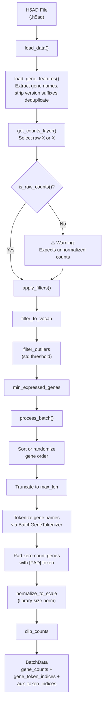

TranscriptFormer's data pipeline transforms raw single-cell expression matrices stored in AnnData (`.h5ad`) files into tokenized, padded, and normalized tensors ready for the transformer encoder. The pipeline is built around two complementary dataset classes—one memory-resident and one OOM-safe—unified by a shared processing core that handles gene ordering, vocabulary filtering, count normalization, and tokenization. Understanding this pipeline is essential for preparing your own data and diagnosing inference issues.

## From H5AD to Tensors: The End-to-End Flow

Every cell entering TranscriptFormer travels through a deterministic sequence: **load → validate → filter → order → normalize → tokenize → pad**. The following diagram illustrates this flow and the decision points within it.



The pipeline's behavior is governed entirely by the `DataConfig` dataclass, which specifies every knob from vocabulary filtering to count clipping. At the end, each cell is represented as a `BatchData` object containing the count tensor, token index tensor, and optional auxiliary token indices.

Sources: [dataloader.py](src/transcriptformer/data/dataloader.py#L1-L200), [dataclasses.py](src/transcriptformer/data/dataclasses.py#L63-L131)

## Loading and Validating AnnData Files

The entry point is `load_data()`, which reads `.h5ad` files using Scanpy (in-memory) or AnnData's `backed="r"` mode (for OOM-safe streaming). Once loaded, two critical validation steps execute before any processing begins.

**Gene feature extraction** (`load_gene_features`) reads gene identifiers from `adata.var` using the column specified by `gene_col_name` (default: `ensembl_id`). It strips Ensembl version suffixes (e.g., `ENSG00000141510.7` → `ENSG00000141510`) and checks for duplicate gene names that arise from version stripping. If duplicates are found, the pipeline either raises an error or silently keeps the first occurrence when `remove_duplicate_genes=True`.

**Count layer selection** (`get_counts_layer`) resolves which matrix to use via the `use_raw` parameter:

| `use_raw` Value | Behavior |
|---|---|
| `True` | Use `adata.raw.X`; raises error if absent |
| `False` | Use `adata.X`; raises error if absent |
| `None` / auto | Try `adata.raw.X` first, fallback to `adata.X` |

After selecting the count layer, `is_raw_counts()` performs a sampling check on non-zero values to verify they are integer-valued. If the data appears normalized (floating-point values), a warning is emitted—TranscriptFormer is designed for **unnormalized raw count data**, and feeding it log-normalized or library-size-normalized values will degrade performance.

Sources: [dataloader.py](src/transcriptformer/data/dataloader.py#L11-L27), [dataloader.py](src/transcriptformer/data/dataloader.py#L203-L298)

## Filtering: Vocabulary, Outliers, and Minimum Genes

The `apply_filters()` function applies three sequential filters that reduce the gene-by-cell matrix before tokenization. Each filter narrows the dataset to improve signal quality and ensure vocabulary alignment.

**Vocabulary filtering** (`filter_to_vocab`) removes genes not present in the model's gene vocabulary. This is critical because the tokenizer maps unknown genes to a special `"unknown"` token, which carries no meaningful pretrained embedding. When `filter_to_vocabs=True`, any gene whose Ensembl ID is absent from the vocabulary is dropped from the expression matrix entirely. If all genes are filtered out, the file is skipped with a warning.

**Outlier filtering** (`filter_outliers`) removes cells whose total expression count deviates beyond a specified number of standard deviations from the mean. A value of `0.0` disables this filter (the default). The formula retains cells where `mean - threshold × std < total_counts < mean + threshold × std`.

**Minimum expressed genes** (`min_expressed_genes`) drops cells with fewer than the specified number of non-zero genes. This eliminates low-information cells that would otherwise consume sequence length with mostly padding tokens.

> [!TIP]
> When preparing your own data, always verify that `adata.var` contains the gene identifier column matching `gene_col_name` (default `ensembl_id`). A mismatch here causes all genes to be filtered out at the vocabulary step, resulting in an empty dataset error.

Sources: [dataloader.py](src/transcriptformer/data/dataloader.py#L56-L99)

## Core Batch Processing: Ordering, Normalization, and Tokenization

After filtering, `process_batch()` transforms the raw count matrix into the final tensor representation. This is where the gene ordering strategy, normalization, and tokenization decisions are applied.

**Gene ordering** is controlled by two mutually influential flags. When `sort_genes=True`, genes are sorted in descending order of expression per cell—highest-expressed genes occupy the first positions in the sequence. When `sort_genes=False` and `randomize_order=True`, non-zero genes are randomly permuted followed by randomly permuted zero-count genes. When both are `False`, genes remain in their original AnnData column order. The sorting strategy matters because the transformer processes the sequence left-to-right; placing highly expressed genes first can improve information density within the `max_len` window.

**Sequence truncation** limits each cell's gene list to `max_len` (typically 2048). After sorting, only the top `max_len` genes are retained—this is why sorting by expression is often preferred, as it ensures the most informative genes survive truncation.

**Tokenization** converts gene name arrays into integer token indices via `BatchGeneTokenizer`. This tokenizer performs a simple dictionary lookup against the gene vocabulary, mapping each Ensembl ID to its corresponding index. Genes not found in the vocabulary map to the `"unknown"` token index, and a warning is logged with the count of unrecognized genes.

**Zero-count padding** replaces token indices of zero-count genes with the `[PAD]` token index when `pad_zeros=True`. This ensures the transformer's attention mechanism can distinguish expressed from unexpressed genes. Sequences shorter than `max_len` are right-padded with additional `[PAD]` tokens and zero counts.

**Normalization and clipping** are the final transformations applied to the count values:

| Parameter | Effect | Default |
|---|---|---|
| `normalize_to_scale` | Divides each cell's counts by its total sum, then multiplies by the scale factor. `0` disables normalization. | `0` |
| `clip_counts` | Clamps count values to `[0, clip_counts]`. Prevents extreme outliers from dominating attention. | `30` |

Sources: [dataloader.py](src/transcriptformer/data/dataloader.py#L102-L183), [tokenizer.py](src/transcriptformer/tokenizer/tokenizer.py#L1-L34)

## Two Dataset Classes: AnnDataset vs AnnDatasetOOM

TranscriptFormer provides two dataset implementations that share the same processing logic but differ fundamentally in memory strategy.

**`AnnDataset`** is the standard in-memory dataset. On initialization, it iterates through all input files, loads each AnnData object fully into memory, applies filtering and processing to every cell, and concatenates the results into a single `BatchData` object. The `__getitem__` method simply indexes into this pre-built tensor. This design maximizes iteration speed during training but requires enough RAM to hold the entire dataset's tokenized representation.

**`AnnDatasetOOM`** is the OOM-safe alternative designed for datasets that exceed available memory. It opens each file in `backed="r"` mode (memory-mapped), builds cumulative row offsets for global indexing, and processes **one cell at a time** in `__getitem__`. The `_loc()` method maps a global index to a `(file_id, row)` pair using binary search on the offset array, then reads only that single row from the backed matrix, converts it to dense, and processes it through the same `process_batch()` function. This trades per-epoch speed for dramatically lower memory footprint.

| Property | AnnDataset | AnnDatasetOOM |
|---|---|---|
| Memory strategy | All data loaded and processed upfront | Backed reads, per-item processing |
| Initialization cost | High (full dataset processing) | Low (metadata and offset computation only) |
| Per-epoch speed | Fast (simple tensor indexing) | Slower (disk read + per-item processing) |
| Use case | Training on datasets fitting in RAM | Large-scale inference, limited-memory environments |
| Outlier/min-gene filtering | Yes (in `apply_filters`) | No (per-item mode, no cross-cell statistics) |

Both classes use the same `collate_fn` static method, which stacks `BatchData` objects into batched tensors, making them interchangeable in PyTorch DataLoader pipelines.

> [!TIP]
> Use `AnnDatasetOOM` with `use_oom_dataloader: true` in the inference config when processing atlases with millions of cells. The backed-read pattern keeps memory usage roughly proportional to a single cell rather than the full dataset.

Sources: [dataloader.py](src/transcriptformer/data/dataloader.py#L342-L453), [dataloader.py](src/transcriptformer/data/dataloader.py#L455-L653)

## The BatchData Contract

All dataset classes output `BatchData`, a lightweight dataclass that serves as the universal data contract between the data pipeline and the model. Its fields are:

| Field | Type | Description |
|---|---|---|
| `gene_counts` | `torch.Tensor` | Expression count values, shape `(seq_len,)` per cell |
| `gene_token_indices` | `torch.Tensor` | Token indices into the gene vocabulary, shape `(seq_len,)` |
| `aux_token_indices` | `torch.Tensor \| None` | Auxiliary token indices (e.g., assay type), shape `(aux_len,)` |
| `file_path` | `str \| None` | Source file path for traceability |
| `obs` | `dict \| None` | Selected observation metadata columns |

The `collate_fn` stacks individual `BatchData` instances along a new batch dimension, producing tensors of shape `(batch_size, seq_len)` for counts and token indices. This contract ensures that whether data comes from the in-memory or OOM-safe dataset, the model receives identically structured input.

Sources: [dataclasses.py](src/transcriptformer/data/dataclasses.py#L220-L237)

## Configuration Quick Reference

The `DataConfig` dataclass centralizes all data processing parameters. Below is a reference of the most impactful settings for data loading and preprocessing behavior.

| Parameter | Type | Default | Purpose |
|---|---|---|---|
| `gene_col_name` | `str` | `"ensembl_id"` | Column in `adata.var` holding gene identifiers |
| `filter_to_vocabs` | `bool` | `True` | Remove genes not in the model vocabulary |
| `filter_outliers` | `float` | `0.0` | Std-dev threshold for cell outlier removal (0 = off) |
| `min_expressed_genes` | `int` | `0` | Minimum non-zero genes per cell (0 = off) |
| `sort_genes` | `bool` | `False` | Sort genes by descending expression per cell |
| `randomize_genes` | `bool` | `False` | Randomize gene order per cell |
| `pad_zeros` | `bool` | `True` | Replace zero-count gene tokens with `[PAD]` |
| `normalize_to_scale` | `int` | `0` | Library-size normalization target (0 = off) |
| `clip_counts` | `int` | `30` | Maximum count value (clamps outliers) |
| `use_raw` | `bool \| None` | `None` | Select `raw.X` (True), `X` (False), or auto-detect |
| `remove_duplicate_genes` | `bool` | `False` | Deduplicate genes after version stripping |

Sources: [dataclasses.py](src/transcriptformer/data/dataclasses.py#L90-L131), [inference_config.yaml](conf/inference_config.yaml#L20-L36)

## Bulk Data Download from CellxGene

For users who need training or evaluation data, TranscriptFormer includes a bulk download utility that fetches datasets from the CELLxGENE Discover portal. The `bulk_download` module queries the CELLxGENE API, filters datasets by organism, and downloads them in parallel with retry logic and progress tracking.

```python
# Download human datasets programmatically
from transcriptformer.data.bulk_download import download_cellxgene_data

download_cellxgene_data(
    species=["homo sapiens"],
    output_dir="./data/human",
    n_processes=4,
)
```

The module skips non-primary datasets, validates download integrity via a `__success__` marker file, and saves full dataset metadata as JSON. For convenience, the `datasets.py` module also provides direct access to curated datasets like Tabula Sapiens (with v1/v2 splits for in-distribution and out-of-distribution evaluation) and Bgee evolutionary testis data across nine species.

Sources: [bulk_download.py](src/transcriptformer/data/bulk_download.py#L1-L100), [datasets.py](src/transcriptformer/datasets.py#L1-L100)

## Where to Go Next

Now that you understand how raw count data flows through loading, filtering, tokenization, and batching, the natural next step is to explore the vocabulary and tokenization system in detail at [Gene Tokenizer and Vocabulary](11-gene-tokenizer-and-vocabulary). To see how the processed `BatchData` feeds into inference, visit [CLI Inference Commands](13-cli-inference-commands). For handling large-scale data that exceeds memory, see [Multi-GPU and OOM-Safe Inference](15-multi-gpu-and-oom-safe-inference).