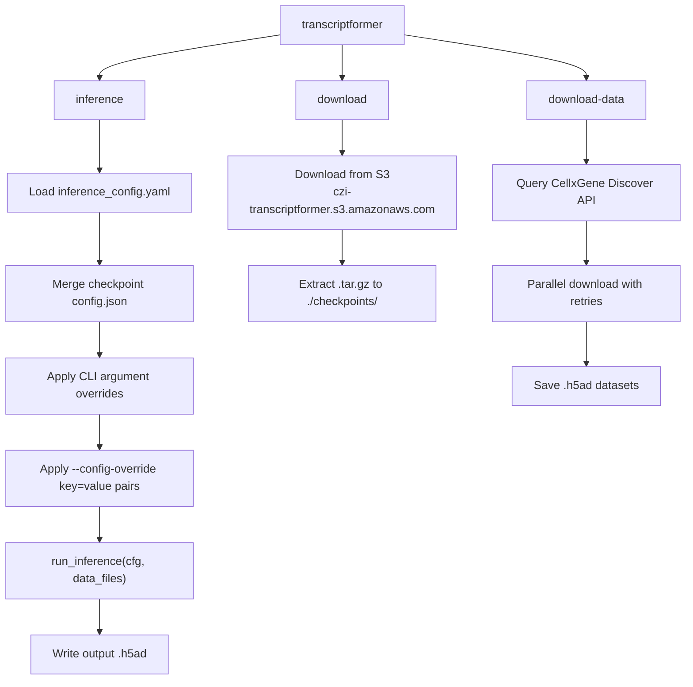
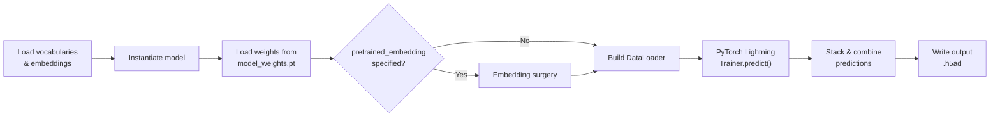
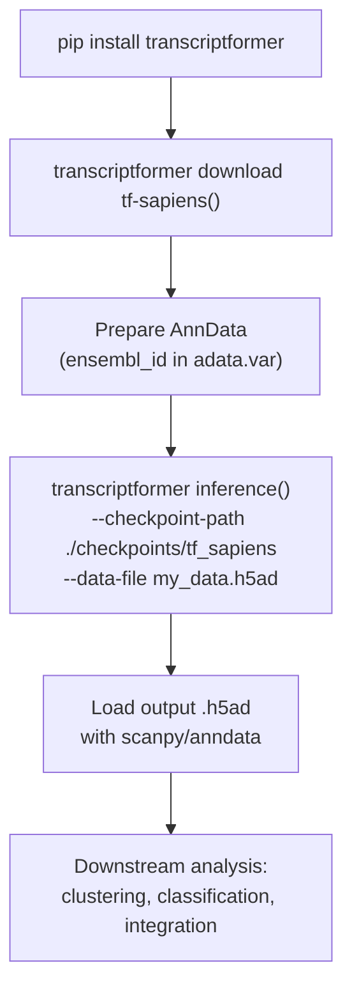

TranscriptFormer exposes a unified `transcriptformer` CLI with three top-level commands — **inference**, **download**, and **download-data** — that cover the full workflow from acquiring model artifacts to producing cell-level or gene-level embeddings. This page walks through each command's syntax, arguments, and practical usage patterns so you can go from raw AnnData to embeddings with confidence.

## Command Architecture

The CLI is registered as the `transcriptformer` entry point and dispatches to three subcommands via `argparse`. Each subcommand has its own parser, configuration merging logic, and execution path. The inference command loads a Hydra-based YAML config, merges it with the model's stored `config.json`, and then applies CLI argument overrides — creating a three-layer configuration stack where the most specific layer wins.



Sources: [\_\_init\_\_.py](/src/transcriptformer/cli/__init__.py#L200-L487), [inference.py](/src/transcriptformer/cli/inference.py#L1-L71)

## The `inference` Command

The `inference` command is the primary interface for running TranscriptFormer models on single-cell data. It accepts an AnnData `.h5ad` file as input and produces an AnnData file containing embeddings (and optionally log-likelihoods) as output.

### Basic Syntax

```bash
transcriptformer inference \
  --checkpoint-path ./checkpoints/tf_sapiens \
  --data-file ./data/my_data.h5ad
```

This minimal invocation downloads nothing further — it expects the checkpoint directory to already contain `model_weights.pt`, `config.json`, and a `vocabs/` subdirectory. The results are written to `./inference_results/embeddings.h5ad` by default.

Sources: [\_\_init\_\_.py](/src/transcriptformer/cli/__init__.py#L96-L119)

### Required Arguments

| Argument | Description |
|---|---|
| `--checkpoint-path` | Path to the model checkpoint directory (must contain `model_weights.pt` and `config.json`) |
| `--data-file` | Path to the input AnnData `.h5ad` file |

Sources: [\_\_init\_\_.py](/src/transcriptformer/cli/__init__.py#L139-L150)

### Inference Options

The full set of optional arguments controls batch processing, embedding type, device selection, and data preprocessing behavior:

| Argument | Default | Description |
|---|---|---|
| `--output-path` | `./inference_results` | Directory where results will be saved |
| `--output-filename` | `embeddings.h5ad` | Filename for the output embeddings |
| `--batch-size` | `8` | Number of samples per batch |
| `--gene-col-name` | `ensembl_id` | Column in `adata.var` containing gene identifiers |
| `--precision` | `16-mixed` | Numerical precision (`16-mixed` or `32`) |
| `--emb-type` | `cell` | Embedding type: `cell` for mean-pooled cell embeddings, `cge` for contextual gene embeddings |
| `--pretrained-embedding` | None | Path to pretrained embeddings for out-of-distribution species (enables embedding surgery) |
| `--model-type` | `transcriptformer` | Model architecture: `transcriptformer` or `esm2ce` |
| `--clip-counts` | `30` | Maximum count value — higher values are clipped |
| `--filter-to-vocabs` | `True` | Filter genes to only those in the model's vocabulary |
| `--use-raw` | `auto` | Use `adata.raw.X` (`True`), `adata.X` (`False`), or auto-detect (`auto`/`None`) |
| `--remove-duplicate-genes` | `False` | Remove duplicate genes instead of raising an error |
| `--num-gpus` | `1` | GPU count: `1` for single, `-1` for all available, `>1` for specific count |
| `--device` | `auto` | Device: `auto`, `cpu`, `cuda`, or `mps` |
| `--disable-compile-block-mask` | `False` | Disable block mask compilation (useful for CPU or debugging) |
| `--oom-dataloader` | `False` | Use OOM-safe map-style DataLoader with DistributedSampler |
| `--n-data-workers` | `0` | Number of DataLoader workers (leave `0` for deterministic behavior) |

Sources: [\_\_init\_\_.py](/src/transcriptformer/cli/__init__.py#L152-L201)

### Configuration Override Mechanism

Not every configuration value is exposed as a dedicated CLI flag. The `--config-override` argument lets you modify any nested configuration key using dot-path notation, and it can be specified multiple times:

```bash
transcriptformer inference \
  --checkpoint-path ./checkpoints/tf_sapiens \
  --data-file ./data/my_data.h5ad \
  --config-override model.data_config.normalize_to_scale=10000 \
  --config-override model.inference_config.obs_keys.0=cell_type
```

The override logic automatically converts values to the appropriate Python type — integers, floats, booleans (`true`/`false`), and nulls (`none`/`null`) are parsed before being applied via `OmegaConf.update`. String values that don't match any conversion rule are kept as-is. This mechanism gives you full access to every field in the configuration hierarchy without requiring a separate YAML file.

Sources: [\_\_init\_\_.py](/src/transcriptformer/cli/__init__.py#L203-L210), [\_\_init\_\_.py](/src/transcriptformer/cli/__init__.py#L310-L342)

### Three-Layer Configuration Merge

When you run `transcriptformer inference`, the configuration is assembled in three sequential layers, each overriding the previous:

1. **Base YAML config** — loaded from `src/transcriptformer/cli/conf/inference_config.yaml`, providing defaults for all settings.
2. **Checkpoint config** — the `config.json` stored inside the checkpoint directory (originally saved by MLflow during training), which carries the exact model architecture and training data settings.
3. **CLI arguments** — explicit `--flag` values and `--config-override` key=value pairs, which take the highest precedence.

This layering ensures that model-specific settings (like architecture dimensions and vocabulary paths) are always correct from the checkpoint, while you only need to specify the data path and any parameters you want to change.

Sources: [inference.py](/src/transcriptformer/cli/inference.py#L34-L43), [\_\_init\_\_.py](/src/transcriptformer/cli/__init__.py#L262-L280)

### Inference Execution Flow

Once the configuration is fully resolved, the inference pipeline proceeds through these stages:



The model is instantiated as a PyTorch Lightning module, loaded with `torch.load` (with `weights_only=True`) and mapped to the target device. If `pretrained_embedding` is specified, the embedding surgery step replaces the gene embedding layer to support species outside the training vocabulary. The PyTorch Lightning `Trainer` handles device placement, mixed precision, and multi-GPU distribution (DDP for `num_gpus > 1`). After prediction, outputs are stacked, combined into a new AnnData object, and written to disk.

Sources: [inference.py](/src/transcriptformer/model/inference.py#L38-L102), [\_\_init\_\_.py](/src/transcriptformer/cli/__init__.py#L344-L387)

### Output Structure

The output AnnData file's content depends on the `emb_type` and `output_keys` settings:

| `emb_type` | Storage Location | Content |
|---|---|---|
| `cell` (default) | `adata.obsm["embeddings"]` | Mean-pooled cell embeddings as a NumPy array (cells × embedding_dim) |
| `cge` | `adata.uns["cge_embeddings"]`, `adata.uns["cge_cell_indices"]`, `adata.uns["cge_gene_names"]` | Contextual gene embeddings in a flattened format with cell indices and gene name metadata |

When `output_keys` includes `llh`, zero-truncated Poisson log-likelihoods are stored in `adata.uns["llh"]`. The `obs_keys` setting (defaulting to `["all"]`) controls which observation columns from the input AnnData are carried through to the output.

> [!TIP]
> When extracting contextual gene embeddings (`--emb-type cge`), the output stores a flattened representation in `uns` rather than `obsm` because each cell can have a variable number of expressed genes. Use `uns["cge_cell_indices"]` and `uns["cge_gene_names"]` to map each embedding back to its source cell and gene.

Sources: [inference.py](/src/transcriptformer/model/inference.py#L243-L296)

### Common Inference Patterns

**Basic cell embeddings** — the most common workflow for downstream tasks like clustering or classification:

```bash
transcriptformer inference \
  --checkpoint-path ./checkpoints/tf_sapiens \
  --data-file ./data/human_pbmc.h5ad \
  --output-path ./results/pbmc \
  --batch-size 16
```

**Contextual gene embeddings** — for per-gene analysis in gene space:

```bash
transcriptformer inference \
  --checkpoint-path ./checkpoints/tf_sapiens \
  --data-file ./data/human_pbmc.h5ad \
  --emb-type cge \
  --output-filename cge_embeddings.h5ad
```

**CPU-only inference** — disable GPU compilation for debugging or machines without CUDA:

```bash
transcriptformer inference \
  --checkpoint-path ./checkpoints/tf_sapiens \
  --data-file ./data/human_pbmc.h5ad \
  --device cpu \
  --disable-compile-block-mask
```

**Out-of-distribution species via embedding surgery** — adapt a model to a species not in its training vocabulary:

```bash
transcriptformer inference \
  --checkpoint-path ./checkpoints/tf_metazoa \
  --data-file ./data/rat_data.h5ad \
  --pretrained-embedding ./checkpoints/all_embeddings/rat_embedding.pt
```

Sources: [\_\_init\_\_.py](/src/transcriptformer/cli/__init__.py#L96-L119), [inference_config.yaml](/src/transcriptformer/cli/conf/inference_config.yaml#L1-L43)

## The `download` Command

Before running inference, you need model checkpoint files. The `download` command fetches and extracts compressed model artifacts from a public S3 bucket (`czi-transcriptformer.s3.amazonaws.com/weights/`), with progress bars for both download and extraction.

### Syntax and Model Options

```bash
transcriptformer download <model> [--checkpoint-dir DIR]
```

| Model Argument | Extracted Directory | Description |
|---|---|---|
| `tf-sapiens` | `./checkpoints/tf_sapiens/` | Human-only model (368M trainable params, 23,829 vocab) |
| `tf-exemplar` | `./checkpoints/tf_exemplar/` | Human + 4 model organisms (542M trainable params, 110,290 vocab) |
| `tf-metazoa` | `./checkpoints/tf_metazoa/` | All 12 species (444M trainable params, 247,388 vocab) |
| `all` | All three + embeddings | Downloads all models and the `all_embeddings` package |
| `all-embeddings` | `./checkpoints/all_embeddings/` | Protein embeddings for 24 species (for embedding surgery) |

The `--checkpoint-dir` flag (default: `./checkpoints`) controls where files are extracted. Each extracted directory contains `model_weights.pt`, `config.json`, and a `vocabs/` subdirectory with the gene and auxiliary vocabularies.

Sources: [download_artifacts.py](/src/transcriptformer/cli/download_artifacts.py#L22-L59), [\_\_init\_\_.py](/src/transcriptformer/cli/__init__.py#L224-L239)

### Download Implementation Details

The download uses `urllib.request.urlretrieve` with a custom `reporthook` callback for progress reporting, then extracts the `.tar.gz` archive with member-by-member extraction and progress tracking. HTTP 404 errors are caught specifically to provide a clear message when a model name doesn't exist at the expected S3 path.

Sources: [download_artifacts.py](/src/transcriptformer/cli/download_artifacts.py#L61-L136)

## The `download-data` Command

The `download-data` command interfaces with the **CellxGene Discover** portal to bulk-download single-cell RNA-seq datasets filtered by species. This is useful for acquiring training or evaluation data in the AnnData format that TranscriptFormer expects.

### Syntax

```bash
transcriptformer download-data --species "homo sapiens" [OPTIONS]
```

| Argument | Default | Description |
|---|---|---|
| `--species` | (required unless `--test-only`) | Comma-separated list of species names (e.g., `"homo sapiens,mus musculus"`) |
| `--output-dir` | `./data/cellxgene` | Directory where datasets will be saved |
| `--processes` | `4` | Number of parallel download processes |
| `--max-retries` | `5` | Maximum retry attempts per dataset |
| `--no-metadata` | flag | Skip saving dataset metadata to JSON file |
| `--test-only` | flag | Only test API connectivity, don't download |

The `--test-only` flag is a quick way to verify that the CellxGene Discover API is reachable before launching a large download. When connectivity fails, the CLI suggests running with `--test-only` to diagnose the issue.

Sources: [\_\_init\_\_.py](/src/transcriptformer/cli/__init__.py#L241-L284), [download_data.py](/src/transcriptformer/cli/download_data.py#L26-L123)

## Hydra-Based Invocation (Alternative)

In addition to the `transcriptformer` CLI, inference can be run directly via the Hydra-decorated module entry point. This approach uses `--config-name` and dot-path overrides instead of `argparse` flags:

```bash
python -m transcriptformer.cli.inference \
  --config-name=inference_config.yaml \
  model.checkpoint_path=./checkpoints/tf_sapiens \
  model.inference_config.data_files.0=test/data/human_val.h5ad \
  model.inference_config.output_path=./custom_results_dir \
  model.inference_config.batch_size=8 \
  model.inference_config.device=cuda
```

> [!TIP]
> The Hydra entry point reads its config from `src/transcriptformer/cli/conf/inference_config.yaml`, while the `transcriptformer inference` CLI loads the same file via `OmegaConf.load`. Both paths converge on the same `run_inference()` function. Use the Hydra path when you need Hydra's advanced features (like multi-run sweeps); use the `transcriptformer` CLI for everyday workflows.

Sources: [inference.py](/src/transcriptformer/cli/inference.py#L25-L71)

## End-to-End Workflow

Putting it all together, the typical workflow from a fresh installation to embeddings on disk follows this sequence:



After installation, you download a model checkpoint, prepare your data as an AnnData file with gene identifiers in the `ensembl_id` column of `adata.var`, run inference, and then consume the resulting embeddings with standard scanpy/anndata tools for downstream analysis.

For deeper control over configuration values, see [Configuration Reference](16-configuration-reference). For details on cell vs. contextual gene embeddings and how to interpret them, see [Cell and Contextual Gene Embeddings](14-cell-and-contextual-gene-embeddings). For scaling inference across multiple GPUs or handling large datasets that exceed memory, see [Multi-GPU and OOM-Safe Inference](15-multi-gpu-and-oom-safe-inference).
