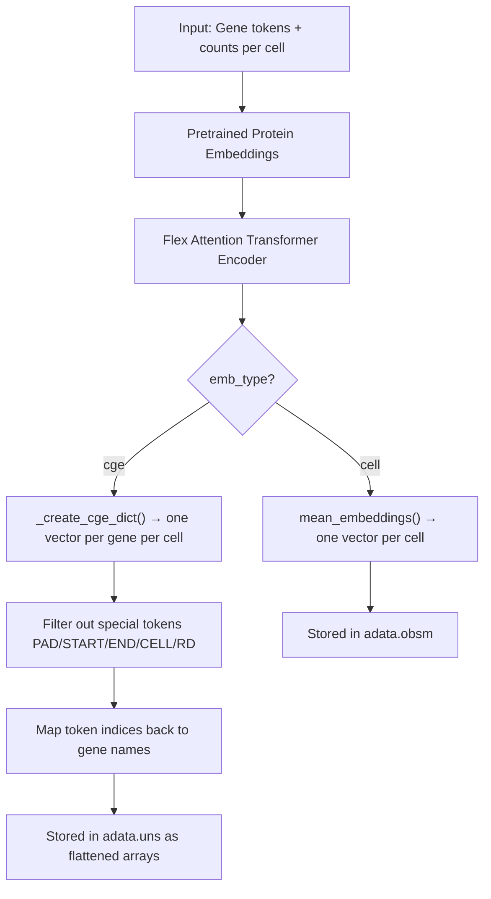

TranscriptFormer produces two complementary embedding types at inference time: **cell embeddings** that represent entire cells as single vectors, and **contextual gene embeddings (CGE)** that represent each gene within the context of a specific cell. Understanding when and how to use each type is critical for extracting maximum value from the model's learned representations.

## Two Embedding Modes

The `emb_type` parameter in `InferenceConfig` governs which embedding the model returns. It accepts exactly two values — `"cell"` (default) and `"cge"` — and the validation logic enforces this constraint strictly.

| Property | Cell Embeddings | Contextual Gene Embeddings (CGE) |
|---|---|---|
| **Granularity** | One vector per cell | One vector per gene per cell |
| **Aggregation** | Mean-pooled across gene positions | No aggregation; each gene position retained |
| **Attention mode** | Bidirectional (full attention) | Bidirectional (full attention) |
| **Output shape** | `(n_cells, embed_dim)` | `(n_gene_instances, embed_dim)` |
| **Primary use cases** | Cell clustering, cell-type classification | Gene regulation analysis, gene-gene interaction, cross-cell gene behavior |
| **Storage in AnnData** | `obsm["embeddings"]` | `uns["cge_embeddings"]` + metadata arrays |

Sources: [dataclasses.py](src/transcriptformer/data/dataclasses.py#L166-L206), [model.py](src/transcriptformer/model/model.py#L337-L346)

## How Cell Embeddings Are Computed

When `emb_type="cell"`, the model's forward pass executes its full transformer encoder and then applies the `mean_embeddings` function to the gene-position outputs. This function multiplies each position's embedding by a boolean pad mask (excluding padded positions from contributing to the mean), then averages across the sequence dimension. The result is a single `embed_dim`-dimensional vector per cell that summarizes the entire transcriptomic state.

The mean-pooling step is straightforward but critical: it ensures that padding tokens — which exist simply to make rectangular batch tensors — do not dilute the embedding signal. The mask marks `True` for valid gene positions and `False` for padding, and only valid positions contribute to the average.

```python
# Simplified from the actual implementation
def mean_embeddings(embeddings, mask=None, include_masked=True):
    if mask is None:
        return embeddings.mean(dim=1)
    else:
        return (embeddings * mask.unsqueeze(-1)).sum(dim=1) / mask.sum(dim=1)
```

Sources: [layers.py](src/transcriptformer/model/layers.py#L15-L21), [model.py](src/transcriptformer/model/model.py#L344-L346)

## How Contextual Gene Embeddings Are Computed

When `emb_type="cge"`, a fundamentally different extraction path activates. Instead of pooling, the model preserves the transformer output at every individual gene position. The `_create_cge_dict` method iterates over each cell in the batch and each gene position in the sequence, building a dictionary that maps gene names (e.g., `ENSG00000152601`) to their position-specific transformer output vectors. Special tokens — `[PAD]`, `[START]`, `[END]`, `[CELL]`, `[RD]`, and `"unknown"` — are explicitly excluded from this dictionary.

The critical architectural detail is that each gene's CGE vector is **not** the pretrained protein embedding for that gene. It is the **transformer's output representation** at that gene's position after all attention layers have mixed information from every other gene in the cell. This means the same gene (e.g., MALAT1) will produce a *different* CGE vector in a T cell than in a hepatocyte, because the surrounding transcriptomic context shapes the attention-weighted representation.



Sources: [model.py](src/transcriptformer/model/model.py#L217-L249), [model.py](src/transcriptformer/model/model.py#L337-L346)

## The Embedding-Mode Attention Switch

A subtle but important mechanism distinguishes embedding extraction from training-time forward passes: the `emb_mode` flag. When the model calls `self.forward(batch, embed=True)`, it passes `emb_mode=True` into the `_score_mod_factory`, which modifies the attention score bias logic.

During training, the count-based attention bias is applied only when `q_idx > kv_idx` (causal masking — a query position can only be biased by key positions that precede it). During embedding extraction, the condition becomes `(q_idx > kv_idx) | emb_mode`, which evaluates to `True` for all position pairs when `emb_mode=True`. This means every gene position attends to every other gene position with count-based bias, producing truly bidirectional contextual representations. Without this switch, CGE vectors would carry the artifacts of causal ordering rather than the full bidirectional context of the cell.

```python
# The score modification logic
def score_mod(score, b, h, q_idx, kv_idx):
    bias = log_counts[b, kv_idx] * ((q_idx > kv_idx) | emb_mode)
    score = score + bias
    ...
```

> [!TIP]
> The bidirectional attention in embedding mode is what makes CGE vectors *contextual* rather than merely positional. If you extract raw pretrained embeddings (the `PretrainedEmbeddings` output before the transformer), you get gene representations that are identical regardless of cell type — these are *non-contextual*. Only the transformer's output, after bidirectional attention mixing, produces embeddings that reflect the cell's transcriptomic state.

Sources: [model.py](src/transcriptformer/model/model.py#L205-L215), [model.py](src/transcriptformer/model/model.py#L311-L313)

## CGE Output Storage Format

Because CGE produces a variable number of gene vectors per cell (cells express different numbers of genes), the output cannot be stored as a simple rectangular matrix in `obsm`. Instead, the inference pipeline flattens all gene embeddings across all cells into three parallel arrays stored in the AnnData object's `uns` (unstructured annotations):

| `uns` Key | Shape | Description |
|---|---|---|
| `cge_embeddings` | `(n_gene_instances, embed_dim)` | The embedding vectors, one per gene per cell |
| `cge_cell_indices` | `(n_gene_instances,)` | Integer index mapping each embedding back to its source cell |
| `cge_gene_names` | `(n_gene_instances,)` | Gene name (e.g., Ensembl ID) for each embedding |

This flattened representation is necessary for HDF5 compatibility — `obsm` requires all arrays to share the same first dimension (number of cells), which does not hold for per-gene-per-cell data. To reconstruct per-cell gene dictionaries, you group by `cge_cell_indices`.

```python
# Example: accessing CGE data from the output AnnData
adata = ad.read_h5ad("cge_emb.h5ad")

embeddings = adata.uns['cge_embeddings']       # shape: (n_gene_instances, 2048)
cell_indices = adata.uns['cge_cell_indices']   # shape: (n_gene_instances,)
gene_names = adata.uns['cge_gene_names']       # shape: (n_gene_instances,)

# Get all embeddings for cell 0
cell_0_mask = cell_indices == 0
cell_0_genes = gene_names[cell_0_mask]
cell_0_embs = embeddings[cell_0_mask]
```

Sources: [inference.py](src/transcriptformer/model/inference.py#L264-L297)

## Running Inference for Each Embedding Type

Both embedding types are accessed through the same `transcriptformer inference` CLI command, differing only in the `--emb-type` flag.

**Cell embeddings** (default):

```bash
transcriptformer inference \
  --checkpoint-path ./checkpoints/tf_sapiens/ \
  --data-file test/data/human_val.h5ad \
  --emb-type cell \
  --output-filename cell_embeddings.h5ad
```

**Contextual gene embeddings**:

```bash
transcriptformer inference \
  --checkpoint-path ./checkpoints/tf_sapiens/ \
  --data-file test/data/human_val.h5ad \
  --emb-type cge \
  --output-filename cge_embeddings.h5ad
```

The `--emb-type` flag maps directly to `InferenceConfig.emb_type`, which is validated at initialization to be either `"cell"` or `"cge"`. Any other value raises a `ValueError`.

> [!TIP]
> CGE output is significantly larger than cell output. For a dataset of 1,000 cells with an average of ~2,000 expressed genes per cell, CGE produces ~2 million embedding vectors versus 1,000 for cell embeddings. Plan storage and downstream memory accordingly — consider filtering to specific genes of interest after extraction.

Sources: [dataclasses.py](src/transcriptformer/data/dataclasses.py#L200-L206), [contextual-gene-embeddings.ipynb](notebooks/contextual-gene-embeddings.ipynb#L167-L171)

## ESM2CE Model: CGE Without the Transformer

The `ESM2CE` model variant (selected via `model_type: esm2ce` in configuration) provides a contrasting approach to CGE. It bypasses the transformer encoder entirely and returns the **raw pretrained protein embeddings** as the CGE vectors, accessed via `PretrainedEmbeddings.forward(x, embed_only=True)`. Because these embeddings have not passed through any attention layers, they are identical for a given gene regardless of which cell that gene appears in — they are *non-contextual* gene representations.

This variant serves as a useful baseline: comparing ESM2CE CGE vectors against TranscriptFormer CGE vectors for the same gene reveals exactly how much contextual information the transformer contributes. If TranscriptFormer's CGE for gene X clusters by cell type while ESM2CE's does not, that differential is purely attributable to the transformer's cross-gene attention.

Sources: [model.py](src/transcriptformer/model/model.py#L482-L526)

## Downstream Analysis Patterns

The CGE format enables analyses that are impossible with cell-level embeddings alone. Two primary patterns emerge from the notebook tutorial:

**Gene behavior across cell types** — By selecting all CGE vectors for a single gene across many cells and projecting with UMAP, you can visualize how that gene's representation shifts depending on cellular context. If the same gene clusters by cell type in CGE space, the transformer has captured cell-type-specific regulation.

**Gene identity vs. cell identity disentanglement** — A joint UMAP of CGE vectors from multiple genes, colored by gene identity on one panel and cell type on the other, reveals whether the embedding space primarily separates by gene identity or by cellular context. The notebook demonstrates this with 10 randomly sampled genes, producing side-by-side UMAP plots colored by cell type and gene name respectively.

```python
# Pattern: filter CGE to a specific gene across all cells
gene_mask = np.isin(adata.uns['cge_gene_names'], ['ENSG00000152601'])
gene_embs = adata.uns['cge_embeddings'][gene_mask]
gene_cells = adata.uns['cge_cell_indices'][gene_mask]
cell_types = adata.obs['cell_type'].iloc[gene_cells].values

# UMAP projection
reducer = umap.UMAP(n_neighbors=15, min_dist=0.5)
embedding_2d = reducer.fit_transform(gene_embs)
```

Sources: [contextual-gene-embeddings.ipynb](notebooks/contextual-gene-embeddings.ipynb#L316-L393)

## Configuring Embedding Extraction

The following `InferenceConfig` fields directly control embedding behavior:

| Parameter | Type | Default | Description |
|---|---|---|---|
| `emb_type` | `str` | `"cell"` | `"cell"` for mean-pooled cell embeddings, `"cge"` for contextual gene embeddings |
| `output_keys` | `list` | `["embeddings"]` | Which outputs to include; must contain `"embeddings"` for either mode |
| `output_filename` | `str` | `"embeddings.h5ad"` | Filename for the output AnnData file |
| `batch_size` | `int` | `8` | Batch size during inference; affects memory usage significantly for CGE |
| `precision` | `str` | `"16-mixed"` | Numerical precision; CGE benefits from higher precision for downstream cosine similarity |

Sources: [dataclasses.py](src/transcriptformer/data/dataclasses.py#L188-L209), [inference_config.yaml](conf/inference_config.yaml#L7-L23)

## Next Steps

- For details on running inference at scale with multiple GPUs and OOM-safe data loading, see [Multi-GPU and OOM-Safe Inference](15-multi-gpu-and-oom-safe-inference).
- For the full set of configuration options, see [Configuration Reference](16-configuration-reference).
- For understanding how the transformer encoder produces the representations that CGE captures, see [Flex Attention Transformer Encoder](6-flex-attention-transformer-encoder).