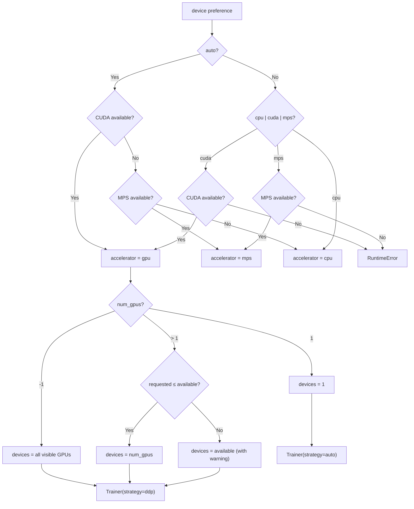
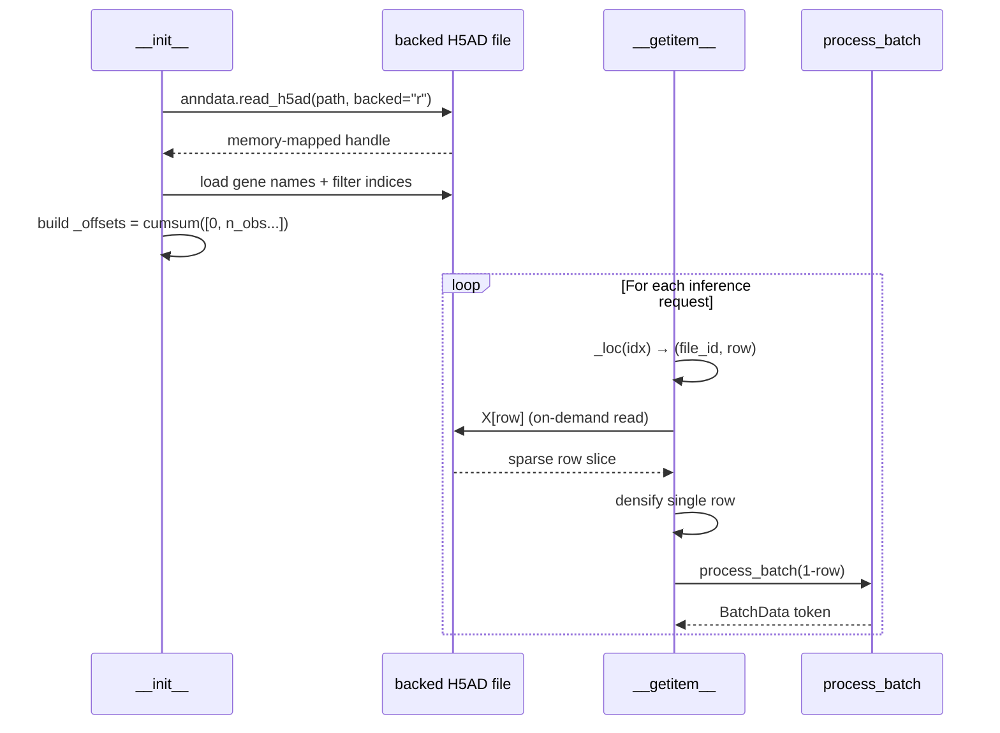

Transcriptformer's inference pipeline is built on PyTorch Lightning and provides two complementary strategies for scaling to large datasets: **multi-GPU parallelism** via Distributed Data Parallel (DDP), and **out-of-memory (OOM)-safe data loading** via memory-mapped backed reads. These mechanisms can be combined—running OOM-safe loading across multiple GPUs—to process datasets that exceed both single-device compute capacity and single-node RAM. This page explains the architecture behind both strategies, their configuration, and the operational considerations that govern their correct use.

## Device Selection and Multi-GPU Architecture

The inference runtime determines device placement through a two-tier resolution process. The `device` parameter (`auto`, `cpu`, `cuda`, `mps`) establishes the accelerator type, while `num_gpus` controls GPU count when the accelerator is `gpu`. The `auto` device preference cascades through CUDA → MPS → CPU based on availability, whereas explicit choices (`cuda`, `mps`) raise a `RuntimeError` if the requested backend is unavailable. For multi-GPU, `num_gpus` accepts three modes: `1` for single-GPU (default), any integer `>1` for a specific GPU count, or `-1` to use all visible GPUs. When requesting more GPUs than available, the system logs a warning and falls back to the detectable count.



Once device resolution completes, the system constructs a PyTorch Lightning `Trainer`. The critical architectural decision occurs at the strategy level: when `devices > 1`, the trainer uses `"ddp"` (Distributed Data Parallel); otherwise it defaults to `"auto"`. DDP replicates the model across GPUs, shards the dataset via `DistributedSampler`, and synchronizes gradients—though for inference (predict-only), the synchronization overhead is minimal since no backward pass occurs. Each rank processes its shard independently and produces a subset of predictions, which the `stack_dict` utility then concatenates into a unified result.

| Parameter | Values | Behavior |
|---|---|---|
| `device` | `auto` | Cascade: CUDA → MPS → CPU |
| `device` | `cpu` | Force CPU, single device |
| `device` | `cuda` | Force GPU, raises if unavailable |
| `device` | `mps` | Force Apple Silicon MPS, raises if unavailable |
| `num_gpus` | `1` (default) | Single GPU, `strategy="auto"` |
| `num_gpus` | `>1` | Multi-GPU, `strategy="ddp"` |
| `num_gpus` | `-1` | All visible GPUs, `strategy="ddp"` |
| `precision` | `16-mixed` (default) | Mixed-precision inference with FP16 |

Sources: [inference.py](/src/transcriptformer/model/inference.py#L170-L247), [dataclasses.py](/src/transcriptformer/data/dataclasses.py#L166-L209)

## OOM-Safe Data Loading with AnnDatasetOOM

The standard `AnnDataset` loads entire AnnData files into memory, densifies sparse count matrices, and tokenizes all cells upfront during initialization. This is efficient for moderate datasets but becomes a memory bottleneck when processing atlases with millions of cells or tens of thousands of genes—the dense count matrix alone for a 1M × 30K dataset exceeds 100 GB in FP32. The `AnnDatasetOOM` class solves this by adopting a fundamentally different data access pattern.

`AnnDatasetOOM` opens each H5AD file in **backed mode** (`backed="r"`), which uses HDF5 memory-mapped access to read data on-demand without loading the full matrix into RAM. During initialization, it scans only the metadata—gene names, filtering indices, and row counts—to build a cumulative offset table (`_offsets`). This offset table enables O(1) global-to-file-and-row index resolution via `np.searchsorted`, making the dataset a proper map-style `Dataset` compatible with PyTorch's `DistributedSampler`.



On each `__getitem__` call, the dataset resolves the global index to a (file, row) pair, reads only that single row from the backed matrix, densifies it (a single row is negligible in memory), and passes it through the standard `process_batch` pipeline for tokenization, padding, and normalization. This per-item processing trades throughput for memory efficiency—each worker holds only the backed file handle and a single row in memory at any time. The `collate_fn` is reused directly from `AnnDataset`, ensuring identical batch assembly semantics.

> [!TIP]
> Enable OOM-safe loading by setting `use_oom_dataloader: true` in your inference config. The standard `AnnDataset` densifies the entire count matrix during initialization, which can silently consume all available RAM on large datasets. `AnnDatasetOOM` avoids this entirely by reading one row at a time from the backed H5AD file.

The following table contrasts the two dataset implementations across key operational dimensions:

| Dimension | `AnnDataset` (in-memory) | `AnnDatasetOOM` (backed) |
|---|---|---|
| **Initialization** | Loads all files, densifies, tokenizes all cells | Opens backed handles, builds offset table only |
| **Memory footprint** | O(cells × genes) for dense matrix | O(1) per worker—only one row at a time |
| **`__getitem__` cost** | Simple tensor indexing (fast) | Disk read + densify + tokenize (slower) |
| **Sampler compatibility** | Any PyTorch sampler | `DistributedSampler` (map-style with `__len__`) |
| **DDP sharding** | Manual or via sampler | Automatic via `DistributedSampler` |
| **Activation** | Default (`use_oom_dataloader: false`) | `use_oom_dataloader: true` |

Sources: [dataloader.py](/src/transcriptformer/data/dataloader.py#L286-L653), [inference.py](/src/transcriptformer/model/inference.py#L139-L158), [dataclasses.py](/src/transcriptformer/data/dataclasses.py#L198-L198)

## Combining Multi-GPU and OOM-Safe Inference

The two strategies compose naturally: when `use_oom_dataloader` is `true` and `num_gpus > 1`, the Lightning Trainer instantiates DDP, which wraps the DataLoader with a `DistributedSampler`. Because `AnnDatasetOOM` is a map-style dataset with a well-defined `__len__`, the sampler automatically shards cell indices across GPU ranks—each rank processes a disjoint subset of rows, reads only its shard from disk, and produces predictions for its partition. The final `stack_dict` call in `run_inference` concatenates all rank outputs into the complete result.

The complete configuration for combined multi-GPU + OOM-safe inference looks like this:

```yaml
model:
  inference_config:
    use_oom_dataloader: true
    num_gpus: -1          # Use all visible GPUs
    device: cuda
    batch_size: 4         # Per-GPU batch size; total = batch_size × num_gpus
    precision: 16-mixed   # Reduce memory via mixed-precision
```

Note that `batch_size` is per-process: each GPU rank creates its own DataLoader with the configured batch size, so the effective global batch size is `batch_size × num_gpus`. For memory-constrained scenarios, reducing the per-GPU batch size is the primary lever.

> [!TIP]
> Flex Attention requires the batch size to be compatible with the block length (`model_config.block_len`, default 128). The model's `inference()` method validates this constraint at runtime. If you encounter shape mismatches with multi-GPU DDP, ensure your per-GPU batch size is a multiple of `block_len`—or use a small enough batch size that the padding logic handles it.

Sources: [inference.py](/src/transcriptformer/model/inference.py#L139-L168), [inference.py](/src/transcriptformer/model/inference.py#L239-L254), [model.py](/src/transcriptformer/model/model.py#L385-L399), [inference_config.yaml](/conf/inference_config.yaml#L1-L36)

## Checkpoint Loading and Device Mapping

Checkpoint loading is device-aware: the `map_location` for `torch.load` is resolved using the same device preference logic before the Trainer initializes. This ensures that model weights are placed on the correct device from the start, avoiding unnecessary CPU→GPU transfers. The system loads weights with `weights_only=True` for security, then applies `model.load_state_dict()` directly. If embedding surgery is configured (`pretrained_embedding` is not null), it is performed after weight loading but before the Trainer takes ownership of the model—ensuring the surgical modifications are present on all DDP replicas.

Sources: [inference.py](/src/transcriptformer/model/inference.py#L86-L118)

## Troubleshooting

| Symptom | Likely Cause | Resolution |
|---|---|---|
| `RuntimeError: CUDA requested but not available` | `device: cuda` with no GPU | Set `device: auto` or `device: cpu` |
| OOM kill during initialization | `AnnDataset` densifying large matrix | Set `use_oom_dataloader: true` |
| Slow iteration with OOM loader | Per-item disk reads + tokenization | Increase `n_data_workers`; ensure SSD storage |
| Uneven DDP predictions | `drop_last=False` (default) + non-divisible dataset | Expected behavior; empty batches are handled by `stack_dict` |
| Flex Attention batch shape error | Per-GPU batch size incompatible with `block_len` | Set `batch_size` to a multiple of `block_len` (default 128) |
| Warning: fewer GPUs than requested | `num_gpus` exceeds `torch.cuda.device_count()` | Reduce `num_gpus` or use `-1` for auto-detection |

Sources: [inference.py](/src/transcriptformer/model/inference.py#L180-L198), [inference.py](/src/transcriptformer/model/inference.py#L239-L247)

## Next Steps

- For the full list of inference configuration parameters and their defaults, see [Configuration Reference](16-configuration-reference).
- For single-GPU inference usage and CLI commands, see [CLI Inference Commands](13-cli-inference-commands).
- For understanding the embedding outputs produced by these inference pipelines, see [Cell and Contextual Gene Embeddings](14-cell-and-contextual-gene-embeddings).