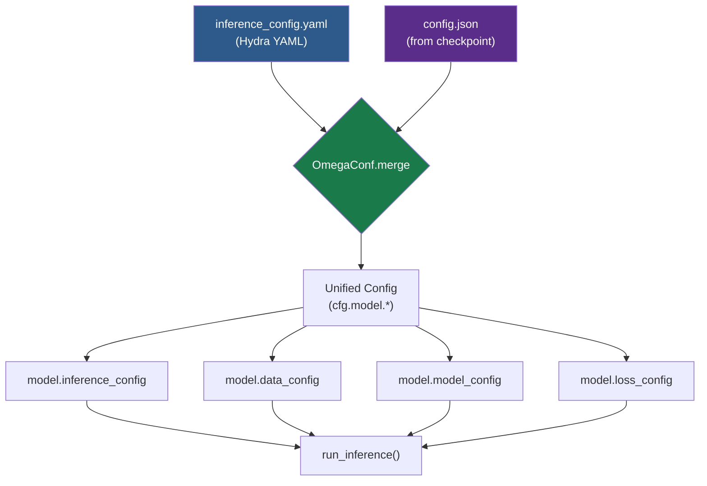

Transcriptformer uses **Hydra** with OmegaConf to manage its configuration hierarchy, enabling YAML-based defaults with full command-line override support. Understanding the configuration system is essential for controlling inference behavior, data preprocessing, device placement, and output format — all without modifying source code. This reference covers every user-facing parameter, its type, default value, and effect on the pipeline.

## Configuration Architecture

The configuration is split across two sources that merge at runtime: the **YAML file** (`inference_config.yaml`) provides user-tunable defaults, while the **checkpoint's `config.json`** supplies the frozen model architecture parameters (`model_config`, `loss_config`, and training-time `data_config` fields). The CLI entry point loads both, with the YAML file taking precedence on overlapping keys — meaning you can always override a checkpoint-derived value from the command line.



The YAML file defines three user-facing groups — `model.checkpoint_path`, `model.inference_config`, and `model.data_config` — while `model.model_config` and `model.loss_config` are populated exclusively from the checkpoint's stored training configuration. The inference script also auto-resolves three paths from `checkpoint_path`: `load_checkpoint` (model weights), `aux_vocab_path`, and `esm2_mappings_path`.

Sources: [inference.py](/src/transcriptformer/cli/inference.py#L33-L53), [inference_config.yaml](/src/transcriptformer/cli/conf/inference_config.yaml#L1-L43)

## Top-Level Model Section

The `model` key is the root namespace for all configuration. Only two fields are set directly at this level:

| Parameter | Type | Default | Description |
|---|---|---|---|
| `checkpoint_path` | `str \| null` | `null` | **Required.** Path to the model checkpoint directory (e.g., `./checkpoints/tf_sapiens`). Must contain `model_weights.pt`, `config.json`, and a `vocabs/` subdirectory. |
| `model_type` | `str` | `"transcriptformer"` | Model class to instantiate. `"transcriptformer"` for the full model, `"esm2ce"` for the ESM2 cross-encoder variant. |

The `checkpoint_path` is the single most important parameter — the inference script resolves all derivative paths from it. Setting it is mandatory; omitting it will cause a failure when the script attempts to read `config.json` or load weights.

Sources: [inference.py](/src/transcriptformer/cli/inference.py#L41-L53), [inference_config.yaml](/src/transcriptformer/cli/conf/inference_config.yaml#L4-L6)

## Inference Config (`model.inference_config`)

The `inference_config` group controls **how inference runs**: batching, device placement, output format, and embedding extraction mode. It maps to the `InferenceConfig` dataclass and is the most commonly overridden section.

| Parameter | Type | Default | Valid Values | Description |
|---|---|---|---|---|
| `batch_size` | `int` | `8` | Positive integer | Number of cells processed per forward pass. Increase for throughput on large GPUs; decrease to reduce peak memory. |
| `output_keys` | `list[str]` | `["embeddings"]` | `"embeddings"`, `"llh"` | Which outputs to include in the result AnnData. `"embeddings"` stores cell or gene embeddings in `obsm`; `"llh"` stores zero-truncated Poisson log-likelihoods in `uns`. |
| `obs_keys` | `list[str]` | `["all"]` | `"all"` or column names | Which `obs` columns to pass through to the output. `"all"` copies every column; specify individual names (e.g., `"cell_type"`, `"tissue"`) for a leaner output. |
| `data_files` | `list[str]` | `["test/data/human_val.h5ad"]` | Paths to `.h5ad` files | Input AnnData files. Accepts one or more paths; all are concatenated during loading. |
| `output_path` | `str` | `"./inference_results"` | Any directory path | Directory where the output `.h5ad` file is written. Created automatically if it does not exist. |
| `output_filename` | `str` | `"embeddings.h5ad"` | Any filename | Name of the output file within `output_path`. |
| `load_checkpoint` | `str \| null` | `null` | Path to `.pt` file | **Auto-resolved.** Set internally to `{checkpoint_path}/model_weights.pt`. Do not set manually unless you have a non-standard layout. |
| `pretrained_embedding` | `str \| list \| null` | `null` | Path(s) to embedding files | Path to pretrained protein embeddings for out-of-distribution species. Triggers [Embedding Surgery](10-embedding-surgery-for-new-species). Accepts a single path or list. |
| `precision` | `str` | `"16-mixed"` | `"16-mixed"`, `"32"`, `"bf16-mixed"` | PyTorch Lightning numerical precision. `"16-mixed"` uses FP16 with mixed-precision autocasting for speed; `"32"` uses full float32 for maximum numerical fidelity. |
| `emb_type` | `str` | `"cell"` | `"cell"`, `"cge"` | Embedding extraction mode. `"cell"` returns mean-pooled cell embeddings in `obsm["embeddings"]`; `"cge"` returns per-gene contextual embeddings in `uns["cge_embeddings"]` with associated metadata. |
| `num_gpus` | `int` | `1` | `-1`, `1`, or positive int | Number of GPUs. `1` = single GPU, `-1` = all available GPUs, `N>1` = use N GPUs (falls back if fewer available). Multi-GPU uses DDP strategy. |
| `device` | `str` | `"auto"` | `"auto"`, `"cpu"`, `"cuda"`, `"mps"` | Device selection. `"auto"` picks CUDA → MPS → CPU in priority order. `"mps"` targets Apple Silicon. |
| `use_oom_dataloader` | `bool` | `false` | `true`, `false` | Switch to the OOM-safe `AnnDatasetOOM` that uses memory-mapped backed reads and per-item processing instead of loading everything into RAM. See [Multi-GPU and OOM-Safe Inference](15-multi-gpu-and-oom-safe-inference). |
| `num_nodes` | `int` | `1` | Positive integer | Number of compute nodes for distributed inference (advanced). |
| `special_tokens` | `list[str]` | `[]` | Any token strings | Additional special tokens to register during inference. |

> [!TIP]
> When extracting contextual gene embeddings (`emb_type: "cge"`), output is stored in `uns` rather than `obsm` because each cell produces a variable-length set of gene embeddings. The `uns` dict contains three parallel arrays — `cge_embeddings`, `cge_cell_indices`, and `cge_gene_names` — that you must join to reconstruct per-cell gene embedding tables.

The `output_keys` and `emb_type` parameters interact: setting `output_keys: ["embeddings"]` with `emb_type: "cge"` changes where embeddings are stored (from `obsm` to `uns`) and their shape (from cell-level vectors to per-gene vectors). Setting `output_keys: ["llh"]` adds zero-truncated Poisson log-likelihoods, useful for evaluating model fit on held-out data.

Sources: [dataclasses.py](/src/transcriptformer/data/dataclasses.py#L167-L209), [inference_config.yaml](/src/transcriptformer/cli/conf/inference_config.yaml#L8-L29), [inference.py](/src/transcriptformer/model/inference.py#L258-L310)

## Data Config (`model.data_config`)

The `data_config` group controls **how input AnnData is preprocessed** before entering the model. These parameters govern gene filtering, count normalization, and tokenization behavior — all of which must match the assumptions the model was trained under.

| Parameter | Type | Default | Description |
|---|---|---|---|
| `gene_col_name` | `str` | `"ensembl_id"` | Column in `adata.var` containing gene identifiers. Must contain Ensembl-style IDs (version suffixes are auto-stripped). |
| `clip_counts` | `float` | `30` | Maximum count value. Counts exceeding this are clamped. Matches the model's training-time clipping — do not change unless you know the checkpoint was trained with a different value. |
| `filter_to_vocabs` | `bool` | `true` | Whether to remove genes not present in the model's vocabulary. When `true`, out-of-vocabulary genes are silently dropped. When `false`, they will cause tokenization errors. |
| `filter_outliers` | `float` | `0.0` | Standard-deviation threshold for filtering outlier cells by total expression. `0.0` disables filtering. A value of `3.0` removes cells whose total counts fall outside ±3σ from the mean. |
| `normalize_to_scale` | `float` | `0` | Library-size normalization target. `0` disables normalization. A value of `10000` would normalize each cell's counts to sum to 10,000. Most checkpoints expect raw (unnormalized) counts. |
| `sort_genes` | `bool` | `false` | Whether to sort genes by descending expression level per cell. Used for ablation studies; default ordering preserves original AnnData column order for expressed genes. |
| `randomize_genes` | `bool` | `false` | Whether to randomize gene order within each cell. Also used for ablation; enabling this introduces stochasticity into the embeddings. |
| `min_expressed_genes` | `int` | `0` | Minimum number of expressed (non-zero) genes required per cell. Cells below this threshold are filtered out. Useful for excluding low-quality cells. |
| `use_raw` | `str \| bool \| null` | `"auto"` | Which count matrix to use: `true` forces `adata.raw.X`, `false` forces `adata.X`, `"auto"` (or `null`) tries `raw.X` first and falls back to `X`. |
| `remove_duplicate_genes` | `bool` | `false` | Whether to silently remove duplicate gene IDs (after version stripping) instead of raising an error. Keeps the first occurrence. |
| `n_data_workers` | `int` | `0` | Number of DataLoader workers. `0` means data loading happens in the main process, ensuring deterministic behavior. Increase for faster I/O on SSD-backed storage. |

> [!TIP]
> The `use_raw: "auto"` setting implements a sensible fallback: if the AnnData object has a `raw` slot (common in Scanpy workflows where `raw` stores pre-normalized counts), Transcriptformer will prefer it. If your data only has `X`, this works transparently. If you have both and want the processed `X` rather than `raw.X`, explicitly set `use_raw: false`.

The data pipeline applies these parameters in a specific order: (1) load gene names and auto-strip version suffixes, (2) remove duplicate genes if `remove_duplicate_genes` is true, (3) select the count matrix layer via `use_raw`, (4) filter to vocabulary genes if `filter_to_vocabs` is true, (5) filter outlier cells by expression if `filter_outliers > 0`, (6) filter cells by minimum expressed genes, (7) sort or randomize gene order, (8) normalize and clip counts. This ordering matters because, for example, `filter_outliers` operates on counts before normalization.

Sources: [dataclasses.py](/src/transcriptformer/data/dataclasses.py#L93-L150), [inference_config.yaml](/src/transcriptformer/cli/conf/inference_config.yaml#L30-L43), [dataloader.py](/src/transcriptformer/data/dataloader.py#L39-L80), [dataloader.py](/src/transcriptformer/data/dataloader.py#L230-L276)

## Checkpoint-Derived Config (`model.model_config` and `model.loss_config`)

When the inference script loads a checkpoint, it reads `config.json` from the checkpoint directory and merges it into the configuration. This file contains the **frozen training-time parameters** that define the model architecture and loss function. These are not exposed in the YAML file because changing them would break weight compatibility.

### Model Architecture Parameters (`model.model_config`)

| Parameter | Type | Default | Description |
|---|---|---|---|
| `num_heads` | `int` | `16` | Number of attention heads in the transformer encoder. |
| `num_layers` | `int` | `12` | Number of transformer layers. |
| `model_dim` | `int` | `2048` | Hidden dimension of the transformer. |
| `embed_dim` | `int` | `2048` | Dimension of protein embeddings (must match ESM2 output). |
| `dropout` | `float` | `0.1` | Dropout rate applied in attention and feed-forward layers. |
| `activation` | `str` | `"gelu"` | Activation function in feed-forward layers. |
| `seq_len` | `int` | `2047` | Maximum gene sequence length (number of gene tokens per cell). |
| `aux_len` | `int` | `1` | Number of auxiliary token slots. `seq_len + aux_len` must be divisible by `block_len`. |
| `block_len` | `int` | `128` | Block length for FlexAttention block masking. |
| `mu_link_fn` | `str` | `"softmax"` | Link function for the count decoder's rate parameter. Must be one of: `exp`, `log`, `relu`, `sigmoid`, `softplus`, `linear`, `softmax`. |
| `softcap` | `int` | `10` | Logit soft-cap value for the gene ID prediction head. |
| `attn_bias` | `bool` | `false` | Whether attention layers use bias terms. |
| `fw_bias` | `bool` | `false` | Whether feed-forward layers use bias terms. |
| `gene_head_hidden_dim` | `int` | `2048` | Hidden dimension of the gene ID prediction MLP head. |
| `use_aux` | `bool` | `false` | Whether auxiliary (metadata) tokens are included in the sequence. |
| `compile_block_mask` | `bool` | `true` | Whether to compile the FlexAttention block mask for performance. |

### Loss Parameters (`model.loss_config`)

| Parameter | Type | Default | Description |
|---|---|---|---|
| `gene_id_loss_weight` | `float` | `1.0` | Weight of the gene ID prediction cross-entropy loss. Set to `0` to disable the gene ID head entirely. |
| `softplus_approx` | `bool` | `true` | Whether to use the approximate softplus in the zero-truncated Poisson loss for numerical stability. |

These checkpoint-derived parameters are validated on load — for instance, `seq_len + aux_len` must be divisible by `block_len`, and `mu_link_fn` must be one of the enumerated link functions. Changing these values without retraining would produce garbage output.

Sources: [dataclasses.py](/src/transcriptformer/data/dataclasses.py#L14-L73), [dataclasses.py](/src/transcriptformer/data/dataclasses.py#L153-L163), [inference.py](/src/transcriptformer/cli/inference.py#L41-L47)

## Hydra Override Syntax

Transcriptformer uses Hydra's override syntax to modify any configuration value from the command line without editing the YAML file. The dot-notation maps directly to the nested config structure:

```bash
python inference.py \
  --config-name=inference_config.yaml \
  model.checkpoint_path=./checkpoints/tf_sapiens \
  model.inference_config.data_files.0=my_data.h5ad \
  model.inference_config.batch_size=16 \
  model.inference_config.device=cuda \
  model.inference_config.precision=32 \
  model.data_config.clip_counts=30 \
  model.data_config.use_raw=false
```

**List overrides** use indexed syntax: `model.inference_config.data_files.0=path1.h5ad`, `model.inference_config.data_files.1=path2.h5ad`. To append without indexing, use the `+` prefix: `+model.inference_config.output_keys.0=llh`.

**Null handling**: The `checkpoint_path` defaults to `null` in the YAML. You must supply it via command line — the script will fail immediately if it is not set, since it needs to read `config.json` from that directory.

The `--config-name` flag can also point to a custom YAML file if you maintain multiple configuration profiles (e.g., one per model variant or experiment). Hydra searches the `conf/` directory relative to the script location.

Sources: [inference.py](/src/transcriptformer/cli/inference.py#L1-L18), [inference.py](/src/transcriptformer/cli/inference.py#L33-L53), [inference_config.yaml](/src/transcriptformer/cli/conf/inference_config.yaml#L1-L6)

## Configuration Quick Reference by Use Case

| Use Case | Key Overrides |
|---|---|
| **Basic inference** | `model.checkpoint_path`, `model.inference_config.data_files.0` |
| **Large datasets (OOM risk)** | `model.inference_config.use_oom_dataloader=true`, `model.inference_config.batch_size=4` |
| **Multi-GPU** | `model.inference_config.num_gpus=-1`, `model.inference_config.use_oom_dataloader=true` |
| **Apple Silicon** | `model.inference_config.device=mps` |
| **CPU-only** | `model.inference_config.device=cpu`, `model.inference_config.batch_size=1` |
| **Contextual gene embeddings** | `model.inference_config.emb_type=cge` |
| **Log-likelihood output** | `+model.inference_config.output_keys.0=llh` |
| **New species (embedding surgery)** | `model.inference_config.pretrained_embedding=path/to/emb` |
| **Filtered obs columns** | `model.inference_config.obs_keys.0=cell_type`, `model.inference_config.obs_keys.1=tissue` |
| **Full precision** | `model.inference_config.precision=32` |

Sources: [inference.py](/src/transcriptformer/cli/inference.py#L1-L18), [inference_config.yaml](/src/transcriptformer/cli/conf/inference_config.yaml#L1-L43)

## Where to Go Next

- For the commands that use these configuration parameters, see [CLI Inference Commands](13-cli-inference-commands).
- For OOM-safe and multi-GPU deployment patterns, see [Multi-GPU and OOM-Safe Inference](15-multi-gpu-and-oom-safe-inference).
- For understanding how `pretrained_embedding` triggers embedding surgery, see [Embedding Surgery for New Species](10-embedding-surgery-for-new-species).
- For how `emb_type` and `output_keys` affect downstream analysis, see [Cell and Contextual Gene Embeddings](14-cell-and-contextual-gene-embeddings).