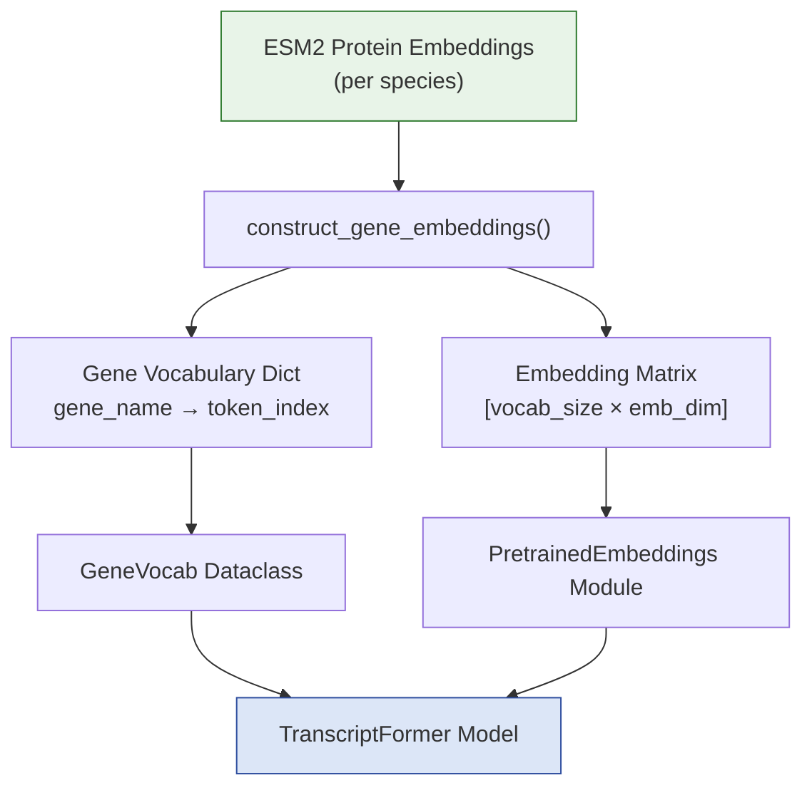
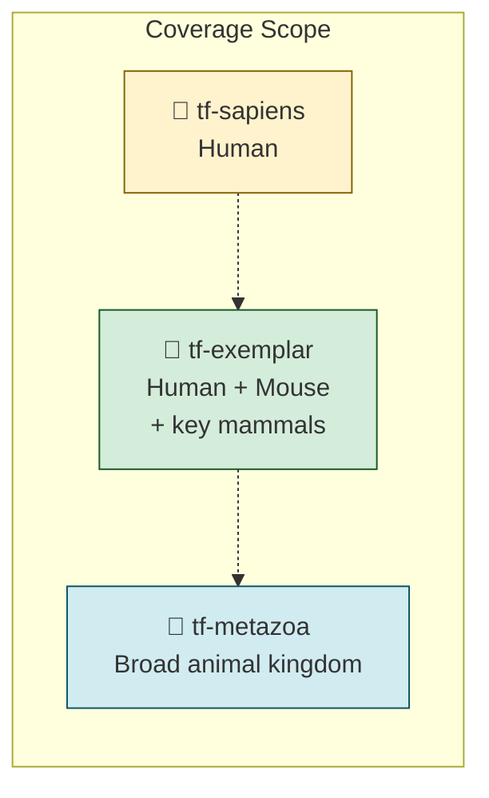

TranscriptFormer ships with **three pretrained model variants**, each trained on a progressively broader phylogenetic scope of single-cell RNA-seq data. Choosing the right variant is the first—and most impactful—decision you'll make when using TranscriptFormer, because the variant determines which species' genes are present in the model's vocabulary and, consequently, which organisms you can run inference on without additional steps.

## The Three Variants at a Glance

The variant names follow a biological naming convention that directly signals their species coverage. Here's how they compare:

| Variant | Phylogenetic Scope | Typical Use Case | Checkpoint Directory |
|---|---|---|---|
| **tf-sapiens** | *Homo sapiens* (human only) | Human cell atlas analysis, clinical single-cell data | `checkpoints/tf_sapiens/` |
| **tf-exemplar** | Key model organisms (human, mouse, and select mammals) | Cross-species analysis between well-studied organisms | `checkpoints/tf_exemplar/` |
| **tf-metazoa** | Broad metazoan (animal) kingdom coverage | Multi-species studies, evolutionary comparisons, non-model organisms | `checkpoints/tf_metazoa/` |

Each variant is a complete, self-contained model bundle that includes trained weights, a gene vocabulary, and the pretrained protein embeddings needed for inference. You download them using the artifact download CLI:

```bash
# Download a single variant
transcriptformer download-artifacts tf-sapiens

# Or download all variants at once
transcriptformer download-artifacts all
```

The three options `tf-sapiens`, `tf-exemplar`, and `tf-metazoa` correspond to the three rows in the table above. There is also an `all-embeddings` option that downloads only the protein embedding files without model weights, which is useful for [Embedding Surgery for New Species](10-embedding-surgery-for-new-species).

Sources: [download_artifacts.py](/src/transcriptformer/cli/download_artifacts.py#L19-L50), [download_artifacts.py](/src/transcriptformer/cli/download_artifacts.py#L127-L164)

## How Variants Differ: Vocabulary and Embeddings

The fundamental difference between variants is **which genes are in the vocabulary**. TranscriptFormer represents each gene as a token whose initial embedding is derived from a pretrained ESM2 protein language model. The variant's vocabulary is the union of all ESM2 embedding files bundled in its checkpoint directory.



When the model initializes, it calls `construct_gene_embeddings()` which reads all ESM2 mapping files listed in the checkpoint's `config.json`, concatenates them into a single embedding matrix, and builds a dictionary mapping every gene name to a unique integer index. Special tokens—`[START]`, `[END]`, `[PAD]`, `[CELL]`, `[RD]`, and `unknown`—are prepended to the vocabulary at indices 0–6. This means **the gene vocabulary size, and therefore the embedding matrix dimensions, differ across variants**.

> [!TIP]
> During inference, genes not present in the model's vocabulary are silently filtered out when `filter_to_vocabs: true` (the default). If your data contains many genes outside the vocabulary, you may lose significant signal. Choose the variant with the broadest coverage that matches your data, or use embedding surgery to extend it.

Sources: [vocab.py](/src/transcriptformer/tokenizer/vocab.py#L1-L116), [model.py](/src/transcriptformer/model/model.py#L55-L89), [layers.py](/src/transcriptformer/model/layers.py#L299-L342)

## Variant Architecture Parameters

All three variants share the same architectural template—a Flex Attention Transformer Encoder with a count decoder head—but may differ in scale parameters. The key dimensions that can vary between checkpoints are:

| Parameter | Description | Effect |
|---|---|---|
| `num_layers` | Number of transformer layers | Depth of the model; more layers capture more complex gene-gene interactions |
| `num_heads` | Number of attention heads | Granularity of multi-head attention |
| `model_dim` | Feed-forward hidden dimension | Capacity of each layer's MLP |
| `embed_dim` | Embedding dimension | Size of the projected gene representation |
| `seq_len` | Maximum sequence length | Maximum number of gene tokens per cell |

These values are stored in each checkpoint's `config.json` and are loaded automatically at inference time—you never need to specify them manually. When the inference script runs, it reads the checkpoint config, merges it with your CLI overrides, and instantiates the model with the correct dimensions.

Sources: [dataclasses.py](/src/transcriptformer/data/dataclasses.py#L18-L64), [inference.py](/src/transcriptformer/model/inference.py#L49-L86)

## Species Coverage and Data Compatibility

The practical question is: **which variant should I use for my data?** The answer depends on the organism(s) in your AnnData files. TranscriptFormer identifies genes by Ensembl ID (the `gene_col_name` defaults to `"ensembl_id"`), and only genes matching the variant's vocabulary will be retained during inference.

The test data included in the repository provides a concrete signal about validated species:

| Test File | Species | Variant Compatibility |
|---|---|---|
| `human_val.h5ad` | *Homo sapiens* | tf-sapiens ✓, tf-exemplar ✓, tf-metazoa ✓ |
| `mouse_val.h5ad` | *Mus musculus* | tf-exemplar ✓, tf-metazoa ✓ |
| `chicken_val.h5ad` | *Gallus gallus* | tf-metazoa ✓ |

The **tf-sapiens** variant is the most specialized—it covers only human genes. The **tf-exemplar** variant extends coverage to include key model organisms like mouse. The **tf-metazoa** variant has the broadest coverage, encompassing diverse species across the animal kingdom including chicken and other non-mammalian organisms.



> [!TIP]
> If you're working with a species not covered by any variant, don't despair—TranscriptFormer supports **embedding surgery**, which lets you swap in new protein embeddings for your target organism while keeping the trained transformer weights intact. See [Embedding Surgery for New Species](10-embedding-surgery-for-new-species) for the full walkthrough.

Sources: [inference_config.yaml](/src/transcriptformer/cli/conf/inference_config.yaml#L26-L29), [dataclasses.py](/src/transcriptformer/data/dataclasses.py#L67-L148)

## Downloading and Selecting a Variant

To run inference, you need both the model weights and the variant-specific vocabulary files. The download process extracts everything into a checkpoint directory with this structure:

```
checkpoints/
├── tf_sapiens/
│   ├── model_weights.pt
│   ├── config.json
│   └── vocabs/
│       ├── esm2_mappings/    # Protein embeddings for human genes
│       └── *_vocab.json      # Auxiliary vocabularies
├── tf_exemplar/
│   ├── model_weights.pt
│   ├── config.json
│   └── vocabs/
│       ├── esm2_mappings/    # Protein embeddings for exemplar species
│       └── *_vocab.json
└── tf_metazoa/
    ├── model_weights.pt
    ├── config.json
    └── vocabs/
        ├── esm2_mappings/    # Protein embeddings for metazoan species
        └── *_vocab.json
```

Point the `model.checkpoint_path` argument to the appropriate directory when running inference:

```bash
# Example: using the metazoa variant
transcriptformer inference \
  model.checkpoint_path=./checkpoints/tf_metazoa \
  model.inference_config.data_files.0=my_data.h5ad
```

The `all_embeddings` download option provides the standalone protein embedding files used by the embedding surgery mechanism, allowing you to extend any variant to cover new species without retraining.

Sources: [download_artifacts.py](/src/transcriptformer/cli/download_artifacts.py#L56-L122), [inference.py](/src/transcriptformer/cli/inference.py#L38-L52)

## What to Read Next

Now that you understand the available variants and how species coverage works, here are logical next steps depending on your goals:

- **To understand *why* the architecture supports multiple species**: Read [Multi-Species Training Strategy](9-multi-species-training-strategy) for the training methodology that makes cross-species embeddings possible.
- **To extend a variant to a new species**: Read [Embedding Surgery for New Species](10-embedding-surgery-for-new-species) for the step-by-step procedure.
- **To dive into the model internals**: Read [Architecture Overview](4-architecture-overview) for a complete walk-through of the transformer encoder, count decoder, and loss function.
- **To start running inference right away**: Read [CLI Inference Commands](13-cli-inference-commands) for practical command-line usage.