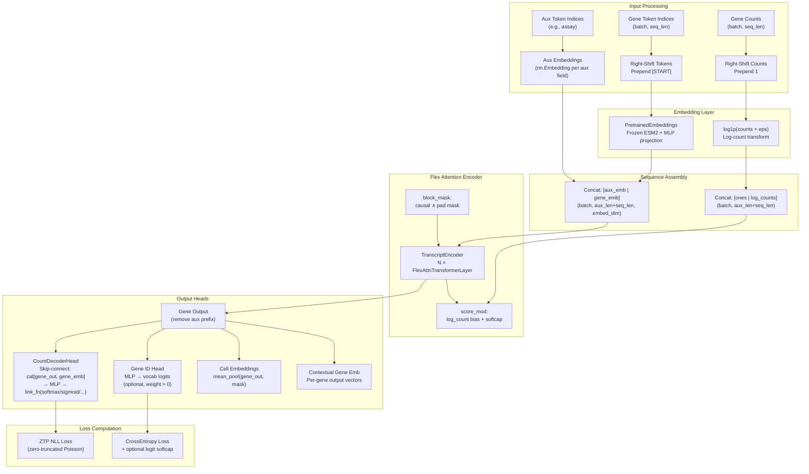
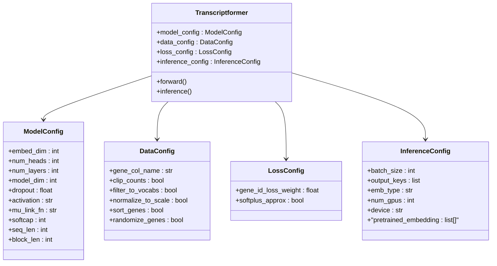

TranscriptFormer is an autoregressive transformer model that learns biologically meaningful representations of single-cell transcriptomic data by predicting gene tokens and their expression counts. Unlike language models that process sequential text, TranscriptFormer operates on **unordered sets of gene–count pairs**, using count-conditioned attention biases and causal masking to model the joint distribution of gene identity and expression within a cell. The architecture fuses pretrained protein embeddings with a Flex Attention transformer encoder and a count decoder head, trained end-to-end with a Zero-Truncated Poisson loss that respects the strictly-positive nature of observed expression counts.


Sources: [model.py](src/transcriptformer/model/model.py#L39-L40), [model_overview.png](assets/model_overview.png)

## System Architecture at a Glance

The codebase is organized into four primary subsystems—**tokenization**, **data loading**, **model**, and **inference**—each with a clear boundary of responsibility. The model subsystem is the architectural core, containing the transformer encoder, embedding layers, decoder heads, loss functions, attention masks, and the embedding surgery module. The inference subsystem orchestrates the full pipeline: loading vocabularies and embeddings, constructing the model, performing optional embedding surgery, and dispatching prediction via PyTorch Lightning's `Trainer`.

```
src/transcriptformer/
├── cli/                        # Command-line interface
│   ├── conf/inference_config.yaml
│   ├── download_artifacts.py
│   ├── download_data.py
│   └── inference.py
├── data/                       # Data subsystem
│   ├── dataclasses.py          # Config & batch dataclasses
│   └── dataloader.py           # AnnDataset, filtering, preprocessing
├── datasets.py                 # Public dataset download helpers
├── model/                      # Model subsystem (core)
│   ├── model.py                # Transcriptformer & ESM2CE classes
│   ├── layers.py               # Encoder, attention, embeddings, decoder
│   ├── losses.py               # ZTP NLL & CrossEntropy losses
│   ├── masks.py                # Causal & padding mask factories
│   ├── embedding_surgery.py    # Cross-species embedding swap
│   └── inference.py            # Full inference orchestration
├── tokenizer/                  # Tokenization subsystem
│   ├── tokenizer.py            # BatchGeneTokenizer, BatchObsTokenizer
│   └── vocab.py                # Vocabulary construction & loading
└── utils/                      # Shared utilities
    └── utils.py
```

Sources: [model.py](src/transcriptformer/model/model.py#L1-L36), [layers.py](src/transcriptformer/model/layers.py#L1-L12), [dataclasses.py](src/transcriptformer/data/dataclasses.py#L1-L10)

## End-to-End Data Flow

The following diagram traces the complete forward pass of the `Transcriptformer` model—from raw gene–count inputs through embedding, attention, decoding, and loss computation. This is the central execution path that ties all subsystems together.



Sources: [model.py](src/transcriptformer/model/model.py#L251-L383), [layers.py](src/transcriptformer/model/layers.py#L146-L223), [losses.py](src/transcriptformer/model/losses.py#L47-L129)

## Core Architectural Components

### Pretrained Gene Embeddings

Each gene is represented by a **frozen** pretrained protein embedding (derived from ESM-2), projected through a learned 2-layer MLP into the model's embedding dimension. The `PretrainedEmbeddings` module wraps an `nn.Embedding.from_pretrained` layer with `freeze=True`, then passes embeddings through an MLP with LayerNorm and dropout. This design preserves the rich biological semantics captured by the protein language model while allowing the projection to adapt to the transcriptomic domain.

| Property | Value |
|---|---|
| Source embeddings | ESM-2 protein embeddings |
| Freeze status | Frozen (`requires_grad=False`) |
| Projection | 2-layer MLP with LayerNorm + ReLU + Dropout |
| Normalization | LayerNorm on intermediate representations |
| Special tokens | Randomly initialized (seeded) |

Sources: [layers.py](src/transcriptformer/model/layers.py#L355-L394), [vocab.py](src/transcriptformer/tokenizer/vocab.py#L13-L57)

### Flex Attention Transformer Encoder

The `TranscriptEncoder` stacks `N` identical `FlexAttnTransformerLayer` modules, each following a **pre-norm** architecture: `LayerNorm → Self-Attention + Residual → LayerNorm → Feed-Forward + Residual`. The critical design departure from standard transformers is the use of PyTorch's `flex_attention`, which accepts a `score_mod` function and a `block_mask`—enabling two architectural innovations:

1. **Count-conditioned attention bias**: The `score_mod` function injects `log(1 + count)` as an additive bias to attention scores for positions where the query index exceeds the key index. This means each gene's influence on subsequent predictions is weighted by its expression level—a high-count gene "speaks louder" in the attention mechanism.

2. **Causal + padding block mask**: A composite `block_mask` is constructed by AND-ing a causal mask (positions can only attend to themselves and prior positions) with a padding mask (masking out `[PAD]` tokens). The `block_mask` format enables efficient sparse attention computation via `torch.compile`.

> [!TIP]
> The `score_mod` closure captures `log_counts` at forward time, so the attention bias dynamically reflects the actual expression profile of each cell in the batch—not a static positional encoding.

| Parameter | Description |
|---|---|
| `embed_dim` | Dimension of input/output embeddings |
| `num_heads` | Number of attention heads |
| `model_dim` | Feed-forward hidden dimension |
| `nlayers` | Number of transformer layers |
| `activation` | GELU (default), ReLU, or SiLU |
| `compile_attention` | Whether to `torch.compile` flex_attention |
| `attn_bias` / `fw_bias` | Linear layer biases (default: False) |

Sources: [layers.py](src/transcriptformer/model/layers.py#L24-L223), [masks.py](src/transcriptformer/model/masks.py#L1-L16), [model.py](src/transcriptformer/model/model.py#L205-L215)

### Count Decoder Head

The `CountDecoderHead` predicts the rate parameter μ of the expression distribution for each gene position. It receives a **skip-connected input** formed by concatenating the transformer's gene output with the original (non-right-shifted) gene embeddings—doubling the effective input dimension to `2 × embed_dim`. This skip connection allows the decoder to condition on both the contextualized representation and the raw gene identity when predicting expression.

Internally, the head applies a 2-layer MLP (with hidden dimension = `model_dim / 4`) that outputs a scalar logit per position, adds an optional **gene-specific bias** via `nn.Embedding(vocab_size, 1)`, then applies a link function. The default `softmax` link normalizes the output across all gene positions and scales by total cell counts—effectively predicting a proportion of the total expression budget allocated to each gene.

| Link Function | Behavior |
|---|---|
| `softmax` | Proportional allocation, scaled by total counts |
| `sigmoid` | Bounded [0, 1] per gene |
| `softplus` | Smooth positive activation |
| `exp` | Unbounded positive |
| `relu` | Clipped at zero |
| `linear` | Identity (no transformation) |

Sources: [layers.py](src/transcriptformer/model/layers.py#L249-L353), [model.py](src/transcriptformer/model/model.py#L140-L148)

### Gene ID Prediction Head (Auxiliary)

When `gene_id_loss_weight > 0`, an auxiliary `MLP` head is trained to predict the identity of the next gene token from the transformer output. This provides an additional supervision signal that encourages the model to learn gene co-expression patterns. The head maps from `embed_dim` through a hidden layer to `vocab_size` logits, with optional logit softcapping via `logit_softcap` to prevent extreme confidence.

Sources: [model.py](src/transcriptformer/model/model.py#L150-L170), [losses.py](src/transcriptformer/model/losses.py#L23-L44)

## Configuration Architecture

The model is configured through a hierarchy of dataclasses that decouple architectural decisions (`ModelConfig`), data processing rules (`DataConfig`), loss parameters (`LossConfig`), and inference behavior (`InferenceConfig`). These are assembled at instantiation time and stored as attributes on the `Transcriptformer` module.



Sources: [dataclasses.py](src/transcriptformer/data/dataclasses.py#L14-L73), [dataclasses.py](src/transcriptformer/data/dataclasses.py#L152-L209)

## Model Variants

The codebase implements two model variants that share the same configuration infrastructure but differ in their forward pass:

| Variant | Class | Forward Pass Behavior | Use Case |
|---|---|---|---|
| **Transcriptformer** | `Transcriptformer` | Full autoregressive pass: right-shift tokens → pretrained embeddings → transformer encoder → count decoder + gene ID head | Training & inference |
| **ESM2-CE** | `ESM2CE` | Embedding-only pass: raw ESM2 embeddings (no MLP projection, no transformer) → mean pool → cell/contextual gene embeddings | Baseline embedding extraction |

The `ESM2CE` variant is a lightweight baseline that bypasses the transformer entirely, returning the frozen pretrained protein embeddings directly (via `embed_only=True`). It exists to evaluate how much the transformer encoder adds beyond the pretrained protein embeddings alone.

Sources: [model.py](src/transcriptformer/model/model.py#L482-L527), [inference.py](src/transcriptformer/model/inference.py#L51-L61)

## Embedding Surgery for Cross-Species Transfer

A distinctive architectural feature is **embedding surgery**—the ability to swap the gene embedding layer at inference time to support species not seen during training. The `change_embedding_layer` function preserves special token embeddings from the trained model, concatenates them with new species' pretrained protein embeddings, reconstructs the `nn.Embedding` layer, and updates the vocabulary mapping. This enables zero-shot transfer to novel organisms without retraining.

> [!TIP]
> Embedding surgery is triggered by setting `pretrained_embedding` in the inference config. The model's vocabulary and embedding matrix are mutated in-place, so the same model object can serve multiple species sequentially.

Sources: [embedding_surgery.py](src/transcriptformer/model/embedding_surgery.py#L7-L79), [inference.py](src/transcriptformer/model/inference.py#L111-L118)

## What to Read Next

Now that you understand the overall architecture, explore each component in depth:

- **[Pretrained Protein Embeddings](5-pretrained-protein-embeddings)** — How ESM-2 embeddings are extracted, stored, and projected into the model
- **[Flex Attention Transformer Encoder](6-flex-attention-transformer-encoder)** — The count-conditioned attention mechanism and block masking in detail
- **[Count Decoder and Expression Prediction](7-count-decoder-and-expression-prediction)** — The skip-connected decoder head and link function design
- **[Zero-Truncated Poisson Loss](8-zero-truncated-poisson-loss)** — Why ZTP and how the NLL is computed
- **[Embedding Surgery for New Species](10-embedding-surgery-for-new-species)** — Cross-species transfer mechanics