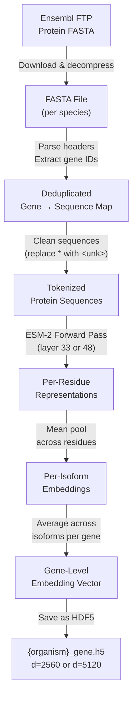

TranscriptFormer replaces the traditional learned gene embedding layer with **pretrained protein language model embeddings** from ESM-2 (Evolutionary Scale Modeling). Rather than learning gene representations from scratch on transcriptomic data alone, each gene is anchored to a fixed vector derived from the amino acid sequence of its encoded protein — injecting rich evolutionary and structural information into the model before a single cell is seen. This design choice is the foundation of TranscriptFormer's cross-species transfer capability and its strong zero-shot performance on unseen organisms.

## Why Protein Embeddings?

Single-cell transcriptomic models face a fundamental vocabulary problem: genes are typically treated as opaque categorical tokens whose relationships must be discovered entirely from expression co-variation. This forces the model to re-learn what biology already knows — that BRCA1 and BRCA2 share functional pathways, that orthologs across species carry conserved structure, and that protein sequence encodes function. ESM-2 embeddings, pretrained on millions of protein sequences via masked language modeling, capture exactly these evolutionary and structural regularities. By freezing these embeddings at the input layer, TranscriptFormer ensures that every gene's initial representation already encodes its protein-level biology, and the transformer encoder only needs to learn **how** these proteins interact within the context of a cell's expression profile.

Sources: [model.py](src/transcriptformer/model/model.py#L110-L117), [protein_embedding.py](preprocess/protein_embedding.py#L70-L143)

## Embedding Generation Pipeline

The preprocessing pipeline converts raw protein sequences from Ensembl into gene-level embedding matrices stored in HDF5 format. The entire flow — from FASTA download to frozen embedding tensor — is orchestrated by `protein_embedding.py`.



### ESM-2 Model Selection

Two ESM-2 model variants are supported, selectable via the `--use_large_model` flag:

| Property | ESM-2 3B (default) | ESM-2 15B (`--use_large_model`) |
|---|---|---|
| Model ID | `esm2_t36_3B_UR50D` | `esm2_t48_15B_UR50D` |
| Parameters | 3 billion | 15 billion |
| Layers | 36 | 48 |
| Representation layer | 33 | 48 |
| Embedding dimension | 2560 | 5120 |
| Output suffix | `{organism}_gene.h5` | `{organism}_gene_large.h5` |
| TranscriptFormer default | ✅ | ❌ |
| UCE default | ❌ | ✅ |

The pipeline extracts representations from the penultimate layer (layer 33 for the 3B model), mean-pools across all residues in each protein sequence to produce a fixed-length vector per isoform, and then averages across all isoforms belonging to the same gene to yield a single gene-level embedding. This isoform-averaging ensures that alternative splicing does not fragment a gene's representation.

> [!TIP]
> When generating embeddings for a new species, always use the same ESM-2 variant that your target TranscriptFormer checkpoint was trained with. Mixing the 3B-generated embeddings into a model trained on 15B embeddings (or vice versa) will produce dimension mismatches and semantically meaningless projections.

Sources: [protein_embedding.py](preprocess/protein_embedding.py#L70-L143), [protein_embedding.py](preprocess/protein_embedding.py#L146-L257)

### Supported Species and FASTA Manifest

The `fasta_manifest_pep.json` file maps organism keys to their Ensembl protein FASTA download URLs. As of the current release, **19 species** are supported, spanning mammals, birds, fish, amphibians, invertebrates, and even coral:

| Clade | Organism Key | Common Name |
|---|---|---|
| Primate | `homo_sapiens` | Human |
| Primate | `pan_troglodytes` | Chimpanzee |
| Primate | `gorilla_gorilla` | Gorilla |
| Primate | `macaca_mulatta` | Rhesus macaque |
| Primate | `callithrix_jacchus` | Marmoset |
| Primate | `microcebus_murinus` | Mouse lemur |
| Rodent | `mus_musculus` | Mouse |
| Rodent | `rattus_norvegicus` | Rat |
| Rodent | `heterocephalus_glaber` | Naked mole-rat |
| Ungulate | `sus_scrofa` | Pig |
| Lagomorph | `oryctolagus_cuniculus` | Rabbit |
| Bird | `gallus_gallus` | Chicken |
| Fish | `danio_rerio` | Zebrafish |
| Amphibian | `xenopus_tropicalis` | Frog |
| Monotreme | `ornithorhynchus_anatinus` | Platypus |
| Marsupial | `monodelphis_domestica` | Opossum |
| Invertebrate | `drosophila_melanogaster` | Fruit fly |
| Invertebrate | `stylophora_pistillata` | Coral |
| Jawless fish | `petromyzon_marinus` | Sea lamprey |

To add a new species, append an entry to the manifest with the appropriate Ensembl FTP URL for the `.pep.all.fa.gz` file. The pipeline will automatically download, parse, embed, and save the gene-level embeddings.

Sources: [fasta_manifest_pep.json](preprocess/fasta_manifest_pep.json#L1-L63), [README.md](preprocess/README.md#L86-L110)

### Output Format and Storage

Embeddings are saved in HDF5 format with a two-level structure: a `keys` dataset containing gene identifier strings, and an `arrays` group containing one dataset per gene. The utility function `load_from_hdf5` decodes byte-string keys and returns a Python dictionary mapping gene names to numpy arrays.

```python
# HDF5 structure
# ├── keys: array of byte-string gene IDs (e.g., b"ENSG00000139618")
# └── arrays/
#     ├── ENSG00000139618: float32 array, shape (2560,)
#     ├── ENSG00000141510: float32 array, shape (2560,)
#     └── ...
```

Sources: [utils.py](src/transcriptformer/utils/utils.py#L13-L45), [protein_embedding.py](preprocess/protein_embedding.py#L23-L33)

## From Embedding Files to Model Layer

The path from HDF5 files on disk to a frozen embedding layer inside the model involves three distinct stages: loading and deduplication, vocabulary construction, and projection via the `PretrainedEmbeddings` module.

```mermaid
flowchart LR
    subgraph "Stage 1: Load & Deduplicate"
        A["{organism}_gene.h5"] -->|"load_embeddings()"| B["Dict[gene_name → vector]"]
        B -->|"Deduplicate genes"| C["Unique gene list + vectors"]
    end
    subgraph "Stage 2: Vocabulary Construction"
        C -->|"Add special tokens<br/>(random init)"| D["Full vocab dict<br/>+ concatenated matrix"]
        D -->|"construct_gene_embeddings()"| E["gene_vocab_dict + emb_matrix"]
    end
    subgraph "Stage 3: Model Integration"
        E -->|"PretrainedEmbeddings"| F["nn.Embedding.from_pretrained<br/>(frozen)"]
        F -->|"2-layer MLP<br/>(trainable)"| G["Output dim = embed_dim<br/>(e.g., 2048)"]
    end
```



### Vocabulary Construction

The `construct_gene_embeddings` function in `vocab.py` is the bridge between raw embedding files and the model. It accepts a list of HDF5 file paths, loads each one, concatenates the gene names and vectors, deduplicates any overlapping genes (logging a warning for each duplicate removed), and then prepends **special token embeddings** — randomly initialized vectors for `[PAD]`, `[START]`, `[END]`, `[RD]`, `[CELL]`, `unknown`, and `_SEP_`. The resulting `gene_vocab_dict` maps each gene name and special token to a unique integer index, while the `emb_matrix` is a single numpy array whose row indices correspond exactly to those vocabulary indices.

The random initialization of special tokens uses a fixed seed (`random_seed=42`) for reproducibility. This is critical because special tokens serve structural roles in the model (padding, sequence boundaries, cell-level conditioning) and should not carry protein-level semantic information.

Sources: [vocab.py](src/transcriptformer/tokenizer/vocab.py#L13-L57), [vocab.py](src/transcriptformer/tokenizer/vocab.py#L88-L95)

### The PretrainedEmbeddings Module

The `PretrainedEmbeddings` class is the model-level component that wraps the frozen ESM-2 embeddings and projects them into the model's internal dimensionality. Its architecture is deliberately simple:

| Component | Trainable | Purpose |
|---|---|---|
| `nn.Embedding.from_pretrained` | ❌ Frozen | Lookup ESM-2 vectors by gene token index |
| `MLP` (2-layer) | ✅ Trainable | Project from ESM-2 dim (2560) to `embed_dim` (2048) |
| LayerNorm in MLP | ✅ Trainable | Normalize projected representations |
| Dropout in MLP | ✅ Trainable | Regularization during training |

The freezing behavior is controlled by the `freeze` parameter (default `True`), which sets `requires_grad = False` on the embedding weight matrix. The MLP projection uses ReLU activation between layers and LayerNorm before the output, with dropout applied for regularization. The `forward` method supports an `embed_only` flag that bypasses the MLP and returns raw ESM-2 vectors — this is used by the `ESM2CE` variant for direct embedding extraction.

> [!TIP]
> The MLP projection is the only trainable component in the embedding layer. If you are fine-tuning TranscriptFormer on a new dataset, the ESM-2 vectors remain fixed while the projection adapts to the model's internal representation space. This preserves the cross-species semantic structure while allowing domain-specific adaptation.

Sources: [layers.py](src/transcriptformer/model/layers.py#L355-L394), [model.py](src/transcriptformer/model/model.py#L110-L117)

## Model Integration: How Embeddings Flow Through TranscriptFormer

Inside the `Transcriptformer` model, gene embeddings participate in two distinct pathways during the forward pass. The `get_gene_embeddings` method produces both **right-shifted embeddings** (conditioned on previous tokens, for autoregressive input to the transformer) and **non-shifted embeddings** (used for the skip-connection in the count decoder). This dual pathway means each gene's ESM-2 representation influences both the self-attention computation and the final expression prediction.

```python
# Simplified flow from model.py forward()
right_shifted_gene_embeddings, gene_embeddings = self.get_gene_embeddings(batch)

# Path 1: Transformer input (autoregressive conditioning)
transformer_output = self.transformer_encoder(x=right_shifted_gene_embeddings, ...)

# Path 2: Skip connection to count decoder (concatenation)
conditioned_output = torch.cat([gene_output, gene_embeddings], dim=-1)
result["mu"] = self.mu(gene_output=conditioned_output, gene_tokens=gene_token_indices, ...)
```

The concatenation of transformer output with the original ESM-2-projected embeddings (`conditioned_output`) doubles the effective dimensionality at the count decoder input, allowing the model to simultaneously access the cell-contextualized representation and the original protein-level identity of each gene.

Sources: [model.py](src/transcriptformer/model/model.py#L187-L196), [model.py](src/transcriptformer/model/model.py#L287-L369)

## The ESM2CE Variant: Embeddings Without a Transformer

TranscriptFormer includes a lightweight variant called `ESM2CE` that bypasses the transformer encoder entirely. In this mode, `forward()` calls `self.gene_embeddings(gene_token_indices, embed_only=True)`, returning the raw ESM-2 embeddings (after the frozen lookup but before the MLP projection) as cell or contextual gene embeddings. This variant serves as a baseline to quantify the value added by the transformer encoder on top of pretrained protein embeddings alone.

Sources: [model.py](src/transcriptformer/model/model.py#L482-L527)

## Embedding Surgery: Extending to New Species

When applying a pretrained TranscriptFormer model to a species not seen during training, the embedding layer must be replaced with one covering the new organism's gene vocabulary. The `change_embedding_layer` function in `embedding_surgery.py` performs this operation by: (1) extracting the learned special token embeddings from the existing model, (2) constructing new gene embeddings from HDF5 files for the target species, (3) concatenating the preserved special token embeddings with the new gene embeddings, and (4) updating both the `nn.Embedding` layer and the `gene_vocab` dictionary. This preserves the model's learned behavior on structural tokens while enabling it to process entirely new gene sets.

For the full procedure and configuration, see [Embedding Surgery for New Species](10-embedding-surgery-for-new-species).

Sources: [embedding_surgery.py](src/transcriptformer/model/embedding_surgery.py#L7-L79)

## Key Design Decisions and Trade-offs

| Design Choice | Rationale | Trade-off |
|---|---|---|
| **Freeze ESM-2 embeddings** | Preserves cross-species protein semantics; prevents catastrophic forgetting of evolutionary information | Cannot adapt gene representations to transcriptomic context at the embedding level |
| **MLP projection (trainable)** | Allows the model to learn an optimal mapping from ESM-2 space to model space | Adds parameters; projection must be relearned during fine-tuning |
| **Mean-pool protein residues** | Produces fixed-length gene vectors regardless of protein length | Loses positional information within the protein sequence |
| **Average across isoforms** | One vector per gene regardless of alternative splicing | Collapses isoform-specific structural differences |
| **Random special token init** | Special tokens serve structural roles, not semantic ones | Slight sensitivity to random seed; mitigated by fixed seed |
| **Layer 33 extraction (3B)** | Penultimate layer balances high-level semantics with task-relevant features | Not the final layer; may miss some task-specific fine-tuning signal |

Sources: [model.py](src/transcriptformer/model/model.py#L110-L117), [layers.py](src/transcriptformer/model/layers.py#L355-L394), [protein_embedding.py](preprocess/protein_embedding.py#L122-L128), [vocab.py](src/transcriptformer/tokenizer/vocab.py#L53-L57)

## Next Steps

- Understand how the projected embeddings are processed by the transformer: [Flex Attention Transformer Encoder](6-flex-attention-transformer-encoder)
- See how gene tokens and counts are prepared for embedding lookup: [Gene Tokenizer and Vocabulary](11-gene-tokenizer-and-vocabulary)
- Learn how to extend embeddings to new species at inference time: [Embedding Surgery for New Species](10-embedding-surgery-for-new-species)