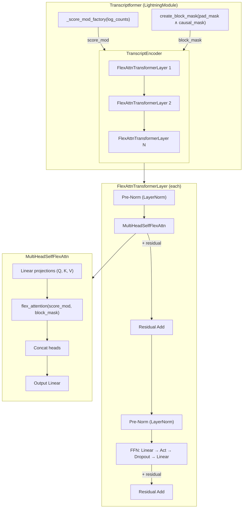
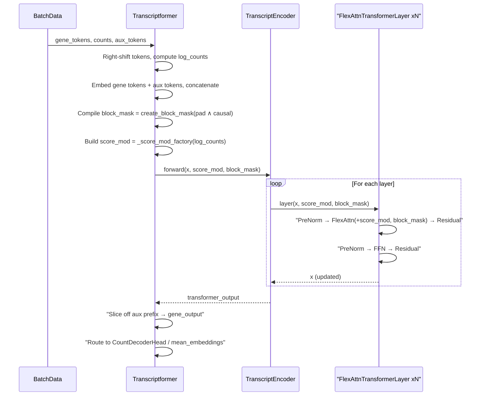

The Flex Attention Transformer Encoder is the computational core of TranscriptFormer — a stack of pre-norm transformer layers that leverages PyTorch's `flex_attention` primitive to implement two domain-specific modifications to standard self-attention: **count-informed attention bias** (via `score_mod`) and **causal padding-aware block masking** (via `block_mask`). Together, these mechanisms allow the encoder to reason about gene expression magnitude directly within the attention computation while maintaining efficient autoregressive masking over variable-length, padded gene sequences.

## Architectural Overview

The encoder is composed of three nested modules, each with a distinct responsibility. `MultiHeadSelfFlexAttn` implements the low-level attention mechanism with flex attention's `score_mod` and `block_mask` hooks. `FlexAttnTransformerLayer` wraps that attention with a pre-norm residual block and a feed-forward network. `TranscriptEncoder` stacks N identical layers and threads the shared `score_mod` and `block_mask` through every layer. The following diagram captures these relationships and the data flow from model-level orchestration down through each component.



Sources: [layers.py](src/transcriptformer/model/layers.py#L27-L98), [model.py](src/transcriptformer/model/model.py#L218-L246), [masks.py](src/transcriptformer/model/masks.py#L1-L17)

## MultiHeadSelfFlexAttn: The Attention Primitive

`MultiHeadSelfFlexAttn` replaces the standard scaled dot-product attention with PyTorch's `torch.nn.attention.flex_attention.flex_attention`, which exposes two hooks for domain-specific customization:

- **`score_mod`**: A closure invoked element-wise on the attention score matrix, enabling additive bias or multiplicative scaling before softmax.
- **`block_mask**: A structured block-sparse mask that determines which (query, key) blocks participate in attention, compiled into an efficient sparse representation.

The module performs the classic multi-head attention factorization — projecting input into Q, K, V via three separate linear layers (each `d_model → d_model`, no bias by default), reshaping into `(batch, heads, seq, d_k)`, applying flex attention, concatenating heads, and projecting back through a fourth linear layer. The key architectural choice is that `score_mod` and `block_mask` are **not** stored as module parameters but are instead **injected at forward time**, allowing the same attention module to serve both training (causal + count-biased) and embedding extraction (bidirectional + count-biased) modes without re-initialization.

> [!TIP]
> The `compile_attention` flag controls whether `flex_attention` is wrapped in `torch.compile(fullgraph=True)`. Compilation fuses the attention kernel and score modification into a single GPU kernel, which is critical for performance with block-sparse masks. Disabling it is useful for debugging but incurs significant runtime overhead on large sequences.

| Parameter | Type | Default | Description |
|---|---|---|---|
| `d_model` | `int` | required | Model dimension (must be divisible by `nheads`) |
| `nheads` | `int` | required | Number of attention heads; determines `d_k = d_model // nheads` |
| `bias` | `bool` | `False` | Whether to include bias in the Q/K/V/output linear layers |
| `compile_attention` | `bool` | `True` | Wrap `flex_attention` in `torch.compile(fullgraph=True)` |

Sources: [layers.py](src/transcriptformer/model/layers.py#L27-L98)

## FlexAttnTransformerLayer: Pre-Norm Residual Block

Each transformer layer follows the **pre-norm** architecture — layer normalization is applied *before* the attention and feed-forward sublayers rather than after. This ordering, denoted as "pre-norm is the new norm" in the codebase, stabilizes training for deep transformers by ensuring the residual path carries gradients with unit scale. The forward computation for each layer is:

```
x = LayerNorm(x)
x = MultiHeadSelfFlexAttn(x, score_mod, block_mask) + x    # residual 1
x = LayerNorm(x)
x = Linear2(Dropout(Activation(Linear1(x)))) + x           # residual 2
```

The feed-forward network is a two-layer MLP with configurable hidden dimension (`dim_fw`), activation function, and dropout. The activation is selectable among `relu`, `gelu` (default), and `silu`. Notably, **bias is independently configurable** for both the attention linear layers (`attn_bias`) and the feed-forward layers (`fw_bias`), both defaulting to `False` — a common practice in modern transformer designs where LayerNorm absorbs the bias role.

| Parameter | Type | Default | Description |
|---|---|---|---|
| `d_model` | `int` | required | Model dimension |
| `nhead` | `int` | required | Number of attention heads |
| `dim_fw` | `int` | `2048` | Feed-forward hidden dimension |
| `dropout` | `float` | `0.0` | Dropout rate applied after FFN activation |
| `fw_bias` | `bool` | `False` | Bias in feed-forward linear layers |
| `attn_bias` | `bool` | `False` | Bias in attention linear layers |
| `activation` | `str` | `"gelu"` | Activation function: `relu`, `gelu`, or `silu` |
| `compile_attention` | `bool` | `True` | Compile flex attention kernel |

Sources: [layers.py](src/transcriptformer/model/layers.py#L101-L189)

## TranscriptEncoder: Stacked Layers with Shared Masks

`TranscriptEncoder` is a thin container that instantiates `N` identical `FlexAttnTransformerLayer` modules and threads the same `score_mod` and `block_mask` through every layer during the forward pass. This design ensures that all layers respect the same causal and padding constraints, and that the count-informed bias is applied consistently at every depth.

```python
def forward(self, x, score_mod, block_mask):
    for layer in self.encoder_layers:
        x = layer(x, score_mod=score_mod, block_mask=block_mask)
    return x
```

The `score_mod` and `block_mask` are constructed externally (in `Transcriptformer.forward`) and passed in — the encoder has no internal knowledge of what they compute. This separation of concerns means the encoder is agnostic to whether it's running in autoregressive training mode, bidirectional embedding mode, or any future masking strategy.

| Parameter | Type | Default | Description |
|---|---|---|---|
| `embed_dim` | `int` | required | Embedding / model dimension |
| `num_head` | `int` | required | Number of attention heads per layer |
| `nlayers` | `int` | required | Number of transformer layers |
| `model_dim` | `int` | `2048` | Feed-forward hidden dimension |
| `dropout` | `float` | `0.0` | Dropout rate |
| `activation` | `str` | `"gelu"` | Activation function |
| `attn_bias` | `bool` | `False` | Attention linear layer bias |
| `fw_bias` | `bool` | `False` | Feed-forward linear layer bias |
| `compile_attention` | `bool` | `True` | Compile flex attention kernel |

Sources: [layers.py](src/transcriptformer/model/layers.py#L192-L252)

## Score Modification: Count-Informed Attention Bias

The most domain-critical component of the flex attention encoder is the **score modification function**, which injects gene expression information directly into the attention computation. This is defined as a closure in `Transcriptformer._score_mod_factory`:

```python
def _score_mod_factory(self, log_counts, emb_mode=False):
    softcap = self.model_config.softcap
    def score_mod(score, b, h, q_idx, kv_idx):
        bias = log_counts[b, kv_idx] * ((q_idx > kv_idx) | emb_mode)
        score = score + bias
        if softcap > 0:
            score = logit_softcap(score, softcap)
        return score
    return score_mod
```

The function receives the raw attention `score` and the four coordinate indices `(b, h, q_idx, kv_idx)` and performs two operations:

**1. Log-Count Bias**: The expression level of the *key* gene (the gene being attended to) is added as an additive bias to the attention score. The log-transformed count `log1p(count + eps)` acts as a signal of how prominently a gene is expressed — highly expressed genes receive stronger attention. Critically, the bias is applied **only when `q_idx > kv_idx`** during autoregressive training (i.e., the query is to the right of the key), which means a gene can only attend to the expression levels of *previously seen* genes. When `emb_mode=True` (embedding extraction), the condition becomes unconditional — `(q_idx > kv_idx) | True` — allowing bidirectional count-informed attention for producing cell-level embeddings.

**2. Logit Softcapping**: When `softcap > 0` (default: 10), attention scores are bounded via the `logit_softcap` function, which applies `softcap * tanh(score / softcap)`. This prevents attention scores from growing unboundedly, which can destabilize training with large expression values. The softcapping is applied *after* the count bias, ensuring both the raw score and the bias contribution are jointly capped.

> [!TIP]
> The `emb_mode` flag is what transforms the encoder from an autoregressive predictor into a bidirectional embedding extractor. During training, the causal constraint (`q_idx > kv_idx`) prevents information leakage from future tokens. During inference for cell embeddings, setting `emb_mode=True` removes this constraint, allowing each gene to attend to all other genes' expression levels — producing richer, context-aware representations.

Sources: [model.py](src/transcriptformer/model/model.py#L218-L230), [losses.py](src/transcriptformer/model/losses.py#L24-L38)

## Block Mask: Causal + Padding-Aware Sparse Attention

The block mask is the second flex attention primitive, constructed by composing two mask factories via `torch.nn.attention.flex_attention.and_masks`:

```python
mask_mod = and_masks(pad_mask_factory(pad_mask), self.causal_mask)
```

**Padding Mask** (`pad_mask_factory`): This mask prevents attention to padded gene positions. It takes a boolean mask indicating which positions are valid (non-padded) for each batch element and returns `True` only when the key position (`kv_idx`) is valid. This ensures that padded genes — which carry no biological signal — do not receive or contribute attention weight.

**Causal Mask** (`causal_mask_factory`): This mask enforces the autoregressive property — each position can only attend to itself and earlier positions. The default factory (with `offset=0`) creates the standard lower-triangular mask where `q_idx >= kv_idx`. The factory supports configurable `start_row`, `start_col`, and `offset` parameters, though the default configuration uses none of these.

The composed mask is compiled into a block-sparse representation via `create_block_mask`, which partitions the attention matrix into blocks of size `block_len` (default: 128) and determines at the block level which blocks contain at least one valid attention pair. This block-level sparsity is what makes flex attention efficient — entire blocks of the attention matrix can be skipped rather than individually masking positions.

The block mask construction also respects auxiliary tokens (e.g., species or assay embeddings prepended to the gene sequence). The padding mask is extended to cover auxiliary token positions, and the concatenation of auxiliary and gene embeddings means the causal mask operates over the full sequence including aux prefixes.

Sources: [masks.py](src/transcriptformer/model/masks.py#L1-L17), [model.py](src/transcriptformer/model/model.py#L243-L268)

## Data Flow Through the Encoder

The complete data flow from raw batch data through the encoder follows a precise sequence. First, gene token indices are right-shifted (prepending a `[START]` token) and log-counts are computed as `log1p(count + eps)`. Gene tokens are embedded via `PretrainedEmbeddings`, and auxiliary tokens are embedded separately and concatenated to the front of the sequence. The block mask is compiled from the composed causal + padding mask. The score modification closure captures the log-counts tensor. The encoder then processes the embedded sequence through all layers, producing contextualized representations for both the auxiliary prefix and the gene positions. After the encoder, auxiliary outputs are sliced off, leaving only gene-level representations for downstream heads.



Sources: [model.py](src/transcriptformer/model/model.py#L232-L310), [layers.py](src/transcriptformer/model/layers.py#L245-L252)

## Configuration Parameters

All encoder-related hyperparameters are defined in the `ModelConfig` dataclass. The following table summarizes the parameters that directly control the flex attention encoder's behavior:

| Parameter | Type | Default | Affects | Description |
|---|---|---|---|---|
| `embed_dim` | `int` | `2048` | Encoder, Embeddings | Model / embedding dimension |
| `num_heads` | `int` | `16` | Encoder | Number of attention heads per layer |
| `num_layers` | `int` | `12` | Encoder | Number of transformer layers |
| `model_dim` | `int` | `2048` | Encoder | Feed-forward hidden dimension |
| `dropout` | `float` | `0.1` | Encoder, Embeddings | Dropout rate |
| `activation` | `str` | `"gelu"` | Encoder | Activation: `relu`, `gelu`, or `silu` |
| `attn_bias` | `bool` | `False` | Encoder | Bias in attention Q/K/V/output projections |
| `fw_bias` | `bool` | `False` | Encoder | Bias in feed-forward linear layers |
| `softcap` | `int` | `10` | Score Mod | Softcap value for attention logit bounding |
| `block_len` | `int` | `128` | Block Mask | Block size for flex attention sparse masking |
| `seq_len` | `int` | `2047` | Block Mask | Maximum gene sequence length |
| `aux_len` | `int` | `1` | Block Mask | Number of auxiliary tokens prepended |
| `compile_block_mask` | `bool` | `True` | Encoder, Block Mask | Compile block mask creation + flex attention |
| `log_counts_eps` | `float` | `1e-6` | Score Mod | Epsilon for numerical stability in log-counts |

A validation constraint enforces that `(seq_len + aux_len) % block_len == 0`, ensuring the block mask can partition the full sequence (genes + aux tokens) into complete blocks without remainder.

Sources: [dataclasses.py](src/transcriptformer/data/dataclasses.py#L16-L76)

## Design Rationale and Trade-offs

**Why Flex Attention over Standard Attention?** Standard PyTorch attention (`F.scaled_dot_product_attention`) supports a fixed set of attention masks (causal, padding) but provides no hook for injecting custom score modifications. Flex attention's `score_mod` callback is essential for the count-informed bias, which is a first-class architectural feature of TranscriptFormer — expression magnitude must influence attention, not just gene identity. The block-sparse masking also provides computational savings over dense attention on variable-length gene sequences where many positions are padding.

**Why Pre-Norm over Post-Norm?** Pre-norm stabilizes gradient flow through deep stacks (the model uses 12 layers by default). In post-norm architectures, the residual path is modulated by LayerNorm, which can cause gradient vanishing in deep models. Pre-norm keeps the residual path clean, allowing gradients to flow unimpeded through the skip connections.

**Why Compile Flex Attention?** The `torch.compile(fullgraph=True)` wrapper on `flex_attention` fuses the attention score computation, score modification, and softmax into a single GPU kernel. Without compilation, each operation launches a separate kernel, and the element-wise score modification becomes a bottleneck. The `compile_block_mask` flag additionally controls whether `create_block_mask` is compiled, which accelerates mask construction for repeated batches of the same shape.

**Softcapping as a Regularizer**: The `softcap` parameter (default: 10) bounds attention scores via `softcap * tanh(score / softcap)`, which maps the real line to `(-softcap, +softcap)`. This prevents any single attention head from producing extremely large logits — particularly important given that the count-informed bias can be large for highly expressed genes. The same softcapping mechanism is also applied in the gene ID prediction head (see [Count Decoder and Expression Prediction](7-count-decoder-and-expression-prediction)), creating a consistent regularization strategy across the model.

Sources: [layers.py](src/transcriptformer/model/layers.py#L27-L98), [model.py](src/transcriptformer/model/model.py#L218-L268), [losses.py](src/transcriptformer/model/losses.py#L24-L38)

## What Comes Next

The encoder's output feeds into two downstream paths: the **count decoder head** for expression prediction and the **mean embedding function** for cell-level representations. The count-informed attention bias and softcapping mechanisms described here directly shape the loss landscape covered in [Zero-Truncated Poisson Loss](8-zero-truncated-poisson-loss). The causal masking strategy connects to the broader autoregressive training design discussed in [Architecture Overview](4-architecture-overview). For the embedding extraction path — where `emb_mode=True` removes the causal constraint — see [Cell and Contextual Gene Embeddings](14-cell-and-contextual-gene-embeddings).