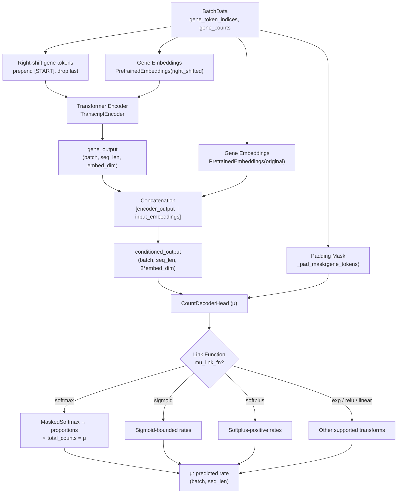
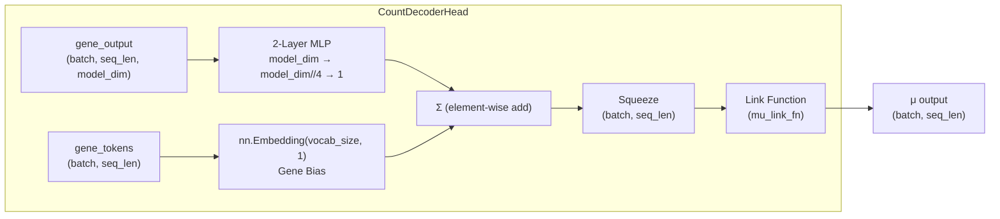

The Count Decoder is the prediction head that transforms TranscriptFormer's transformer encoder output into per-gene expression rate estimates. It is the architectural bridge between the contextual gene representations produced by the [Flex Attention Transformer Encoder](6-flex-attention-transformer-encoder) and the actual count values that define a cell's transcriptomic profile. Unlike generative language models that decode into a discrete token vocabulary, TranscriptFormer's decoder produces a **continuous rate parameter** μ for each gene position—this rate is then consumed by the [Zero-Truncated Poisson Loss](8-zero-truncated-poisson-loss) to compute training likelihoods. Understanding this component is essential for anyone modifying the model's prediction behavior, adapting it to new data regimes, or interpreting the meaning of the `mu` output key.

Sources: [model.py](src/transcriptformer/model/model.py#L1-L27), [layers.py](src/transcriptformer/model/layers.py#L229-L329)

## From Encoder Output to Expression Rate: The Data Flow

The count decoder does not operate on the transformer output alone. A critical architectural detail is that the decoder receives a **concatenation of two signals**: the transformer's contextual output (which has attended to all prior genes via causal attention) and the original input gene embedding (which carries the pretrained protein identity signal). This skip-connection-style concatenation doubles the input dimensionality and ensures that the decoder always has direct access to the identity of the gene whose count it is predicting, without relying solely on the encoder's ability to preserve that information through multiple attention layers.

The following diagram traces the complete path from raw batch data through the decoder to the final μ prediction:



The concatenation step is visible in the forward method where `gene_output` and `gene_embeddings` are joined along the embedding dimension, and this concatenated tensor is what feeds into the `self.mu` head:

```python
conditioned_output = torch.cat([gene_output, gene_embeddings], dim=-1)
result["mu"] = self.mu(
    gene_output=conditioned_output,
    gene_tokens=gene_token_indices,
    mask=self._pad_mask(gene_token_indices, dtype="float"),
)
```

Note the naming convention: the parameter is called `gene_output` inside `CountDecoderHead.forward`, but it receives the *concatenated* `conditioned_output` from the model. The decoder is agnostic to whether its input came from a pure encoder or a skip-concatenated path—it simply processes whatever `model_dim`-dimensional tensor it receives.

Sources: [model.py](src/transcriptformer/model/model.py#L320-L336)

## CountDecoderHead Architecture

The `CountDecoderHead` is a structured neural module with three independently parameterized components: a gene-specific bias, an MLP, and a link function. Each plays a distinct role in shaping the final expression prediction.



### Component 1: Gene-Specific Bias

When `gene_bias_size > 0` (which it always is in the standard model, set to the full gene vocabulary size), the decoder maintains an `nn.Embedding(vocab_size, 1)` table that provides a **scalar bias per gene token**. This bias captures the baseline expression propensity of each gene—a housekeeping gene naturally has a higher prior rate than a rarely-expressed transcription factor, and the gene bias learns this without requiring the MLP or transformer to encode it. The bias is added directly to the MLP output logit before the link function is applied, and its weights are initialized to zero via `init_weights()`.

Sources: [layers.py](src/transcriptformer/model/layers.py#L258-L271)

### Component 2: Two-Layer MLP

The MLP maps the concatenated representation (dimension `2 * embed_dim`, e.g., 4096 for `embed_dim=2048`) down to a scalar logit through a bottleneck architecture:

| Layer | Input Dim | Output Dim | Activation | Normalization | Dropout |
|-------|-----------|------------|------------|---------------|---------|
| Linear 1 | `model_dim` | `model_dim // 4` | ReLU | LayerNorm | Yes |
| Linear 2 | `model_dim // 4` | `1` | None | None | None |

The quarter-dimension bottleneck (e.g., 1024 hidden units for 4096 input) provides regularization while still giving the network sufficient capacity to learn nonlinear relationships between the contextual gene representation and its expression rate. The `use_layer_norm` flag defaults to `True`, and the final layer intentionally omits activation, normalization, and dropout—the raw scalar logit must pass through the link function to become a valid rate.

Sources: [layers.py](src/transcriptformer/model/layers.py#L272-L284), [layers.py](src/transcriptformer/model/layers.py#L399-L434)

### Component 3: Link Function

The link function is the most architecturally significant choice in the count decoder because it determines the mathematical domain and distributional semantics of the output. It is configured via `ModelConfig.mu_link_fn` and must be one of seven validated options.

| Link Function | Class/Op | Output Range | Use Case | Distributional Assumption |
|---------------|----------|--------------|----------|--------------------------|
| **`softmax`** | `MaskedSoftmax` | (0, 1) per gene, sums to 1 | Default; multinomial proportions | Gene comp. = multinomial, μ = proportion × total count |
| `sigmoid` | `nn.Sigmoid` | (0, 1) per gene | Bounded rates | Independent bounded rates |
| `softplus` | `nn.Softplus` | (0, ∞) | Positive rates | Poisson-like unbounded |
| `relu` | `nn.ReLU` | [0, ∞) | Sparse positive rates | Sparse expression |
| `exp` | `torch.exp` | (0, ∞) | Exponential rates | Rate = exp(logit) |
| `linear` | `nn.Identity` | (-∞, ∞) | Unconstrained | Not recommended for counts |
| `tanh` | `nn.Tanh` | (-1, 1) | Experimental | Rarely used |

The **softmax** link (the default) deserves special attention. It treats each cell's expression profile as a multinomial distribution over genes: the softmax produces a probability vector p̂ over gene positions, and this is rescaled by the cell's total observed count to produce μ̂ = p̂ × Σcᵢ. This rescaling happens in the model's forward pass immediately after the decoder call:

```python
if self.model_config.mu_link_fn == "softmax":
    result["mu"] = result["mu"] * gene_counts.sum(dim=1, keepdim=True)
```

This design means the model predicts **relative proportions** of expression and then calibrates them to the observed total library size. The `MaskedSoftmax` implementation also supports **softcapping** (configured via `ModelConfig.softcap`, default 10) which applies a `tanh`-based cap to logits before the softmax to prevent extreme probability concentration on a single gene.

Sources: [layers.py](src/transcriptformer/model/layers.py#L285-L329), [model.py](src/transcriptformer/model/model.py#L333-L336), [dataclasses.py](src/transcriptformer/data/dataclasses.py#L42-L83)

## The Softmax-Mask Interaction

When the softmax link is used, the mask passed to `CountDecoderHead.forward` is not a boolean tensor but a **float-valued additive mask** where padded positions are set to `-inf`. This is critical: the `MaskedSoftmax` computes `softmax(logits + mask)`, and the `-inf` entries ensure that padded gene positions receive exactly zero probability mass. This prevents the decoder from "spending" any of its expression budget on padding tokens, which would otherwise distort the rate estimates for real genes.

The mask construction follows a two-path convention in the model:

- **Float path** (`dtype="float"`): Padded positions → `-inf`, valid positions → `0`. Used for the softmax mask fed to the decoder.
- **Bool path** (`dtype="bool"`): Padded positions → `False`, valid positions → `True`. Used for attention masking and the output `result["mask"]`.

The convention for the output mask (`result["mask"]`) inverts the boolean: `True` indicates a *masked* (padded) position, consistent with PyTorch loss function conventions.

Sources: [model.py](src/transcriptformer/model/model.py#L147-L163), [layers.py](src/transcriptformer/model/layers.py#L194-L217)

## Expression Prediction at Inference Time

During inference, the `mu` predictions are available when `"mu"` is included in `InferenceConfig.output_keys`. However, the default inference configuration only outputs `"embeddings"`. To obtain expression rate predictions, you must explicitly add `"mu"` to the output keys. When `llh` (log-likelihood) is requested, the model recomputes the ZTP loss in eval mode, which internally uses `mu` alongside `input_counts` and `mask`.

The complete set of keys produced by the forward pass that relate to expression prediction:

| Key | Shape | Description |
|-----|-------|-------------|
| `mu` | `(batch, seq_len)` | Predicted rate parameter per gene |
| `input_counts` | `(batch, seq_len)` | Right-shifted observed counts (last position = 1) |
| `input_gene_token_indices` | `(batch, seq_len)` | Right-shifted gene tokens (last position = [END]) |
| `mask` | `(batch, seq_len)` | Boolean mask, `True` = padded/ignore |

> [!TIP]
> The `input_counts` and `input_gene_token_indices` in the result dict are **right-shifted** versions of the batch inputs—the last gene position is replaced with `[END]` token and a count of 1. This aligns the prediction targets with the autoregressive structure: each position i predicts the count for gene i, conditioned on genes 0..i-1.

Sources: [model.py](src/transcriptformer/model/model.py#L322-L349), [model.py](src/transcriptformer/model/model.py#L400-L445)

## Design Rationale: Why a Separate Decoder Head?

The decision to use a dedicated `CountDecoderHead` rather than sharing the transformer's output projection is deliberate. Expression count prediction is a fundamentally different task from the contextual representation learning performed by the encoder. The decoder must:

1. **Collapse a high-dimensional representation to a scalar** — The transformer operates in `embed_dim` space (e.g., 2048), but expression is a single positive number per gene. The MLP bottleneck with gene-specific bias provides a structured way to perform this reduction.

2. **Enforce distributional constraints** — Raw logits can be any real number, but expression rates must be positive and, under the softmax link, must partition a fixed budget. The link function is the mathematical contract that maps unconstrained neural output to a valid parameter space for the ZTP distribution.

3. **Decouple representation learning from prediction** — The gene-specific bias absorbs the "main effect" of each gene's baseline expression, allowing the transformer-MLP pathway to focus on learning **context-dependent deviations** from that baseline. This is analogous to how generalized linear models separate intercept terms from covariate effects.

> [!TIP]
> When extending TranscriptFormer to new species via [Embedding Surgery](10-embedding-surgery-for-new-species), the gene bias embedding will contain untrained entries for the new species' genes. Calling `init_weights()` on the `CountDecoderHead` to zero the gene bias can help stabilize early training, forcing the model to rely on the MLP pathway (which operates on shared pretrained embeddings) rather than uninitialized gene-specific offsets.

Sources: [layers.py](src/transcriptformer/model/layers.py#L229-L329), [model.py](src/transcriptformer/model/model.py#L97-L103)

## Next Steps

The μ output from the count decoder feeds directly into the loss computation. To understand how the predicted rates are evaluated against observed counts—and why the Zero-Truncated Poisson is the appropriate distribution for single-cell data—continue to [Zero-Truncated Poisson Loss](8-zero-truncated-poisson-loss). For the full end-to-end data flow from raw AnnData files through tokenization and into the decoder, see [Data Loading and Preprocessing](12-data-loading-and-preprocessing).