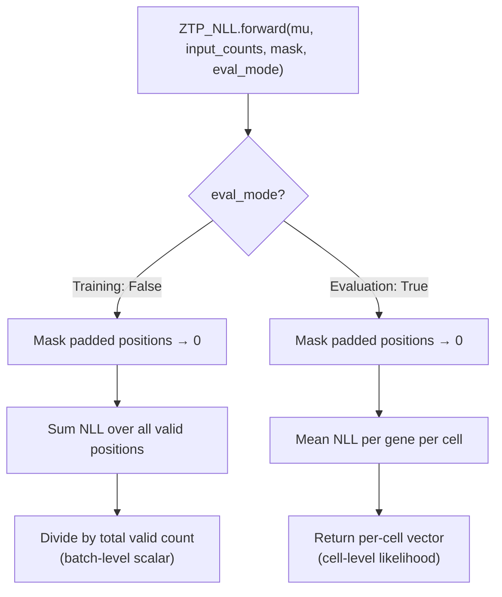

TranscriptFormer models single-cell gene expression as a **Zero-Truncated Poisson (ZTP)** distribution over observed counts, replacing the standard Poisson assumption to correctly account for a fundamental property of the data: zero-count genes are excluded from the input sequence entirely. The `ZTP_NLL` module implements the negative log-likelihood of this distribution as the primary training objective, computing a differentiable loss that drives the model's rate parameter predictions (μ) toward the true expression rates observed in each cell.

Sources: [losses.py](src/transcriptformer/model/losses.py#L1-L198), [model.py](src/transcriptformer/model/model.py#L147-L157)

## Why Zero-Truncation?

In a standard single-cell count matrix, the vast majority of entries are zero—a cell may express only ~10–20% of its genes. TranscriptFormer exploits this sparsity by **excluding zero-count genes from the input sequence**, representing each cell as an ordered list of only its expressed genes. This design dramatically reduces sequence length and computational cost, but it introduces a distributional shift: the model never observes zeros, so the likelihood of each observed count must be conditioned on the event that the count is at least one. A vanilla Poisson distribution assigns non-zero probability to k=0, which is inappropriate when zeros are structurally absent. The Zero-Truncated Poisson distribution corrects for this by renormalizing the probability mass over k ≥ 1:

$$P_{\text{ZTP}}(k \mid \mu) = \frac{P_{\text{Poisson}}(k \mid \mu)}{1 - P_{\text{Poisson}}(0 \mid \mu)} = \frac{\mu^k e^{-\mu}}{k! \cdot (1 - e^{-\mu})}, \quad k = 1, 2, 3, \ldots$$

This renormalization divides the standard Poisson probability by the survival function $S(\mu) = 1 - e^{-\mu}$, which ensures the distribution sums to one over the support {1, 2, 3, …}.

Sources: [losses.py](src/transcriptformer/model/losses.py#L76-L114)

## Negative Log-Likelihood Derivation

Taking the logarithm and negating yields the ZTP negative log-likelihood for a single gene observation:

$$\text{NLL}(k, \mu) = -k \log(\mu) + \log(1 - e^{-\mu}) + \log(k!)$$

The three terms correspond to: (1) the count-weighted log-rate, (2) the **log-normalization constant** $\log(1 - e^{-\mu})$ that accounts for the zero-truncation, and (3) the log-factorial term $\log \Gamma(k+1)$. The implementation decomposes exactly along these lines:

```python
nll = -counts_clamped * torch.log(mu + self.eps)   # term 1: -k * log(μ)
log_norm = compute_log_norm(mu + self.eps, self.softplus_approx)  # term 2: log(1 - e^{-μ})
nll += log_norm
nll += torch.lgamma(counts_clamped + 1)              # term 3: log Γ(k+1)
```

> [!TIP]
> The log-normalization constant $\log(1 - e^{-\mu})$ is the most numerically delicate component. For large μ, $e^{-\mu}$ underflows to zero and $\log(1 - 0) = 0$ is correct via direct computation. For small μ, $1 - e^{-\mu}$ approaches zero and direct evaluation suffers catastrophic cancellation. The `compute_log_norm` function addresses this with a numerically stable approximation (detailed in the next section).

Sources: [losses.py](src/transcriptformer/model/losses.py#L96-L114)

## Numerical Stability: The Log-Normalization Constant

The log-normalization constant $\log(1 - e^{-\mu})$ is the critical numerical challenge in the ZTP loss. The implementation provides two strategies controlled by the `softplus_approx` flag in [LossConfig](src/transcriptformer/data/dataclasses.py#L150-L155):

| Strategy | `softplus_approx` | Formula | Stability Regime |
|---|---|---|---|
| **Softplus approximation** | `True` (default) | $\mu - \text{softplus}(-\mu) = \mu - \log(1 + e^{-\mu})$ | Stable for all μ via PyTorch's softplus |
| **Direct log-expm1** | `False` | $\log(\text{expm1}(\mu)) = \log(e^{\mu} - 1)$ | Requires threshold switching at μ ≤ 5 |

The **softplus approximation** exploits the identity $\log(1 - e^{-\mu}) = \mu - \log(1 + e^{-\mu}) = \mu - \text{softplus}(-\mu)$. Since `torch.nn.functional.softplus` is implemented with log-sum-exp stability internally, this formulation avoids overflow/underflow across the entire range of μ without branching. The result is clamped to a minimum of zero to prevent spurious negative values from floating-point rounding.

The **direct log-expm1** strategy uses `log_expm1`, which computes $\log(e^x - 1)$ via `torch.log1p(torch.expm1(x))` for $x \leq 5$ (where expm1 provides precision near zero) and falls back to the identity $x$ for $x > 5$ (where $e^x - 1 \approx e^x$). Both paths are clamped to non-negative values.

Sources: [losses.py](src/transcriptformer/model/losses.py#L7-L21)

## Loss Instantiation and Configuration

The `ZTP_NLL` criterion is instantiated during model initialization via `_init_nll_loss`, drawing its hyperparameters from the model and loss configuration dataclasses:

```python
def _init_nll_loss(self):
    self.criterion = ZTP_NLL(
        eps=self.model_config.log_counts_eps,       # numerical floor (default 1e-6)
        softplus_approx=self.loss_config.softplus_approx,  # stable approximation (default True)
        max_counts=self.data_config.clip_counts,     # upper clamp for counts
    )
```

The three constructor parameters serve distinct protective roles:

| Parameter | Source Config | Purpose |
|---|---|---|
| `eps` | `ModelConfig.log_counts_eps` | Floor value preventing $\log(0)$ in rate computations and division by zero |
| `softplus_approx` | `LossConfig.softplus_approx` | Selects numerical strategy for log-normalization constant |
| `max_counts` | `DataConfig.clip_counts` | Upper clamp on observed counts to prevent extreme gradients from outlier UMI counts |

Sources: [model.py](src/transcriptformer/model/model.py#L147-L153), [dataclasses.py](src/transcriptformer/data/dataclasses.py#L150-L155)

## Masking and Reduction Modes

Single-cell transcriptomes vary in the number of expressed genes, producing variable-length sequences within each batch. The `ZTP_NLL.forward` method accepts a boolean `mask` tensor where `True` indicates padded positions that must be excluded from the loss computation. The loss operates in two reduction modes depending on the `eval_mode` flag:



In **training mode** (`eval_mode=False`), the loss sums all per-position NLL values across the batch and divides by the total number of valid (non-masked) positions, yielding a single scalar for backpropagation. This gives equal weight to each gene observation regardless of which cell it belongs to.

In **evaluation mode** (`eval_mode=True`), the loss computes the **mean NLL per gene within each cell independently**, returning a vector of per-cell negative log-likelihoods. This is essential for downstream tasks like cell-type identification where per-cell likelihood scores are compared. The inference pathway activates this mode when `"llh"` is included in `InferenceConfig.output_keys`.

> [!TIP]
> During inference, the per-cell likelihood vector enables principled cell-type classification: a cell is assigned to the type whose reference distribution yields the lowest average ZTP NLL. This is only valid because `eval_mode=True` normalizes per-cell rather than per-batch, preventing cells with more expressed genes from dominating the likelihood comparison.

Sources: [losses.py](src/transcriptformer/model/losses.py#L96-L114), [model.py](src/transcriptformer/model/model.py#L408-L415)

## Input Clamping and Guardrails

Before computing the NLL, the implementation applies two clamping operations that serve as numerical guardrails:

- **Counts clamping**: `torch.clamp(input_counts, min=eps, max=max_counts)` ensures counts remain in [ε, max_counts]. The lower bound is necessary because the ZTP distribution is only defined for k ≥ 1, and the epsilon floor prevents log-gamma singularities at zero. The upper bound prevents extreme UMI counts (which can reach millions in some protocols) from producing destabilizing gradient magnitudes.
- **Rate clamping**: `mu + self.eps` is used wherever the rate parameter appears in logarithms or denominators, preventing NaN propagation from zero or near-zero rate predictions.

These guardrails operate in concert with the `CountDecoderHead`'s link function (controlled by `ModelConfig.mu_link_fn`). When the link function is `softmax`, the rate parameter is inherently positive and sums to the total counts per cell, making zero rates structurally impossible. When using other link functions like `softplus` or `exp`, the epsilon floor provides the necessary safety net.

Sources: [losses.py](src/transcriptformer/model/losses.py#L96-L100)

## Sampling from the ZTP Distribution

The `ZTP_NLL.sample` method implements inverse-CDF sampling from the Zero-Truncated Poisson distribution, useful for generative evaluation and model criticism:

```python
def sample(self, mu, mask=None):
    mu = torch.clamp(mu, min=self.eps)
    p_zero = torch.exp(-mu)                         # P(k=0) under standard Poisson
    u = torch.distributions.Uniform(p_zero, 1).sample()  # sample above P(k=0)
    t = -torch.log(u)                                # invert the CDF
    sample = 1 + torch.poisson(mu - t)               # shifted Poisson draw
```

The algorithm works by sampling uniformly from the truncated region $[P(k=0), 1]$ of the Poisson CDF, then mapping back through the inverse CDF. Since $P(k \geq 1) = 1 - e^{-\mu}$, drawing $u \sim \text{Uniform}(e^{-\mu}, 1)$ and computing $1 + \text{Poisson}(\mu - t)$ where $t = -\log(u)$ yields a sample guaranteed to be ≥ 1. The optional mask fills excluded positions with `NaN`.

Sources: [losses.py](src/transcriptformer/model/losses.py#L61-L94)

## Data Flow: From Model Output to Loss

The following diagram traces the complete path from the transformer's output through the count decoder and into the ZTP loss computation:

```mermaid
flowchart LR
    subgraph Transformer
        TO["gene_output\n(B, S, D)"]
    end
    subgraph CountDecoderHead
        MLP["MLP → logit\n(B, S, 1)"]
        GB["gene_bias\n(B, S, 1)"]
        LF["link_func\n(softmax/softplus/exp)"]
        MLP --> LF
        GB --> LF
    end
    subgraph ZTP_NLL
        N1["-k·log(μ+ε)"]
        N2["log_norm(μ+ε)"]
        N3["lgamma(k+1)"]
        SUM["Σ → NLL"]
        RED{"eval_mode?"}
        N1 --> SUM
        N2 --> SUM
        N3 --> SUM
        SUM --> RED
        RED -->|False|"scalar\n(sum/valid)"
        RED -->|True|"vector\n(mean/cell)"
    end
    TO -->|"concat with\ninput embeddings"| MLP
    TO --> GB
    LF -->|"μ (B, S)"| N1
```

The `mu` tensor produced by `CountDecoderHead` flows directly as the rate parameter into `ZTP_NLL`, alongside the observed `input_counts` and the padding `mask`. The model's `forward` method assembles these three tensors into the result dictionary that the loss function consumes during training.

Sources: [model.py](src/transcriptformer/model/model.py#L285-L298), [losses.py](src/transcriptformer/model/losses.py#L76-L114)

---

Understanding the ZTP loss is the foundation for understanding how TranscriptFormer is trained. The count decoder that produces the μ parameter is detailed in [Count Decoder and Expression Prediction](7-count-decoder-and-expression-prediction), while the training strategy that combines this loss with the gene ID prediction loss is covered in [Multi-Species Training Strategy](9-multi-species-training-strategy).