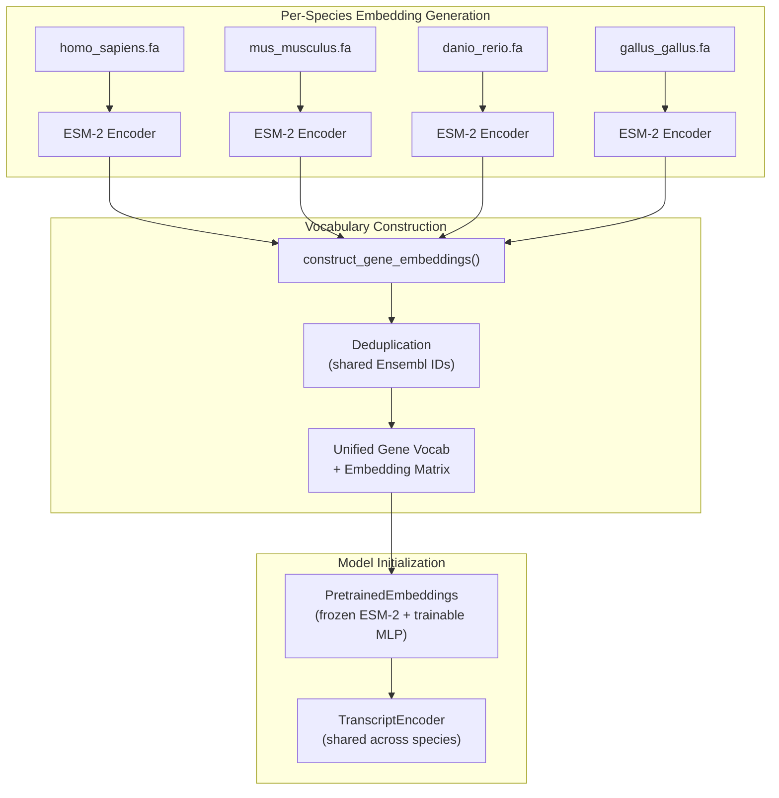
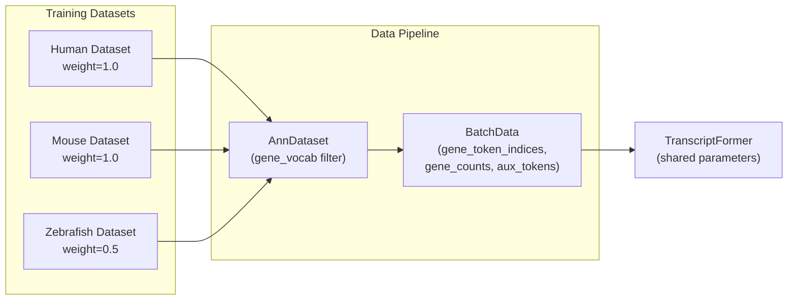

TranscriptFormer's multi-species training strategy is the architectural foundation that enables cross-species transfer learning. Rather than training isolated single-species models, the system constructs a **unified gene vocabulary** spanning multiple organisms, trains a single shared transformer on pooled multi-species data, and leverages the homology implicitly captured by ESM-2 protein embeddings to align orthologous genes across evolutionary distances. This page explains the three pillars of that strategy: unified vocabulary construction from multi-species protein embeddings, data mixing with per-species weighting, and the gene filtering mechanism that bridges the vocabulary to each species' genome.

## The Unified Vocabulary: One Token Space for All Species

The central insight behind multi-species training is that genes across organisms can share a single token space when their identifiers are grounded in protein sequence homology. TranscriptFormer achieves this by constructing a **concatenated embedding matrix** from ESM-2 protein embeddings generated independently for each species, then merging them into one vocabulary with deduplication.



The process begins in the preprocessing pipeline, where `protein_embedding.py` downloads Ensembl reference proteomes (listed in `fasta_manifest_pep.json`) and runs them through ESM-2 to produce per-gene embeddings stored as HDF5 files. Each species' FASTA file is sourced from Ensembl release 110 or 113, and protein sequences are mean-pooled over residue positions to yield one fixed-length vector per gene. The supported organism catalog spans **20 species** across major vertebrate and invertebrate lineages:

| Clade | Species |
|---|---|
| Primates | *Homo sapiens*, *Pan troglodytes*, *Gorilla gorilla*, *Macaca mulatta*, *Callithrix jacchus*, *Microcebus murinus* |
| Rodents | *Mus musculus*, *Rattus norvegicus*, *Heterocephalus glaber* |
| Other Mammals | *Sus scrofa*, *Oryctolagus cuniculus*, *Ornithorhynchus anatinus*, *Monodelphis domestica* |
| Birds | *Gallus gallus* |
| Amphibians & Fish | *Xenopus tropicalis*, *Danio rerio* |
| Invertebrates | *Drosophila melanogaster*, *Stylophora pistillata* |
| Basal Vertebrates | *Petromyzon marinus* |

Sources: [fasta_manifest_pep.json](preprocess/fasta_manifest_pep.json#L1-L64), [protein_embedding.py](preprocess/protein_embedding.py#L92-L158)

## Vocabulary Construction: Merging and Deduplication

The `construct_gene_embeddings` function in `vocab.py` is the mechanical heart of the unified vocabulary. It accepts a **list of pretrained embedding file paths** (one per species), loads each in sequence, and concatenates all gene names and embedding vectors into flat lists. A critical deduplication step then removes duplicate gene names—this occurs when the **same Ensembl gene ID** appears in multiple species' embedding files (rare under Ensembl naming conventions, but possible for shared identifiers). The surviving entries are assembled into a single vocabulary dictionary mapping gene names to integer indices, with special tokens prepended at index positions 0 through 6.

```python
# Simplified logic from construct_gene_embeddings
gene_names = []
embeddings = []
for file in pretrained_embedding_paths:
    gene_emb = load_embeddings(file)
    gene_names += list(gene_emb.keys())
    embeddings += list(gene_emb.values())

# Deduplication: first occurrence wins
seen_genes = {}
deduped_names = []
deduped_embeddings = []
for i, gene in enumerate(gene_names):
    if gene not in seen_genes:
        deduped_names.append(gene)
        deduped_embeddings.append(embeddings[i])
        seen_genes[gene] = True
```

The `load_vocabs_and_embeddings` function orchestrates this by reading the `esm2_mappings` list from the data configuration—each entry is a species-specific embedding file—and passing them all to `construct_gene_embeddings`. The resulting embedding matrix is wrapped as a frozen `torch.Tensor` and validated against the vocabulary size to ensure consistency.

> [!TIP]
> The order of embedding files in `esm2_mappings` matters: when duplicate gene IDs exist across species, the **first occurrence** is retained and subsequent duplicates are silently dropped. Place your primary training species first to avoid unintended vocabulary collisions.

Sources: [vocab.py](src/transcriptformer/tokenizer/vocab.py#L14-L68), [vocab.py](src/transcriptformer/tokenizer/vocab.py#L70-L97)

## Freezing Protein Priors: Why ESM-2 Embeddings Stay Fixed

Once constructed, the unified embedding matrix is injected into the model via the `PretrainedEmbeddings` module, which wraps it in an `nn.Embedding` layer with `freeze=True`. This means the ESM-2 protein embeddings are **never updated during backpropagation**—they serve as a fixed prior encoding each gene's functional and evolutionary properties based on its protein sequence. A trainable two-layer MLP then projects these frozen embeddings into the model's `embed_dim`, allowing the transformer to learn how to interpret the protein-level features while preserving the cross-species alignment that ESM-2 provides.

This design choice is architecturally significant for multi-species training: because the embedding for an orthologous gene pair (e.g., human *BRCA1* and mouse *Brca1*) is determined entirely by their respective protein sequences as encoded by ESM-2, the model receives a **homology-aware initialization** without any explicit orthology mapping. Genes with similar protein sequences naturally receive similar embeddings, creating an inductive bias that enables the transformer to share statistical strength across species boundaries.

Sources: [layers.py](src/transcriptformer/model/layers.py#L349-L391), [model.py](src/transcriptformer/model/model.py#L79-L83)

## Multi-Species Data Mixing and Weighting

Training on multiple species simultaneously requires careful data composition. The `DatasetConfig` dataclass provides a `weight` parameter (defaulting to `1.0`) for each training dataset, enabling per-species contribution control. Each dataset entry also specifies a `files` path and a `name` identifier, allowing the training loop to interleave examples from different organisms with configurable sampling ratios.



The `AnnDataset` class handles the practical mechanics of loading multi-species data. When given a `files_list` containing paths to `.h5ad` files from different species, it loads and processes each file independently—applying vocabulary filtering, normalization, and tokenization—then **concatenates all batches** into a single unified dataset. The `load_and_process_all_data` method iterates through each file, converts expression matrices to dense format, filters genes to those present in the shared vocabulary, tokenizes using the shared `BatchGeneTokenizer`, and stacks the resulting `BatchData` objects.

Sources: [dataclasses.py](src/transcriptformer/data/dataclasses.py#L98-L111), [dataloader.py](src/transcriptformer/data/dataloader.py#L322-L370), [dataloader.py](src/transcriptformer/data/dataloader.py#L371-L415)

## Gene Filtering: The Vocabulary-to-Genome Bridge

Not every gene in a species' genome appears in the unified vocabulary—only those with valid ESM-2 protein embeddings are included. The `filter_to_vocab` parameter (enabled by default in the inference configuration) controls whether genes absent from the vocabulary are dropped during data loading. When enabled, the `apply_filters` function scans the gene names in each AnnData object and retains only those present in the shared vocabulary dictionary.

This filtering mechanism creates an important dynamic: **the effective gene set varies by species**, but all retained genes share the same token index space. A human cell might have 19,000 of its ~20,000 protein-coding genes represented, while a chicken cell retains a different but overlapping subset. Genes not found in the vocabulary are mapped to the `"unknown"` token by `BatchGeneTokenizer`, and those with zero expression after filtering are padded with the `[PAD]` token. The result is that each cell's gene sequence is a species-specific projection into the universal vocabulary.

| Scenario | Filter Behavior | Impact |
|---|---|---|
| Gene in vocab, expressed | Retained and tokenized | Normal training signal |
| Gene in vocab, not expressed | Zero count with PAD token | Masked in attention |
| Gene not in vocab | Mapped to "unknown" token | Minimal information |
| `filter_to_vocab=True` | Non-vocab genes removed before tokenization | Cleaner sequences, fewer unknowns |
| `filter_to_vocab=False` | All genes kept, missing ones → "unknown" | More genes but noisier signal |

Sources: [dataloader.py](src/transcriptformer/data/dataloader.py#L39-L65), [tokenizer.py](src/transcriptformer/tokenizer/tokenizer.py#L7-L20), [inference_config.yaml](conf/inference_config.yaml#L30-L31)

## Auxiliary Tokens: Species Context as Prefix Conditioning

Beyond the gene vocabulary, TranscriptFormer supports **auxiliary token columns** (configured via `aux_cols` in `DataConfig`) that prepend contextual metadata—such as assay type or species identity—to each cell's gene sequence. When auxiliary tokens are present, they are embedded via separate `nn.Embedding` modules and concatenated to the front of the gene embedding sequence before entering the transformer. This gives the model explicit categorical context about each cell's experimental origin, which can help disentangle species-specific expression patterns from shared biological programs.

The auxiliary vocabulary is loaded from JSON files in `aux_vocab_path`, where each file (e.g., `assay_vocab.json`) maps categorical values to integer indices. The `BatchObsTokenizer` converts observation metadata into token indices that are stacked alongside gene tokens, and the attention mask is extended to cover the auxiliary prefix positions.

Sources: [model.py](src/transcriptformer/model/model.py#L89-L92), [model.py](src/transcriptformer/model/model.py#L242-L262), [tokenizer.py](src/transcriptformer/tokenizer/tokenizer.py#L23-L34)

## Cross-Species Validation: Probing the Embedding Space

The test data directory provides validation datasets for three species—human, mouse, and chicken—reflecting the model's multi-species training objective. The `bgee_testis_evolution` dataset function in `datasets.py` extends this further by providing testis tissue data across **nine species** spanning primates (human, chimpanzee, gorilla, marmoset, rhesus macaque), rodents (mouse), mammals (opossum, platypus), and birds (chicken). This evolutionary gradient is designed to evaluate how well the shared embedding space generalizes across increasing phylogenetic distance.

Sources: [datasets.py](src/transcriptformer/datasets.py#L88-L133)

## Architectural Summary

The multi-species training strategy can be summarized as a three-layer design: **(1)** ESM-2 protein embeddings provide a homology-aware gene representation that aligns orthologs across species without explicit orthology databases; **(2)** a unified vocabulary merges all species' gene tokens into a single index space with deduplication, enabling one model to process cells from any supported organism; **(3)** shared transformer parameters learn cross-species patterns while auxiliary tokens and per-species dataset weights provide the flexibility to capture species-specific variation. This design means that adding a new species requires only generating its ESM-2 protein embeddings and performing [Embedding Surgery](10-embedding-surgery-for-new-species)—no retraining of the transformer backbone is needed.
