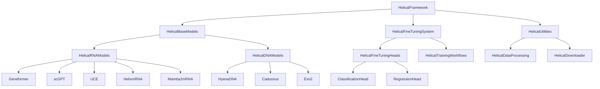
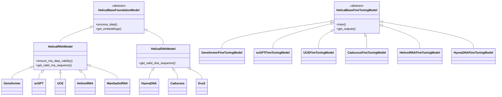
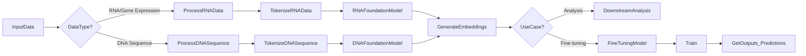
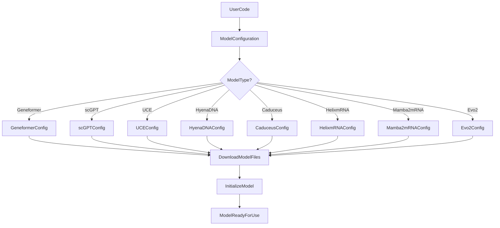

# Overview

<details>
<summary>Relevant source files</summary>

The following files were used as context for generating this wiki page:

- [.gitignore](.gitignore)
- [CITATION.bib](CITATION.bib)
- [README.md](README.md)
- [docs/index.md](docs/index.md)
- [examples/notebooks/Helix-mRNA.ipynb](examples/notebooks/Helix-mRNA.ipynb)
- [helical/models/caduceus/fine_tuning_model.py](helical/models/caduceus/fine_tuning_model.py)
- [mkdocs.yml](mkdocs.yml)
- [pyproject.toml](pyproject.toml)
- [requirements.txt](requirements.txt)

</details>


Helical is a unified framework for state-of-the-art pre-trained bio foundation models focused on genomics and transcriptomics. It provides a standardized interface to access, use, and fine-tune various biological language models through a consistent API, making these advanced models accessible to computational biologists, researchers, and AI developers.

For detailed installation instructions, see [Installation and Setup](#2).

Sources: [README.md:12-21](), [docs/index.md:1-11]()

## Purpose and Scope

Helical simplifies the entire application lifecycle when working with bio foundation models by:

1. Providing a unified API for diverse biological models
2. Simplifying data preprocessing workflows
3. Offering standardized fine-tuning capabilities 
4. Handling model downloading and configuration automatically

The framework currently supports two main categories of models:

- **RNA models**: For gene expression and RNA sequence analysis, including single-cell data
- **DNA models**: For genomic sequence analysis and interpretation

Sources: [README.md:16-21](), [docs/index.md:5-11]()

## Framework Architecture

Helical follows a modular architecture with clear separation between base models, fine-tuning systems, and utilities. This design ensures a consistent interface across all model implementations.

Helical Framework Architecture



Sources: [README.md:99-109](), [mkdocs.yml:7-50]()

### Model Inheritance Hierarchy

Models in Helical follow a clear inheritance pattern, with abstract base classes defining common interfaces that specific implementations inherit and extend.

Model Class Structure



Sources: [helical/models/caduceus/fine_tuning_model.py:2-6](), [helical/models/caduceus/fine_tuning_model.py:21-42]()

## Data Processing Workflow

The typical workflow in Helical involves processing input data, generating embeddings, and then using those embeddings for analysis or fine-tuning. The framework handles tokenization and model-specific processing automatically.

Data Flow in Helical



Sources: [examples/notebooks/Helix-mRNA.ipynb:152-177](), [examples/notebooks/Helix-mRNA.ipynb:280-313]()

## Model Configuration System

Each model in Helical has a corresponding configuration class that handles model-specific parameters, file paths, and download requirements. This system ensures consistent initialization and automatic downloading of required files.

Configuration and Model Loading System



Sources: [examples/notebooks/Helix-mRNA.ipynb:125-145]()

## Supported Models

### RNA Models

Helical includes several state-of-the-art RNA and gene expression models:

| Model | Description | Use Cases |
|-------|-------------|-----------|
| Geneformer | Transformer-based model for gene expression analysis | Cell type classification, perturbation prediction |
| scGPT | GPT-based model for single-cell RNA-seq analysis | Cell type annotation, trajectory analysis |
| UCE | Universal Cell Embedding model | Zero-shot cell type mapping, reference building |
| Helix-mRNA | Model for mRNA sequence analysis | mRNA therapy design, property prediction |
| Mamba2-mRNA | State space model for efficient mRNA sequence processing | Long mRNA sequence analysis |

Sources: [README.md:99-104](), [docs/index.md:79-85]()

### DNA Models

For genomic sequence analysis, Helical provides:

| Model | Description | Use Cases |
|-------|-------------|-----------|
| HyenaDNA | Efficient long-range model for DNA sequences | Regulatory element prediction, variant effect prediction |
| Caduceus | Transformer-based DNA sequence model | DNA sequence modeling and generation |
| Evo2 | Model for evolutionary sequence analysis | Multi-species DNA/RNA analysis |

Sources: [README.md:106-109](), [docs/index.md:86-89]()

## Fine-Tuning System

The fine-tuning system in Helical allows users to adapt pre-trained models for specific downstream tasks through a consistent interface:

1. **Fine-Tuning Heads**: Neural network components attached to the base model:
   - `ClassificationHead`: For categorical predictions (e.g., cell type classification)
   - `RegressionHead`: For continuous value predictions (e.g., expression levels)

2. **Training Workflow**: Standardized process with:
   - Control over which layers to freeze/unfreeze via the `trainable_layers` parameter
   - Customizable optimizers and learning rate schedulers
   - Built-in validation during training
   - Progress tracking through `tqdm` progress bars

3. **Output Generation**: Methods to generate predictions from fine-tuned models

Sources: [helical/models/caduceus/fine_tuning_model.py:136-294](), [examples/notebooks/Helix-mRNA.ipynb:280-313]()

## Standard Usage Pattern

Using Helical typically follows this consistent pattern:

1. **Import and initialize a model with its configuration**:
   ```python
   from helical.models.helix_mrna import HelixmRNAConfig, HelixmRNA
   config = HelixmRNAConfig(device="cuda", batch_size=5, max_length=1000)
   model = HelixmRNA(config)
   ```

2. **Process input data**:
   ```python
   processed_data = model.process_data(input_sequences)
   ```

3. **Generate embeddings**:
   ```python
   embeddings = model.get_embeddings(processed_data)
   ```

4. **For fine-tuning**:
   ```python
   from helical.models.helix_mrna import HelixmRNAFineTuningModel
   fine_tune_model = HelixmRNAFineTuningModel(
       helix_mrna_config=config, 
       fine_tuning_head="regression", 
       output_size=1
   )
   fine_tune_model.train(
       train_dataset=processed_data, 
       train_labels=labels,
       epochs=5
   )
   predictions = fine_tune_model.get_outputs(test_data)
   ```

Sources: [examples/notebooks/Helix-mRNA.ipynb:68-174](), [examples/notebooks/Helix-mRNA.ipynb:280-407]()

## Key Features

1. **Unified API**: All models implement the same core interface for consistent usage
2. **Efficient Data Processing**: Automated handling of data preprocessing and tokenization
3. **Easy Fine-tuning**: Standardized fine-tuning system for downstream tasks
4. **Model Downloading**: Automatic downloading of model weights and files
5. **Modality-specific Optimizations**: Specialized handling for RNA and DNA data

For more detailed information about these features, see [Key Features](#1.1).

Sources: [README.md:138-148](), [docs/index.md:119-127]()

## Dependencies

Helical depends on several key libraries:

- `torch` and `transformers`: For model architecture and operations
- `pandas` and `anndata`: For data handling, especially single-cell data
- `scikit-learn`: For evaluation metrics and utilities
- `datasets`: For efficient dataset handling
- Optional dependencies like `mamba-ssm` for certain models

Sources: [pyproject.toml:22-46](), [requirements.txt:1-26]()

## Summary

Helical provides a comprehensive framework for working with bio foundation models in genomics and transcriptomics. Its consistent API design, modular architecture, and standardized workflows make it easy for researchers and developers to leverage state-of-the-art models without needing to understand the implementation details of each model.

Sources: [README.md:138-148](), [docs/index.md:119-127]()

---