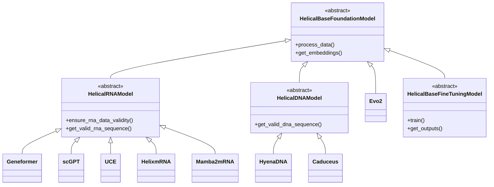
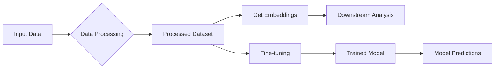
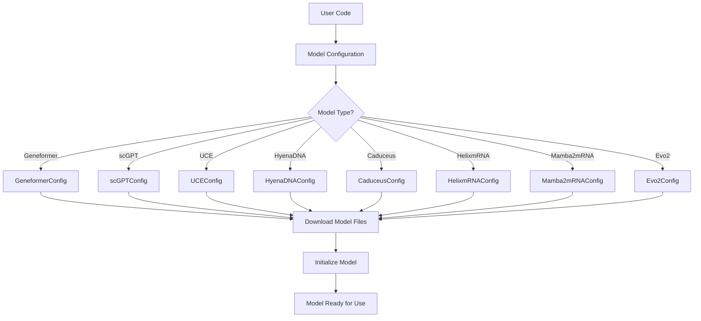
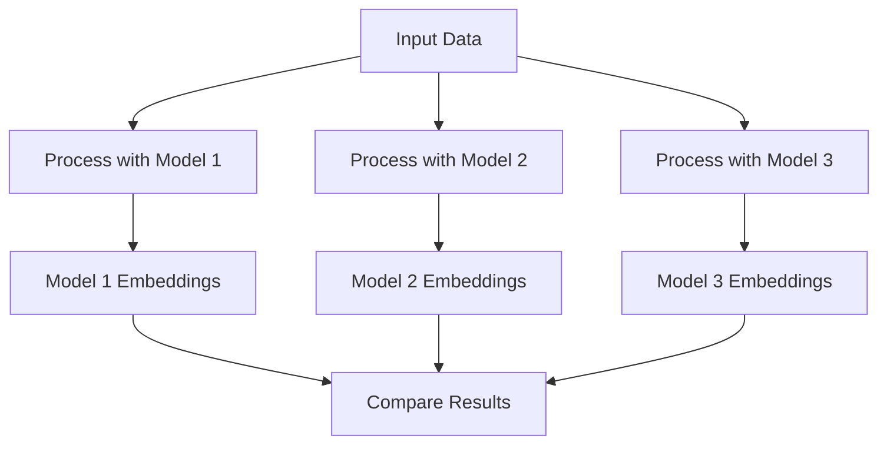

# Key Features

<details>
<summary>Relevant source files</summary>

The following files were used as context for generating this wiki page:

- [CITATION.bib](CITATION.bib)
- [README.md](README.md)
- [docs/index.md](docs/index.md)
- [docs/model_cards/caduceus.md](docs/model_cards/caduceus.md)
- [docs/model_cards/geneformer.md](docs/model_cards/geneformer.md)
- [docs/model_cards/helix_mrna.md](docs/model_cards/helix_mrna.md)
- [docs/model_cards/hyena_dna.md](docs/model_cards/hyena_dna.md)
- [docs/model_cards/mamba2_mrna.md](docs/model_cards/mamba2_mrna.md)
- [docs/model_cards/scgpt.md](docs/model_cards/scgpt.md)
- [docs/model_cards/uce.md](docs/model_cards/uce.md)
- [helical/models/caduceus/fine_tuning_model.py](helical/models/caduceus/fine_tuning_model.py)
- [mkdocs.yml](mkdocs.yml)

</details>


This page outlines the core features of the Helical framework, a unified API for working with bio foundation models in genomics and transcriptomics. Helical simplifies the entire workflow when working with these models, from initialization to embedding generation and fine-tuning.

For installation instructions, see [Installation and Setup](#2).

## Unified API Structure

Helical implements a consistent API across all supported models, allowing users to easily switch between different models while maintaining the same workflow. This is achieved through an inheritance hierarchy with abstract base classes.

### Model Hierarchy



All models inherit from the `HelicalBaseFoundationModel` abstract class, which defines the core interface methods:
- `process_data()`: Processes input data (sequences or expression data) into a format the model can use
- `get_embeddings()`: Generates embeddings from processed data

This standardization ensures that code written for one model can be easily adapted to work with another model.

Sources: [README.md:14-21]()

## Supported Bio Foundation Models

Helical provides access to state-of-the-art models across different biological modalities:

### RNA Models

| Model | Description | Use Cases |
|-------|-------------|-----------|
| [Geneformer](#4.1) | Pre-trained on ~103 million human single-cell transcriptomes | Gene network mapping, disease modeling, target identification |
| [scGPT](#4.2) | Pre-trained on >33 million human cells | Cell type annotation, perturbation response prediction, batch correction |
| [UCE](#4.3) | Pre-trained on >36 million cells across 8 species | Cell type prediction, cross-dataset integration, hypothesis generation |
| [Helix-mRNA](#4.4) | Single nucleotide resolution model for mRNA | mRNA optimization, therapeutic applications, biomanufacturing |
| [Mamba2-mRNA](#4.4) | Mamba2-based model for mRNA sequences | mRNA sequence analysis |

### DNA Models

| Model | Description | Use Cases |
|-------|-------------|-----------|
| [HyenaDNA](#5.1) | Long-range genomic sequence modeling at single nucleotide resolution | Genomic feature prediction, enhancer identification |
| [Caduceus](#5.2) | Bi-directional equivariant long-range DNA sequence modeling | Variant effect prediction, long-range effects analysis |
| [Evo2](#5.3) | Trained on DNA and RNA sequences | Evolutionary analysis across genomes |

Sources: [README.md:99-109](), [docs/index.md:79-89]()

## Standard Workflows

Helical standardizes the entire workflow for working with bio foundation models:



### Common Usage Pattern

All models follow the same usage pattern:

1. Create a configuration object
2. Initialize the model with the configuration
3. Process input data
4. Generate embeddings or fine-tune for specific tasks

Example with any model:
```python
from helical.models.MODEL_NAME import MODEL, MODELConfig

# 1. Create configuration
config = MODELConfig(...)

# 2. Initialize model
model = MODEL(configurer=config)

# 3. Process data
dataset = model.process_data(input_data)

# 4. Generate embeddings
embeddings = model.get_embeddings(dataset)
```

Sources: [docs/model_cards/geneformer.md:189-211](), [docs/model_cards/uce.md:110-124](), [docs/model_cards/scgpt.md:99-109]()

## Configuration System

Helical uses a configuration-based initialization system to simplify model setup:



Each model has its own configuration class that handles:
- Model variant selection (e.g., model size, version)
- Batch size and processing parameters
- Device configuration (CPU/GPU)
- Model-specific parameters

The configuration system automates:
- Downloading appropriate model files
- Setting up the correct model architecture
- Configuring tokenizers and preprocessing steps

Sources: [mkdocs.yml:7-50]()

## Fine-tuning System

Helical provides a standardized fine-tuning system that works consistently across all models:


The fine-tuning system supports:

- **Classification heads**: For tasks like cell type classification, disease prediction
- **Regression heads**: For numerical prediction tasks
- **Custom fine-tuning heads**: Users can implement custom heads for specific tasks

Each model has a corresponding fine-tuning class (e.g., `GeneformerFineTuningModel`, `UCEFineTuningModel`) that follows the same API:

```python
# Standard pattern for all fine-tuning models
fine_tune_model = MODELFineTuningModel(
    MODEL_config=config,
    fine_tuning_head="classification",
    output_size=num_classes
)
dataset = fine_tune_model.process_data(input_data)
fine_tune_model.train(train_dataset=dataset, train_labels=labels)
predictions = fine_tune_model.get_outputs(test_dataset)
```

Sources: [helical/models/caduceus/fine_tuning_model.py:21-62](), [docs/model_cards/geneformer.md:214-258]()

## Model Saving and Loading

Helical allows users to save fine-tuned models for later use, enabling:

- Persisting trained models across sessions
- Sharing models with collaborators
- Building model pipelines for production use

This feature ensures that the effort put into fine-tuning is preserved and can be leveraged in future work.

Sources: [README.md:34-36]()

## Data Processing

Helical provides utilities for processing different types of biological data:

### RNA Data Processing

- Supports single-cell gene expression data (e.g., AnnData format)
- Handles rank value encoding for gene expression
- Processes mRNA sequences at single nucleotide resolution

### DNA Data Processing

- Processes DNA sequences with support for various lengths
- Handles reverse complement operations
- Tokenizes sequences for model input

Sources: [docs/model_cards/geneformer.md:126-129](), [docs/model_cards/helix_mrna.md:89-92](), [docs/model_cards/hyena_dna.md:107-110]()

## Model Interoperability

One of Helical's key strengths is the ability to easily compare different models on the same task:



This interoperability enables:
- Benchmarking different models on the same dataset
- Ensemble approaches combining multiple models
- Finding the most suitable model for specific biological tasks

Sources: [README.md:128-132](), [README.md:125-129]()

## Containerization Support

Helical provides containerization options for reproducible environments:

- Docker container support
- Singularity/Apptainer support for HPC environments

This ensures that users can run Helical consistently across different computing environments, from local workstations to high-performance computing clusters.

Sources: [README.md:88-97](), [docs/index.md:68-77]()

## Comprehensive Examples

Helical includes comprehensive examples covering various use cases:

- Quick start tutorials
- Model comparison workflows
- Cell type classification
- DNA sequence analysis
- Fine-tuning examples

These examples serve as practical guides for users to adapt to their own research questions.

Sources: [README.md:124-133](), [docs/index.md:103-113]()

---