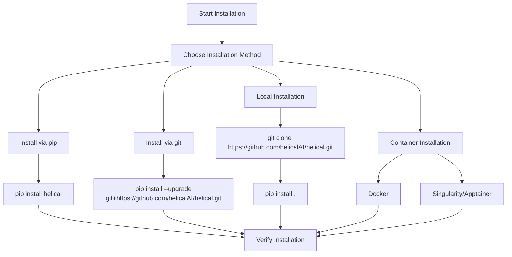
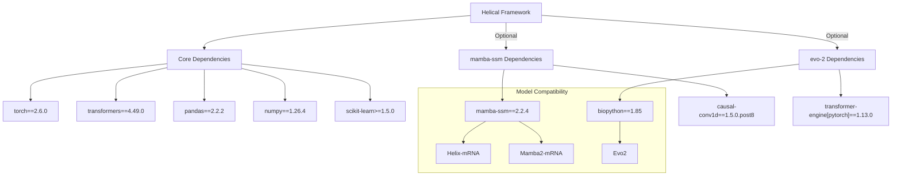

# Installation and Setup

<details>
<summary>Relevant source files</summary>

The following files were used as context for generating this wiki page:

- [.gitignore](.gitignore)
- [CITATION.bib](CITATION.bib)
- [Dockerfile](Dockerfile)
- [README.md](README.md)
- [docs/index.md](docs/index.md)
- [docs/model_cards/template.md](docs/model_cards/template.md)
- [entrypoint.sh](entrypoint.sh)
- [examples/notebooks/Helix-mRNA.ipynb](examples/notebooks/Helix-mRNA.ipynb)
- [helical/models/caduceus/fine_tuning_model.py](helical/models/caduceus/fine_tuning_model.py)
- [mkdocs.yml](mkdocs.yml)
- [pyproject.toml](pyproject.toml)
- [requirements.txt](requirements.txt)
- [singularity.def](singularity.def)

</details>


This document provides comprehensive instructions for installing the Helical framework and setting up your development environment. Helical is a unified API for working with bio foundation models in genomics and transcriptomics. For information about the framework's core architecture, see [Core Architecture](#3).

## System Requirements

Before installing Helical, ensure your system meets the following requirements:

- **Python**: Version 3.9 or higher (3.11.8 recommended)
- **Operating System**: Platform-independent (Windows, macOS, Linux)
- **Hardware**: 
  - CPU installation is supported for basic usage
  - GPU with CUDA support strongly recommended for model training and inference
  - Minimum 8GB RAM (16GB+ recommended for larger models)

Sources: [pyproject.toml:1-68](), [README.md:50-86]()

## Installation Methods



Sources: [README.md:50-72](), [docs/index.md:33-64]()

### Using Conda Environment (Recommended)

It's recommended to install Helical within a dedicated conda environment:

```bash
conda create --name helical-package python=3.11.8
conda activate helical-package
```

This isolates your Helical installation from other Python environments on your system.

Sources: [README.md:53-57](), [docs/index.md:36-39]()

### Standard Installation via pip

The simplest way to install the latest stable release of Helical is via pip:

```bash
pip install helical
```

Sources: [README.md:59-62](), [docs/index.md:42-44]()

### Installation from GitHub

To install the most recent version directly from GitHub:

```bash
pip install --upgrade git+https://github.com/helicalAI/helical.git
```

Sources: [README.md:64-67](), [docs/index.md:47-49]()

### Local Installation

To clone the repository and install locally:

```bash
git clone https://github.com/helicalAI/helical.git
cd helical
pip install .
```

This method is useful for developers who want to modify the framework.

Sources: [README.md:69-73](), [docs/index.md:51-55]()

## Optional Dependencies

Helical has optional dependencies for specific models and functionalities that can be installed based on your needs.



Sources: [pyproject.toml:22-58](), [requirements.txt:1-26]()

### Installing mamba-ssm Dependencies

For Helix-mRNA and Mamba2-mRNA models, install the mamba-ssm dependencies:

```bash
pip install helical[mamba-ssm]
```

If you've installed from a local repository:

```bash
pip install .[mamba-ssm]
```

**Note**: 
- A CUDA-compatible GPU is required for mamba-ssm and causal-conv1d packages
- The package `causal_conv1d` requires `torch` to be installed first. You may need to install Helical without optional dependencies first, then add them in a separate installation command

Sources: [README.md:75-86](), [docs/index.md:57-66]()

### Installing Evo-2 Dependencies

For the Evo-2 model, you can install the required dependencies:

```bash
pip install helical[evo-2]
```

Sources: [pyproject.toml:55-58]()

## Container Setup

For reproducible environments, Helical provides container configurations for both Docker and Singularity/Apptainer.

### Docker

The Helical Docker container is based on the PyTorch CUDA image:

```bash
# Pull the pre-built image
docker pull helicalai/helical:latest

# Or build from Dockerfile
docker build -t helical .

# Run container with GPU support
docker run --gpus all -it helical
```

Sources: [Dockerfile:1-21]()

### Singularity/Apptainer

To use Helical with Singularity/Apptainer:

```bash
# Build a sandbox container
apptainer build --sandbox singularity/helical singularity.def

# Shell into the container (use --nv for GPU support)
apptainer shell --nv --fakeroot singularity/helical/
```

This is particularly useful for HPC environments where Docker may not be available.

Sources: [README.md:88-97](), [docs/index.md:68-77](), [singularity.def:1-17]()

## Verifying Your Installation

After installation, you can verify that Helical is working correctly by running a simple example:

```python
from helical.models.helix_mrna import HelixmRNAConfig, HelixmRNA

# Initialize a model configuration
config = HelixmRNAConfig(device="cpu", batch_size=1)

# Initialize the model
model = HelixmRNA(config)

# Test with a simple sequence
test_sequence = ["AUGCUAGCUAGCUAGCUAGCUA"]
processed_data = model.process_data(test_sequence)
```

If no errors occur, the installation is successful.

Sources: [examples/notebooks/Helix-mRNA.ipynb:68-74](), [examples/notebooks/Helix-mRNA.ipynb:142-145]()

## Troubleshooting

### Common Installation Issues

| Issue | Possible Solution |
|-------|-------------------|
| `ImportError: No module named 'helical'` | Ensure you've activated the correct conda environment and that the installation completed successfully |
| CUDA-related errors | Verify that your CUDA installation is compatible with the torch version. You may need to install a specific torch version with `pip install torch==2.6.0+cu121` |
| Out of memory errors | Reduce batch size in model configuration or use a device with more memory |
| `causal_conv1d` installation failures | Install helical without optional dependencies first, then run a separate command for mamba-ssm: `pip install helical && pip install helical[mamba-ssm]` |

Sources: [README.md:84-86]()

### Package Compatibility

Helical has been tested with the following package versions:

| Package | Version |
|---------|---------|
| Python | 3.9-3.11 |
| torch | 2.6.0 |
| transformers | 4.49.0 |
| pandas | 2.2.2 |
| numpy | 1.26.4 |
| mamba-ssm | 2.2.4 |
| causal-conv1d | 1.5.0.post8 |
| biopython | 1.85 |

For the complete list of dependencies, see [pyproject.toml:22-58]().

Sources: [pyproject.toml:22-58](), [requirements.txt:1-26]()

## Quick Start Example

Once installed, you can quickly test Helical with the following example that loads a model and gets embeddings:

```python
import torch
from helical.models.helix_mrna import HelixmRNAConfig, HelixmRNA

# Set device (use GPU if available)
device = "cuda" if torch.cuda.is_available() else "cpu"

# Configure model
config = HelixmRNAConfig(device=device, batch_size=1, max_length=100)
model = HelixmRNA(config)

# Process sample sequences
sequences = ["AUGCUAGCUAGCUAGCUAGCUA", "UUUUUAAAAGGGCCCA"]
processed_data = model.process_data(sequences)

# Generate embeddings
embeddings = model.get_embeddings(processed_data)
print(f"Embeddings shape: {embeddings.shape}")
```

For more examples and usage guides, see the example notebooks in the repository.

Sources: [examples/notebooks/Helix-mRNA.ipynb:68-74](), [examples/notebooks/Helix-mRNA.ipynb:142-145](), [examples/notebooks/Helix-mRNA.ipynb:160-162]()

---