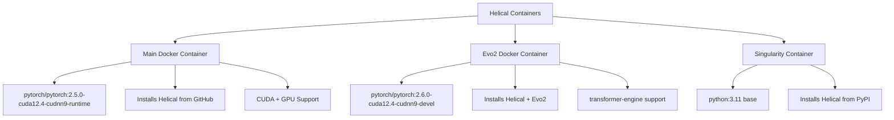
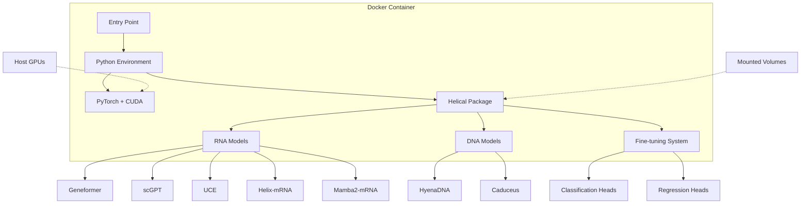
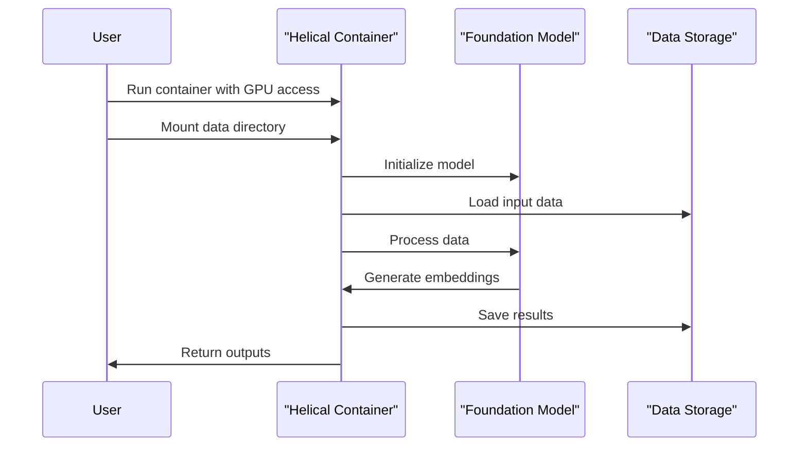
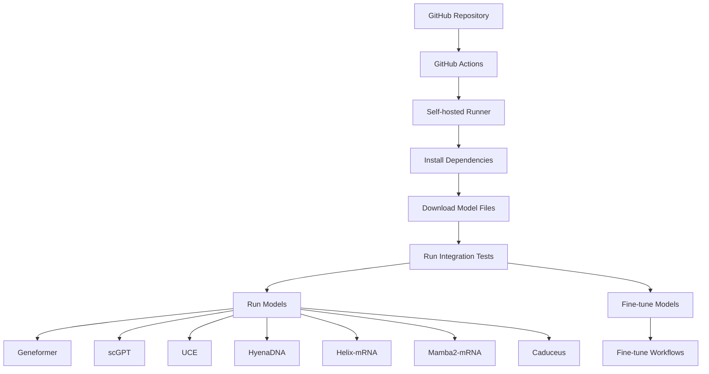

# Container Setup

<details>
<summary>Relevant source files</summary>

The following files were used as context for generating this wiki page:

- [.github/workflows/main.yml](.github/workflows/main.yml)
- [.github/workflows/release.yml](.github/workflows/release.yml)
- [Dockerfile](Dockerfile)
- [docs/model_cards/template.md](docs/model_cards/template.md)
- [entrypoint.sh](entrypoint.sh)
- [helical/models/evo_2/Dockerfile](helical/models/evo_2/Dockerfile)
- [singularity.def](singularity.def)

</details>


This page provides instructions for using and customizing Docker and Singularity containers with Helical. Containers offer consistent, reproducible environments for running Helical models across different systems, which is particularly valuable for computational biology workflows that require specific dependencies and GPU support.

For general installation instructions without containers, see [Installation and Setup](#2).

## Available Containers

Helical provides several container options to support different use cases:



Sources: [Dockerfile:1-20](), [helical/models/evo_2/Dockerfile:1-29](), [singularity.def:1-16]()

## Docker Container Setup

### Main Container

The main Docker container provides a ready-to-use environment with CUDA support for running all Helical models except Evo2 (which has its own specialized container).

#### Building the Main Container

```bash
# Clone the repository (if not already done)
git clone https://github.com/helicalAI/helical.git
cd helical

# Build the Docker image
docker build -t helical:latest .
```

#### Running the Main Container

```bash
# Run container with GPU support
docker run --gpus all -it helical:latest

# Run container with specific GPUs
docker run --gpus '"device=0,1"' -it helical:latest

# Mount local directory to container for data persistence
docker run --gpus all -v $(pwd):/workspace -it helical:latest
```

### Evo2 Specialized Container

The Evo2 model requires additional dependencies, which are provided in a specialized container.

#### Building the Evo2 Container

```bash
# Navigate to the Evo2 Dockerfile directory
cd helical/models/evo_2

# Build the Docker image
docker build -t helical-evo2:latest .
```

#### Running the Evo2 Container

```bash
# Run Evo2 container with GPU support
docker run --gpus all -it helical-evo2:latest

# Mount local directory
docker run --gpus all -v $(pwd):/workspace -it helical-evo2:latest
```

Sources: [Dockerfile:1-20](), [helical/models/evo_2/Dockerfile:1-29]()

## Container Architecture

The following diagram illustrates the architecture of the main Helical Docker container:



Sources: [Dockerfile:1-20]()

## Singularity Container Setup

Singularity containers are particularly useful in HPC environments where Docker may not be available.

### Building the Singularity Container

```bash
# Build the Singularity image
sudo singularity build helical.sif singularity.def
```

### Running the Singularity Container

```bash
# Run the Singularity container
singularity run --nv helical.sif

# Execute a specific command
singularity exec --nv helical.sif python -c "import helical; print(helical.__version__)"

# Shell into the container
singularity shell --nv helical.sif
```

Sources: [singularity.def:1-16]()

## Container Usage Example

The following diagram illustrates a typical workflow using the Helical container:



## GPU Configuration

Both Docker and Singularity containers are configured to utilize NVIDIA GPUs when available. The Docker containers use the `--gpus` flag, while Singularity uses the `--nv` flag to enable GPU access.


The Docker containers set the following environment variables for GPU support:

```
NVIDIA_DRIVER_CAPABILITIES=compute,utility
NVIDIA_DRIVER_CAPABILITIES=all
```

Sources: [Dockerfile:16-17](), [helical/models/evo_2/Dockerfile:15-16]()

## CI/CD Container Usage

The Helical CI/CD pipeline uses containerized environments for testing and deployment. The pipeline runs all models to ensure they work correctly in containerized environments.



Sources: [.github/workflows/main.yml:1-159](), [.github/workflows/release.yml:1-226]()

## Customizing Containers

You can extend the provided Dockerfiles to add custom dependencies or configurations.

### Customizing the Docker Container

Create a new Dockerfile based on the Helical image:

```dockerfile
FROM helical:latest

# Add your custom dependencies
RUN pip install your-package-name

# Add your custom files
COPY your-scripts /workspace/scripts

# Set your custom environment variables
ENV YOUR_ENV_VAR=value
```

### Customizing the Singularity Container

Create a new Singularity definition file:

```
Bootstrap: docker
From: helical:latest

%post
    pip install your-package-name
    
%environment
    export YOUR_ENV_VAR=value
```

Sources: [Dockerfile:1-20](), [singularity.def:1-16]()

## Troubleshooting

### GPU Access Issues

If you encounter issues with GPU access in containers:

1. Ensure NVIDIA drivers are properly installed on the host
2. Verify Docker is configured with NVIDIA Container Toolkit:
   ```bash
   sudo apt-get install nvidia-container-toolkit
   sudo systemctl restart docker
   ```
3. Test GPU access with:
   ```bash
   docker run --gpus all -it helical:latest python -c "import torch; print(torch.cuda.is_available())"
   ```

### Container Build Failures

If the container fails to build:

1. Ensure you have sufficient disk space
2. Check network connectivity for downloading dependencies
3. Verify Docker or Singularity is properly installed

Sources: [Dockerfile:1-20](), [helical/models/evo_2/Dockerfile:1-29](), [singularity.def:1-16]()

---